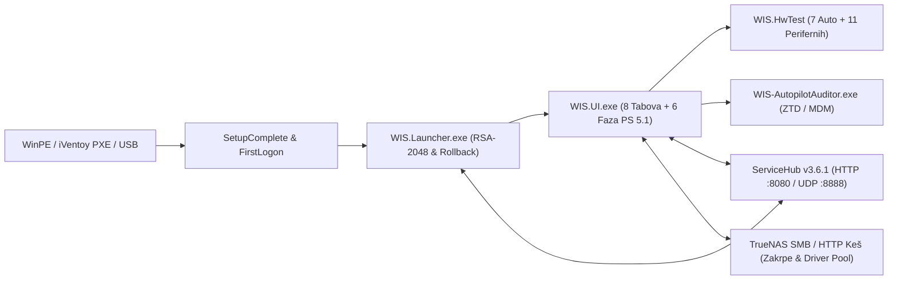

# Windows Installation Assistant (WIS) v3.4.1 — IG-Systems

[](version.json)
[](ServiceHub/)
[](https://github.com/Gruya13/WIS/actions/workflows/windows-validation.yml)
[](ISO/Skripte/Build-WIS.ps1)
[](UI/WIS.UI.csproj)
[](LICENSE)

**WIS (Windows Installation Assistant)**, u vlasništvu **IG-Systems**, je modularni, **Zero-Touch** sistem za automatizovano postavljanje **Windows 11 Home / Pro (24H2+)**, mrežnu PXE (iVentoy) i USB distribuciju, integrisanu hardversku dijagnostiku (`WIS.HwTest`), Microsoft Autopilot/ZTD forenziku, determinističko upravljanje drajverima i aplikacijama (`StepGuard`), jedinstveni deduplikovani **Driver Pool (CAS)** sa zvaničnim OEM Enterprise katalozima, dvosmerni HTTP/SMB keš za zakrpe i pakete drajvera, termalnu štampu servisnih nalepnica (Star TSP700II) i centralni nadzor flote kroz **ServiceHub v3.6.1**.

---

## Ključne Mogućnosti

- **Kriptografski lanac poverenja (`RSA-2048` + `SHA-256`):** Svaki OTA paket (`wis-payload.zip`) potpisuje se putem [`Release-WIS.py`](ISO/Skripte/Release-WIS.py), a [`WIS.Launcher.exe`](Launcher/) pre pokretanja proverava potpis manifesta, anti-downgrade granicu (`>= 3.1.0`), zabranu ranjivih kernel modula (`WinRing0`/`LHM`), Zip-Slip/`.sys` / Junction zaštitu, svaku pojedinačnu datoteku i transakciono vrši rollback u slučaju greške.
- **6-fazna orkestracija pod PowerShell 5.1 & Live Kokpit WPF UI (`8` tabova):** [`WIS.UI.exe`](UI/) pruža trojezični interfejs (`SR` / `ZH` / `EN`) sa **8 tabova** (uklonjen tab `Mreža`, globalni `WIS` watermark iza svih kartica, 5 vizuelnih kartica faza sa uvek vidljivim koracima i `▲`/`▼` skupljanjem, EDID/WMI specifikacija ekrana, `HARDVER MONITOR` + klikabilna `UPOZORENJA`, `260×260` ServiceHub QR kod sa `/device/<id>` deep-linkom, donja fiksirana `GlobalProgressCard` sa `WIS Benchmark` ETA vremenima i `150% DPI` responzivnim prilagođavanjem za kompaktne ekrane, `↻ Retry` za pojedinačne aplikacije putem `-OnlyApp`, detaljni **`HW Monitor`** tab sa 5 KPI kartica, 6-kanalnim grafikonom i 13 senzora bez `WinRing0`/LHM Anti-BYOVD, redizajnirani `CompletionOverlay` i 3-zonski footer), jedinstvenim termalnim pragom (`95°C × 2 / 97°C`), koordinacijom Faze 4 (`Phase4Active` / `ServisWuActive`) i kontrolisanim međurestartom (`HKLM\...\RunOnce`).
- **Hibridni Windows Update & Driver keš:** Dvosmerna sinhronizacija `.msu`/`.cab` zakrpi (`/api/updates/*`, sa podrazumevanim `DriversOnly` režimom u `Get-WUConfigMode` i `20s` heartbeat napretkom uz prikaz veličine paketa u `Install-LocalUpdatePackageFile`), model-specifičnih `<Model>.tar` paketa (`/api/drivers/model-pack/*` sa skript-blokadom arhive, auto-ingestom preko `/api/drivers/pool/notify-harvest` uz fail-closed `X-ServisHub-Client-Token`, `GenericPC` zaštitom i `5.0 GB` limitom), cross-model `.cab` `.inf` HWID indeksiranjem (`bsdtar`), SUBSYS/HWID filtriranje multi-OEM `.cab` paketa (`Select-RelevantDriverInfFiles`) i Microsoft Update Catalog resolver po HWID-u (uklj. hvatanje generičkih `Microsoft Basic Display Adapter` uređaja).
- **Integrisana hardverska i Autopilot dijagnostika:** `WIS.HwTest` izvodi **7 automatskih** (uklj. unapređeni pasivni RF Wi-Fi test sa `WlanQueryInterface`/`WlanGetNetworkBssList` za `2.4/5/6 GHz` bez konektovanja i pre-flight blokadu GPU 3D testa bez grafičkog drajvera) i **11 perifernih testova** u 2-kolonskom prikazu (razdvojeni `touchpad`/`trackpoint` i `camera`/`ir_camera`, bez korisničkog preskakanja, sa UEFI BIOS restartom + `hwtest-checkpoint.json` nastavkom, merenjem `operator_wait_sec`/`active_hwtest_sec`, zvučnim signalom pažnje i automatskim `N/A` na desktop sistemima), dok [`WIS-AutopilotAuditor.exe`](Tools/AutopilotAuditor/) sprovodi troslojnu proveru MDM/ZTD stanja (registar, UEFI/SMBIOS, Microsoft cloud) uz zaštitu Pre-OOBE keša.
- **WIS Benchmark, Predictive Cache (`Model DNA`) & Dijagnostika Licenciranja:** [`ServiceHub`](ServiceHub/) meri trajanje po fazama, kohortama (`v3_modern` vs `legacy`), LAN/WAN protok, realistični cache-hit odnos (`N/A` kada nema transfera), isključuje zaglavljene outlier sesije (`> 14400s`) iz agregacije, deduplikuje izveštaje, uči HWID otisak modela (`model_aliases`), unapred priprema pakete pre dolaska računara u servis i prikazuje strukturisani **`Status Licenciranja (Windows & Office)`** u Markdown i JSON kartonima uz troslojno maskiranje ključeva.
- **Anti-Leak, Recovery Sentinel i Post-Verifikovani Hardening (`Faza 6`):** Automatsko brisanje servisnih Wi-Fi profila/kredencijala (`Wifi-Servis.ini`, privremenih WLAN XML-ova), gašenje SMB sesija, `Remove-LegacyWinRing0Driver`, vraćanje i **post-verifikacija** OS bezbednosnih polisa (`Restore-WisSecurityHardening` / `$Global:WisSecurityHardeningVerified`), brisanje `WIS_SecurityRecovery_Sentinel` zadatka i čišćenje `C:\setup` (uključujući `C:\setup\Cache\Licensing`).

---

## Arhitektura Sistema



Kanonski izvor verzija svih podsistema definisan je u [`version.json`](version.json).

| Celina / Alat | Verzija | Tehnologija | Odgovornost |
| :--- | :--- | :--- | :--- |
| **[`ISO/`](ISO/)** | `3.4.1` | PowerShell 5.1, Python 3, Unattend XML, WinPE Batch | Izgradnja Ultra-Lean Windows 11 ISO/USB medijuma, `boot.wim` LAN driver injection (`000_wis_net1ix64.inf_guard`), VMD podrška, Pre-OOBE bootstrap (`PreOOBE-Network.ps1`, `SetupComplete.ps1`, `Provera_autopilota.ps1`), [`Build-WIS.ps1`](ISO/Skripte/Build-WIS.ps1) i [`Release-WIS.py`](ISO/Skripte/Release-WIS.py). |
| **[`Launcher/`](Launcher/)** | `3.4.1` (`min: 3.1.0`) | C# 5.0 / .NET Framework 4.0 | Samostalni bootstrapper (`WIS.Launcher.exe`): Wi-Fi profili (WPA2/WPA3/Open sa XML escaping-om), UDP/SMB otkrivanje Hub-a, RSA-2048 + SHA-256 + anti-downgrade verifikacija paketa (`MandatoryRelease310Files`), Zip-Slip/`.sys` zaštita i transakcioni rollback. |
| **[`UI/`](UI/)** | `3.4.1` | C# 5.0 WPF (.NET 4.8) + PowerShell 5.1 | Glavni orkestrator `WIS.UI.exe` (`MainWindow.xaml.cs`, `MainWindow.Hardware.cs`, `MainWindow.HwTest.cs`, `MainWindow.Reboot.cs`), ugrađeni [`UI/HwTest/`](UI/HwTest/) modul (`WIS.HwTest.exe`), 13 PowerShell modula (`UI/Skripte/Modules/`), 6 faza (`UI/Skripte/Phases/`) i Star TSP700II štampa (`LabelPrintService.cs`). |
| **[`ServiceHub/`](ServiceHub/)** | `3.6.1` | Python 3.10+ (Stdlib HTTP + opcioni FastAPI), Docker | Centralni nadzorni server (`TCP 8080` / `UDP 8888`): jedinstveni CAS **Driver Pool** + auto-ingest (`notify-harvest` sa tokenom) + zvanični Dell/HP/Lenovo OEM XML katalozi (`drivers/pool.py`, `drivers/oem/catalogs.py`), fail-closed admin/client autentifikacija, CORS allowlist, async `.cab` driver resolver, `/device/<id>` deep-link rute, 1 Hz Screen Mirror (TTL + RAM cap), strukturisani izveštaji licenciranja (`reports.py`), WIS Benchmark (`14400s` outlier filter), Predictive Cache i UEFI USB Builder sa ZFS zaštitom. |
| **[`Tools/AutopilotAuditor/`](Tools/AutopilotAuditor/)** | `3.4.1` | C# 5.0 / .NET Framework 4.8 | Forenzički alat (`WIS-AutopilotAuditor.exe`) za troslojnu Autopilot/ZTD analizu (CLI/GUI/JSON/HTML) uz očuvanje Pre-OOBE keša i strogu TLS proveru. |

---

## 6-Fazni Servisni Pajplajn

| Faza | Orkestrator / Skripta | Timeout | Ključne Operacije i Zaštite |
| :--- | :--- | :--- | :--- |
| **Faza 1 — Mreža i Triage** | [`Phase1-Network.ps1`](UI/Skripte/Phases/Phase1-Network.ps1) | `15 min` | Fast-Pass mrežna provera, PnP LAN fallback, S.M.A.R.T. trijaža, Pre-OOBE Autopilot ZTD keš/retry i `STARTED` telemetrija. |
| **Faza 2 — Drajveri i WU** | [`Phase2-Drivers.ps1`](UI/Skripte/Phases/Phase2-Drivers.ps1) | `60 min` | `StepGuard` (`P2.Identify`..`P2.WuDrivers`): `Model DNA`, HTTP/SMB WU keš (podrazumevani `DriversOnly` režim i `.msu`/`.cab` `20s` heartbeat sa veličinom), `<Model>.tar` keš (blokada skripti pre `pnputil.exe`) + `GenericPC` zaštita, SUBSYS `.inf` filter, MS Update Catalog resolver (uklj. `Basic Display`), `5.0 GB` / `.harvest.lock` berba uz `notify-harvest` i LAN auto-recovery. |
| **Faza 3 — Optimizacija i Branding** | [`Phase3-Optimization.ps1`](UI/Skripte/Phases/Phase3-Optimization.ps1) | `20 min` | `StepGuard` (`P3.Debloat`..`P3.UsbFree`): debloat, gašenje telemetrije, OEM branding, DPI skaliranje, offline/fallback VC++ Runtimes i kontrolisani međurestart (`HKLM\...\RunOnce`). |
| **Faza 4 — Programi i Licenca** | [`Phase4-Apps.ps1`](UI/Skripte/Phases/Phase4-Apps.ps1) | `60 min` | `StepGuard` (`P4.Runtimes`..`P4.Activation` + `phase4_steps_sec`), pojedinačni `-OnlyApp` retry, `Phase4Active = 1` / jedinstveni `ServisWuActive` koordinacija, `_MSIExecute` zaključavanje, Chrome, Adobe Acrobat + `PdfDefault`, Office LTSC, WinRAR, BatteryBar, Reality Check, te `Get-ServisLicensingSettings`, `sppsvc`/`OSPP.VBS` (`25s`), `Sync-ServisLicensingFromNas` i bezbedni `Invoke-ServisExternalLicensingHook` (`180s` timeout + `C:\setup\license-status.json`). |
| **Faza 5 — Hardverski Test & Stres** | [`ExecutePhase5IntegratedHwTest`](UI/MainWindow.HwTest.cs) / [`Phase5-Stress.ps1`](UI/Skripte/Phases/Phase5-Stress.ps1) | `45 min` | 7 automatskih testova (`WlanQueryInterface` + `WlanGetNetworkBssList` pasivni Wi-Fi RF scan, NVMe, LCD, baterija, GPU pre-flight bez drajvera, `Firmware [Code 14]`), CPU stres nativnim WMI/ACPI/OEM senzorima bez `WinRing0` (`95°C × 2 / 97°C` abort + `thermal_note`), zvučni signal pažnje (`880Hz->1175Hz`), `operator_wait_sec`/`active_hwtest_sec` i 11 perifernih testova (razdvojeni `touchpad`/`trackpoint` i `camera`/`ir_camera`, bez preskakanja, UEFI BIOS restart + `hwtest-checkpoint.json`, `N/A` na desktopu). |
| **Faza 6 — Finalizacija i Anti-Leak** | [`Phase6-Finalize.ps1`](UI/Skripte/Phases/Phase6-Finalize.ps1) | `45 min` | Brzi WU Pass 2 (`wu-secondpass-done.flag` + asinhroni `120s` `SEARCH_TIMEOUT`), `benchmark` + `servisni_karton` (uključujući status licenciranja sa maskiranim ključevima), Star TSP700II nalepnica, brisanje `Wifi-Servis.ini` / WLAN XML profila / `C:\setup\Cache\Licensing`, `Remove-LegacyWinRing0Driver`, `Restore-WisSecurityHardening` sa post-verifikacijom (`security_hardening_verified`) i uklanjanjem recovery sentinela. |

---

## Brzi Početak i Konfiguracija

### 1. Priprema lokalne konfiguracije i tajni (van Git-a)
```bash
# Klijentska konfiguracija za medijum (Wifi-Servis.ini ostaje u .gitignore)
cp Wifi-Servis.example.ini ISO/Wifi-Servis.ini

# Opciona ServiceHub konfiguracija okruženja i admin tokena
cp ServiceHub/.env.example ServiceHub/.env
```

### 2. Pokretanje `ServiceHub` servera (Python ili Docker)
```bash
# Lokalno pokretanje
cd ServiceHub
python3 main.py --port 8080

# Ili Docker Compose produkcija
cd ServiceHub
docker compose up -d --build
```
Očuvana fail-closed administrativna autentifikacija (`SERVIS_HUB_ADMIN_TOKEN`, uz opcioni `SERVIS_HUB_CLIENT_TOKEN` za upload zakrpi/drajvera i eksplicitni `SERVIS_HUB_ALLOW_UNAUTHENTICATED_LAN=true` za otvorenu radionicu) za rute `/api/wis/usb/burn`, `/api/updates/prune`, `/api/updates/upload`, `/api/drivers/model-pack/upload` i `/api/devices/<id>/command`, definisana u [`ServiceHub/.env.example`](ServiceHub/.env.example).

### 3. Build i potpisivanje izdanja
- **Windows (zvanična MSBuild + PowerShell 5.1 potvrda):**
  ```powershell
  powershell -NoProfile -ExecutionPolicy Bypass -File .\ISO\Skripte\Build-WIS.ps1
  ```
  Kompajlira sva 4 `.csproj` projekta (`WIS.UI`, `WIS.Launcher`, `WIS.HwTest`, `WIS-AutopilotAuditor`) sa `/p:LangVersion=5`, izvršava PowerShell 5.1 AST i Launcher testove i generiše `build-attestation.json`.
- **Linux (Mono Roslyn build i priprema medijuma):**
  ```bash
  python3 UI/Build-UI.py                      # Koristi fallback resurse iz UI/Resources/ na čistom klonu
  python3 UI/HwTest/Build-HwTest.py
  python3 Launcher/Build-Launcher.py
  python3 Tools/AutopilotAuditor/Build-AutopilotAuditor.py
  ```
- **Potpisivanje OTA paketa:** [`ISO/Skripte/Release-WIS.py`](ISO/Skripte/Release-WIS.py) pakuje i RSA-2048 potpisuje `wis-payload.zip` uz obaveznu potvrdu čistog Git commita, `build-attestation.json` i `vm-validation.json`. Pripremu USB/$OEM$ medijuma obavlja [`ISO/Skripte/Prepare-WISMedia.py`](ISO/Skripte/Prepare-WISMedia.py).

---

## Verifikacija i CI

Workflow [`.github/workflows/windows-validation.yml`](.github/workflows/windows-validation.yml) (svi Actions pinovani po punom commit SHA-u uz `permissions: contents: read`) automatski verifikuje svaku izmenu na **`windows-2022`** (stvarni Windows PowerShell 5.1 parser, status ugovor, Launcher C# testovi i MSBuild za sva 4 `.csproj`) i **`ubuntu-24.04`** runneru (`ruff F821`, zabrana `WinRing0`/LHM DLL-ova i svi unit testovi):

```bash
# Sinhronizacija verzija i deljenih skripti sa version.json
python3 ISO/Skripte/Sync-Versions.py --check

# Statička provera PowerShell 5.1 i C# 5.0 koda
python3 ISO/Skripte/Verify-PowerShellSyntax.py
python3 ISO/Skripte/Verify-CSharpSyntax.py

# Launcher behavioral testovi u Mono okruženju (33 testa)
python3 Launcher/Tests/run_tests.py

# UI / HwTest / Pre-OOBE Autopilot / WU & Driver jedinični testovi
python3 -m unittest UI/Tests/Test-HwTestLogic.py UI/Tests/Test-AutopilotPreOobeCache.py UI/Tests/Test-UpdateAndDriversLogic.py

# ServiceHub unittest paket
cd ServiceHub && python3 -m unittest discover -s tests
```

Puni PXE/OOBE laboratorijski i Windows testovi nalaze se u [`UI/Tests/`](UI/Tests/) (`Test-InstalledWindowsE2E.ps1`, `Test-DisposableWindowsVM.ps1`) i [`ISO/Tests/PxeZeroTouch/`](ISO/Tests/PxeZeroTouch/).

---

## Dokumentacija

- **[Tehnički opis sistema WIS](docs/TEHNICKI_OPIS_SISTEMA_WIS.md)** — Detaljna specifikacija podsistema, telemetrijskih ugovora i poznatih inženjerskih ograničenja (**IG-Systems**).
- **[Terenski Benchmark Izveštaj Flote (`FIELD-2026-11`)](docs/benchmark/FIELD-2026-11.md)** — Anonimizovana analiza 177 instalacija (P50/P90, 65 modela, 1.048 HWID-ova) koja je definisala unapređenja u `v3.1.0`–`v3.1.1`.
- **[Politika bezbednosti (`SECURITY.md`)](SECURITY.md)** — Model pretnji, četiri granice poverenja, Anti-BYOVD, Anti-Leak kontrole, rotacija ključeva i poslovna odluka za lokalni nalog.
- **[Interna bezbednosna revizija (`docs/security/`)](docs/security/NEZAVISNA_BEZBEDNOSNA_REVIZIJA.md)** — Security Self-Audit izveštaj (`CTRL-01..12`, `SEC-WIS-001..007` i dopunska sanacija `WIS-TASK-253`).
- **[Arhitektura podsistema (`docs/architecture/`)](docs/architecture/overview.md)** — Pregledi pajplajna, drajvera, Windows Update toka, aplikacija, mreže i ServiceHub-a.
- **[Arhitektonske odluke (`docs/decisions/`)](docs/decisions/)** — Zbirka ADR zapisa (`ADR-0001` .. [`ADR-0254`](docs/decisions/ADR-0254-wis-3-1-1-audio-deadlock-driver-resilience-and-ig-systems-ownership.md), [`ADR-0258`](docs/decisions/ADR-0258-jedinstveni-driver-pool-i-oem-katalozi.md)).
- **[Dnevnik izmena (`CHANGELOG.md`)](CHANGELOG.md)** i **[Smernice za doprinos (`CONTRIBUTING.md`)](CONTRIBUTING.md)** — videti [`CHANGELOG.md`](CHANGELOG.md) za detalje izdanja **`v3.4.1` / `ServiceHub v3.6.1`**.

---

## Licenca i Autorska Prava Trećih Strana

Ovaj projekat i ceo **WIS** ekosistem nalaze se u vlasništvu **IG-Systems** i objavljeni su pod [MIT licencom](LICENSE). Informacije o licencama i atribucijama za prateću biblioteku treće strane (`zxing.dll` `Apache-2.0`, uz belešku o trajnom uklanjanju `LibreHardwareMonitorLib` / `HidSharp` / `WinRing0` u v3.1.0) nalaze se u [`THIRD-PARTY-NOTICES.md`](THIRD-PARTY-NOTICES.md).
