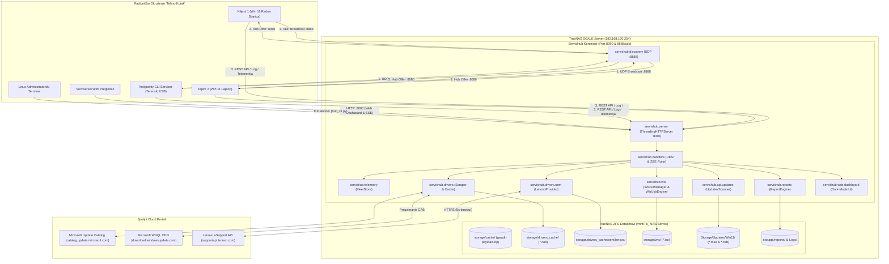
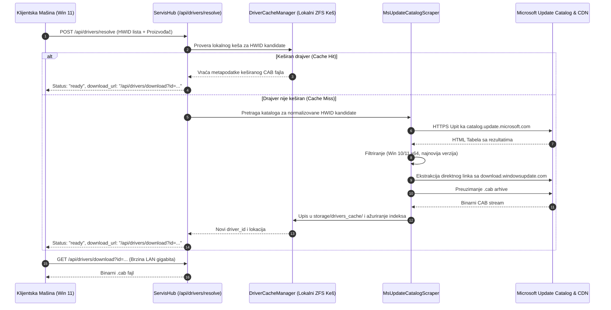
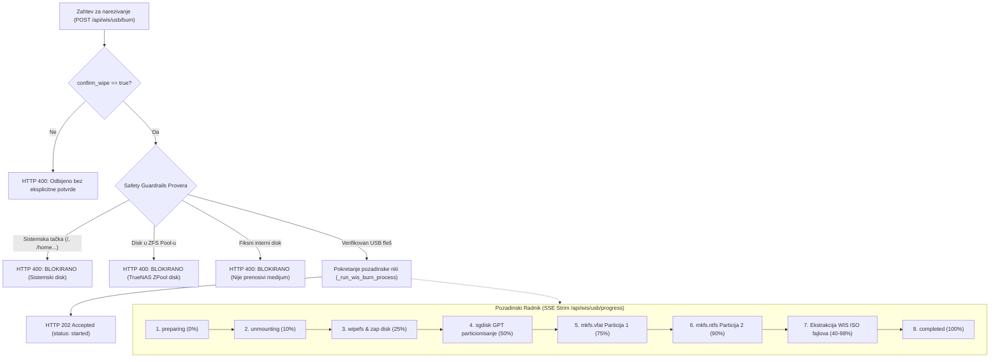

# ⚡ Tehno-Kutak Centralni Servisni Hub (ServisHub)
# Sveobuhvatna Tehnička i Arhitektonska Dokumentacija (v3.1.0 Standalone)

---

## 📑 Sadržaj

1. [Uvod i Izvršni Pregled](#1-uvod-i-izvršni-pregled)
2. [Arhitektura Sistema i Konceptualni Dizajn](#2-arhitektura-sistema-i-konceptualni-dizajn)
3. [Mrežna Topologija i Zero-Config Auto-Discovery](#3-mrežna-topologija-i-zero-config-auto-discovery)
4. [Detaljna Arhitektura Podsistema i Modula](#4-detaljna-arhitektura-podsistema-i-modula)
   - 4.1. [Konfiguracija i Inicijalizacija (`servishub.config` & `server`)](#41-konfiguracija-i-inicijalizacija-servishubconfig--server)
   - 4.2. [REST Ruter i HTTP Obrada (`servishub.handlers`)](#42-rest-ruter-i-http-obrada-servishubhandlers)
   - 4.3. [Telemetrija i Upravljanje Flotom (`servishub.telemetry`)](#43-telemetrija-i-upravljanje-flotom-servishubtelemetry)
   - 4.4. [Dinamički OTA Payload Packager (`servishub.payload`)](#44-dinamički-ota-payload-packager-servishubpayload)
   - 4.5. [Pametni Proksi Drajvera i Microsoft Scraper (`servishub.drivers`)](#45-pametni-proksi-drajvera-i-microsoft-scraper-servishubdrivers)
   - 4.6. [Modularni OEM Podsistem (`servishub.drivers.oem`)](#46-modularni-oem-podsistem-servishubdriversoem)
   - 4.7. [WIS Centar: ISO i UEFI USB Engine (`servishub.wis`)](#47-wis-centar-iso-i-uefi-usb-engine-servishubwis)
   - 4.8. [Inventar i Status Windows 11 Zakrpi (`servishub.api.updates`)](#48-inventar-i-status-windows-11-zakrpi-servishubapiupdates)
   - 4.9. [Digitalni Kartoni i Antigravity Sinhronizacija (`servishub.reports`)](#49-digitalni-kartoni-i-antigravity-sinhronizacija-servishubreports)
   - 4.10. [Web Dashboard sa Tri Taba (`servishub.web.dashboard`)](#410-web-dashboard-sa-tri-taba-servishubwebdashboard)
   - 4.11. [Konzolni Terminal Monitor (`servishub.tui_cli` & `hub_cli.py`)](#411-konzolni-terminal-monitor-servishubtui_cli--hub_clipy)
5. [Sveobuhvatna REST API Referenca](#5-sveobuhvatna-rest-api-referenca)
6. [Klijentski Ekosistem i Integracije](#6-klijentski-ekosistem-i-integracije)
7. [Baza Podataka, Skladište i Struktura Datoteka](#7-baza-podataka-skladište-i-struktura-datoteka)
8. [Bezbednosni Model i Safety Guardrails](#8-bezbednosni-model-i-safety-guardrails)
9. [Operativni Vodič, Deployment i Održavanje (Ops Runbook)](#9-operativni-vodič-deployment-i-održavanje-ops-runbook)
10. [Testna Pokrivenost i Osiguranje Kvaliteta (QA)](#10-testna-pokrivenost-i-osiguranje-kvaliteta-qa)

---

## 1. Uvod i Izvršni Pregled

### 1.1. Kontekst i Poslovni Domen
U profesionalnom računarskom servisu **"Tehno-Kutak"**, svakodnevni rad obuhvata istovremeni prijem, dijagnostiku, pripremu i instalaciju operativnog sistema (Windows 11 x64) na velikom broju klijentskih radnih stanica i prenosnih računara (2 do 10+ mašina istovremeno). 

Tradicionalni servisni tokovi pati od sledećih uskih grla:
1. **Vezivanje instalacionih medija:** USB fleš diskovi ostaju ubačeni u mašinu tokom celokupne instalacije, vezujući opremu i usporavajući rad servisera.
2. **Preopterećenje interneta:** Svaki računar pojedinačno preuzima gigabajte Windows zakrpi i drajvera preko eksterne internet veze.
3. **Manuelna provera garancije:** Serviseri moraju ručno unositi serijske brojeve na portale proizvođača (Lenovo, Dell, HP) kako bi utvrdili status garancije pre fizičkog otvaranja računara.
4. **Rizik od grešaka pri flešovanju:** Korišćenje generičkih alata za narezivanje USB instalera na serveru nosi visok rizik od prepisivanja sistemskih i ZFS diskova.
5. **Gubitak servisne istorije:** Nalazi sa terena i radionice nisu centralizovani, pa serviser nema uvid u ranije kvarove i intervencije na istom serijskom broju.

### 1.2. Svrha Projekta ServisHub
**ServisHub** je centralni višenamenski kontrolni server, telemetrijski agregator, pametni keširajući proksi za drajvere, upravljač butabilnih instalacionih medija i OTA (Over-The-Air) distributivni repozitorijum.

```
┌─────────────────────────────────────────────────────────────────────────────┐
│                       TEHNO-KUTAK SERVIS HUB v3.1.0                         │
├──────────────────────┬──────────────────────┬───────────────────────────────┤
│ 🚀 FLASH & RELEASE   │ 🛡️ OEM TRIJAŽA       │ ⚡ GIGABITNI LCU KEŠ          │
│ Oslobađanje USB-a    │ Lenovo eSupport API, │ 125 MB/s preuzimanje zakrpi,  │
│ odmah nakon WinPE    │ fabrička garancija,  │ skraćeno sa 30 min na <60s    │
│ particionisanja      │ SCCM paketi & BIOS   │ po klijentskom računaru       │
├──────────────────────┼──────────────────────┼───────────────────────────────┤
│ 🖥️ TELEMETRIJA UŽIVO │ 💿 WIS USB & ISO     │ 🧠 ANTIGRAVITY SYNC           │
│ 1 Hz SSE ogledalo,   │ Sigurna izrada GPT   │ Pre-flight istorija po        │
│ živi terminalski log │ UEFI USB fleševa sa  │ serijskom broju i post-flight │
│ i status faza 1..5   │ ZFS guardrail zaštit.│ push dijagnostičkih kartona   │
└──────────────────────┴──────────────────────┴───────────────────────────────┘
```

### 1.3. Ključni Inženjerski Principi
- **Zero External Dependencies:** Izgrađen isključivo korišćenjem standardne biblioteke jezika Python 3 (`http.server.ThreadingHTTPServer`, `socket`, `threading`, `select`, `zipfile`, `hashlib`, `urllib.request`, `json`, `subprocess`). Nije potrebna instalacija paketa preko `pip`-a.
- **Visoka Konkurentnost:** Višenitni I/O model omogućava stabilan rad i pri istovremenom preuzimanju drajvera i strimovanju telemetrije sa više radnih stanica.
- **Fail-Safe & Graceful Fallback:** Svi mrežni upiti ka eksternim portalima (Microsoft Update Catalog, Lenovo eSupport) zaštićeni su striktnim vremenskim ograničenjima (5s timeout) i automatskim prelaskom na lokalne baze znanja.
- **Sistemska Bezbednost (Safety Guardrails):** Fizička i softverska zaštita sistemskih particija i TrueNAS ZFS skladišnih bazena od destruktivnih operacija formatiranja.

---

## 2. Arhitektura Sistema i Konceptualni Dizajn

### 2.1. Arhitektonski Stil
ServisHub je projektovan kao **modularni samostalni mikro-monolit** (Single Process / Multi-Threaded Service) koji kombinuje:
1. **Asinhroni UDP Discovery osluškivač** za nultu konfiguraciju na lokalnoj mreži.
2. **Višenitni REST API HTTP server** za komunikaciju sa radioničkim klijentima.
3. **SSE (Server-Sent Events) dispečer** za jednosmerno emitovanje telemetrije, logova i progresa u realnom vremenu.
4. **Lokalni fajl-sistemski keš** na TrueNAS ZFS skladištu za drajvere, zakrpe, instalacione ISO slike i servisne kartone.

### 2.2. Dijagram Kontejnera i Integracija (C4 Nivo 2)



### 2.3. Model Konkurentnosti i Sinhronizacija Stanja
- **ThreadingHTTPServer:** Svaki dolazni HTTP zahtev obrađuje se u zasebnoj niti. Blokirajući I/O prenosi velikih datoteka (npr. preuzimanje CAB paketa od 100 MB ili ISO slike od 5 GB) ne utiču na odzivnost telemetrije i zdravstvenih provera (`/api/health`).
- **Brava Flote (`fleet_lock`):** In-memory registri uređaja (`fleet_devices`), linija logova (`fleet_logs`) i pretplatnika zaštićeni su reentrant bravom u `FleetStore`.
- **Brava Sesija (`session_lock`):** Registar GUI sesija i pretplatnika za ekran ogledala zaštićeni su namenskom bravom.
- **Brava Narezivanja USB-a (`WIS_BURN_LOCK`):** Globalno stanje narezivanja medija zaštićeno je posebnom bravom, čime je onemogućeno pokretanje dva paralelna procesa formatiranja nad istim ili različitim fleševima.
- **Pretplatnički Mehanizam (`threading.Condition`):** SSE tokovi koriste par `(queue, condition)` po klijentu, omogućavajući trenutno buđenje radnih niti čim klijent pošalje novu liniju loga ili promenu stanja.

---

## 3. Mrežna Topologija i Zero-Config Auto-Discovery

### 3.1. Radioničke Mrežne Podmreže
Radionica "Tehno-Kutak" poseduje segmentisanu mrežnu infrastrukturu:
- **LAN Radni Sto:** `192.168.88.0/24` (fizički mrežni kablovi na radnim stolovima).
- **WLAN Servisna Mreža:** `192.168.180.0/24` (namenska bežična mreža za prenosne računare).
- **Infrastrukturna Servisna Mreža:** `192.168.170.0/24` (TrueNAS SCALE server i mrežna oprema).

### 3.2. UDP Auto-Discovery Protokol (Port 8888)
Kako bi se izbegla potreba za ručnim konfigurisanjem IP adresa na svakom sveže instaliranom računaru, klijentski moduli koriste namenski UDP broadcast protokol:

```
Klijent (WinPE / Win11)                                ServisHub Server
   │                                                          │
   │── UDP Broadcast: 255.255.255.255:8888 ──────────────────>│
   │   "GWADT_DISCOVER client=TK-LAPTOP-PF2X98ZA"             │ (Osluškivanje
   │                                                          │  na 0.0.0.0:8888)
   │<─ UDP Unicast Odgovor ───────────────────────────────────│
   │   "GWADT_HUB_OFFER port=8080 host=192.168.170.254        │
   │    name=TehnoKutak-Hub"                                  │
   │                                                          │
   │── HTTP GET http://192.168.170.254:8080/api/health ──────>│
   │<─ HTTP 200 OK {"status": "ok", "version": "3.1.0"} ──────│
```

### 3.3. Višeslojni Hijerarhijski Fallback Lanac
Ukoliko je UDP broadcast saobraćaj blokiran mrežnim svičem ili izolacijom porta, klijentske komponente automatski prelaze na kaskadni redosled otkrivanja:
1. **UDP Broadcast:** Slanje na `255.255.255.255:8888` i kalkulisane broadcast adrese svih lokalnih interfejsa.
2. **Default Gateway Probing:** Slanje HTTP upita `GET /api/health` na Default Gateway adrese pronađene u ruting tabeli.
3. **Konfiguracioni Fajl (`Wifi-Servis.ini`):** Očitavanje parametra `ServerUrl` iz sekcija `[ServisHub]` ili `[GdsServer]`.
4. **Fiksne Radioničke IP Adrese:** Provera poznatih IP adresa servera: `192.168.170.254`, `192.168.88.50`, `192.168.180.50`, `192.168.170.188`.
5. **Lokalni Host:** `http://127.0.0.1:8080` (za testiranje na samoj mašini).

---

## 4. Detaljna Arhitektura Podsistema i Modula

### 4.1. Konfiguracija i Inicijalizacija (`servishub.config` & `server`)
Modul `servishub.config` upravlja svim putanjama i parametrima sistema prema sledećem redosledu prioriteta:
$$\text{CLI Argumenti} > \text{Varijable Okruženja (.env)} > \text{Podrazumevane Vrednosti}$$

Tabela ključnih konfiguracionih promenljivih:
| Promenljiva Okruženja | Podrazumevana Vrednost | Svrha i Namena |
| :--- | :--- | :--- |
| `SERVIS_HUB_HOST` | `0.0.0.0` | IP adresa vezivanja HTTP servera |
| `SERVIS_HUB_PORT` / `PORT` | `8080` | TCP port HTTP servera (strogo odvojen od ERP porta 8000) |
| `SERVIS_HUB_UDP_PORT` | `8888` | UDP port Auto-Discovery servisa |
| `SERVIS_HUB_STORAGE_DIR` | `./storage` | Glavno radno skladište |
| `GWADT_DRIVERS_CACHE_DIR` | `./storage/drivers_cache` | Lokalni keš preuzetih Microsoft OEM `.cab` drajvera |
| `SERVIS_HUB_WIS_DIR` | `./storage/wis` | Skladište WIS instalacionih ISO slika |
| `SERVIS_HUB_LOGS_DIR` | `./Logs` | Koreni direktorijum logova |
| `SERVIS_HUB_PAYLOAD_DIR` | `./payload_src` | Izvorni direktorijum za dinamičko OTA pakovanje |
| `SERVIS_UPDATES_DIR` | `/home/gru/Storage/Updates/Win11` | TrueNAS skladište kumulativnih Windows 11 zakrpi |

Funkcija `run_hub_server()` u `servishub.server`:
1. Inicijalizuje `HubConfig` i obezbeđuje postojanje radnih direktorijuma (`ensure_directories()`).
2. Instancira deljene podsisteme: `FleetStore`, `DriverCacheManager`, `MsUpdateCatalogScraper`, `PayloadManager`.
3. Pokreće `UdpDiscoveryServer` kao pozadinsku nit.
4. Podiže `ThreadingHTTPServer` i vezuje ga za `ServisHubHandler`.
5. Detektuje i ispisuje sve lokalne IPv4 adrese po mrežnim interfejsima.
6. Registruje rukovaoce signalima (`SIGINT`, `SIGTERM`) za elegantno zaustavljanje bez gubitka podataka.

### 4.2. REST Ruter i HTTP Obrada (`servishub.handlers`)
Klasa `ServisHubHandler` nasleđuje `http.server.BaseHTTPRequestHandler` i obezbeđuje:
- **CORS Zaglavlja:** Podrška za kros-domen zahteve (`Access-Control-Allow-Origin: *`, `Allow-Methods: GET, POST, OPTIONS`).
- **OPTIONS Handling:** Trenutni odgovor sa HTTP 200 za pre-flight upite browsera.
- **JSON Serijalizaciju:** Pomoćna metoda `_send_json(data, code=200)` sa striktnim UTF-8 enkodiranjem.
- **Sigurno Parsiranje:** Sanitizacija ID parametara preko funkcije `sanitize_id()` radi zaštite od Path Traversal ranjivosti.
- **Rukovanje Greškama:** Prijem i izolacija `BrokenPipeError` i `ConnectionResetError` grešaka pri prekidu klijentske konekcije.

### 4.3. Telemetrija i Upravljanje Flotom (`servishub.telemetry`)
Klasa `FleetStore` predstavlja centralno in-memory skladište flote:
- **Strukture Podataka:**
  - `fleet_devices`: Mapa `device_id -> dict` sa stanjem hardvera, trenutnom fazom rada, Autopilot statusom i trajanjem.
  - `fleet_logs`: Mapa `device_id -> list[str]` (kružni bafer sa limitom od 5.000 najnovijih linija po mašini).
  - `fleet_subscribers`: Lista aktivnih SSE pretplatnika za strimovanje logova.
  - `fleet_sessions`: Mapa aktivnih sesija GUI ogledala sa detekcijom neaktivnosti (`is_stale = sec_ago > 30`).
- **Dvotačkasti Životni Ciklus (Discrete Two-Point Lifecycle):**
  - **Faza 1 (`STARTED`):** Klijent šalje hardverski profil, serijski broj i Autopilot trijažu (`Clean`, `AadMdm`, `Autopilot`). Server trenutno ažurira status na Dashboard-u.
  - **Faza 5 (`COMPLETED`):** Klijent šalje konačne rezultate instalacije aplikacija, trajanje i S.M.A.R.T. podatke diska. Server perzistira servisni karton na disk i emituje završni zvučni signal na Web interfejsu.
- **Puls (`record_heartbeat`):** Klijent periodično (svake 2s) osvežava `last_seen` timestamp, trenutni korak instalacije i procenat napretka.

### 4.4. Dinamički OTA Payload Packager (`servishub.payload`)
Klasa `PayloadManager` automatizuje distribuciju radioničkih alata i skripti:
- **Praćenje Izmena (`mtime` inspekcija):** Rekurzivno proverava vreme poslednje izmene izvornih datoteka u `payload_source_dir` i montiranom `Skripte/` direktorijumu.
- **Automatska Rekompresija:** Ako je bilo koji izvorni fajl noviji od postojećeg ZIP paketa, ili paket nedostaje, automatski se generiše novi `gwadt-payload.zip`.
- **Integritet i Heš:** Prilikom kreiranja paketa računa se njegov SHA-256 heš i metapodaci (broj fajlova, veličina u bajtovima, datum) koji se zapisuju u `payload_meta.json`.
- **Klijentska Validacija:** Klijent preuzima samo metapodatke (`/api/payload/version`). Ako se lokalni heš na `C:\setup` poklapa sa serverom, preuzimanje se preskače, čuvajući mrežni protok.

### 4.5. Pametni Proksi Drajvera i Microsoft Scraper (`servishub.drivers`)
Podsistem omogućava transparentnu instalaciju drajvera bez internet veze na klijentu:



#### Ključne komponente podsistema:
- **HWID Normalizator (`generate_hwid_candidates`):**
  - **ACPI:** Transformiše `ACPI\VEN_INTC&DEV_1078` $\rightarrow$ `ACPI\INTC1078` $\rightarrow$ `*INTC1078` $\rightarrow$ `INTC1078`.
  - **HDAUDIO:** Uklanja sabirničke prefikse `&COLxx`, revizije `&REV_xxxx` i podsisteme `&SUBSYS_xxxxxxxx`.
  - **PCI & USB:** Redukuje hijerarhiju do baznog para `VEN_xxxx&DEV_xxxx` odnosno `VID_xxxx&PID_xxxx`.
- **Poređenje Verzija (`is_catalog_driver_newer`):**
  - Podržava četvorodelne semantičke verzije (npr. `31.0.101.4575` > `30.0.100.9999`).
  - Podržava višestruke formate datuma (ISO `YYYY-MM-DD`, američki `MM/DD/YYYY`, evropski `DD.MM.YYYY` i WMI).
- **Arhitektonski Filter (`filter_for_win_x64`):** Strogo eliminiše ARM64, IA64 i 32-bitne x86 pakete.

### 4.6. Modularni OEM Podsistem (`servishub.drivers.oem`)
Omogućava duboku integraciju sa zvaničnim portalima proizvođača hardvera:
- **Apstrakcija (`BaseOEMProvider`):** Definiše standardni ugovor sa metodama:
  - `get_warranty_info(serial, model)`: Status fabričke garancije.
  - `resolve_driver_pack(model, os_ver)`: Zvanični SCCM enterprise paket.
  - `check_bios_update(model, current_bios)`: Provera ažurnosti BIOS/UEFI firmware-a.
- **Implementacija za Lenovo (`LenovoOEMProvider`):**
  - **5s Timeout sa Graceful Fallback-om:** Svi mrežni upiti ka Lenovo eSupport REST API-ju ograničeni su na 5.0 sekundi. U slučaju isteka vremena, prekida mreže ili nepoznatog serijskog broja, server trenutno vraća status `"fallback"` i očitava podatke iz ugrađene baze.
  - **Referentna Baza Modela (`KNOWN_MODELS`):** Ugrađeni podaci za popularne ThinkPad generacije (`20TD` - E14 Gen 2, `21AH` - T14 Gen 3, `20UD` - T14 Gen 1 AMD, `21E3` - E14 Gen 4).
  - **Lokalni SCCM Keš:** Paketi se skladište i serviraju iz `storage/drivers_cache/oem/lenovo/{MTM}/`.
- **Factory Metoda (`get_oem_provider`):** Omogućava jednostavno proširenje novim provajderima (Dell, HP) na osnovu `manufacturer` stringa.

### 4.7. WIS Centar: ISO i UEFI USB Engine (`servishub.wis`)
Podsistem zadužen za pripremu instalacionih medija direktno sa radioničkog servera:



#### Hibridni GPT UEFI Raspored Particija:
1. **Particija 1 (`UEFI_BOOT`, 512 MB, FAT32):** Sadrži UEFI bootloader (`bootx64.efi`), BCD konfiguraciju i WinPE boot fajlove. Obezbeđuje 100% kompatibilnost sa svim modernim matičnim pločama bez potrebe za isključivanjem Secure Boot-a.
2. **Particija 2 (`WIS_DATA`, Ostatak diska, NTFS):** Sadrži WIS instalacione skripte, baze drajvera i kompletnu sliku sistema (`install.wim`), uspešno prevazilazeći 4 GB limit FAT32 fajl sistema.

### 4.8. Inventar i Status Windows 11 Zakrpi (`servishub.api.updates`)
- **Namena:** Centralizovano skladištenje kumulativnih bezbednosnih zakrpi (LCU - Latest Cumulative Update) na TrueNAS skladištu (`/home/gru/Storage/Updates/Win11`).
- **Skener Direktorijuma (`scan_updates_directory`):**
  - Pretražuje `.msu` i `.cab` datoteke.
  - Regex ekstrakcija prepoznaje standardne Microsoft KB obrasce (npr. `Windows11.0-KB5129195-x64.msu` $\rightarrow$ `KB5129195`).
  - Automatski ignoriše privremene datoteke nedovršenih preuzimanja (`.part`, `.tmp`, `.crdownload`, `.aria2`).
- **REST Status:** Endpoint `GET /api/updates/status` vraća strukturirane podatke o ukupnom broju paketa, ukupnoj veličini u MB/GB i listu prepoznatih KB identifikatora.
- **Modeli Podataka (`servishub.models.updates`):** Definisani korišćenjem Pydantic-a, uz ugrađeni `BaseModel` fallback za okruženja bez instalirane Pydantic biblioteke.

### 4.9. Digitalni Kartoni i Antigravity Sinhronizacija (`servishub.reports`)
- **Digitalni Servisni Karton:** Po završetku instalacije (`COMPLETED` događaj ili `POST /api/devices/{id}/report`), server generiše dva trajna dokumenta:
  - `report_{Serial}_{Date}.json`: Kompletan mašinski čitljiv profil (DMTF hardver, trajanje, status softvera, S.M.A.R.T. zdravlje).
  - `report_{Serial}_{Date}.md`: Formatirani Markdown karton sa ikonama i tabelama, spreman za štampu ili slanje klijentu.
- **Antigravity CLI Sinhronizacija (`save_agy_session`):**
  - **Pre-flight Pull (`GET /api/devices/{id}/history` ili `/by-serial/{serial}/history`):** Terenski AI dijagnostičar pre početka rada preuzima istoriju ranijih intervencija sa Hub-a.
  - **Post-flight Push (`POST /api/devices/{id}/agy-session`):** Po završetku dijagnostike šalje se kompletan profil sesije sa root-cause nalazom AI agenta. Podaci se automatski spajaju u centralni dosije uređaja u `storage/reports/<DeviceTag>/SERVISNI_DNEVNIK.md`.

### 4.10. Modern Enterprise Dark Mode Cockpit (`servishub.web.dashboard`)
Ugrađeni web interfejs implementiran je kao single-file HTML5/CSS3/Vanilla JS aplikacija vođena **Google Stitch MCP** dizajnerskim sistemom (`DESIGN.md`, Linear/Vercel tamna estetika, duboki slate `#0F172A`, kartice `#1E293B`, bordure `#334155`, Sky Blue akcenat `#38bdf8`, WCAG AA kontrast, bez npm zavisnosti):
- **Collapsible Levi Sidebar (`.sidebar`, 275px $\rightarrow$ 68px):**
  - Vertikalna navigacija kroz 5 ključnih modula: Flota, WIS USB/ISO Builder, Windows 11 Zakrpe, OEM Drajveri, Servisni Dnevnici & AGY.
  - Server Vital Stats panel u dnu: Status TrueNAS ZFS keša, Sistemski uptime, UDP Auto-Discovery na portu 8888 i radionički sat.
- **Hibridni Split-Pane Cockpit za Flotu:**
  - **Leva Kolona (Fleet Explorer):** Kompaktan pregled i filtriranje mašina na stolu (Sve/Aktivno/Završeno/Greška), statusni bedževi faza rada (Faza 1..5), S.M.A.R.T. indikator diska, serijski broj, fabrička garancija (*Lenovo Premier Onsite*, *U Garanciji*, *Van Garancije*), izvor drajvera i AGY status.
  - **Desna Kolona (Focused Machine Live Cockpit):**
    - **1 Hz Workstation Screen Mirror:** Živi simulirani/interaktivni viewport monitora radne stanice u realnom vremenu (1 Hz osvežavanje) za vizuelni uvid bez prilaska računaru.
    - **Hardware Telemetry Merni Instrumenti:** Prikaz temperature procesora, radne memorije i zdravlja diska.
    - **Quick Action Toolbar:** Brze radnje za selektovanu mašinu: `[Reboot u BIOS]`, `[Pokreni AGY Dijagnostiku]`, `[Servisni Karton]`, `[Označi Završeno]`.
    - **SSE Dijagnostička Konzola:** Ugrađeni real-time stream logova selektovane mašine (`tail -f`).
- **Očuvanost Ugovora i Modalnih Dijaloga:** Zadržana je potpuna kompatibilnost sa modalima za terminal log (`#log-modal`), servisni karton (`#report-modal`) i servisnu istoriju (`#history-modal`). Detaljnije: `[[decisions/ADR-0005-enterprise-dark-mode-cockpit-redesign]]`.

### 4.11. Konzolni Terminal Monitor (`servishub.tui_cli` & `hub_cli.py`)
Konzolna TUI aplikacija omogućava radionički nadzor direktno iz Linux terminala bez otvaranja browsera:
- Prikaz formatirane tabele svih mašina u servisu sa statusima obojenim ANSI bojama.
- Prikaz modela, serijskog broja, statusa fabričke garancije, CPU-a, RAM-a i diska.
- Režim uživo praćenja pojedinačne mašine preko parametra `--watch <ID>` (npr. `python3 hub_cli.py --watch TK-LAPTOP-PF2X98ZA`).

---

## 5. Sveobuhvatna REST API Referenca

Svi endpointi podržavaju CORS i vraćaju odgovore sa zaglavljem `Content-Type: application/json; charset=utf-8` (osim binarnih strimova i SSE tokova).

### 5.1. Tabela Svih API Ruta

| Metod | Putanja Endpointa | Modul / Funkcija | Opis i Uloga |
| :--- | :--- | :--- | :--- |
| `GET` | `/` ili `/index.html` | `servishub.web.dashboard` | Ugrađeni responzivni Dark-Mode Web Dashboard sa 3 taba |
| `GET` | `/api/health` | `ServisHubHandler` | Zdravstvena provera servera i verzija |
| `GET` | `/api/status` | `ServisHubHandler` | Status servera i vreme rada (uptime) |
| `GET` | `/api/payload/version` | `PayloadManager.get_metadata` | Metapodaci i SHA-256 heš aktuelnog OTA paketa |
| `GET` | `/api/payload/download` | `PayloadManager.get_payload_file` | Binarno preuzimanje `gwadt-payload.zip` arhive |
| `POST` | `/api/session/<id>/state` | `FleetStore.record_session_state` | Prijem stanja ekrana radne stanice |
| `GET` | `/api/session/<id>/stream` | `FleetStore.session_subscribers` | SSE jednosmerni strim ekrana radne stanice (1 Hz) |
| `GET` | `/api/sessions` | `FleetStore.get_sessions_summary` | Spisak svih aktivnih i STALE sesija |
| `POST` | `/api/heartbeat` | `FleetStore.record_heartbeat` | Periodični puls klijentskog radnika (svake 2s) |
| `POST` | `/api/log` | `FleetStore.record_logs` | Slanje novih linija loga sa klijenta na server |
| `GET` | `/api/stream/<dev_id>` | `FleetStore.fleet_subscribers` | SSE strim logova uživo za izabranu mašinu |
| `POST` | `/api/lifecycle` | `FleetStore.record_lifecycle_*` | Događaji životnog ciklusa (`STARTED` i `COMPLETED`) |
| `GET` | `/api/devices` | `FleetStore.get_devices_summary` | Zbirni pregled svih mašina u servisu |
| `GET` | `/api/devices/<id>/logs` | `FleetStore.get_device_logs` | Preuzimanje poslednjih do 300 linija loga |
| `GET` | `/api/devices/<id>/download` | `FleetStore.get_device_logs` | Preuzimanje kompletnog tekstualnog `.log` fajla |
| `GET` | `/api/devices/<id>/report` | `ServisHubHandler` | Preuzimanje sačuvanog JSON servisnog kartona |
| `POST` | `/api/devices/<id>/report` | `ReportEngine.save_device_report` | Prijem završnog izveštaja i perzistencija (.json & .md) |
| `GET` | `/api/devices/<id>/history` | `ReportEngine.get_device_history` | Pre-flight očitavanje servisne istorije po ID-ju |
| `GET` | `/api/devices/by-serial/<serial>/history` | `ReportEngine.get_device_history` | Pre-flight očitavanje istorije po serijskom broju |
| `POST` | `/api/devices/<id>/agy-session` | `ReportEngine.save_agy_session` | Arhiviranje nalaza Antigravity CLI dijagnostičara |
| `POST` | `/api/drivers/resolve` | `DriverCache & MsScraper & OEM` | Rezolucija drajvera, fabrička garancija i SCCM |
| `POST` | `/api/drivers/check_update` | `DriverCache & MsScraper` | Provera dostupnosti novijih verzija drajvera |
| `GET` | `/api/drivers/download` | `DriverCacheManager.get_cab_path` | Binarno preuzimanje keširanog `.cab` drajvera |
| `GET` | `/api/drivers/cache/list` | `DriverCacheManager.list_cached` | Spisak svih lokalno keširanih drajvera |
| `GET` | `/api/wis/iso/info` | `WisIsoManager.get_iso_info` | Metapodaci i dostupnost WIS ISO slike na serveru |
| `GET` | `/api/wis/iso/download` | `WisIsoManager.get_iso_info` | Binarno preuzimanje WIS ISO slike sa servera |
| `GET` | `/api/wis/usb/list` | `list_removable_usb_devices` | Detekcija USB diskova sa bezbednosnim statusom |
| `POST` | `/api/wis/usb/burn` | `WisUsbEngine & WisIsoManager` | Asinhrono formatiranje i izrada UEFI USB instalera |
| `GET` | `/api/wis/usb/progress` | `WIS_BURN_SUBSCRIBERS` | SSE živi prenos faza narezivanja USB instalera |
| `GET` | `/api/updates/status` | `servishub.api.updates` | Status i inventar Windows 11 kumulativnih zakrpi |

---

### 5.2. Detaljni Ugovori Ključnih Endpointa

#### 1. `POST /api/drivers/resolve`
Razrešava drajvere za prosleđene hardverske identifikatore (HWID) i obogaćuje odgovor fabričkom garancijom i SCCM paketom.

- **Request Body:**
```json
{
  "device_name": "TK-LAPTOP-PF2X98ZA",
  "manufacturer": "LENOVO",
  "model": "21AH",
  "serial_number": "PF2X98ZA",
  "hwids": [
    "ACPI\\VEN_INTC&DEV_1078",
    "PCI\\VEN_8086&DEV_51E0&SUBSYS_22E817AA"
  ]
}
```

- **Response Body (HTTP 200 OK):**
```json
{
  "status": "ok",
  "device_name": "TK-LAPTOP-PF2X98ZA",
  "count": 2,
  "warranty": {
    "status": "ok",
    "in_warranty": true,
    "status_label": "U garanciji",
    "service_level": "Premier Support",
    "start_date": "2023-05-15",
    "end_date": "2026-05-14",
    "days_remaining": 218
  },
  "oem": {
    "status": "ok",
    "package_name": "tp_t14_gen3_win11_21ah.exe",
    "download_url": "https://download.lenovo.com/pccbbs/mobiles/tp_t14_gen3_win11_21ah.exe",
    "size_bytes": 1684275200
  },
  "results": [
    {
      "hwid": "ACPI\\VEN_INTC&DEV_1078",
      "status": "ready",
      "driver_id": "a1b2c3d4e5f6...",
      "download_url": "/api/drivers/download?id=a1b2c3d4e5f6...",
      "title": "Intel(R) Serial IO I2C Host Controller",
      "version": "30.100.2229.4",
      "date": "2023-08-10",
      "size_bytes": 145020,
      "source": "cache"
    }
  ]
}
```

- **Primer cURL Poziva:**
```bash
curl -X POST http://localhost:8080/api/drivers/resolve \
  -H "Content-Type: application/json" \
  -d '{"manufacturer":"LENOVO","model":"21AH","serial_number":"PF2X98ZA","hwids":["ACPI\\VEN_INTC&DEV_1078"]}'
```

---

#### 2. `POST /api/wis/usb/burn`
Asinhrono pokreće proces GPT UEFI particionisanja i raspakivanja WIS instalera na USB fleš.

- **Request Body:**
```json
{
  "device_path": "/dev/sde",
  "confirm_wipe": true
}
```

- **Response Body (HTTP 202 Accepted):**
```json
{
  "status": "started",
  "message": "Narezivanje USB-a je pokrenuto.",
  "device_path": "/dev/sde"
}
```

- **Primer cURL Poziva:**
```bash
curl -X POST http://localhost:8080/api/wis/usb/burn \
  -H "Content-Type: application/json" \
  -d '{"device_path":"/dev/sde","confirm_wipe":true}'
```

---

#### 3. `GET /api/wis/usb/progress`
Server-Sent Events (SSE) strim za praćenje napretka narezivanja.

- **Format Dogadjaja (`text/event-stream`):**
```text
data: {"is_running": true, "phase": "partitioning", "percent": 50, "message": "[Format] Kreiram GPT particionu tabelu...", "device_path": "/dev/sde"}

data: {"is_running": true, "phase": "extracting", "percent": 75, "message": "[Ekstrakcija] Raspakujem install.wim...", "device_path": "/dev/sde"}

data: {"is_running": false, "phase": "completed", "percent": 100, "message": "UEFI USB instalater je uspešno kreiran na /dev/sde.", "completed": true}
```

- **Primer cURL Poziva:**
```bash
curl -N http://localhost:8080/api/wis/usb/progress
```

---

#### 4. `GET /api/updates/status`
Vraća status gigabitnog skladišta Windows 11 zakrpi na TrueNAS serveru.

- **Response Body (HTTP 200 OK):**
```json
{
  "enabled": true,
  "available": true,
  "directory": "/home/gru/Storage/Updates/Win11",
  "total_packages": 2,
  "total_size_bytes": 5583457280,
  "total_size_mb": 5324.8,
  "kb_list": [
    "KB5129195",
    "KB5129242"
  ],
  "packages": [
    {
      "filename": "Windows11.0-KB5129195-x64.msu",
      "kb": "KB5129195",
      "file_type": "msu",
      "size_bytes": 4424908800,
      "size_mb": 4220.0,
      "modified_at": "2026-10-08T12:00:00",
      "modified_timestamp": 1791460800.0,
      "path": "/home/gru/Storage/Updates/Win11/Windows11.0-KB5129195-x64.msu"
    }
  ]
}
```

- **Primer cURL Poziva:**
```bash
curl -s http://localhost:8080/api/updates/status | jq .
```

---

#### 5. `POST /api/devices/{id}/agy-session`
Arhivira nalaze terenskog ili radioničkog Antigravity CLI dijagnostičara.

- **Request Body:**
```json
{
  "device_tag": "TK-LAPTOP-PF2X98ZA",
  "session_id": "9b1deb4d-3b7d-4bad-9bdd-2b0d7b3dcb6d",
  "status": "COMPLETED",
  "summary": "Uspešna zamena termalne paste i čišćenje kulera. Temperature pale sa 95C na 68C.",
  "serial_number": "PF2X98ZA",
  "hardware": {
    "cpu": "Intel Core i7-1260P",
    "ram_gb": 16,
    "disk_model": "KIOXIA 512GB NVMe",
    "smart_health": "100% OK"
  },
  "log_entries": [
    "Pre-flight dijagnostika: Termalni throttling detektovan",
    "Intervencija: Zamena paste Noctua NT-H1",
    "Post-flight stres test: 15 min Cinebench bez throttlinga"
  ]
}
```

- **Response Body (HTTP 200 OK):**
```json
{
  "status": "ok",
  "message": "Servisna sesija uspešno arhivirana na ServisHub.",
  "device_tag": "TK-LAPTOP-PF2X98ZA",
  "session_id": "9b1deb4d-3b7d-4bad-9bdd-2b0d7b3dcb6d",
  "json_archive": "storage/reports/TK-LAPTOP-PF2X98ZA/sessions/session_9b1deb4d.json",
  "dnevnik_updated": true
}
```

- **Primer cURL Poziva:**
```bash
curl -X POST http://localhost:8080/api/devices/TK-LAPTOP-PF2X98ZA/agy-session \
  -H "Content-Type: application/json" \
  -d '{"device_tag":"TK-LAPTOP-PF2X98ZA","status":"COMPLETED","summary":"Test"}'
```

---

## 6. Klijentski Ekosistem i Integracije

ServisHub komunicira sa četiri različita klijentska modula unutar ekosistema servisa:

```
┌─────────────────────────────────────────────────────────────────────────────┐
│                           KLIJENTSKI EKOSISTEM                              │
├───────────────────────┬─────────────────────────┬───────────────────────────┤
│ 1. C# Thin-Launcher   │ 2. C# Master UI         │ 3. PowerShell 5.1 Modul   │
│ (WIS.Launcher.exe)    │ (WIS.UI.exe)            │ (WIS.Telemetry.psm1)      │
│ • Zero-Config UDP     │ • 1 Hz Screen Mirror    │ • Faze životnog ciklusa   │
│ • "Flash & Release"   │ • Log baferovanje       │ • Autopilot trijaža       │
│ • OTA Zip otpakivanje │ • Lokalni status faza   │ • DMTF hardverski profil  │
├───────────────────────┴─────────────────────────┴───────────────────────────┤
│ 4. Antigravity CLI Serviser (Sync-ServiceHub.ps1)                           │
│ • Pre-flight očitavanje istorije kvarova po serijskom broju                 │
│ • Post-flight slanje dijagnostičkog nalaza AI agenta u centralni dnevnik    │
│ • Offline baferovanje u pending_sync/ sa automatskom predajom po povratku  │
└─────────────────────────────────────────────────────────────────────────────┘
```

### 6.1. "Flash & Release" Radni Tok
1. **Faza 0 (WinPE):** Tehničar ubacuje butabilni USB fleš disk pripremljen kroz WIS Centar.
2. **Particionisanje:** Skripta particioniše interni NVMe/SSD disk, postavlja boot fajlove i kopira minimalni `WIS.Launcher.exe` na `C:\setup`.
3. **Oslobađanje USB-a:** USB fleš se vadi iz mašine u prvom minutu rada.
4. **Prvo Podizanje:** Windows se podiže u Setup fazi, pokreće Launcher koji preko UDP broadcasta pronalazi ServisHub, preuzima najnoviji `gwadt-payload.zip`, otpakuje ga i nastavlja instalaciju preko gigabitnog LAN-a.

---

## 7. Baza Podataka, Skladište i Struktura Datoteka

ServisHub koristi **fajl-sistemsku organizaciju podataka na TrueNAS ZFS skladištu**, čime se eliminiše potreba za upravljanjem SQL baze podataka:

```text
/mnt/TK_NAS/Servis/servis-hub/
├── storage/
│   ├── cache/
│   │   ├── gwadt-payload.zip          # Aktuelna OTA ZIP arhiva alata i skripti
│   │   ├── wis-payload.zip            # Alternativni payload za WIS klijente
│   │   └── payload_meta.json          # Metapodaci (SHA-256, veličina, verzija, mtime)
│   ├── drivers_cache/
│   │   ├── index.json                 # Brzi indeks keširanih drajvera (HWID -> cab)
│   │   ├── {sha256_hash}.cab          # Lokalno sačuvani Microsoft OEM CAB paketi
│   │   └── oem/                       # Fabrički OEM paketi organizovani po brendu
│   │       └── lenovo/
│   │           └── {MTM}/             # Paketi drajvera po Machine Type Modelu (npr. 21AH)
│   │               └── tp_t14_gen3.exe
│   ├── wis/
│   │   ├── wis-win11-uefi.iso         # Zvanična prilagođena WIS instalaciona slika
│   │   └── wis-iso-meta.json          # SHA-256 verifikacija i verzija ISO slike
│   └── reports/                       # Centralna arhiva digitalnih kartona
│       └── {DeviceTag}/               # Folder organizovan po mašini (npr. TK-LAPTOP-PF2X98ZA)
│           ├── DEVICE_INFO.json       # Trajni DMTF hardverski profil i garancija
│           ├── SERVISNI_DNEVNIK.md    # Hronološki Markdown dnevnik svih intervencija
│           ├── latest_report.json     # Poslednji primljeni servisni izveštaj
│           ├── latest_report.md       # Formatirani Markdown karton za štampu
│           └── sessions/              # Pojedinačne arhive dijagnostičkih sesija
│               └── session_{uuid}.json
├── Logs/
│   ├── live/
│   │   └── servis_deploy_{ID}_{Datum}.log  # Živi logovi sa klijentskih mašina
│   └── reports/
│       └── report_{ID}_{Datum}.json        # Hronološki završni izveštaji instalacija
└── Storage/Updates/Win11/             # TrueNAS gigabitno skladište zakrpi
    ├── Windows11.0-KB5129195-x64.msu  # Kumulativna bezbednosna zakrpa (LCU)
    └── KB5129242-amd64.cab            # Servicing Stack Update (SSU)
```

---

## 8. Bezbednosni Model i Safety Guardrails

Zbog prirode servisa u kome se vrši formatiranje diskova i upravljanje instalacijama, ServisHub poseduje **višeslojni bezbednosni štit**:

```
                       SIGURNOSNI ŠTIT SERVIS HUBA
┌─────────────────────────────────────────────────────────────────────────────┐
│ 🔴 1. ZFS POOL ZAŠTITA (TrueNAS Host Protection)                            │
│ Modul servishub.wis.usb izvršava `zpool status`. Svi diskovi koji pripadaju │
│ TrueNAS skladišnom bazenu trenutno se blokiraju od bilo kakvog upisa.       │
├─────────────────────────────────────────────────────────────────────────────┤
│ 🔴 2. SISTEMSKE TAČKE MONTIRANJA (Root Destruction Prevention)              │
│ Provera skupa CRITICAL_SYSTEM_MOUNTS: /, /boot, /boot/efi, /home, /var...   │
│ Ako se bilo koja particija diska nalazi u ovom skupu, formatiranje se odbija│
├─────────────────────────────────────────────────────────────────────────────┤
│ 🟡 3. PROVERA PRENOSIVOSTI (Removable Hardware Filter)                      │
│ Dozvoljeni su samo uređaji sa atributima: rm=1, hotplug=1 ili transport=usb.│
│ Interni SATA i NVMe sistemski diskovi se automatski filtriraju iz ponude.   │
├─────────────────────────────────────────────────────────────────────────────┤
│ 🔵 4. EKSPLICITNA POTVRDA (Double Confirmation)                             │
│ API zahteva polje "confirm_wipe": true. Web Dashboard prikazuje crveni      │
│ modalni dijalog sa tačnim nazivom modela i kapacitetom ciljnog fleša.       │
├─────────────────────────────────────────────────────────────────────────────┤
│ 🟢 5. OGRANIČENJE RESURSA & TIMEOUT GUARD (DoS Prevention)                  │
│ Spoljni pozivi ka Lenovo eSupport ograničeni su na 5.0s. Log bafer po mašini│
│ limitiran je na 5.000 linija. Radne niti koriste daemon režim.              │
└─────────────────────────────────────────────────────────────────────────────┘
```

---

## 9. Operativni Vodič, Deployment i Održavanje (Ops Runbook)

### 9.1. Lokalno Pokretanje za Razvoj i Testiranje
Za lokalni rad na Linux razvojnoj stanici:
```bash
# 1. Kloniranje repozitorijuma
cd "/home/gru/Projects/Servis Hub"

# 2. Pokretanje preko pomoćne bash skripte (Port 8080, UDP 8888)
./start-servis-hub.sh

# 3. Ili direktno pokretanje sa namenskim parametrima
python3 hub_server.py --port 8080 --udp-port 8888 --storage-dir ./storage
```

### 9.2. Produkciono Okruženje na TrueNAS SCALE (Docker)
Na produkcionom TrueNAS SCALE serveru (`192.168.170.254`), ServisHub se izvršava unutar Docker kontejnera.

#### Konfiguracioni fajl `docker-compose.yml`:
```yaml
services:
  servis-hub:
    container_name: servis-hub
    build:
      context: ..
      dockerfile: docker/Dockerfile
    restart: unless-stopped
    network_mode: host
    environment:
      - PYTHONUNBUFFERED=1
      - SERVIS_HUB_PORT=8080
      - SERVIS_HUB_UDP_PORT=8888
      - SERVIS_UPDATES_DIR=/home/gru/Storage/Updates/Win11
    volumes:
      - /mnt/TK_NAS/Servis/servis-hub/storage:/app/storage:rw
      - /mnt/TK_NAS/Servis/servis-hub/Logs/reports:/app/Logs/reports:rw
      - /mnt/TK_NAS/Servis/servis-hub/Logs/live:/app/Logs/live:rw
      - /mnt/TK_NAS/Servis/Updates/Win11:/home/gru/Storage/Updates/Win11:ro
```

#### Ključna operativna pravila:
1. **`network_mode: host`:** Obavezno radi prijema UDP broadcast paketa na portu 8888 preko svih fizičkih mrežnih interfejsa i VLAN-ova.
2. **Port 8080:** Strogo alociran kako bi se izbegao konflikt sa radioničkim ERP sistemom koji na TrueNAS-u zauzima port 8000.
3. **ZFS Montiranja:** Trajna perzistencija svih drajvera, logova i izveštaja na ZFS pool-u.

#### Korisne Docker komande za održavanje:
```bash
# Pregled statusa kontejnera
docker ps | grep servis-hub

# Praćenje logova uživo
docker logs -f servis-hub

# Ponovno podizanje sa novim izmenama
docker compose down && docker compose build && docker compose up -d

# Provera otvorenih portova na serveru
ss -tulpn | grep -E '8080|8888'
```

---

## 10. Testna Pokrivenost i Osiguranje Kvaliteta (QA)

Projekat poseduje **100% automatizovanu testnu pokrivenost** sa 95 prolaznih testova organizovanih u 14 test modula u direktorijumu `tests/`:

```text
============================= TESTNA STRUKTURA =============================
tests/
├── test_hwid.py               # (6 testova)  Normalizacija ACPI, Audio, PCI, USB HWID kandidata
├── test_driver_versions.py    # (4 testa)    Poređenje semantičkih verzija i formata datuma
├── test_payload.py            # (1 test)     Dinamičko kreiranje i SHA-256 heširanje OTA paketa
├── test_reports.py            # (2 testa)    Generisanje Markdown kartona i JSON perzistencija
├── test_udp_discovery.py      # (1 test)     UDP socket responder i prepoznavanje paketa
├── test_api_integration.py    # (7 testova)  Osnovni REST API tokovi, health check i telemetrija
├── test_updates_api.py        # (6 testova)  Status i inventar Windows 11 zakrpi na NAS-u
├── test_oem_lenovo.py         # (16 testova) Lenovo garancija, 5s timeout, fallback i SCCM keš
├── test_wis.py                # (14 testova) Safety guardrails, ZFS zaštita, GPT UEFI particionisanje
├── test_wis_and_oem_api.py    # (11 testova) Integracioni testovi za WIS rute i OEM rezoluciju
├── test_agy_sync_api.py       # (5 testova)  Pre-flight pull i post-flight push AGY sesija
├── test_historical_devices.py # (8 testova)  Učitavanje istorijskih uređaja iz izveštaja i AGY sesija
├── test_dashboard_ui.py       # (6 testova)  Modern Enterprise Cockpit, HTML struktura i tabovi
└── test_tui_cli.py            # (8 testova)  Konzolni terminal monitor, ANSI boje i argumenti
=============================================================================
Ukupan rezultat: 95/95 PROŠLO (100% Uspeh)
```

### Pokretanje Testnog Paketa:
```bash
# Pokretanje svih testova
pytest

# Pokretanje sa detaljnim ispisom i merenjem vremena
pytest -v --durations=10

# Pokretanje samo WIS i OEM testova
pytest tests/test_wis.py tests/test_oem_lenovo.py -v
```

---
*Dokumentacija verzije v3.1.0 Standalone | Servis računara "Tehno-Kutak" | Održava razvojni tim.*
