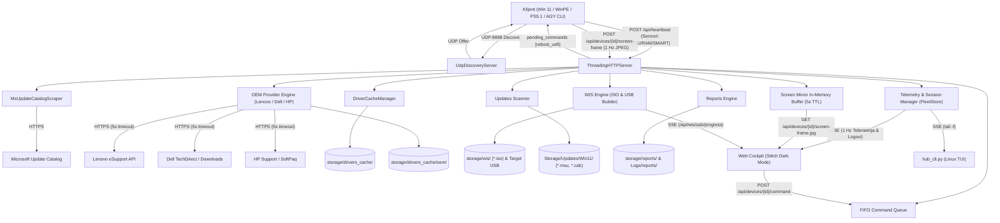

# Pregled Arhitekture Projekta: Servis Hub

Ovaj dokument definiše arhitekturu, ciljeve i osnovne komponente projekta **Servis Hub** (v3.2.0).

## 🎯 Cilj i Svrha
**Servis Hub** je samostalni centralni serverski podsistem servisa računara "Tehno-Kutak", zadužen za:
- **Telemetriju i praćenje flote:** Prikupljanje statusa u realnom vremenu sa računara na radnom stolu uz proširenu hardversku telemetriju (CPU opterećenje i temperatura, RAM upotreba i NVMe S.M.A.R.T. zdravlje).
- **1 Hz Live Ogledalo Ekrana (Screen Mirror):** Radioničko vizuelno praćenje ekrana klijentskih mašina u realnom vremenu (1 Hz) u WinPE i Windows okruženju preko laganog in-memory JPEG bafera (5s TTL).
- **Daljinsko Upravljanje Radnim Stanicama (Remote Commands):** Dvosmerni komandni FIFO kanal za slanje akcija iz Web Cockpita (`reboot_uefi`, `reboot_pxe`, `cancel`, `abort`) koje klijentski worker preuzima kroz periodični heartbeat.
- **Modularni OEM Podsistem (Lenovo, Dell i HP):** Fabrička provera garancije (Lenovo eSupport, Dell Service Tag, HP Support API sa striktnim 5s timeout-om i offline fallbackom), rezolucija zvaničnih Enterprise paketa drajvera (Lenovo SCCM, Dell Command | Deploy CAB, HP SoftPaq / Driver Pack) i provera novijih BIOS/UEFI firmware verzija.
- **Auto-Discovery:** Zero-config pronalaženje servera preko UDP broadcasta na portu 8888.
- **Pametni proksi drajvera:** Automatsko pretraživanje Microsoft Update Catalog-a, skidanje OEM CAB paketa i lokalno keširanje.
- **WIS USB & ISO Builder:** Izrada butabilnih UEFI USB instalacionih fleševa (GPT FAT32 boot + NTFS data) sa rigoroznim bezbednosnim zaštitama i SSE praćenjem napretka u realnom vremenu.
- **OTA Distribuciju:** Izdavanje verzionisanih ZIP paketa skripti i alata (`gwadt-payload.zip`).
- **Keš Windows 11 zakrpi:** Centralizovano skladištenje i REST uvid u kumulativna ažuriranja (.msu/.cab) na gigabitnom TrueNAS kešu za munjeviti pre-patching.
- **Digitalni servisni karton & AGY Sync:** Trajno arhiviranje izveštaja o instalaciji u JSON i Markdown formatu, uz dvosmernu sinhronizaciju servisnih sesija Antigravity CLI servisera.

## 🏗️ Osnovne Komponente i Slojevi
- **Frontend / Dashboard (Modern Enterprise Cockpit)**: Ugrađeni responzivni Dark-Mode Web Dashboard (`servishub.web.dashboard`) usklađen sa Google Stitch `DESIGN.md` specifikacijom i Linear/Vercel estetikom. Uključuje ergonomski **Collapsible Levi Sidebar** (275px $\rightarrow$ 68px), **Hibridni Split-Pane Cockpit** za radioničku flotu sa integrisanim **1 Hz ogledalom ekrana radne stanice** (Screen Mirror sa LIVE/Standby indikatorom), mernim instrumentima hardverske telemetrije (CPU/RAM/NVMe), Quick Action trakom sa alatima ("🔄 Reboot u UEFI", "🌐 Reboot u PXE") i bezbednosnim potvrdnim modalom (`#command-confirm-modal`). Očuvan je striktan zero-dependency princip (čist HTML5, CSS3, Vanilla JS bez npm alata). Detaljnije: [[decisions/ADR-0005-enterprise-dark-mode-cockpit-redesign]] i [[decisions/ADR-0007-telemetry-screen-mirror-and-oem-expansion]].
- **Terminal CLI Monitor**: `hub_cli.py` TUI konzolna aplikacija za nadzor flote i praćenje mašina direktno iz Linux terminala.
- **Backend / REST API**: Višenitni Python 3 HTTP server (`servishub.server` / `ThreadingHTTPServer`) bez spoljnih biblioteka, sa in-memory komandnim FIFO redom i JPEG baferom.
- **OEM Provajderi**: `servishub.drivers.oem` sa apstraktnom bazom `BaseOEMProvider` i modularnim provajderima za vodeće proizvođače:
  - `LenovoOEMProvider`: Lenovo eSupport API, SCCM paketi i BIOS provera.
  - `DellOEMProvider`: Dell Service Tag garancija, Dell Command | Deploy CAB paketi i BIOS provera.
  - `HpOEMProvider`: HP Support API, HP SoftPaq / Driver Pack paketi i BIOS provera.
- **Klijentski Moduli i Skripte**:
  - `WIS.ScreenCapture.ps1`: Klijentska PowerShell skripta za snimanje ekrana na 1 Hz (.NET Graphics/Drawing), kompresiju u JPEG (70%) i slanje na `/api/devices/{id}/screen-frame`.
  - `WIS.Telemetry.psm1`: Klijentski modul za periodični puls (2s), očitavanje hardverskih senzora (WMI/ACPI termika, memorija, NVMe SMART) i preuzimanje/izvršavanje daljinskih komandi (`Invoke-ServisRemoteCommand` za `reboot_uefi` / `reboot_pxe`).
- **WIS Medija Engine**: `servishub.wis` (`WisIsoManager`, `WisUsbEngine`) sa safety guardrails proverama sistemskih tačaka i ZFS pool diskova.
- **Mrežni Discovery**: UDP socket osluškivač na portu 8888 (`servishub.discovery`).
- **Skladište & Keš**: Lokalni fajl sistem (ZFS volumen na TrueNAS SCALE) sa automatskim heširanjem drajvera (`storage/drivers_cache/` i `storage/drivers_cache/oem/{lenovo,dell,hp}/`), payload arhivama (`storage/cache/`), skladištem Windows 11 zakrpi (`/home/gru/Storage/Updates/Win11`), WIS ISO slikama (`storage/wis/`) i logovima/kartonima (`Logs/` i `storage/reports/`).
- **Spoljni Servisi i Integracije**: Microsoft Update Catalog (`catalog.update.microsoft.com`), Microsoft WHQL CDN (`download.windowsupdate.com`), Lenovo eSupport Portal, Dell Downloads/TechDirect, HP FTP/SoftPaq i lokalni TrueNAS sinhronizator `nas_update_sync.py`.

## 🔄 Tok Podataka (Data Flow)

## 🎨 Google Stitch Dizajn Sistem & Katalog Ekrana
Korisnički interfejs ServisHub-a prati **Stitch-First Frontend Protokol** i formalizovan je preko Google Stitch platforme (Projekat: `Servis Hub Enterprise Cockpit`, Project ID: `16865739281301355668` na `stitch.withgoogle.com`). 

Svi vizuelni elementi i dizajn tokeni definisani su u [DESIGN.md](file:///home/gru/Projects/Servis%20Hub/DESIGN.md), dok je celokupan katalog od 5 produkcionih ekrana, rezolucija i vodič za rad na Stitch platformi detaljno dokumentovan u:
👉 **[Google Stitch Dizajn Katalog & Vodič (docs/stitch_designs/README.md)](file:///home/gru/Projects/Servis%20Hub/docs/stitch_designs/README.md)**

### Generisani Ekrani u Katalogu:
1. **Fleet Cockpit Dashboard (v2)** (`3945733ff2924a26ac6382a52b1811d1`): Hibridni Split-Pane sa Collapsible sidebarom, 1 Hz ogledalom ekrana, CPU/RAM/NVMe telemetrijom, daljinskim upravljanjem i SSE konzolom (v2 revizija, rezolucija `2560 x 2444`).
2. **WIS USB & ISO Builder Centar (v2)** (`da90fa64e14d48a397a03ce534477ec9`): UEFI GPT hibridni USB kreirač sa bezbednosnim guardrailsima za ZFS/Root diskove i real-time SSE trakom napretka (v2 revizija, rezolucija `2560 x 2432`).
3. **Digitalni Servisni Karton & AGY Sesije** (`58a0b24e69c746bdb7ba29c953a5f9f8`): Trajno arhiviranje radnih naloga, Pre-flight inspekcija i sinhronizacija Antigravity CLI sesija servisera (`2560 x 2226`).
4. **OEM Drajveri & Firmware Centar** (`2b3a6237f4b141a1929eb6ccc0fabd3d`): Lenovo, Dell i HP fabrička garancija (5s fallback), TrueNAS Enterprise paketi drajvera i BIOS/UEFI saveti (`2560 x 2048`).
5. **Windows 11 Zakrpe (TrueNAS Keš)** (`bd444814b01e45f38fd04d28f3f4a703`): Gigabajtni offline keš kumulativnih zakrpi (.msu/.cab) uz 85%+ uštedu protoka (`2560 x 2048`).

## 📚 Povezane Beleške
- Glavni indeks memorije: [[index]]
- Detaljna tehnička specifikacija: [[architecture/servis-hub]]
- Dizajn sistem: [DESIGN.md](file:///home/gru/Projects/Servis%20Hub/DESIGN.md)
- Stitch dizajn katalog i vodič: [docs/stitch_designs/README.md](file:///home/gru/Projects/Servis%20Hub/docs/stitch_designs/README.md)
- Inženjerska mapa implementacije i arhitektonski jaz: [docs/BACKEND_IMPLEMENTATION_ROADMAP.md](file:///home/gru/Projects/Servis%20Hub/docs/BACKEND_IMPLEMENTATION_ROADMAP.md)
- Arhitektonske odluke:
  - [[decisions/ADR-0001-decoupling-servis-hub]] — Odluka o osamostaljivanju i dekaplovanju ServisHub-a
  - [[decisions/ADR-0002-windows-update-cache-and-status-api]] — Keš Windows 11 zakrpi i status API
  - [[decisions/ADR-0003-antigravity-serviser-sync-api]] — Integracija Antigravity CLI Servisera i pre-flight istorija
  - [[decisions/ADR-0004-oem-and-wis-tools]] — Modularni OEM podsistem i WIS USB/ISO alati
  - [[decisions/ADR-0005-enterprise-dark-mode-cockpit-redesign]] — Modern Enterprise Dark Mode Cockpit redizajn (Stitch, Collapsible Sidebar, 1 Hz ogledalo ekrana)
  - [[decisions/ADR-0006-stitch-design-application-and-no-mock-roadmap]] — Primena Stitch dizajna, Striktna No-Mock politika i inženjerska mapa puta
  - [[decisions/ADR-0007-telemetry-screen-mirror-and-oem-expansion]] — Proširenje telemetrije, 1 Hz Screen Mirror, daljinsko upravljanje i OEM ekspanzija za Dell i HP (v3.2.0)
- Rečnik pojmova: [[domain/glossary]]
- Poznate zamke i rešenja: [[memory/gotchas]]
- Operativni runbook: [[memory/ops-runbook]]
