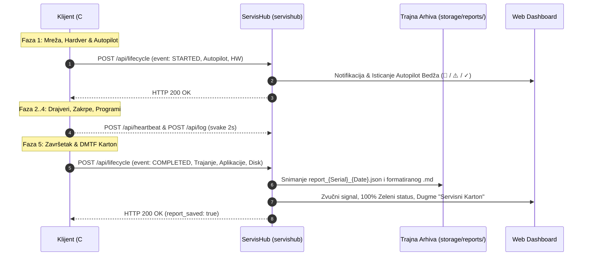

# ⚡ Tehno-Kutak Centralni Servisni Hub (ServisHub)
## Sveobuhvatna Tehnička i Arhitektonska Specifikacija Sistema (v3.1.0 Standalone)

---

## 📑 Sadržaj
1. [Pregled i Svrha Sistema](#1-pregled-i-svrha-sistema)
2. [Arhitektura Serverskog Podsistema (`servishub`)](#2-arhitektura-serverskog-podsistema-servishub)
3. [Mrežna Topologija i Zero-Config Auto-Discovery (Port 8888)](#3-mrežna-topologija-i-zero-config-auto-discovery-port-8888)
4. [Sveobuhvatna REST API Specifikacija](#4-sveobuhvatna-rest-api-specifikacija)
5. [Dinamički OTA Payload Auto-Packager (`PayloadManager`)](#5-dinamički-ota-payload-auto-packager-payloadmanager)
6. [Microsoft Update Catalog Scraper i Pametni Proksi Drajvera](#6-microsoft-update-catalog-scraper-i-pametni-proksi-drajvera)
7. [Modularni OEM Podsistem (`servishub.drivers.oem`)](#7-modularni-oem-podsistem-servishubdriversoem)
8. [WIS USB i ISO Medija Podsistem (`servishub.wis`)](#8-wis-usb-i-iso-medija-podsistem-servishubwis)
9. [Centralizovani TrueNAS Keš Windows 11 Zakrpi i Status REST API](#9-centralizovani-truenas-keš-windows-11-zakrpi-i-status-rest-api)
10. [Antigravity CLI Serviser Integracija i Sinhronizacija Sesija](#10-antigravity-cli-serviser-integracija-i-sinhronizacija-sesija)
11. [Live SSE Telemetrijsko Ogledalo i Trodelni Web Dashboard](#11-live-sse-telemetrijsko-ogledalo-i-trodelni-web-dashboard)
12. [Dvotačkasti Životni Ciklus i Digitalni Servisni Karton Flote](#12-dvotačkasti-životni-ciklus-i-digitalni-servisni-karton-flote)
13. [Klijentski Ekosistem (C# Launcher, C# UI, PowerShell 5.1 i AGY CLI)](#13-klijentski-ekosistem-c-launcher-c-ui-powershell-51-i-agy-cli)
14. [TrueNAS SCALE Produkciono Okruženje i Docker Kontejnerizacija](#14-truenas-scale-produkciono-okruženje-i-docker-kontejnerizacija)
15. [Operativni Runbook i Vodič za Otklanjanje Grešaka (Troubleshooting)](#15-operativni-runbook-i-vodič-za-otklanjanje-grešaka-troubleshooting)
16. [Povezane Beleške](#16-povezane-beleške)

---

## 1. Pregled i Svrha Sistema

**ServisHub** je centralni višenamenski kontrolni server, telemetrijski agregator, pametni keširajući proksi za drajvere, upravljač butabilnih instalacionih medija i OTA (Over-The-Air) repozitorijum u servisu računara **"Tehno-Kutak"**.

U verziji **v3.1.0**, ServisHub uvodi modularni OEM podsistem za fabričku garanciju i SCCM enterprise drajvere, kompletan WIS USB & ISO builder za UEFI instalacione fleševe sa SSE praćenjem, dvosmernu sinhronizaciju servisnih sesija Antigravity CLI dijagnostičara, kao i redizajnirani Web Dashboard organizovan u tri namenska taba.

### Ključni Inženjerski Ciljevi:
1. **Centralizovano Daljinsko Praćenje Flote ("Iz Fotelje"):** Omogućava tehničaru da sa jednog ekrana u realnom vremenu prati instalaciju operativnog sistema na 2 do 10+ računara istovremeno.
2. **"Flash & Release" Autonomija:** Oslobađa butabilni USB fleš disk odmah nakon prve faze particionisanja i primene slike u WinPE-u. Računari sve dalje skripte, binarne module i programe dinamički preuzimaju sa ServisHub-a i radioničkog NAS-a preko gigabitne mreže.
3. **Fabrička OEM Trijaža i Garancija:** Trenutna provera statusa fabričke garancije (Lenovo eSupport API sa striktnim 5s timeout-om i offline fallback-om), provera novijih verzija BIOS/UEFI firmware-a i preuzimanje zvaničnih SCCM enterprise drajver paketa.
4. **Sigurna Izrada Butabilnih USB Instalera (WIS):** Automatizovana priprema UEFI USB fleš diska sa GPT tabelom (FAT32 bootloader + NTFS instalacioni podaci za `install.wim` > 4 GB) uz striktne bezbednosne zaštite protiv prepisivanja TrueNAS ZFS pool diskova i sistemskih particija.
5. **Rana Detekcija Zaključanog Hardvera (Autopilot / MDM):** Prepoznavanje računara vezanih za Microsoft Intune / Autopilot korporativne zakupce u prvom minutu instalacije (Faza 1).
6. **Pametna Rezolucija Drajvera bez Interneta na Klijentu:** ServisHub samostalno pretražuje Microsoft Update Catalog za specifične hardverske identifikatore (HWID), preuzima zvanične OEM CAB pakete sa Microsoft CDN-a i proksira ih klijentu.
7. **Munjeviti TrueNAS Keš za Windows 11 Zakrpe:** Centralizovano skladištenje višemesečnih kumulativnih zakrpi (LCU) na gigabitnom NAS-u uz REST statusni pregled.
8. **Trajna Digitalna Arhiva i Sinhronizacija Sesija:** Arhiviranje DMTF hardverske specifikacije u JSON i Markdown formatu, uz podršku za pre-flight i post-flight sinhronizaciju prenosivog Antigravity CLI servisera.

---

## 2. Arhitektura Serverskog Podsistema (`servishub`)

Serverski proces implementiran je kao modularni Python 3 paket `servishub`.

### Struktura Modula:
- `servishub.config`: Upravljanje konfiguracijom (portovi, putanje, CLI argumenti, `.env`).
- `servishub.server`: Glavni višenitni HTTP server (`ThreadingHTTPServer`) sa elegantnim zaustavljanjem.
- `servishub.handlers`: REST API ruter koji implementira sve rute sa CORS podrškom i SSE tokovima.
- `servishub.discovery`: UDP Auto-Discovery server na portu 8888.
- `servishub.telemetry`: Thread-safe in-memory evidencija uređaja, sesija i statusa.
- `servishub.sse`: Server-Sent Events pretplatnički mehanizam (1 Hz ogledalo, živi logovi i status USB narezivanja).
- `servishub.drivers`: Podsistem za normalizaciju HWID-ja, pretragu Microsoft kataloga i keširanje CAB paketa.
- `servishub.drivers.oem`: Modularni OEM podsistem (`BaseOEMProvider`, `LenovoOEMProvider`, `get_oem_provider`) za garanciju, SCCM drajvere i BIOS ažuriranja.
- `servishub.wis`: Upravljanje Windows Installation Server (WIS) medijima (`WisIsoManager`, `WisUsbEngine`) za GPT UEFI particionisanje i ISO ekstrakciju.
- `servishub.payload`: Konfigurabilni dinamički OTA auto-packager (`gwadt-payload.zip`).
- `servishub.reports`: Generator digitalnih servisnih kartona (Markdown / JSON) i menadžer istorije uređaja (`save_agy_session`, `get_device_history`).
- `servishub.api.updates` & `servishub.models.updates`: REST inspekcija i modeli za inventar i status Windows 11 kumulativnih zakrpi (.msu / .cab).
- `servishub.web.dashboard`: Integrisani responzivni Dark-Mode Web Dashboard sa 3 taba.

### Karakteristike Implementacije:
- **Zero External Dependencies:** Izgrađen isključivo korišćenjem standardne biblioteke jezika Python 3 (`http.server.ThreadingHTTPServer`, `socket`, `threading`, `select`, `zipfile`, `hashlib`, `urllib.request`, `json`, `subprocess`). Nije potrebna instalacija paketa preko `pip`-a.
- **Konkurentnost:** Svaki klijentski HTTP zahtev obrađuje se u zasebnoj radnoj niti, čime se sprečava blokiranje servera pri sporom prenosu podataka sa klijenta.
- **Sinhronizacija Stanja:** Deljeni resursi (telemetrija, keš drajvera, stanje USB narezivanja) zaštićeni su namenskim bravama (`threading.Lock`).

```mermaid
graph TD
    subgraph KlijentskeMasine["Klijenti i Alati"]
        K1["Klijent 1 (Win 11)"]
        K2["Klijent 2 (Win 11)"]
        AGY["Antigravity CLI Serviser (USB)"]
    end

    subgraph HubServer["ServisHub Serverski Proces (servishub v3.1.0)"]
        UDP["UDP Discovery Osluškivač (:8888)"]
        HTTP["ThreadingHTTPServer (:8080)"]
        
        subgraph ModuliServera["Serverski Moduli"]
            PLM["PayloadManager (OTA Zip)"]
            DCM["DriverCacheManager (CAB keš)"]
            CAT["MsUpdateCatalogScraper (MS CDN)"]
            OEM["OEM Podsistem (Lenovo, SCCM, BIOS)"]
            WIS["WIS Engine (ISO & USB Builder)"]
            UPD["UpdatesScanner (Win 11 LCU Keš)"]
            REP["Report & History Engine"]
            SSE["SSE Dispatcher (Mirror, Logs & USB Burn)"]
        end
    end

    subgraph SkladisteTrueNAS["TrueNAS Skladište (/mnt/TK_NAS/Servis/ & Storage/)"]
        SCache["storage/cache/ (gwadt-payload.zip)"]
        SDrivers["storage/drivers_cache/ (*.cab)"]
        SOEM["storage/drivers_cache/oem/lenovo/"]
        SWIS["storage/wis/ (*.iso)"]
        SUpdates["Storage/Updates/Win11/ (*.msu & *.cab)"]
        SReports["storage/reports/<DeviceTag>/"]
        SLive["Logs/live/ (*.log)"]
    end

    subgraph Dashboard["Nadzor Servisera"]
        WEB["Dark-Mode Web Dashboard (3 Taba)"]
        CLI["hub_cli.py (Linux TUI)"]
    end

    K1 & K2 & AGY -- "UDP Discovery (8888)" --> UDP
    K1 & K2 & AGY -- "REST API / State / Logs / Reports (8080)" --> HTTP
    HTTP --> PLM & DCM & OEM & WIS & UPD & REP & SSE
    DCM <--> CAT
    CAT -- "HTTPS" --> MS["Microsoft Update Catalog"]
    OEM -- "HTTPS (5s timeout)" --> LenovoAPI["Lenovo eSupport Portal"]
    OEM --> SOEM
    WIS --> SWIS
    WIS -- "Format & Extract" --> USBDisk[("Ciljni USB Fleš Disk")]
    UPD --> SUpdates
    PLM --> SCache
    DCM --> SDrivers
    REP --> SReports
    HTTP --> SLive
    SSE -- "Server-Sent Events" --> WEB & CLI
```



---

## 3. Mrežna Topologija i Zero-Config Auto-Discovery (Port 8888)

Da bi se eliminisala potreba za ručnim unošenjem IP adrese na klijentskim mašinama, ServisHub koristi hibridni mehanizam otkrivanja:

### 3.1. UDP Auto-Discovery Protokol (Port 8888)
1. Klijent (`HubDiscovery.cs` u C# Launcher-u, `Find-ServisHub` u PowerShell modulu ili `Sync-ServiceHub.ps1` u Antigravity CLI-ju) šalje usmereni UDP broadcast na port `8888` sa sadržajem:
   ```text
   GWADT_DISCOVER client=DESKTOP-ABC1234
   ```
2. Klasa `UdpDiscoveryServer` u `servishub.discovery` osluškuje na `0.0.0.0:8888`. Čim primi paket koji počinje sa `GWADT_DISCOVER`, server odmah odgovara pošiljaocu:
   ```text
   GWADT_HUB_OFFER port=8080 host=<Lokalna_IP_Servera> name=TehnoKutak-Hub
   ```
3. Klijent preuzima ponudu, formira bazni URL `http://<Lokalna_IP_Servera>:8080` i vrši verifikaciju pozivom `GET /api/health`.

### 3.2. Višeslojni Hijerarhijski Fallback Lanac
Ukoliko je UDP broadcast blokiran (npr. izolovani VLAN ili specifičan mrežni switch), klijentski podsistem primenjuje strogo definisan redosled traženja:
1. **UDP Broadcast:** Usmereno slanje na globalni broadcast `255.255.255.255` i lokalne kalkulisane broadcast adrese svih aktivnih mrežnih kartica.
2. **Default Gateway Probing:** Slanje brzog HTTP `GET /api/health` upita ka Default Gateway adresama.
3. **Konfiguracija iz `Wifi-Servis.ini`:** Čitanje sekcije `[ServisHub]` ili `[GdsServer]`.
4. **Fiksne Radioničke IP Adrese:** `192.168.170.254`, `192.168.88.50`, `192.168.180.50`, `192.168.170.188`.
5. **Localhost:** `http://127.0.0.1:8080`.

---

## 4. Sveobuhvatna REST API Specifikacija

ServisHub implementira kompletan RESTful interfejs sa JSON formatom i CORS zaglavljima (`Access-Control-Allow-Origin: *`).

### 4.1. Tabela API Ruta

| Endpoint | Metod | Glavna Uloga i Odgovornost | Tip Tela (Request) | Tip Tela (Response) |
| :--- | :--- | :--- | :--- | :--- |
| `/` ili `/index.html` | `GET` | Ugrađeni responzivni Dark-Mode Web Dashboard sa 3 taba | - | `text/html; charset=utf-8` |
| `/api/health`, `/api/status` | `GET` | Health check servera i status provera | - | `{"status": "ok", "uptime_sec": int}` |
| `/api/payload/version` | `GET` | Provera aktuelne verzije i SHA-256 heša OTA paketa | - | JSON meta podaci paketa |
| `/api/payload/download` | `GET` | Binarno preuzimanje `gwadt-payload.zip` paketa | - | `application/zip` stream |
| `/api/session/<id>/state` | `POST` | Prijem trenutnog stanja klijentskog GUI-ja i hardvera | JSON stanje sesije | `{"ok": true, "session_id": str}` |
| `/api/session/<id>/stream`| `GET` | Server-Sent Events (SSE 1 Hz) živi strim GUI ogledala | - | `text/event-stream` |
| `/api/sessions` | `GET` | Lista svih aktivnih i STALE sesija na serveru | - | `{"sessions": [...], "total": int}` |
| `/api/heartbeat` | `POST` | Periodični puls klijentskog radnika (svake 2s) | JSON podaci o napretku | `{"status": "ok", "device_id": str}` |
| `/api/log` | `POST` | Batch slanje novih linija loga sa klijenta | `{"lines": [...]}` | `{"status": "ok", "appended": int}` |
| `/api/stream/<dev_id>` | `GET` | SSE živi prenos linija loga (`tail -f`) za mašinu | - | `text/event-stream` |
| `/api/lifecycle` | `POST` | Dvotačkasti životni ciklus (`STARTED` i `COMPLETED`) | JSON događaja | `{"status": "ok", "event": str}` |
| `/api/devices` | `GET` | Sumarni spisak svih registrovanih računara flote | - | JSON mapa uređaja |
| `/api/devices/<id>/logs` | `GET` | Preuzimanje poslednjih do 300 linija loga za mašinu | - | JSON niz stringova |
| `/api/devices/<id>/download`| `GET` | Preuzimanje kompletnog tekstualnog `.log` fajla | - | `text/plain` |
| `/api/devices/<id>/report`| `GET` | Preuzimanje sačuvanog JSON servisnog kartona | - | JSON servisni karton |
| `/api/devices/<id>/report`| `POST` | Zaprima završni izveštaj i generiše `.json` i `.md` | JSON završnog kartona | `{"status": "ok", "json_file": str}` |
| `/api/devices/<id>/history` | `GET` | Pre-flight očitavanje servisne istorije uređaja po ID-ju | - | JSON istorijat (`is_registered`, `interventions`) |
| `/api/devices/by-serial/<serial>/history` | `GET` | Pre-flight očitavanje istorije uređaja po serijskom broju | - | JSON istorijat |
| `/api/devices/<id>/agy-session` | `POST` | Arhiviranje dijagnostičke sesije Antigravity CLI servisera | JSON AGY sesije | `{"status": "ok", "session_id": str}` |
| `/api/drivers/resolve` | `POST` | Rezolucija drajvera uz fabričku garanciju i SCCM | `{"hwids": [...], "manufacturer": str, "model": str}` | JSON lista drajvera + `"warranty"` + `"oem"` |
| `/api/drivers/check_update`| `POST` | Provera novije verzije drajvera na OEM katalogu | `{"hwids": [...], "current_version": str}` | JSON status ažuriranja |
| `/api/drivers/download` | `GET` | Preuzimanje keširanog OEM `.cab` drajvera po ID-ju | Query: `?id=<hash>` | `application/vnd.ms-cab-compressed` |
| `/api/drivers/cache/list` | `GET` | Pregled svih keširanih drajvera u skladištu | - | `{"drivers": [...], "count": int}` |
| `/api/wis/iso/info` | `GET` | Pregled dostupnosti i metapodataka WIS ISO slike | - | JSON info (`available`, `version`, `sha256`) |
| `/api/wis/iso/download` | `GET` | Preuzimanje WIS ISO slike sa servera | - | Binarni `application/octet-stream` |
| `/api/wis/usb/list` | `GET` | Detekcija USB diskova sa bezbednosnim proverama | Query: `?all=true` | JSON lista diskova (`is_safe`, `blocked_reason`) |
| `/api/wis/usb/burn` | `POST` | Asinhrono pokretanje kreiranja UEFI USB instalera | `{"device": "/dev/sdX", "confirm_wipe": true}` | `{"status": "started", "device": str}` (HTTP 202) |
| `/api/wis/usb/progress` | `GET` | SSE živi prenos toka narezivanja USB instalera | - | `text/event-stream` (faza, procenat, poruka) |
| `/api/updates/status` | `GET` | Status i inventar Windows 11 kumulativnih zakrpi na NAS-u | Query: `?directory=<path>` (opciono) | JSON status skladišta zakrpi (`UpdatesStatusResponse`) |

---

## 5. Dinamički OTA Payload Auto-Packager (`PayloadManager`)

U samostalnom ServisHub-u, `PayloadManager` podržava fleksibilne izvore:
1. **Konfigurabilni Payload Izvor (`SERVIS_HUB_PAYLOAD_DIR`):** Ukoliko je montiran direktorijum sa skriptama i modulima, server prati `mtime` i automatski generiše ažuran `gwadt-payload.zip`.
2. **Pre-built Paket:** Ukoliko se koristi unapred zapakovan ZIP paket u `storage/cache/`, server automatski računa njegov SHA-256 heš i metapodatke bez potrebe za izvornim kodom.
3. **Klijentska Validacija (C# Launcher):** Klijent upoređuje lokalni heš na `C:\setup` sa hešom sa servera (`/api/payload/version`). Ukoliko se razlikuju, preuzima najnoviji paket (1-2 MB, ~0.1s preko mreže) i otpakuje ga.

---

## 6. Microsoft Update Catalog Scraper i Pametni Proksi Drajvera

ServisHub implementira autonomnu proksi integraciju sa **Microsoft Update Catalog** servisom.

### 6.1. Inteligentna HWID Normalizacija (`generate_hwid_candidates`)
Kada Windows prijavi nepoznat uređaj u Device Manager-u, njegov identifikator često sadrži sabirničke i revizijske sufikse koje Microsoft-ov katalog ne može direktno da filtrira:
- **ACPI Uređaji:** `ACPI\VEN_INTC&DEV_1078` $\rightarrow$ `ACPI\INTC1078` $\rightarrow$ `*INTC1078` $\rightarrow$ `INTC1078` $\rightarrow$ `VEN_INTC&DEV_1078`.
- **High Definition Audio (HDAUDIO):** Uklanjaju se sabirničke kolekcije `&COLxx`, revizije `&REV_xxxx` i podsistemi `&SUBSYS_xxxxxxxx`, svodeći upit na stabilan nivo.
- **PCI i USB Uređaji:** Hijerarhijsko skidanje revizija i generisanje stabilnih identifikatora.

### 6.2. Poređenje Verzija i Formata Datuma (`is_catalog_driver_newer`)
- Podržava semantičko poređenje verzija drajvera (`4.12.0.1` vs `4.11.9.99`).
- Podržava različite formate datuma koje Microsoft koristi (ISO `YYYY-MM-DD`, američki `MM/DD/YYYY`, evropski `DD/MM/YYYY` i WMI format).

---

## 7. Modularni OEM Podsistem (`servishub.drivers.oem`)

Modularni OEM podsistem obezbeđuje namensku podršku za proizvođački hardver (Lenovo, Dell, HP) kroz jedinstveni interfejs apstrakcije.

### 7.1. Arhitektura Interfejsa (`BaseOEMProvider`)
Svaki provajder implementira tri ključne metode:
- `get_warranty_info(serial: str, model: str = "")`: Očitava status fabričke garancije, datum početka i kraja, nivo podrške i preostale dane.
- `resolve_driver_pack(model: str, os_ver: str = "win11-x64")`: Pronalazi zvanični Enterprise SCCM paket drajvera, proverava lokalni keš ili vraća metapodatke za preuzimanje.
- `check_bios_update(model: str, current_bios: str = "")`: Proverava dostupnost novije BIOS/UEFI firmware verzije.

### 7.2. Implementacija za Lenovo (`LenovoOEMProvider`)
- **Striktni 5s Timeout sa Fallback-om:** Svi upiti ka Lenovo eSupport REST API-ju ograničeni su na najviše 5 sekundi. U slučaju isteka vremena, mrežne greške ili nevalidnog serijskog broja, provajder se vraća na ugrađenu bazu poznatih modela (`KNOWN_MODELS`) i lokalni keš sa statusom `"fallback"`.
- **Lokalni SCCM Keš:** Paketi se skladište u `storage/drivers_cache/oem/lenovo/{MTM}/`.
- **Ugrađena Baza Modela:** Podrška za popularne ThinkPad generacije (npr. `20TD` - ThinkPad E14 Gen 2, `21AH` - ThinkPad T14 Gen 3, `20UD` - ThinkPad T14 Gen 1 AMD).

### 7.3. Integracija sa `/api/drivers/resolve`
Kada klijent pošalje `manufacturer` i `model`/`serial_number` u telu `/api/drivers/resolve`, server automatski uključuje blokove:
```json
{
  "status": "ok",
  "results": [...],
  "warranty": {
    "status": "ok",
    "in_warranty": true,
    "status_label": "U garanciji",
    "service_level": "Premier Support",
    "end_date": "2027-05-15",
    "days_remaining": 218
  },
  "oem": {
    "status": "ok",
    "package_name": "tp_t14_gen3_win11_21ah.exe",
    "download_url": "https://download.lenovo.com/...",
    "size_bytes": 1684275200
  }
}
```

---

## 8. WIS USB i ISO Medija Podsistem (`servishub.wis`)

Omogućava bezbednu, automatizovanu pripremu butabilnih USB instalacionih fleševa za Windows Installation Server (WIS) direktno sa radioničkog servera.

### 8.1. Sigurnosni Guardrails (Zaštita Sistema i ZFS Pool-a)
Pre formatiranja bilo kog diska, modul `servishub.wis.usb` primenjuje stroge filtere:
1. **`CRITICAL_SYSTEM_MOUNTS`:** Blokira formatiranje ako se na disku ili njegovim particijama nalaze tačke `/`, `/boot`, `/boot/efi`, `/home`, `/var`, `/etc`, `/usr`, `/root`, `/opt`.
2. **`get_active_zpool_devices`:** Očitava `zpool status` i strogo sprečava bilo kakav upis na diskove koji pripadaju ZFS skladišnom bazenu na TrueNAS SCALE hostu.
3. **Provera prenosivosti:** Dozvoljeni su samo uređaji sa atributima `rm=1` (removable), `hotplug=1` ili `transport=usb`.
4. **Potvrda brisanja (`confirm_wipe=True`):** Neophodna eksplicitna potvrda u POST telu, inače server odbija zahtev.

### 8.2. Hibridni GPT Particioni Layout (FAT32 + NTFS)
- **Particija 1 (`UEFI_BOOT`, 512 MB, FAT32):** Sadrži UEFI bootloader (`bootx64.efi`), BCD konfiguraciju i WinPE boot fajlove. Kompatibilna sa svim modernim i starijim UEFI matičnim pločama bez potrebe za Disable Secure Boot opcijom.
- **Particija 2 (`WIS_DATA`, ostatak diska, NTFS):** Sadrži WIS instalacione skripte, repozitorijum drajvera i kompletnu Windows sliku (`install.wim`), prevazilazeći 4 GB limit FAT32 fajl sistema.

### 8.3. Asinhroni Tok i SSE Praćenje (`/api/wis/usb/progress`)
Proces teče kroz jasne faze uz višenitno obaveštavanje:
1. `preparing` (0%) $\rightarrow$ 2. `unmounting` (10%) $\rightarrow$ 3. `wiping` (25%) $\rightarrow$ 4. `partitioning` (50%) $\rightarrow$ 5. `formatting_fat32` (75%) $\rightarrow$ 6. `formatting_ntfs` (90%) $\rightarrow$ 7. `extracting` (40-98%) $\rightarrow$ 8. `completed` (100%).

---

## 9. Centralizovani TrueNAS Keš Windows 11 Zakrpi i Status REST API

- **Gigabitno LAN Keširanje:** Čuvanje zvaničnih kumulativnih bezbednosnih zakrpi (LCU) za Windows 11 na TrueNAS skladištu (`/home/gru/Storage/Updates/Win11`).
- **Autonomna Sinhronizacija (`nas_update_sync.py`):** Pozadinski proces autonomno pretražuje Microsoft Update Catalog, skida nove `.msu`/`.cab` pakete, validira SHA-256 sume i rotira starije verzije.
- **Munjeviti Pre-patching & Slipstreaming:** Paketi poput `KB5129195` (4.4 GB) i `KB5129242` (1.1 GB) preuzimaju se preko gigabitnog LAN-a brzinom ~125 MB/s, čime je instalacija zakrpa skraćena sa 30+ minuta na ispod 60 sekundi po računaru.
- **REST Status Uvid:** Endpoint `GET /api/updates/status` u realnom vremenu klijentima vraća detaljne metapodatke skladišta, prepoznate KB brojeve i veličine, uz automatsko filtriranje privremenih preuzimanja (`.part`, `.tmp`).

---

## 10. Antigravity CLI Serviser Integracija i Sinhronizacija Sesija

Za terenske servisere koji koriste prenosivi **Tehno-kutak AGY serviser** na USB flešu:
- **Pre-flight Istorija (`GET /api/devices/{id}/history` ili `/by-serial/{serial}/history`):** Pre pokretanja dijagnostike, alat preuzima ranije servisne nalaze sa Hub-a i prosleđuje ih u kontekst AI agenta.
- **Post-flight Arhiviranje (`POST /api/devices/{id}/agy-session`):** Po završetku dijagnostike šalje se kompletan profil uređaja, root-cause zaključak AI agenta i unosi u dnevnik, koji se spajaju u `storage/reports/<DeviceTag>/SERVISNI_DNEVNIK.md`.
- **Offline Red Čekanja:** Ukoliko Hub nije dostupan tokom rada na terenu, sesije se baferuju u `pending_sync/` na USB-u i automatski šalju po povratku u radionicu.

---

## 11. Live SSE Telemetrijsko Ogledalo i Trodelni Web Dashboard

### 11.1. Server-Sent Events (SSE)
- Klijentski browser otvara persistentnu GET konekciju: `/api/session/<session_id>/stream`.
- Server na taktu od **1 Hz** emituje snapshot celokupnog stanja radne stanice kao tekstualni tok.
- Klikom na karticu mašine otvara se modalni terminal sa posebnim stream-om `/api/stream/<device_id>` koji strimuje svaku novu liniju loga (`tail -f`).

### 11.2. Redizajnirani Trodelni Web Dashboard
Web Dashboard (`servishub.web.dashboard`) organizovan je u tri intuitivna taba:
1. **🖥️ Radionička Flota & Telemetrija (`#tab-fleet`):**
   - Zbirni brojači (ukupno mašina, aktivne, završene, restart, greške).
   - Interaktivne kartice računara sa prikazom faza (Faza 1..5), S.M.A.R.T. statusom diska, modelom, serijskim brojem i dugmadima za uživo logove i preuzimanje servisnog kartona.
2. **💿 WIS Centar - ISO & USB Builder (`#tab-wis`):**
   - Pregled statusa i verifikacije WIS ISO slike na serveru (verzija, SHA-256 heš, veličina, dugme za preuzimanje).
   - Tabela prepoznatih USB uređaja sa prikazom kapaciteta, modela i bezbednosnog statusa (`Bezbedan za formatiranje` vs `Blokiran - Sistemski / ZFS disk`).
   - Modalni prozor sa upozorenjem i dugmetom za potvrdu formatiranja.
   - Live SSE progress bar sa prikazom trenutne faze (Wiping, Particionisanje, Formatiranje, Ekstrakcija fajlova).
3. **📦 Windows Updates - LCU Keš (`#tab-updates`):**
   - Prikaz statusa gigabitnog skladišta zakrpi na TrueNAS serveru.
   - Ukupan broj paketa, ukupna veličina u GB i lista identifikovanih KB brojeva.
   - Tabela pojedinačnih `.msu` i `.cab` datoteka sa datumima izmene.

---

## 12. Dvotačkasti Životni Ciklus i Digitalni Servisni Karton Flote

Telemetrija kombinuje periodični puls sa **dva diskretna ključna životna događaja**:



- **Događaj `STARTED` (Faza 1):** Prijavljuje trostepeni Autopilot status (`Clean`, `AadMdm`, `Autopilot`).
- **Događaj `COMPLETED` (Faza 5):** Prijavljuje tačno vreme trajanja, statuse aplikacija i hardverski profil. Server automatski kreira `report_<Serial>_<Datum>.json` i formatirani Markdown `report_<Serial>_<Datum>.md`.

---

## 13. Klijentski Ekosistem (C# Launcher, C# UI, PowerShell 5.1 i AGY CLI)

ServisHub je u potpunosti kompatibilan sa svim klijentskim modulima:
- **C# Launcher (`WIS.Launcher.exe` / `GWADT.Launcher.exe`):** Otkriva hub putem UDP broadcasta, preuzima OTA ZIP arhivu i pokreće instalaciju.
- **C# Master UI (`WIS.UI.exe` / `GWADT.UI.exe`):** Šalje telemetrijski puls, baferovane logove i SSE ogledalo ekrana.
- **PowerShell 5.1 (`WIS.Telemetry.psm1`):** Šalje diskretne događaje životnog ciklusa i zahteve za drajvere.
- **Tehno-kutak AGY Serviser:** Koristi `Sync-ServiceHub.ps1` za pre-flight pull ranijih kvarova i post-flight push dijagnostičkih kartona.

---

## 14. TrueNAS SCALE Produkciono Okruženje i Docker Kontejnerizacija

U produkcionom radu u radionici, ServisHub se izvršava kao Docker kontejner na **TrueNAS SCALE** serveru (`192.168.170.254`).

### Konfiguracija (`docker-compose.yml`):
```yaml
services:
  servis-hub:
    container_name: servis-hub
    build:
      context: ..
      dockerfile: docker/Dockerfile
    restart: unless-stopped
    network_mode: host
    environment:
      - PYTHONUNBUFFERED=1
      - SERVIS_HUB_PORT=8080
      - SERVIS_HUB_UDP_PORT=8888
      - SERVIS_UPDATES_DIR=/home/gru/Storage/Updates/Win11
    volumes:
      - /mnt/TK_NAS/Servis/servis-hub/storage:/app/storage:rw
      - /mnt/TK_NAS/Servis/servis-hub/Logs/reports:/app/Logs/reports:rw
      - /mnt/TK_NAS/Servis/servis-hub/Logs/live:/app/Logs/live:rw
      - /mnt/TK_NAS/Servis/Updates/Win11:/home/gru/Storage/Updates/Win11:ro
```

### Kritična Pravila Arhitekture:
1. **`network_mode: host`:** Neophodan za prijem UDP broadcast paketa na portu 8888 preko svih VLAN i subnet interfejsa.
2. **Port 8080:** Strogo alociran radi zaštite internog ERP programa koji na TrueNAS-u koristi port 8000.
3. **ZFS Perzistencija:** Svi keširani drajveri, izveštaji i logovi čuvaju se na ZFS skladištu.

---

## 15. Operativni Runbook i Vodič za Otklanjanje Grešaka (Troubleshooting)

### Pokretanje:
```bash
# Brzo pokretanje preko bash skripte
./start-servis-hub.sh

# Ili direktno preko Pythona
python3 hub_server.py --port 8080 --udp-port 8888
```

### Praćenje:
```bash
# TUI pregled flote
python3 hub_cli.py

# Uživo praćenje loga mašine
python3 hub_cli.py --watch TK-LAPTOP-PF2X98ZA
```

---

## 16. Povezane Beleške
- Pregled arhitekture: [[architecture/overview]]
- Odluka o osamostaljivanju: [[decisions/ADR-0001-decoupling-servis-hub]]
- Odluka o kešu zakrpi i status API-ju: [[decisions/ADR-0002-windows-update-cache-and-status-api]]
- Odluka o Antigravity serviser integraciji: [[decisions/ADR-0003-antigravity-serviser-sync-api]]
- Odluka o OEM podsistemu i WIS alatima: [[decisions/ADR-0004-oem-and-wis-tools]]
- Rečnik pojmova: [[domain/glossary]]
- Zamke i specifičnosti: [[memory/gotchas]]
- Operativni vodič: [[memory/ops-runbook]]
- Početni indeks: [[index]]
