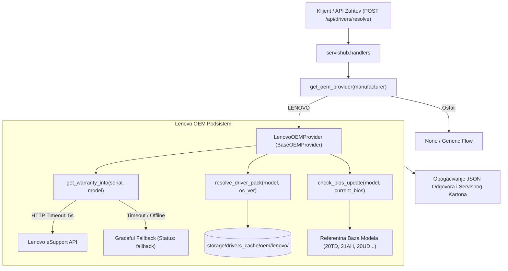
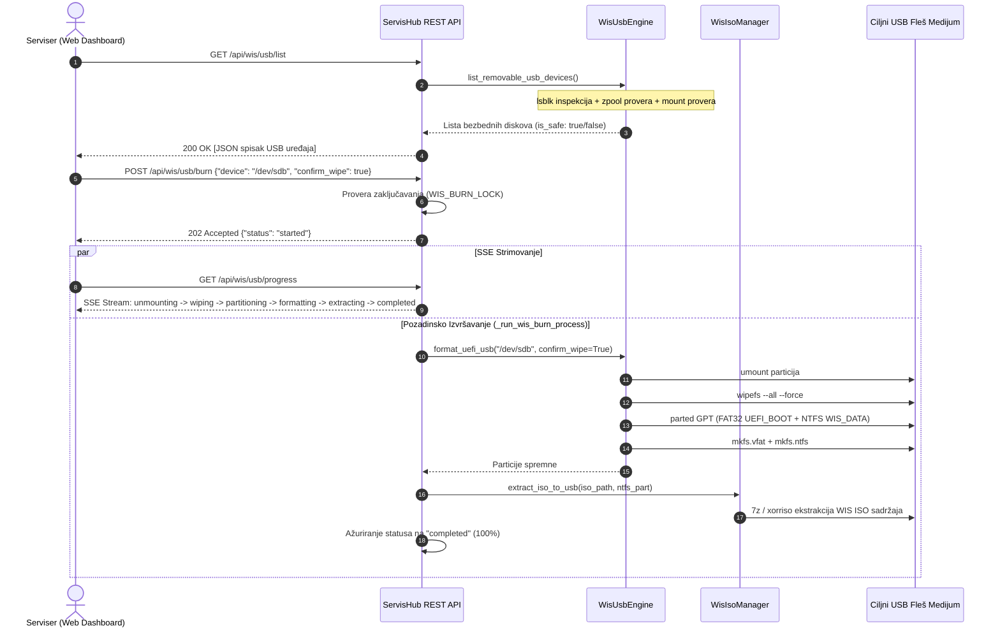

# ADR-0004: Modularni OEM Podsistem (Garancija, SCCM, BIOS) i WIS USB/ISO Alati

## 1. Kontekst i Problem

U prethodnim verzijama (v3.0.0), ServisHub je obezbeđivao telemetriju računara, centralizovani keš Windows 11 zakrpi i generički proksi za drajvere preko Microsoft Update Catalog-a. Međutim, radionička praksa u servisu "Tehno-Kutak" identifikovala je nekoliko kritičnih tačaka koje su usporavale servisni tok i nosile operativne rizike:

1. **Nedostatak uvida u fabričku garanciju:**
   - Prilikom prijema računara na servis (posebno poslovnih laptopova poput Lenovo ThinkPad, Dell Latitude, HP EliteBook), serviseri su morali ručno da otvaraju web portale proizvođača i prekucavaju serijske brojeve kako bi utvrdili da li je uređaj još uvek pod garancijom pre otvaranja i zamene delova.
2. **Generički naspram fabričkih SCCM paketa:**
   - Microsoft Update Catalog često nudi rasparčane drajvere ili generičke verzije, dok proizvođači hardvera obezbeđuju objedinjene, testirane Enterprise SCCM pakete optimizovane za specifičnu matičnu ploču i platformu.
3. **Zastarele BIOS/UEFI verzije:**
   - Mnoga nestabilna ponašanja (pregrevanje, nepravilno prepoznavanje NVMe diskova, baterijski throttling) rešena su novijim BIOS verzijama. Serviseri nisu imali automatizovanu proveru da li je BIOS na mašini ažuran.
4. **Manuelna i rizična izrada butabilnih USB instalera (WIS):**
   - Priprema USB instalacionih fleševa sa prilagođenim Windows Installation Server (WIS) slikama radila se preko alata trećih strana (Rufus, Ventoy) na radnim stanicama.
   - Često je dolazilo do grešaka sa veličinom fajla `install.wim` (koji redovno prelazi 4 GB limit FAT32 fajl sistema) ili izbora pogrešnog diska.
   - Pokretanje alata za formatiranje diska na serveru ili administratorskoj mašini bez strogih bezbednosnih filtera nosilo je katastrofalan rizik od formatiranja ZFS skladišnih diskova (TrueNAS ZPool) ili sistemskih particija operativnog sistema.

---

## 2. Razmatrane Opcije

- **Opcija A: Zadržavanje eksternih alata i ručna provera garancije preko browsera:**
  - *Mane:* Gubitak vremena servisera (5-10 minuta po prijemu), nema centralizovane evidencije garancije u digitalnom servisnom kartonu, rizik od prepisivanja sistemskih diskova ručnim alatima.
- **Opcija B: Monolitni mikroservisi i eksterne skripte van ServisHub-a:**
  - *Mane:* Povećava kompleksnost deployment-a, zahteva više Docker kontejnera, otežava praćenje napretka u realnom vremenu na jedinstvenom Dashboard-u.
- **Opcija C: Modularni OEM podsistem i integrisani WIS Engine sa striktnim bezbednosnim zaštitama [PRIHVAĆENO]:**
  - **Modularni OEM provajderi (`servishub.drivers.oem`):** Apstraktna bazna klasa `BaseOEMProvider` sa ugovorom za garanciju, SCCM drajvere i BIOS ažuriranja. Početna kompletna implementacija za **Lenovo** hardver (`LenovoOEMProvider`), sa lakim dodavanjem Dell/HP provajdera u budućnosti.
  - **Graceful Fallback i 5s Timeout:** Svi mrežni pozivi ka OEM API-jima (npr. Lenovo eSupport) zaštićeni su striktnim timeout-om od 5 sekundi. U slučaju nedostupnosti ili mrežnog prekida, server prelazi na lokalnu bazu znanja i lokalni keš, sprečavajući blokiranje niti.
  - **Lokalni SCCM Keš:** Zvanični paketi drajvera keširaju se u `storage/drivers_cache/oem/{proizvođač}/{MTM}/`.
  - **Sigurnosni Guardrails za diskove (`servishub.wis.usb`):** Višeslojna zaštita koja pre bilo kakvog upisa na disk rigorozno proverava sistemske tačke montiranja (`CRITICAL_SYSTEM_MOUNTS`), aktivne ZFS pool diskove (`get_active_zpool_devices`), atribute prenosivosti (`rm=1`, `hotplug=1`, `tran=usb`) i zahteva eksplicitnu potvrdu `confirm_wipe=True`.
  - **Hibridni UEFI Particioni Layout (FAT32 + NTFS):** Automatsko kreiranje GPT tabele sa FAT32 particijom za UEFI bootloader (nativno podržan od svih matičnih ploča) i NTFS particijom za WIS instalacione podatke i `install.wim` datoteke veće od 4 GB.
  - **Real-time SSE Praćenje:** Celokupan tok narezivanja (unmount, wipefs, particionisanje, formatiranje, ekstrakcija ISO-a) emituje se u realnom vremenu preko Server-Sent Events (SSE) na `/api/wis/usb/progress`.

---

## 3. Doneta Odluka i Tehnička Specifikacija

### 3.1. Modularna OEM Arhitektura (`servishub.drivers.oem`)

#### Ključne komponente:
1. **`BaseOEMProvider` (`servishub.drivers.oem.base`):**
   - `get_warranty_info(serial: str, model: str = "") -> Dict[str, Any]`
   - `resolve_driver_pack(model: str, os_ver: str = "win11-x64") -> Dict[str, Any]`
   - `check_bios_update(model: str, current_bios: str = "") -> Dict[str, Any]`
2. **`LenovoOEMProvider` (`servishub.drivers.oem.lenovo`):**
   - Podrška za ThinkPad, ThinkCentre i IdeaPad serije.
   - Povezivanje sa Lenovo eSupport servisom uz `urllib.request` timeout od 5.0 sekundi.
   - Formatirani izlaz garancije sa poljima: `in_warranty`, `status_label`, `service_level`, `start_date`, `end_date`, `days_remaining`.
   - Zvanični SCCM paketi drajvera organizovani po Machine Type Model (MTM) oznaci.
   - Poređenje BIOS verzija i prepoznavanje preporučenih ažuriranja.
3. **Integracija u Servisni Karton (`servishub.reports`):**
   - Podaci o garanciji automatski se arhiviraju u `DEVICE_INFO.json` i ugrađuju u Markdown izveštaj (`latest_report.md` i `SERVISNI_DNEVNIK.md`).

---

### 3.2. WIS ISO i USB Engine (`servishub.wis`)

#### Bezbednosni Zaštitni Mehanizmi (Safety Guardrails):
- **Zabrana sistemskih particija (`CRITICAL_SYSTEM_MOUNTS`):** Stroga blokada formatiranja bilo kog uređaja na kome su montirani `/`, `/boot`, `/boot/efi`, `/home`, `/var`, `/etc`, `/usr` i druge ključne tačke sistema.
- **Zaštita ZFS Pool-ova (`get_active_zpool_devices`):** Pokretanje `zpool status` i dinamičko blokiranje svih diskova i particija koji pripadaju aktivnom TrueNAS ZFS skladištu.
- **Verifikacija prenosivosti:** Dozvoljeno je targetiranje isključivo uređaja sa oznakom `rm=1` (removable), `hotplug=1` ili `transport=usb`.
- **Eksplicitna potvrda (`confirm_wipe=True`):** API odbija bilo koji zahtev sa HTTP 400 ukoliko klijent eksplicitno ne potvrdi uništenje podataka.
- **Hibridni GPT UEFI Layout:**
  - Particija 1 (FAT32, label `UEFI_BOOT`, 512 MB): Sadrži UEFI bootloader fajlove kompatibilne sa svim PC firmware standardima.
  - Particija 2 (NTFS, label `WIS_DATA`, preostali kapacitet): Sadrži instalacione skripte, driver repozitorijum i `install.wim` datoteku bez veličinskih ograničenja.

---

### 3.3. REST API Ugovor za WIS i OEM

| Endpoint | Metod | Opis i Funkcionalnost | Request Body / Parametri | Response |
| :--- | :--- | :--- | :--- | :--- |
| `/api/wis/iso/info` | `GET` | Metapodaci i dostupnost WIS ISO slike na serveru | - | JSON detalji (ime, verzija, veličina, SHA-256 heš) |
| `/api/wis/iso/download` | `GET` | Direktan download WIS ISO slike | - | Binarni `application/octet-stream` |
| `/api/wis/usb/list` | `GET` | Lista detektovanih USB uređaja sa bezbednosnim statusom | Query: `?all=true` (opciono) | JSON lista diskova (`device_path`, `is_safe`, `blocked_reason`, `size_formatted`) |
| `/api/wis/usb/burn` | `POST` | Pokretanje asinhronog kreiranja UEFI USB instalera | `{"device": "/dev/sdX", "confirm_wipe": true}` | `{"status": "started", "device": str}` (HTTP 202) |
| `/api/wis/usb/progress` | `GET` | Server-Sent Events (SSE) živi strim napretka narezivanja | - | `text/event-stream` sa fazama i procentima (0-100%) |
| `/api/drivers/resolve` | `POST` | Obogaćena rezolucija drajvera sa proverom fabričke garancije i SCCM paketa | `{"hwids": [...], "manufacturer": "Lenovo", "model": "21AH", "serial_number": "PF..."}` | JSON sa rezolucijom drajvera + blokovi `"warranty"` i `"oem"` |

---

## 4. Posledice Odluke

### Pozitivne Posledice:
1. **Trenutna trijaža garancije na prijemu:** Serviser odmah pri povezivanju računara vidi preostale dane fabričke garancije, nivo podrške (npr. Premier Support, Depot) i datum isteka.
2. **Optimizovani drajveri:** Korišćenje fabričkih enterprise SCCM paketa drajvera eliminiše bagove sa generičkim zvukom, touchpad gestovima i naponskim kontrolerima.
3. **Nulta tolerancija na oštećenje servera:** Zahvaljujući ZFS i sistemskim bezbednosnim zaštitama, nemoguće je slučajno obrisati serverske diskove radionice preko API-ja ili Web Dashboard-a.
4. **Jednostavna priprema instalera:** Narezivanje butabilnog USB fleša vrši se jednim klikom iz Web Dashboard-a ("WIS Centar"), bez instaliranja i konfigurisanja dodatnog softvera.
5. **Robustan rad bez blokiranja:** U slučaju kvara interneta ili eksternog portala proizvođača, 5-sekundni timeout garantuje trenutni fallback bez zastoja servisa.

### Kompromisi i Zahtevi:
1. **Zavisnost od sistemskih alata:** Narezivanje USB-a na Linux hostu zahteva prisustvo alata `wipefs`, `parted`, `mkfs.vfat`, `mkfs.ntfs` i `7z` / `xorriso`. Za razvojna i testna okruženja implementiran je potpun `dry_run` i mock mehanizam.
2. **Ograničenja eksternog API-ja:** Lenovo eSupport API može izmeniti format ili uvesti rate-limit. Ugrađeno keširanje i lokalna referentna baza umanjuju ovaj rizik.

---

## 5. Povezane Beleške
- Glavni indeks: [[index]]
- Pregled arhitekture: [[architecture/overview]]
- Tehnička specifikacija: [[architecture/servis-hub]]
- Arhitektonska odluka o Antigravity integraciji: [[decisions/ADR-0003-antigravity-serviser-sync-api]]
- Arhitektonska odluka o Windows Update kešu: [[decisions/ADR-0002-windows-update-cache-and-status-api]]
- Poznate zamke i rešenja: [[memory/gotchas]]
