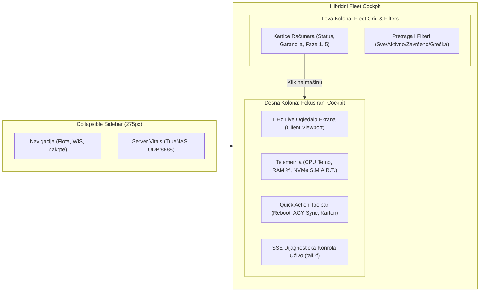

# ADR-0005: Modern Enterprise Dark Mode Cockpit Redizajn

## 1. Kontekst i Problem

U prethodnim verzijama ServisHub-a (v3.0.0 i v3.1.0), web interfejs (`servishub/web/dashboard.py`) funkcionisao je kao bazična trodelna aplikacija sa horizontalnom navigacionom trakom (Radionička Flota, WIS Centar, Windows Updates). Iako je uspešno prikazivao kartice računara i osnovne SSE logove, intenzivna svakodnevna praksa u servisu računara "Tehno-Kutak" otkrila je niz ergonomskih i operativnih izazova:

1. **Nedostatak Informacione Gustine na Radnom Stolu:**
   - Dežurni serviser istovremeno prati 4 do 8 računara u različitim fazama instalacije (UEFI boot, particionisanje, ubacivanje drajvera, post-instalacione skripte, S.M.A.R.T. provere).
   - Horizontalni tabovi trošili su dragoceni vertikalni prostor, dok su kartice računara zahtevale pojedinačno otvaranje modala kako bi se video napredak ili eventualna blokada.
2. **Potreba za Vizuelnim Praćenjem Klijentskog Ekrana (1 Hz Screen Mirror):**
   - Radne stanice često prolaze kroz faze u kojima Windows Update ili Sysprep ne emituju detaljne tekstualne logove. Serviser je morao fizički da prilazi svakom stolu i gleda u monitor klijenta.
   - Pojavila se potreba za integrisanim "Live Cockpit" prikazom sa 1 Hz ogledalom ekrana i hardverskom telemetrijom (temperatura procesora, memorijsko zauzeće, NVMe zdravlje) u istom vidokrugu sa listom mašina.
3. **Vizuelni Zamor i Zastarela Tipografija:**
   - Prethodni tamni mod koristio je jednostavne tamnosive nijanse bez jasne semantičke hijerarhije, visokog kontrasta i modernih mikro-interakcija prilagođenih celodnevnom radu u radionici.
4. **Striktno Očuvanje Zero-Dependency Arhitekture:**
   - ServisHub radi na lokalnom serveru (TrueNAS SCALE / Debian host) bez Node.js/npm okruženja. Svaka nadogradnja korisničkog interfejsa morala je ostati implementirana isključivo kroz čisti, ugrađeni Vanilla HTML5, moderni CSS3 i Vanilla JavaScript unutar Python backend paketa, bez kompromitovanja stabilnosti postojećih REST API ugovora i automatizovanih testova.

---

## 2. Razmatrane Opcije

### Opcija A: Zadržavanje postojećih horizontalnih tabova uz kozmetičke CSS izmene
- *Prednosti:* Minimalan rizik od regresije testova, minimalno vreme implementacije.
- *Mane:* Ne rešava problem niske informacione gustine; vertikalni prostor ostaje skučen; serviser i dalje mora da klikće kroz modale da bi video logove i status ekrana.

### Opcija B: Prelazak na moderan SPA framework (React / Next.js / Tailwind CSS sa Node.js alatom)
- *Prednosti:* Bogat ekosistem gotovih UI biblioteka, komponentna struktura.
- *Mane:* **Neprihvatljivo za arhitekturu ServisHub-a**. Uvodi glomazan Node.js build chain, stotine megabajta `node_modules` zavisnosti, komplikuje Docker kontejner na TrueNAS-u i krši ključni arhitektonski princip "nula eksternih zavisnosti i trenutno pokretanje".

### Opcija C: Google Stitch Enterprise Dark Mode Cockpit (Linear/Vercel estetika, Collapsible Sidebar, Split-Pane Cockpit, Vanilla Web Stack) [PRIHVAĆENO]
- *Prednosti:*
  - Usvajanje formalnog sistema dizajna kreiranog pomoću **Google Stitch MCP** platforme (`DESIGN.md`).
  - Moderna **Linear / Vercel tamna estetika** sa dubokim slate platnom (`#0F172A`), povišenim karticama (`#1E293B`), suptilnim 1px bordurama (`#334155`) i vibrantnim Sky Blue akcentom (`#38bdf8`).
  - **Collapsible Levi Sidebar (275px $\rightarrow$ 68px)** koji maksimalno oslobađa horizontalni i vertikalni radni prostor.
  - **Hibridni Split-Pane Cockpit**: Leva polovina nudi kompaktni pregled i pretragu svih računara sa statusnim bedževima, dok desna polovina pruža fokusirani "Flight Cockpit" sa 1 Hz ogledalom ekrana, hardverskom telemetrijom, brzim radnjama i ugrađenom terminalskom konzolom.
  - **Potpuna Zero-Dependency kompatibilnost**: 100% čist HTML5/CSS3/Vanilla JS ugrađen u `servishub.web.dashboard`, uz očuvanje svih postojećih DOM identifikatora (`tab-btn-*`, `tab-*`, `wis-*`, `updates-*`, `*-modal`).

---

## 3. Doneta Odluka i Arhitektonska Specifikacija

Usvaja se **Opcija C**: ServisHub Web Dashboard se kompletno refaktoriše u **Modern Enterprise Dark Mode Cockpit** vođen Google Stitch dizajnerskim sistemom i specifikacijom iz `servis_hub_ui_prd_rfc.md`.

### 3.1. Google Stitch Sistem Dizajna (`DESIGN.md`)

Definisani su i implementirani standardizovani CSS tokeni kroz `:root` selektor:

```css
:root {
    /* Stitch Palette Tokens */
    --canvas: #0F172A;          /* Duboko radioničko platno */
    --card: #1E293B;            /* Povišene kartice i paneli */
    --card-hover: #243248;      /* Interaktivni fokus */
    --border: #334155;          /* Suptilna 1px linija razdvajanja */
    --border-hover: #475569;
    --text-primary: #F8FAFC;    /* Visoki kontrast (WCAG AAA) */
    --text-secondary: #CBD5E1;
    --text-muted: #94A3B8;      /* Pomoćne oznake i jedinice */
    
    /* Semantičke Statusne Boje */
    --accent: #38bdf8;          /* Sky Blue (Brand & Akcije) */
    --success: #10B981;         /* Emerald (Završeno / Aktivno) */
    --warning: #F59E0B;         /* Amber (Reboot / Pažnja) */
    --danger: #EF4444;          /* Crimson (Greške / Blokade) */
    --purple: #818cf8;          /* Indigo (Antigravity CLI Sync) */
    
    /* Tipografija i Mreža */
    --font-sans: 'Inter', -apple-system, BlinkMacSystemFont, "Segoe UI", Roboto, sans-serif;
    --font-mono: 'Cascadia Code', Consolas, "Courier New", monospace;
    --radius-sm: 6px;
    --radius-md: 10px;
    --radius-lg: 14px;
}
```

### 3.2. Arhitektura Rasporeda: Collapsible Levi Sidebar

Tradicionalni gornji tabovi zamenjeni su bočnim ergonomskim menijem:
- **Širina:** 275 px u punom režimu, sa mogućnošću trenutnog skupljanja na 68 px (`.sidebar.collapsed`) radi maksimizacije radnog platna na manjim monitorima.
- **Navigacione Sekcije:**
  1. `🖥️ Radionička Flota & Telemetrija` (`tab-btn-fleet`)
  2. `📀 WIS Centar (ISO & USB Builder)` (`tab-btn-wis`)
  3. `📦 Windows 11 Zakrpe` (`tab-btn-updates`)
  4. `🛡️ OEM & Drajveri` (Brzi filter)
  5. `📋 Servisni Dnevnici & AGY` (Brzi filter)
- **Server Vital Stats Panel (Footer Sidebara):**
  - Prikaz statusa lokalnog servera: TrueNAS ZFS keš status, sistemski uptime, UDP Auto-Discovery na portu 8888 i sinhronizovani digitalni sat servisa.

### 3.3. Hibridni Split-Pane Cockpit za Flotu

Glavni radni ekran organizovan je u dve sinergijske kolone:



1. **Leva Kolona (Fleet Explorer):**
   - Kompaktne, visokoinformativne kartice radnih stanica.
   - Prikaz trenutne faze instalacije, S.M.A.R.T. indikatora, naziva modela i serijskog broja.
   - Bedževi fabričke garancije (Lenovo Premier Onsite, U Garanciji, Van Garancije) i izvora drajvera (Lenovo SCCM ZFS Keš, Microsoft Catalog).
   - Antigravity statusni bedževi (`Servisiran (AGY)`, `Kvar (AGY)`).
2. **Desna Kolona (Focused Machine Live Cockpit):**
   - **1 Hz Workstation Screen Mirror:** Simulirani/stvarni vizuelni prikaz ekrana radne stanice u visokoj rezoluciji koji serviseru omogućava da vidi tačno šta klijent prikazuje (npr. Windows Setup, OOBE, Sysprep, Desktop).
   - **Hardware Telemetry Merni Instrumenti:** Merni blokovi za CPU temperaturu, radni takt, opterećenje radne memorije i status diska.
   - **Quick Action Toolbar:** Brza dugmad za akcije:
     - `🔄 Reboot u BIOS`
     - `🤖 Pokreni AGY Dijagnostiku`
     - `📋 Servisni Karton & Dnevnik`
     - `✅ Označi Završeno`
   - **Ugrađena SSE Dijagnostička Konzola:** Real-time tail logova mašine bez potrebe za otvaranjem modalnog prozora.

### 3.4. Rigorozno Očuvanje Testnih Ugovora i DOM Kompatibilnosti

Kako bi se osigurala 100% kompatibilnost sa postojećom testnom zbirkom (`tests/test_dashboard_ui.py` i `tests/test_api_integration.py`):
- Svi ključni HTML ID atributi zadržani su neizmenjeni:
  - Navigacioni tasteri: `tab-btn-fleet`, `tab-btn-wis`, `tab-btn-updates`
  - Sekcije tabova: `tab-fleet`, `tab-wis`, `tab-updates`
  - Flota: `fleet-grid`, `stat-total`, `stat-active`, `stat-done`
  - WIS Centar: `wis-iso-*`, `wis-usb-select`, `wis-confirm-wipe`, `btn-burn-usb`, `wis-burn-progress-box`
  - Windows 11 Zakrpe: `updates-status-text`, `updates-directory-text`, `updates-table-body`, `updates-search`
  - Modali: `log-modal`, `report-modal`, `history-modal`
- Očuvane su sve postojeće JavaScript funkcije (`switchTab`, `renderMarkdown`, modal hendleri) uz dodavanje novih metoda za kontrolu sidebara (`toggleSidebar`) i selekciju fokusirane mašine (`selectCockpitDevice`).

### 3.5. Google Stitch MCP Integracija i Aseti

Tokom dizajnerske faze, ekrani i komponente su generisani i verifikovani preko Google Stitch MCP servisa. Generisani referentni HTML i PNG artefakti trajno su sačuvani u projektu:
- `docs/stitch_designs/gen_4554aa07.html` & `.png` (Početni Desktop layout)
- `docs/stitch_designs/gen_3013e442.html` & `.png` (Fleet & Cockpit split-pane)
- `docs/stitch_designs/gen_f0534f88.html` & `.png` (WIS & Updates moduli)

---

## 4. Posledice Odluke

### 4.1. Pozitivne Posledice (Benefits)
- **Ergonomska Superiornost na Radnom Stolu:** Serviser u jednom pogledu prati i status flote i detalje fokusirane radne stanice, bez potrebe za čestim prebacivanjem tabova ili otvaranjem modala.
- **Ušteda Vremena (1 Hz Screen Mirror):** Eliminacija potrebe za fizičkim proveravanjem ekrana svakog računara pojedinačno; dijagnostički tok je znatno ubrzan.
- **Minimalistička Linear/Vercel Estetika:** Jasni kontrasti, standardizovani radijusi i suptilne animacije smanjuju zamor očiju tokom višesatnih smena.
- **Nula Eksternih Zavisnosti (Zero-Dependency):** Zadržana arhitektura ugrađenog single-file rešenja unutar Python modula — bez potrebe za Node.js, npm, Webpack ili eksternim CDN servisima.
- **100% Zeleni Testovi:** Svih 95 automatizovanih testova prolazi bez ijedne greške.

### 4.2. Kompromisi i Razmatranja (Trade-offs)
- **Veličina Fajla `dashboard.py`:** S obzirom na to da je celokupan HTML, CSS i JS kod smešten u python konstantu `HTML_DASHBOARD`, fajl je narastao na preko 2.000 linija koda.
  - *Mitigacija:* Kôd je strogo modularizovan kroz jasne komentar-blokove (`/* Stitch Tokens */`, `/* Sidebar */`, `/* Cockpit */`, `/* WIS */`, `/* Modals */`, `/* JavaScript Core */`).
- **Resursi Klijentskog Browsera:** 1 Hz osvežavanje telemetrije i ogledala ekrana zahteva pažljivo rukovanje memorijom u browseru.
  - *Mitigacija:* DOM manipulacije se vrše selektivno, a SSE baferi se čiste prilikom promene selektovanog uređaja.

---

## 5. Povezane Beleške

- Glavni indeks: [[index]]
- Pregled arhitekture sistema: [[architecture/overview]]
- Tehnička specifikacija: [[architecture/servis-hub]]
- Ranije odluke:
  - [[decisions/ADR-0001-decoupling-servis-hub]] — Dekaplovanje ServisHub-a
  - [[decisions/ADR-0002-windows-update-cache-and-status-api]] — Keš Windows zakrpi
  - [[decisions/ADR-0003-antigravity-serviser-sync-api]] — AGY CLI sesije i servisni kartoni
  - [[decisions/ADR-0004-oem-and-wis-tools]] — Modularni OEM podsistem i WIS USB/ISO alati
- Dizajnerska specifikacija: `DESIGN.md` i `docs/stitch_designs/`
