# 🏛️ WIS — Sveobuhvatni Tehničko-Opisni Dokument i Specifikacija Arhitekture Sistema
### Windows Installation Assistant (WIS)
**Verzija Paketa:** `v3.0.0` (`release_status: development`, `windows_validation: pending`; razvojno izdanje `2026-11-14`)  
**Komponentne Verzije (`version.json`):** `ISO 3.0.0` | `Launcher 3.0.0` (`min: 2.2.17`) | `UI 3.0.0` | `ServiceHub 3.3.0` | `AutopilotAuditor 3.0.0`  
**Ciljna Platforma:** Windows 11 Home / Pro x64 (24H2 / Build `10.0.26200.8037`), Windows PowerShell 5.1, .NET Framework 4.0 / 4.8  
**Datum Dokumenta:** 11. novembar 2026.  
**Organizacija:** WIS Service (`IG-Systems`)  

---

## 📑 Sadržaj (Table of Contents)

1. [Uvod, Misija i Namena Sistema](#1-uvod-misija-i-namena-sistema)
   - 1.1. Operativni izazovi u servisu računara
   - 1.2. Koncept „Jedan klik" i Zero-Touch autonomija
   - 1.3. Ključne inženjerske metrike i ubrzanja
   - 1.4. Kvantitativni presek izvornog koda i binarnih artefakata
2. [Organizacija Monorepo-a i Kanonsko Verzionisanje (`v3.0.0`)](#2-organizacija-monorepo-a-i-kanonsko-verzionisanje-v300)
   - 2.1. Razvojne celine (`ISO/`, `Launcher/`, `UI/`, `ServiceHub/`, `Tools/AutopilotAuditor/`) i `.workspace/`
   - 2.2. Kanonsko verzionisanje komponenti (`version.json` i `Sync-Versions.py`)
   - 2.3. Očuvanje klijentskog runtime rasporeda (`C:\setup\`)
3. [End-to-End Životni Ciklus Instalacije](#3-end-to-end-životni-ciklus-instalacije)
   - 3.1. Globalni Mermaid dijagram toka
   - 3.2. Kontrolne tačke i sigurnosne kapije (Gates)
4. [WinPE Pre-Boot Podsistem, Skladišna i Mrežna Akceleracija (`ISO/`)](#4-winpe-pre-boot-podsistem-skladišna-i-mrežna-akceleracija-iso)
   - 4.1. Univerzalna Dual-Index `boot.wim` sinhronizacija i LAN-only `/Drivers/Net` (`~582 MiB`)
   - 4.2. Intel RST VMD strategija (Gen 10–14 i Core Ultra) i `000_wis_net1ix64.inf_guard` (`DEV_15FB`)
   - 4.3. Trajno otklanjanje Setup grešaka `0x80070103` i `0x800700FF` (`ver >nul`)
   - 4.4. WinPE Turbo Akceleracija (All-Core Turbo CPU profil i 512 MB FBWF RAM keš)
   - 4.5. Idempotentni Pre-Boot Tag Bypass (`X:\WIS_PreBoot_Done.tag`)
   - 4.6. WinPE SMB 3.1.1 Akcelerator (`WIS-AcceleratePE.cmd` i `WIS-ConnectNAS.cmd`) sa zaštitom iVentoy diska
   - 4.7. Zlatni Ultra-Lean Solid LZMS ISO (`~6.07 GB`, `sources/install.esd`, UDF + UEFI/BIOS)
5. [Deklarativna Automatizacija Windows Setup-a i Post-OOBE Bootstrap](#5-deklarativna-automatizacija-windows-setup-a-i-post-oobe-bootstrap)
   - 5.1. `autounattend.xml` prolazi (`windowsPE`, `specialize`, `oobeSystem`)
   - 5.2. Čisto Thin-Client `$OEM$` integraciono stablo i `ei.cfg`
   - 5.3. `SetupComplete.cmd`, `SetupComplete.ps1` i `PreOOBE-Network.ps1` (SYSTEM kontekst, rani Wi-Fi uvoz i Pre-OOBE Autopilot keš)
   - 5.4. `FirstLogon.cmd` i `FirstLogon.ps1` (NTFS SID permisije, QuickEdit blokada, 12s Wi-Fi Fast-Exit i 1 Hz Screen Mirror radnik)
6. [Thin-Client Pokretački Podsistem (`Launcher/` — `WIS.Launcher.exe` v3.0.0)](#6-thin-client-pokretački-podsistem-launcher--wislauncherexe-v300)
   - 6.1. Tehnološki profil (C# 5.0 / .NET Framework 4.0, nulta spoljna zavisnost)
   - 6.2. Arhitektura C# klasa (`Program.cs`, `SplashForm.cs`, `WifiHelper.cs`, `HubDiscovery.cs`, `PayloadManager.cs`)
   - 6.3. Reaktivni mrežni osluškivač, `\\host\servis` SMB prioritet i procesna provera UI-ja
   - 6.4. Kriptografska RSA-2048 PKCS#1 v1.5 verifikacija, Zip-Slip zaštita i transakcioni rollback (`.update_tx.json`)
   - 6.5. Eliminacija Windows Shell „Security Warning" dijaloga (`:Zone.Identifier` unblock)
7. [Klijentski Grafički Servisni Panel (`UI/` — `WIS.UI.exe` v3.0.0, `WIS.HwTest` & `LabelPrintService`)](#7-klijentski-grafički-servisni-panel-ui--wisuiexe-v300-wishwtest--labelprintservice)
   - 7.1. WPF MVVM arhitektura, Task Runner, `StepGuard` (`Expander`) i `EnsureRunOnceEntry` (HKLM-only)
   - 7.2. Pregled svih 8 funkcionalnih kartica i kartice pozadinskog WU radnika (`wu-bg-status.json`)
   - 7.3. Višekanalni 5-minutni rolling Canvas grafikon (300s @ 1 Hz), Core Clocks i obrnuti dnevnik (`Insert(0)`)
   - 7.4. `HardwareIdentityService`, `DeviceChangeMonitor` i hibridni senzorski motor (`ThermalSensorEngine.cs`)
   - 7.5. Kumulativni tajmer kroz restarte i eliminacija mock podataka
   - 7.6. Trojezični interfejs u realnom vremenu (SRB `435` / 中文 `435` / EN `73`) i `App.config` fallback
   - 7.7. Dvosmerni JSON IPC cevovod (`Send-IpcStep`), kooperativna pauza i odlaganje restarta (+10 min)
8. [Forenzički Podsistem za Microsoft Autopilot / Intune Detekciju (`Tools/AutopilotAuditor/` & `Provera_autopilota.ps1`)](#8-forenzički-podsistem-za-microsoft-autopilot--intune-detekciju-toolsautopilotauditor--provera_autopilotaps1)
   - 8.1. Dvostepena integracija u `WIS.UI.exe` (`FindAutopilotTool`)
   - 8.2. Samostalni C# izvršni alat `WIS-AutopilotAuditor.exe` v2.0 (`.NET 4.8`, GUI + CLI + JSON + HTML/CSV)
   - 8.3. PowerShell skripta `Provera_autopilota.ps1` (799 linija) i TrueNAS SMB fallback
   - 8.4. 5-stupanjska deterministička matrica stanja (`LOCKED_TENANT`, `HIDDEN_LOCK`, `RELEASED_LOCAL_TRACES`, `CONFIRMED_CLEAN`, `UNVERIFIED_CLEAN`)
   - 8.5. Inženjerska verifikacija integriteta i arhitektonska ograničenja Microsoft ZTD protokola van OOBE-a (`WIS-TASK-165`)
9. [Šestofazni Orkestracioni Pajplajn (`UI/Skripte/Phases/`)](#9-šestofazni-orkestracioni-pajplajn-uiskriptephases)
   - 9.1. Pregled faza, `WIS.StepGuard.psm1` (21 korak) i zaštitnih tajmauta (`GetPhaseTimeoutMinutes`)
   - 9.2. Faza 1 (`Phase1-Network.ps1` — 15 min): Mreža, Fast-Pass, S.M.A.R.T. trijaža i Autopilot/MDM detekcija
   - 9.3. Faza 2 (`Phase2-Drivers.ps1` — 60 min): `StepGuard` koraci, NAS Pre-Patch, `.tar` drajveri, WU COM API i pozadinski WU radnik
   - 9.4. Pre-Reboot Gate: Autoritativni `interim_reboot_required` i kontrolisani međurestart (`HandleInterimReboot`)
   - 9.5. Faza 3 (`Phase3-Optimization.ps1` — 20 min): `StepGuard` optimizacija, debloat, VC++ AIO, DPI skaliranje i OEM brendiranje
   - 9.6. Faza 4 (`Phase4-Apps.ps1` — 60 min): Rani uvoz `WIS.Core.psm1`, lokalni Chrome keš, Office ODT lokalni `SourcePath` bez BOM-a, Reality Check i `[↻ Ponovi Fazu 4]`
   - 9.7. Faza 5 (`ExecutePhase5IntegratedHwTest` — 45 min, ugrađeni `WIS.HwTest` & `Phase5-Stress.ps1` fallback)
   - 9.8. Faza 6 (`Phase6-Finalize.ps1` — 45 min): Asinhroni WU Pass 2, DMTF servisni karton, Anti-Leak brisanje tajni i samouništenje `C:\setup`
10. [Modularna PowerShell 5.1 Infrastruktura (`UI/Skripte/Modules/`)](#10-modularna-powershell-51-infrastruktura-uiskriptemodules)
    - 10.1. Pravila kompatibilnosti (PowerShell 5.1, UTF-8 BOM, eliminacija CP1252 `0x93`/`0x94`, bez 4-bajtnih emodžija)
    - 10.2. Specifikacija 13 PowerShell modula i radnika (`WIS.*.psm1` i `WIS.ScreenCapture.ps1`)
11. [Matrica Softverskog Paketa i Mehanizmi Tihe Instalacije](#11-matrica-softverskog-paketa-i-mehanizmi-tihe-instalacije)
    - 11.1. Izolacija Windows Installer servisa (`Global\_MSIExecute` mutex)
    - 11.2. Specifikacija 8 aplikacija i alata (Chrome MSI sa lokalnim kešom, Acrobat Pro 2024, Office 2024 LTSC sa lokalnim NVMe `SourcePath`-om, VC++ AIO, .NET, WinRAR, BatteryBar Solo, OEM Licenca)
12. [Centralizovani Nadzorni i Distribucijski Server (`ServiceHub/` v3.3.0)](#12-centralizovani-nadzorni-i-distribucijski-server-servicehub-v330)
    - 12.1. Modularna Python arhitektura (`servishub` paket, 32 modula) i Docker kontejnerizacija na TrueNAS-u (port 8080 i UDP 8888)
    - 12.2. Imutabilni potpisani release sistem (`releases/<release_id>/`, `current.json`, `payload_meta.json`)
    - 12.3. 1 Hz Live Screen Mirror u RAM-u (5s TTL), SSE telemetrija i daljinske komande (`reboot_uefi`, `reboot_pxe`)
    - 12.4. Trozubac OEM Podsistema (Lenovo, Dell, HP), ACPI/Audio HWID normalizacija i Microsoft Update Catalog keširanje
    - 12.5. WIS Centar: UEFI USB Builder sa Safety Guardrails zaštitom ZFS i sistemskih diskova
    - 12.6. Sveobuhvatna tabela REST API endpointa
13. [Radionička Mrežna i TrueNAS Infrastruktura](#13-radionička-mrežna-i-truenas-infrastruktura)
    - 13.1. Mrežna topologija (`192.168.170.0/24`) i servisni portovi
    - 13.2. Organizacija TrueNAS SMB deljenja (`WIS`, `Programi`, `ServiceHub`, `Servis`, `iVentoy`)
    - 13.3. iVentoy PXE server (`:26000`), iVentoy watchdog (`entrypoint.sh`) i TrueNAS systemd loop-mount (`mnt-TK_NAS-WIS-shared-win11.mount`)
14. [Alati za Build, Izdanja, Održavanje Medijuma i QA Verifikaciju](#14-alati-za-build-izdanja-održavanje-medijuma-i-qa-verifikaciju)
    - 14.1. Kanonski Build, Release i Media Pajplajn (`Build-WIS.ps1`, `UI/Build-UI.py`, `Release-WIS.py`, `Prepare-WISMedia.py`)
    - 14.2. `USB Tool` Web GUI (`127.0.0.1:8092`) sa CSRF, DNS Rebinding i sistemskom disk zaštitom
    - 14.3. WIM/ESD i ISO alati (`Patch-BootWim.py`, `Export-SlimWim.py`, `Build-Iso.py`)
    - 14.4. Verifikacija koda: Linux provere vs Windows/PXE laboratorija
15. [Bezbednosna Arhitektura i Zaštita Servisnih Tajni (Security Hardening)](#15-bezbednosna-arhitektura-i-zaštita-servisnih-tajni-security-hardening)
16. [Najvažnije Inženjerske Zamke i Rešenja (SRE Gotchas)](#16-najvažnije-inženjerske-zamke-i-rešenja-sre-gotchas)
17. [Standardne Operativne Procedure (SOP) i Zvučna Signalizacija](#17-standardne-operativne-procedure-sop-i-zvučna-signalizacija)

---

## 1. Uvod, Misija i Namena Sistema

### 1.1. Operativni izazovi u servisu računara
U svakodnevnom radu servisa računara **WIS Service**, instalacija, konfiguracija, hardverska trijaža i testiranje operativnog sistema Windows 11 na raznovrsnim klijentskim prenosnim i desktop računarima suočava se sa nizom složenih tehničkih prepreka:
- **Hardverska ograničenja Windows 11:** Fabrički instaler odbija rad na računarima bez TPM 2.0 modula, Secure Boot-a ili na starijim procesorima, dok OOBE čarobnjak forsira povezivanje na internet i kreiranje Microsoft Online naloga.
- **Intel VMD / RST „nevidljivi" NVMe diskovi:** Na Intel platformama od 10. do 14. generacije i Core Ultra seriji, NVMe diskovi su povezani preko Intel Volume Management Device (VMD) kontrolera i nisu vidljivi u Windows Setup-u bez odgovarajućeg `iaStorVD.inf` drajvera (pri čemu mešanje verzija v18, v19.5 i v20 izaziva SetupAPI kolizije i grešku `0x80070103`).
- **Mrežna zagušenja i SMB nekompatibilnosti:** Preuzimanje gigabajta drajvera, Windows Update zakrpi i aplikacija sa interneta za svaki računar opterećuje link servisa, dok Windows 11 24H2 podrazumevano blokira SMB povezivanje bez potpisa paketa i drastično usporava prenos hiljada malih fajlova drajvera („Small-File Latency Storm").
- **Konflikti Windows Installer servisa:** Paralelno pokretanje instalacija drajvera i MSI aplikacija dovodi do kolizije nad sistemskim mutexom `Global\_MSIExecute` (greška `1618`) ili pada instalacije usled zaključanog CBS steka i NTFS privilegija (greška `1603`).
- **Skriveni hardverski defekti i Autopilot zaključavanje:** Računari sa degradiranim SSD-om, oslabljenom baterijom, zapušenim rashladnim sistemom ili skrivenim korporativnim Microsoft Autopilot / Intune MDM profilom zahtevaju temeljnu dijagnostiku i termalni stres test pre isporuke klijentu.

### 1.2. Koncept „Jedan klik" i Zero-Touch autonomija
**WIS (*Windows Installation Assistant*)** je autonomni inženjerski ekosistem koji celokupan proces — od butovanja praznog računara preko PXE mreže ili USB-a do potpuno opremljenog, ažuriranog, aktiviranog, termalno testiranog, forenzički proverenog i očišćenog sistema — svodi na **samo jedan manuelni korak operatera: izbor ciljne particije u Windows Setup-u**.

Sve naredne etape odvijaju se bez ljudske intervencije (**100% Zero-Touch**), uz centralizovano praćenje uživo (uključujući 1 Hz sliku ekrana i daljinske komande) na serviserskom **ServiceHub** veb panelu.

### 1.3. Ključne inženjerske metrike i ubrzanja

| Parametar / Faza rada | Klasična ručna instalacija | WIS automatizovani sistem | Ostvareni napredak |
|---|---|---|---|
| **Ukupno vreme pripreme računara** | 75 – 120 min | **11 – 18 min** (zavisno od hardvera) | **~85% uštede vremena** |
| **Angažovanje servisera** | 15 – 25 ručnih koraka | **1 klik** (odabir diska u Setup-u) | **Potpuna Zero-Touch autonomija** |
| **Raspakivanje OS slike preko PXE mreže** | ~14 min 22 s (iVentoy CIFS / SMB 1.0) | **~3 min 11 s** (WinPE SMB 3.1.1 @ 105–122 MB/s) | **4.5× brže** |
| **Veličina butabilnog ISO medijuma** | 14.20 GB (Full ISO) | **~6.07 GB** (`6,522,753,024 B` Ultra-Lean Solid LZMS `install.esd`, `boot.wim` `~582 MiB`) | **>57% manji mrežni otisak** |
| **Instalacija drajvera poznatog modela** | 15 – 30 min sa interneta | **~3 sekunde** (Single-Stream `.tar` sa TrueNAS-a) | **100% lokalno iz ZFS ARC keša** |
| **Instalacija Google Chrome-a** | 2 – 4 min (online web stub) | **~8 sekundi** (Offline Enterprise 64-bit MSI) | **>90% brže** |
| **Provera hlađenja i stabilnosti** | Ručni alati ili preskočeno | **Automatski 30s Multi-Core 100% CPU stres test** | **Standardizovana kontrola kvaliteta** |

### 1.4. Kvantitativni presek izvornog koda i binarnih artefakata

> **Napomena:** U Git repozitorijumu prate se izvorni kodovi (`UI/`, `Launcher/`, `ServiceHub/`, `Tools/`, tekstualne skripte u `ISO/`), dok se izgrađeni PE32 binarci, `boot.wim`, `install.esd` i `.iso` medijum distribuiraju kao lokalni/produkcioni build artefakti izvan Git stabla (`.workspace/artifacts/` i TrueNAS deljenja).

| Podsistem / Artefakt | Obim Izvornog Koda | Glavni Binarni / Izlazni Artefakt | Veličina i SHA-256 otisak (lokalni/produkcioni build) |
|---|---|---|---|
| **`UI/` (WPF Panel + Ugrađeni `HwTest`)** | `14` korenskih fajlova (`21,124` lin. C#/XAML, `1,052,658 B`) + `21` fajl u `UI/HwTest/` (`21,284` lin. C#, `950,553 B`) | `UI/WIS.UI.exe` (`v3.0.0`) + standalone `WIS.HwTest.exe` | `2,977,280 B` (SHA-256: `253c7544fc7e3642894ac4ff97b18e1b86f2aebd40a5bae1ce8f7182df240824`) \| `WIS.HwTest.exe`: `1,736,704 B` (`74156a5b...`) |
| **`Launcher/` (Thin-Client Pokretač)** | `6` prod. `.cs` fajlova (`4,739` lin., `198,843 B`) + `LauncherBehaviorTests.cs` (`332` lin., `27,129 B`) | `Launcher/WIS.Launcher.exe` (`v3.0.0`) | `468,480 B` \| SHA-256: `33ef900f4e30244bc551e89315c98f19de710b2f929df7e5198a7d6896fc7380` |
| **`Tools/AutopilotAuditor/`** | `8` fajlova (`2,333` linija C#, `108,474 B`) | `WIS-AutopilotAuditor.exe` (`v3.0.0`) | `447,488 B` \| SHA-256: `c50fbe03ed89be8adbc6c718caf8cf9969b34487e460a6a15addfdb7bfafee21` |
| **`UI/Skripte/Modules/` (PS 5.1 Moduli)** | `13` fajlova (`21,315` linija PS, `1,041,317 B`) | `12` `.psm1` modula (sa `WIS.StepGuard.psm1`) + `WIS.ScreenCapture.ps1` | Ugrađeno u potpisani `wis-payload.zip` (`68,475,013 B`, `78` fajlova, SHA-256: `ea2ca928...`) |
| **`UI/Skripte/Phases/` (PS 5.1 Faze)** | `6` fajlova (`1,768` linija PS, `92,163 B`) | `Phase1-Network.ps1` .. `Phase6-Finalize.ps1` | Ugrađeno u potpisani `wis-payload.zip` i `$OEM$` |
| **`UI/Skripte/Provera_autopilota.ps1`** | `1` fajl (`973` linija PS bez BOM-a, `56,662 B`) | `Provera_autopilota.ps1` | `56,662 B` \| SHA-256: `793bbee1e3fccad4bb9c05b159eca59b9b4693d0bba752808eaf84d473f42d5f` |
| **`ServiceHub/` (Nadzorni Server)** | `35` modula (`15,112` linija Python, `643,465 B`) + `32` test fajla (`7,656` linija, `279` test metoda) | `ServiceHub/hub_server.py` (`v3.3.0`) | Docker servis na `192.168.170.254:8080` (UDP `:8888`) |
| **`ISO/` (WinPE, Unattend, OEM & Build)** | `PreOOBE-Network.ps1` (`144` lin.), `SetupComplete.ps1` (`669` lin.), WIM/ISO i build/release skripte | `WIS-Win11-Pro-10.0.26200.8037-Lean.iso` (`v3.0.0` target) | UDF + UEFI/BIOS build pipeline (`Build-Iso.py` / `Prepare-WISMedia.py`) |

---

## 2. Organizacija Monorepo-a i Kanonsko Verzionisanje (`v3.0.0`)

### 2.1. Razvojne celine (`ISO/`, `Launcher/`, `UI/`, `ServiceHub/`, `Tools/AutopilotAuditor/`) i `.workspace/`
Kanonski monorepo nalazi se na putanji `/home/gru/Projects/WIS` i podeljen je u jasno razgraničene razvojne celine i skriveni radni direktorijum `.workspace/`:

```text
/home/gru/Projects/WIS/
├── ISO/                      # Instalacioni medijum, WinPE/OOBE bootstrap, USB Tool, build/release/media skripte i PxeZeroTouch test matrica
├── Launcher/                 # Thin-Client pokretač (C# 5.0 / .NET 4.0) i objedinjeni funkcionalni testovi (Tests/ - 31/31)
├── UI/                       # WPF grafički panel (C# / .NET 4.8 + v4.0 fallback), PowerShell moduli (13 fajlova) i faze (6 fajlova)
├── ServiceHub/               # Kanonski Python HTTP/SSE/UDP nadzorni i release server (servishub paket i 279 testova)
├── Tools/AutopilotAuditor/   # Samostalni C# .NET 4.8 forenzički alat za Autopilot detekciju (WIS-AutopilotAuditor.exe)
├── .workspace/               # Zajednička dokumentacija, Obsidian wiki, istorija izrade, Agent Bus, arhive i build artefakti
├── README.md                 # Krovni pregled projekta i operativnih ugovora
├── AGENTS.md                 # Pravila Multi-Agent sistema i razvojnog toka
└── version.json              # Jedini kanonski izvor verzija paketa i komponenti
```

### 2.2. Kanonsko verzionisanje komponenti (`version.json` i `Sync-Versions.py`)
Korenski fajl `version.json` predstavlja jedini autoritativni izvor verzija za ceo ekosistem (`release_status: development`, `windows_validation: pending`):

| Stavka / Komponenta | Kanonska verzija (`version.json`) | Tehnološki okvir i binarni artefakt |
|---|---|---|
| **WIS paket izdanja (`release_package`)** | **3.0.0** | Celokupno potpisano izdanje (`wis-payload.zip`, `min_launcher_version: 2.2.17`) |
| **ISO medijum (`components.iso`)** | **3.0.0** | Butabilni Windows 11 24H2+ medijum (`ISO/`, `embedded_launcher_version: 3.0.0`) |
| **Launcher (`components.launcher`)** | **3.0.0** | WinForms / C# 5.0 .NET Framework 4.0 (`WIS.Launcher.exe`) |
| **UI (`components.ui`)** | **3.0.0** | WPF / C# .NET Framework 4.8 (`WIS.UI.exe` + ugrađeni `WIS.HwTest`) |
| **ServiceHub (`components.servicehub`)** | **3.3.0** | Python 3 HTTP/SSE/UDP server (`ServiceHub/`) |
| **AutopilotAuditor (`Tools/AutopilotAuditor`)** | **3.0.0** | WPF + CLI C# .NET Framework 4.8 (`WIS-AutopilotAuditor.exe`) |

Alat `python3 ISO/Skripte/Sync-Versions.py` automatski propagira verzije iz korenskog `version.json` u `AssemblyInfo.cs` fajlove C# projekata, konstante Launcher-a, `ServiceHub/servishub/version.py` i komponentne JSON manifeste, dok `python3 ISO/Skripte/Sync-Versions.py --check` služi kao obavezni verifikacioni korak (Build Gate) za detekciju bilo kakvog odstupanja (drift-a).

### 2.3. Očuvanje klijentskog runtime rasporeda (`C:\setup\`)
> [!IMPORTANT]
> Podela repozitorijuma na razvojne celine (`ISO/`, `Launcher/`, `UI/`, `ServiceHub/`, `Tools/`) olakšava razvoj, kompilaciju i verzionisanje, dok izvršni raspored na klijentskom Windows računaru (`C:\setup\`, `C:\setup\Skripte\Modules\`, `C:\setup\Skripte\Phases\`, `C:\setup\WIS.Launcher.exe`, `C:\setup\Skripte\WIS.UI\WIS.UI.exe`, `C:\setup\WIS-AutopilotAuditor.exe`) ostaje **100% neizmenjen**.

---

## 3. End-to-End Životni Ciklus Instalacije

### 3.1. Globalni Mermaid dijagram toka

```mermaid
flowchart TD
    subgraph S1["1. WinPE Pre-Boot, Turbo Akceleracija & Setup (Zlatni Lean ISO 6.07 GB, boot.wim ~582 MiB)"]
        A["PXE iVentoy (:26000) ili Ventoy USB But"] --> A1["VTOYPE PNPHELP (000_wis_net1ix64.inf_guard) + VentoyAutoRun.bat: High Perf CPU, VMD/LAN drvload"]
        A1 --> A2["Upis markera: X:\WIS_PreBoot_Done.tag"]
        A2 --> A3["X:\Windows\System32\startnet.cmd: wpeinit & Provera Taga"]
        A3 -- "Tag postoji (iVentoy/Ventoy)" --> A4["Trenutni preskok duplog skeniranja (ušteda 20-30s)"]
        A3 -- "Nema taga (Standardni USB)" --> A5["Fallback: High Perf CPU, PCI VMD detekcija & LAN drvload + InitializeNetwork"]
        A4 --> B["autounattend.xml (windowsPE): 6 LabConfig + Order 7 load_vmd.cmd + Order 8 WIS-AcceleratePE.cmd (ver >nul)"]
        A5 --> B
        B --> ACC["WIS-AcceleratePE.cmd / WIS-ConnectNAS.cmd: Potvrda Z:\win11 pre demontiranja iVentoy Y:, SMB 3.1.1 mount"]
        ACC --> C["Učitavanje ei.cfg i Dual-Edition Solid LZMS install.esd (Home + Pro)"]
        C --> D["JEDINI KLIK OPERATERA: Izbor particije na SSD-u"]
        D --> E["Dekompresija slike preko SMB 3.1.1 (105-122 MB/s, ~3 min)"]
    end

    subgraph S2["2. Specialize, SetupComplete & OOBE Faza"]
        E --> F["Specialize: BypassNRO=1, LanmanWorkstation SMB 24H2 polise, privremeno utišavanje UAC-a"]
        F --> SC["SetupComplete.cmd -> SetupComplete.ps1 (SYSTEM): wlansvc start, XML escaping Wi-Fi profila, Pre-OOBE Autopilot keš, RunOnce"]
        SC --> G["OOBESystem: Kreiranje naloga 'Korisnik', AutoLogon i preskakanje čarobnjaka"]
        G --> FL["FirstLogon.cmd -> FirstLogon.ps1: SID NTFS permisije, QuickEdit=0, 12s Wi-Fi Fast-Exit, 1Hz ScreenCapture Job"]
    end

    subgraph S3["3. Thin-Client Launcher (v3.0.0) & 6-Fazni C# Master Runner (WIS.UI.exe v3.0.0)"]
        FL --> L1["WIS.Launcher.exe: Wi-Fi konekcija, UDP :8888 Discovery / SMB \\host\servis & \WIS manifest prioritet"]
        L1 --> L2["Preuzimanje wis-payload.zip (v3.0.0) + RSA-2048 verifikacija potpisa i SHA-256 heševa"]
        L2 --> L3["Transakciono raspakivanje u C:\setup, brisanje :Zone.Identifier, provera aktivnog UI procesa i --master"]
        L3 --> P1["Faza 1 (Mreža): Fast-Pass provera, S.M.A.R.T. trijaža diska, baterija i Autopilot detekcija"]
        P1 --> P2["Faza 2 (Drajveri): StepGuard (6 koraka), .tar modeli, WU COM API + Pozadinski WU radnik (wu-bg-status.json)"]
        P2 --> P3["Faza 3 (Optimizacija): StepGuard (6 koraka), Debloat, DPI skaliranje, OEM brending, pending reboot provera"]
        P3 --> RG{"Interim Reboot Gate: Posle Faze 3 pre Faze 4"}
        RG -- "Obavezan restart / pending reboot" --> RB["Kontrolisani međurestart: deploy-state.json + HKLM RunOnce -> WIS.Launcher --master"]
        RB --> P4["Faza 4 (Programi): StepGuard (9 koraka), Chrome keš, Acrobat, Office ODT BOM-free lokalni SSD SourcePath, Shortcuts, Reality Check"]
        RG -- "Već odrađen (.stage_reboot_done)" --> P4
        P4 --> P5["Faza 5 (45 min — Stres & HwTest): WU Barijera, 30s Multi-Core CPU RunspacePool, 7 auto + 9 interaktivnih HW testova, 98°C Abort"]
        P5 --> P6["Faza 6 (Završetak): Konsolidacija pozadinskog WU-a (45m timeout), DMTF karton, Anti-Leak brisanje tajni i C:\setup"]
    end

    P6 --> END["Računar spreman za predaju klijentu (60s odbrojavanje do gašenja)"]
```



### 3.2. Kontrolne tačke i sigurnosne kapije (Gates)
1. **Pre-Boot & iVentoy Guard Gate (WinPE):** Determinističko učitavanje VMD (`DEV_9A0B` vs v20) i LAN drajvera, abecedna zaštita `000_wis_net1ix64.inf_guard` za `Intel I219-LM` (`DEV_15FB`), kao i uspostavljanje SMB 3.1.1 kanala ka TrueNAS-u **tek nakon potvrde** da je `Z:\win11` dostupan (uz čuvanje iVentoy diska `Y:` kao sigurnosne rezerve).
2. **Partition Selection Gate:** Jedina tačka u kojoj operater vrši interakciju (odabir ciljnog SSD diska).
3. **Cryptographic Payload Gate (`WIS.Launcher.exe`):** Svaki preuzeti (HTTP ili SMB `\\host\servis` / `\WIS`) ili lokalni `wis-payload.zip` paket mora proći RSA-2048 PKCS#1 v1.5 verifikaciju digitalnog potpisa i SHA-256 kontrolu svih deklarisanih komponenti pre izvršavanja.
4. **Interim Reboot Gate & StepGuard (`WIS.StepGuard.psm1`):** Faze 2, 3 i 4 izvršavaju se kroz **21 idempotentni `StepGuard` korak** zabeležen u `C:\setup\step-journal.json`, čime je omogućen siguran nastavak bez ponavljanja već uspešnih koraka i ručno ponavljanje Faze 4 (`force-rerun-phase4.flag` preko dugmeta `[↻ Ponovi Fazu 4]`). Po završetku Faze 3, kontrolisani međurestart (`HandleInterimReboot()` uz HKLM-only `EnsureRunOnceEntry`) oslobađa `PendingFileRenameOperations`, Component-Based Servicing (CBS) i Windows Installer (`msiexec.exe`) brave pre instalacije MSI/ODT programa u Fazi 4.
5. **Thermal, Hardware & Stability Gate (Faza 5 — 45 min):** 30-sekundni višenitni test opterećenja procesora uz ugrađeni 9. tab za dijagnostiku hardvera (`WIS.HwTest`: 7 automatskih + 9 interaktivnih testova periferija, 12 OEM šablona tastatura, dual-mode LAN/USB test, bez ugrađenog `WinRing0`). Fizičko pregrevanje ($\ge 95^\circ\text{C}$ ili Emergency Abort na $98^\circ\text{C}$) blokira predaju računara (`handover_ready = false`, `exit 2`), dok nedostatak senzora na specifičnoj ploči (`UNKNOWN` / `SENSOR_UNAVAILABLE`) ne blokira instalaciju već postavlja žuto upozorenje za ručnu proveru (`manual_check_required = true`, `cooling_verified = false`). Za napredovanje bez lažnih blokada korišćena je i bazna Turbo referenca (`_baseMaxClockMHz`) i egzaktna filtracija BIOS sigurnosnih ključeva.
6. **Anti-Leak & Handover Gate (Faza 6):** Pre proglašenja statusa `DONE`, sistem garantovano briše `Wifi-Servis.ini`, uklanja WLAN profile sa lozinkama sa klijentskog sistema (`netsh wlan delete profile`), raskida SMB veze, vraća UAC na fabrički nivo i zakazuje samouništenje foldera `C:\setup`.

---

## 4. WinPE Pre-Boot Podsistem, Skladišna i Mrežna Akceleracija (`ISO/`)

### 4.1. Univerzalna Dual-Index `boot.wim` sinhronizacija, LAN-only fokus (`~582 MiB`) i iVentoy Guard (`000_wis_net1ix64.inf_guard`)
Standardni Windows 11 `sources/boot.wim` sadrži dva indeksa: **Index 1 (Microsoft Windows PE)** i **Index 2 (Microsoft Windows Setup)**. Alat `ISO/Skripte/Patch-BootWim.py` (**1,313** linija, uz pomoć `wimlib-imagex`) sinhronizuje oba indeksa identičnim skladištem Intel RST VMD i LAN mrežnih drajvera, kao i optimizovanim `startnet.cmd`, `VentoyAutoRun.bat`, `load_vmd.cmd`, `WIS-AcceleratePE.cmd`, `WIS-ConnectNAS.cmd` i `autounattend.xml` fajlovima, nakon čega vrši rekompresiju i **32 automatske provere** integriteta (`verify_boot_wim_contents()`):
- **WinPE LAN-only `/Drivers/Net` (`15` fajlova, `7.57 MiB`):** Funkcija `prepare_net_winpe_staging()` ubacuje u `boot.wim` isključivo žične LAN i USB LAN drajvere (`Intel_LAN`, `Realtek_LAN`, `Realtek_USB_LAN`), izostavljajući `137.49 MiB` Wi-Fi drajvera (`Intel_WiFi`, `MediaTek_WiFi`, `Realtek_WiFi`) koji su u PXE WinPE okruženju neupotrebljivi. Time je veličina `ISO/sources/boot.wim` smanjena sa `668,895,874 B` (`639 MiB`) na **`609,758,089 B` (`~582 MiB`)**, čime se direktno ubrzava TFTP/HTTP prenos po PXE klijentu. Potpuni Wi-Fi paketi ostaju sačuvani u `ISO/sources/$OEM$/$1/setup/Drivers/Net/` za instalirani Windows u Fazi 1.
- **iVentoy `PNPHELP` Guard (`000_wis_net1ix64.inf_guard`, `238,786 B`):** Disasembliranjem `vtoypxe64.exe` (`VTOYPE.EXE PNPHELP`) utvrđeno je da skener abecedno obilazi `X:\Windows\System32\DriverStore\FileRepository\*`, odseca ime foldera nakon `.inf` i za prvi match odmah pokreće `drvload` u `pnp_drv_load.bat`. Kako naš OEM paket `e1d.inf` abecedno prethodi Microsoftovom ugrađenom `net1ix64.inf` (`e1i68x64.sys`), na pločama sa **Intel Enterprise vPro I219-LM (`PCI\VEN_8086&DEV_15FB`)** `PNPHELP` je rušio već aktivnu PXE mrežnu vezu. Funkcija `prepare_driverstore_staging()` sada ekstraktuje inbox `net1ix64.inf` u prvi abecedni paket `000_wis_net1ix64.inf_guard\000_wis_net1ix64.inf` (bez `.sys`/`.cat`, uz proveru prisustva `DEV_15FB` i odsustva `DEV_15FC`/`DEV_0D4F`), čime se `DEV_15FB` zaustavlja na bezbednom inbox drajveru, dok `DEV_15FC` i `DEV_0D4F` (I219-V) nesmetano učitavaju `e1d.inf`.
- **Striktne zabrane unutar `boot.wim`:** `Patch-BootWim.py` automatski briše i verifikuje odsustvo `/Windows/System32/winpeshl.ini`, `/Windows/System32/ventoy` (jer `vtoypxe64.exe` pri njegovom prisustvu preskače `UnpackExtraData` i izaziva rani reset WinPE-a), `/$WinPEDriver$` i Wi-Fi podfoldera.

### 4.2. Intel RST VMD strategija (Gen 10–14 i Core Ultra) i selektivna PCI detekcija (`load_vmd.cmd`)
Kako različite generacije Intel procesora zahtevaju specifične verzije `iaStorVD.sys` drajvera, u direktorijumu `ISO/Za disk 10+ gen/` (i unutar `boot.wim` na `X:\Drivers\VMD\`) nalaze se tri pažljivo kurirane grane:
- **`01_RST_v20_Gen12-14_CoreUltra` (`v20.0.0.1038`):** Za Intel 12, 13. i 14. generaciju (Alder Lake, Raptor Lake) i Core Ultra (Meteor Lake / Arrow Lake, npr. `DEV_7D0B`, `DEV_A77F`, `DEV_467F`).
- **`02_RST_v19_Gen11-13` (`v19.5.2.1049`):** Namenski za Intel 11. generaciju (Tiger Lake) sa kontrolerom `PCI\VEN_8086&DEV_9A0B` (rešava nestajanje NVMe diska na Acer, HP i Asus Tiger Lake prenosnim računarima).
- **`03_RST_v18_Legacy_Optane` (`v18.6.1.1016`):** Za Intel 10. generaciju (Ice Lake / Comet Lake) i Intel Optane memorije.

Pre pokretanja `setup.exe`, skripte `startnet.cmd`, `VentoyAutoRun.bat` i `load_vmd.cmd` vrše PCI enumeraciju (`reg.exe query "HKLM\SYSTEM\CurrentControlSet\Enum\PCI" | find.exe /I "DEV_9A0B"`) bez korišćenja u WinPE-u nepostojećih alata (`findstr.exe`, `timeout.exe`) i bez višerednih `if (...)` blokova sa neeskejpovanim zagradama, i učitavaju tačno odgovarajući drajver preko `drvload.exe` + `pnputil.exe /scan-devices`, sprečavajući gaženje Tiger Lake v19.5 drajvera novijom v20 verzijom.

### 4.3. Trajno otklanjanje Setup grešaka `0x80070103` i `0x800700FF`
- **Eliminacija greške `0x80070103 - 0x40031` (SetupAPI kolizija drajvera):** Komponenta `Microsoft-Windows-PnpCustomizationsWinPE` i folder `/$WinPEDriver$` potpuno su uklonjeni iz `autounattend.xml` i `boot.wim` kako Windows Setup u SafeOS fazi ne bi istovremeno stage-ovao više verzija `iaStorVD.inf` drajvera.
- **Eliminacija greške `0x800700FF - 0x40030` (Pad pri parsiranju `windowsPE` prolaza):** U `<settings pass="windowsPE">` u `ISO/autounattend.xml` zadržano je 6 deklarativnih `LabConfig` registarskih komandi (`<Order>1</Order>`–`6`), dok su `<Order>7</Order>` (`load_vmd.cmd`) i `<Order>8</Order>` (`WIS-AcceleratePE.cmd`) obavezno zaštićeni sufiksom `& ver >nul` unutar `cmd.exe /c "..."`. Time je garantovan strogi izlazni kod `0` (`ver >nul`) u svakoj situaciji, eliminisana sintaksna zamka sa zagradama `)` u `echo` ispisima, a mrežna akceleracija se izvršava deterministički bez rušenja `SP_EXECUTION_OP_RUNSYNCHRONOUS` faze.

### 4.4. WinPE Turbo Akceleracija (All-Core Turbo CPU profil i 512 MB FBWF RAM keš)
Fabrički WinPE ograničava takt procesora na štedljivi režim (~1.4 GHz) i dodeljuje samo 32 MB RAM keša (FBWF). WIS primenjuje:
1. Aktivaciju Microsoft High Performance profila (`powercfg.exe /s 8c5e7fda-e8bf-4a96-9a85-a6e23a8c635c`), podižući sva jezgra na pun Turbo takt.
2. Proširenje `WinPECacheThreshold` (FBWF scratch space) na **512 MB**, eliminišući uska grla pri raspakivanju arhiva u RAM disku `X:\`.

### 4.5. Idempotentni Pre-Boot Tag Bypass (`X:\WIS_PreBoot_Done.tag`)
Da bi se izbeglo dvostruko učitavanje drajvera i dvostruko čekanje na mrežnu inicijalizaciju kada se sistem podiže preko Ventoy/iVentoy okruženja (gde se izvršavaju i `VentoyAutoRun.bat` i `startnet.cmd`), `VentoyAutoRun.bat` po završetku kreira marker `X:\WIS_PreBoot_Done.tag`. Kada `startnet.cmd` detektuje ovaj marker, preskače duplirane korake i štedi **20–30 sekundi** po instalaciji.

### 4.6. WinPE SMB 3.1.1 Akcelerator (`WIS-AcceleratePE.cmd` i `WIS-ConnectNAS.cmd`) i nepovratna zaštita medijuma
Pri mrežnom PXE butovanju preko iVentoy-a, podrazumevani HTTP/CIFS virtuelni disk `Y:\` na portu 10445 ostvaruje svega 10–12 MB/s. Skripte `WIS-AcceleratePE.cmd` (**208** linija) i `WIS-ConnectNAS.cmd` (**125** linija) u Pre-Boot fazi:
1. Otključavaju `AllowInsecureGuestAuth = 1` i `RequireSecuritySignature = 0` u `LanmanWorkstation\Parameters`.
2. Najpre proveravaju da li adapter već ima dodeljenu IPv4 adresu (npr. iz `VTOYPE.BAT` na PXE-u) i u tom slučaju preskaču ponovno učitavanje drajvera i DHCP petlju (`0 s` čekanja). U suprotnom učitavaju LAN drajvere (`drvload` + `pnputil /add-driver ... /install`), pozivaju `wpeutil.exe InitializeNetwork` i koriste `ping.exe -n 2 127.0.0.1` za stvarnu 1s DHCP petlju do 10 s (nikada nepostojeći `timeout.exe` niti `ping 192.168...` koji na neinicijalizovanom NIC-u trenutno vraća grešku).
3. Nakon brzog `3×1s` pinga ka `192.168.170.254` i upisa `truenas.servis` u `hosts`, mapiraju `Z:` na `\\truenas.servis\WIS`.
4. **Nepovratna zaštita aktivnog iVentoy diska:** Skripta `T:\iventoy.iso` virtuelni VHD (`diskpart detach vdisk`) i postojeće slovo `Y:` demontira **isključivo NAKON** što je autoritativno potvrđeno postojanje `Z:\win11\sources\install.esd` (ili `install.wim`), a zatim mapira `Y:` $\rightarrow$ `\\truenas.servis\WIS\win11`. Ukoliko TrueNAS SMB nije dostupan ili računar nema IPv4 adresu, iVentoy CD-ROM ostaje netaknut na `Y:`, sprečavajući grešku *„A media driver your computer needs is missing“*.
5. Preko SMB 3.1.1 na portu 445 (`105 – 122 MB/s`) istovremeno podržava do 20 paralelnih klijenata uz očuvanje `$OEM$` foldera, skraćujući kopiranje slike sa 14+ minuta na **~3 minuta**.

### 4.7. Zlatni Ultra-Lean Solid LZMS ISO (`6.07 GB`, `sources/install.esd`, UDF + UEFI/BIOS)
Korišćenjem alata `ISO/Skripte/Export-SlimWim.py` i `ISO/Skripte/Build-Iso.py`, instalaciona slika sadrži tačno dve edicije (**Index 1: Windows 11 Home** i **Index 2: Windows 11 Pro**) kompresovane u `sources/install.esd` uz Solid LZMS kompresiju (`lzms:100`). Butabilni UDF (`ECMA-167`) + El Torito UEFI (`0xEF`) + Legacy BIOS (`0x00`) Zlatni Lean ISO medijum (`WIS-Win11-Pro-10.0.26200.8037-Lean.iso`) čuva sve VMD i mrežne drajvere (Wi-Fi drajveri prebačeni u `$OEM$`) i ugrađuje ažurirane `v3.0.0` binarne alate `WIS.UI.exe`, `WIS.Launcher.exe`, `WIS-AutopilotAuditor.exe`, `Provera_autopilota.ps1` i `PreOOBE-Network.ps1`.

---

## 5. Deklarativna Automatizacija Windows Setup-a i Post-OOBE Bootstrap

### 5.1. `autounattend.xml` prolazi (`windowsPE`, `specialize`, `oobeSystem`)
Datoteka `ISO/autounattend.xml` (**180** linija, **`11,395 B`**) upravlja sa 3 ključna prolaza:
- **Prolaz `windowsPE`:** Sadrži 6 `LabConfig` registarskih unosa (`Order 1–6`: `BypassTPMCheck`, `BypassSecureBootCheck`, `BypassRAMCheck`, `BypassStorageCheck`, `BypassCPUCheck`, `BypassDiskCheck` = `1`), `<Order>7</Order>` (`load_vmd.cmd & ver >nul`), `<Order>8</Order>` (`WIS-AcceleratePE.cmd & ver >nul`), podešava regionalne parametre (`en-GB`) i unosi generički Pro ključ radi preskakanja ekrana za licencu.
- **Prolaz `specialize`:**
  - Postavlja `BypassNRO = 1` u `HKLM\SOFTWARE\Microsoft\Windows\CurrentVersion\OOBE` (preskakanje obaveznog interneta i Microsoft naloga).
  - Otključava Windows 11 24H2 `LanmanWorkstation` SMB polise (`AllowInsecureGuestAuth = 1`, `RequireSecuritySignature = 0`).
  - Privremeno spušta UAC (`ConsentPromptBehaviorAdmin = 0`, `PromptOnSecureDesktop = 0`) kako nijedan sistemski prompt ne bi zaustavio automatizovani tok (UAC se u Fazi 6 vraća na fabričke vrednosti `5` i `1`).
- **Prolaz `oobeSystem`:** Kreira lokalni administratorski nalog `Korisnik` bez lozinke, aktivira `AutoLogon`, sakriva sve EULA/Privacy ekrane (`HideEULAPage`, `HideWirelessSetupInOOBE`, `ProtectYourPC = 3`) i registruje `FirstLogonCommands`.

### 5.2. Čisto Thin-Client `$OEM$` integraciono stablo i `ei.cfg`
- **`ISO/sources/ei.cfg`:** Definiše `[Channel] _Default` i `[VL] 0`, sprečavajući da ugrađeni OEM Home ključ u BIOS-u matične ploče nametne Home ediciju bez znanja servisera.
- **`ISO/sources/$OEM$/`:** Tokom kopiranja sistemskih fajlova automatski prenosi:
  - `$$/Setup/Scripts/SetupComplete.cmd`, `SetupComplete.ps1` i `PreOOBE-Network.ps1` $\rightarrow$ `C:\Windows\Setup\Scripts\`
  - `$1/setup/` $\rightarrow$ `C:\setup\` (sadrži `WIS.Launcher.exe`, `WIS.UI.exe`, `WIS.HwTest.exe`, `WIS-AutopilotAuditor.exe`, `Provera_autopilota.ps1`, senzorske i QR DLL biblioteke `LibreHardwareMonitorLib.dll`, `HidSharp.dll`, `zxing.dll`, `FirstLogon.cmd`, `FirstLogon.ps1`, `Wifi-Servis.ini`, kompletne Wi-Fi + LAN mrežne drajvere u `Drivers/Net/`, potpisani `payload_meta.json` i kompletno `Skripte/` stablo od 13 PowerShell modula/radnika i 6 faza za 100% offline otpornost).

### 5.3. `SetupComplete.cmd`, `SetupComplete.ps1` i `PreOOBE-Network.ps1` (SYSTEM kontekst, rani Wi-Fi uvoz i Pre-OOBE Autopilot keš)
Izvršava se pod `NT AUTHORITY\SYSTEM` nalogom pre pojave ekrana za prijavljivanje:
1. Kratki `SetupComplete.cmd` (**32** linije, `1,813 B`) poziva kanonski `SetupComplete.ps1` (**669** linija, `34,251 B`) uz strukturirani `try/catch/finally` blok i logovanje u `C:\Windows\Logs\WIS\setupcomplete.log`, dok `PreOOBE-Network.ps1` (**144** linije, `6,573 B`) priprema mrežu i Autopilot keš pre OOBE toka. Korak `6b` (`AutopilotPreOOBE`) u `SetupComplete.ps1` privremeno uklanja `SkipNetworkSetup`, kontaktira `ztd.dds.microsoft.com` preko `WIS-AutopilotAuditor.exe` i snima trajni keš `C:\Windows\Logs\WIS\autopilot_report.json` + `AutopilotDDSZTDFile.preoobe.json` pre obnavljanja offline OOBE zastavice.
2. Konfiguriše i pokreće servis `wlansvc`, omogućava sve mrežne adaptere (`Enable-NetAdapter`), čita `C:\setup\Wifi-Servis.ini` i generiše WLAN XML profil uz obavezni XML escaping specijalnih karaktera (`[System.Security.SecurityElement]::Escape()`).
3. Uvozi Wi-Fi profil na nivou cele mašine (`netsh wlan add profile ... user=all`) i inicira povezivanje u pozadini, tako da računar već ima aktivnu IP adresu pre prvog logovanja korisnika.
4. Ukoliko na disku postoji arhiva `Programi.tar` (Full USB profil), raspakuje je preko `tar.exe -xf` (na Lean profilu ovaj korak traje 0 sekundi).

### 5.4. `FirstLogon.cmd` i `FirstLogon.ps1` (NTFS SID permisije, QuickEdit blokada, 12s Wi-Fi Fast-Exit i 1 Hz Screen Mirror radnik)
Pri prvom automatskom prijavljivanju naloga `Korisnik`:
1. **`FirstLogon.cmd` (79 linija, `6,081 B`):** Kratak batch omotač (bez dugih komandnih linija koje bi prešle limit `cmd.exe` od 8191 karaktera). Dodeljuje pune NTFS dozvole nad `C:\setup` i `C:\Windows\Logs\WIS` koristeći jezički nezavisne SID identifikatore (`*S-1-5-18` za SYSTEM, `*S-1-5-32-544` za Administrators, `*S-1-1-0` za Everyone), gasi `QuickEdit` mod u registru (`HKCU\Console\QuickEdit = 0`) i poziva `FirstLogon.ps1`.
2. **`FirstLogon.ps1` (562 linije, `32,262 B`):**
   - Postavlja Windows Defender izuzetke za `C:\setup` kako skeniranje u realnom vremenu ne bi usporavalo raspakivanje i instalaciju.
   - Izvršava pametnu Wi-Fi bootstrap petlju (do 12 sekundi) koja proverava IPv4 konektivnost i izlazi čim je mreža dostupna (**Fast-Exit** za `< 1 s` ako je `SetupComplete` već spojio Wi-Fi ili LAN).
   - Postavlja mehanizam automatskog pokretanja za `WIS.Launcher.exe`.
   - **Sekcija `10d`:** Pokreće pozadinskog radnika `WIS.ScreenCapture.ps1` (`Start-Job -Name "WIS_ScreenCapture_Worker"`) za 1 Hz Live Screen Mirror ka ServiceHub-u.
   - **Sekcija `10c`:** Pokreće `C:\setup\WIS.Launcher.exe` (ili direktno `WIS.UI.exe --master` u fallback režimu).

---

## 6. Thin-Client Pokretački Podsistem (`Launcher/` — `WIS.Launcher.exe` v3.0.0)

### 6.1. Tehnološki profil (C# 5.0 / .NET Framework 4.0, nulta spoljna zavisnost)
`WIS.Launcher.exe` (**`468,480 B`**) je samostalni WinForms izvršni program pisan u čistom C# 5.0 kodu (**`4,739`** linija produkcionog koda u 6 `.cs` fajlova + **`332`** linije u test paketu `LauncherBehaviorTests.cs`, verzija sklopa **`3.0.0`**), ciljan na ugrađeni CLR `v4.0.30319`. Poseduje ugrađenu WIS Service ikonicu (`Assets/WIS.ico`), ugrađeni javni RSA-2048 ključ (`trusted_public_key.xml`) i prikazuje moderan tamni interfejs u GitHub Dark stilu.

### 6.2. Arhitektura C# klasa (`Program.cs`, `SplashForm.cs`, `WifiHelper.cs`, `HubDiscovery.cs`, `PayloadManager.cs`)
- **`Program.cs` (155 linija):** Ulazna tačka sa imenovanim sistemskim Mutex-om za sprečavanje duplog startovanja, podrškom za odvojeni self-update helper režim i globalnim hvatanjem izuzetaka.
- **`SplashForm.cs` (1,350 linija):** Glavna forma sa statusnim indikatorima, reaktivnim mrežnim tajmerom, dijagnostikom mrežnih adaptera, Lifecycle dijalozima i **`StartMasterUIAndExit()`** procesnom zaštitom (ukoliko `Process.GetProcessesByName("WIS.UI")` već postoji u memoriji, Launcher tiho izlazi sa `Environment.Exit(0)` bez dupliranja UI prozora).
- **`WifiHelper.cs` (389 linija):** Čita `Wifi-Servis.ini`, generiše privremeni WLAN XML sa XML escaping-om i povezuje Wi-Fi adaptere pre traženja servera.
- **`HubDiscovery.cs` (309 linija):** Šalje UDP broadcast pakete (`WIS_DISCOVER` / `GWADT_DISCOVER`) na port **8888**, ispituje konfigurisanu adresu (`192.168.170.254:8080`) i default gateway kako bi automatski pronašao aktivan `ServiceHub`.
- **`PayloadManager.cs` (2,518 linija):** Upravlja autentifikacijom na SMB deljenjima (`EnsureSmbAuthentication` za `\\host\WIS`, `\\host\Programi` i `\\host\servis`), preuzimanjem `wis-payload.zip` i `payload_meta.json`, kriptografskom proverom RSA-2048 potpisa, transakcionom ekstrakcijom i rollback-om. Pri fallback rezoluciji manifesta preko SMB-a (`GetRemoteSmbVersion`), prioritetno proverava `\\host\servis` i njegove keš putanje (`\servis\storage\cache`, `\servis\servis-hub\storage\cache`), pa potom `\\host\WIS` i `\\host\WIS\storage\cache`.

### 6.3. Reaktivni mrežni osluškivač i Lifecycle dijalozi (`Up-To-Date`, `Update-Available`, `Offline Fallback`)
- **Reaktivni mrežni listener (`NetworkChange.NetworkAddressChanged` + 1.5s Timer):** Ako računar pri paljenju nema mrežu (npr. nedostaje drajver ili LAN kabl još nije priključen), Launcher prikazuje status svih mrežnih kartica. Čim operater priključi LAN kabl ili USB mrežnu karticu i sistem dobije IP adresu, Launcher automatski nastavlja rad (**Auto-Resume**) bez ijednog klika.
- **Lifecycle paneli:**
  - `pnlUpToDate`: Kada se lokalni payload poklapa sa serverom, nudi dugme `[▶ Nastavi]` sa automatskim **7-sekundnim odbrojavanjem** (očuvan Zero-Touch tok), kao i opcije `[⟳ Preuzmi ponovo]` i `[✕ Obriši]`.
  - `pnlUpdateAvailable`: Kada server ima novije potpisano izdanje, automatski preuzima i primenjuje ažuriranje.
  - `Offline Fallback`: Ukoliko mreža nije dostupna, verifikuje RSA-2048 potpis i SHA-256 heševe lokalnog paketa u `C:\setup` i omogućava siguran offline rad.

### 6.4. Kriptografska RSA-2048 PKCS#1 v1.5 verifikacija, Zip-Slip zaštita i transakcioni rollback (`.update_tx.json`)
Bezbednost distribucije koda u `PayloadManager.cs` zasniva se na 4 mehanizma (verifikovana kroz **`31/31` behavioral testova** u `Launcher/Tests/LauncherBehaviorTests.cs` pokrenutih putem `Launcher/Tests/run_tests.py`):
1. **RSA-2048 PKCS#1 v1.5 (SHA-256) potpis:** Launcher poseduje ugrađeni javni RSA ključ kojim verifikuje digitalni potpis polja `signed_payload` u `payload_meta.json`. Čak i kada je prosleđen parametar `force=true`, provera potpisa i SHA-256 heša se nikada ne zaobilazi.
2. **Provera kompletnog sadržaja i `min_launcher_version`:** Proverava se kompatibilnost verzije Launcher-a (`min_launcher_version: 2.2.17`) i SHA-256 heševi svake deklarisane datoteke, uz odbijanje nepoznatih izvršnih fajlova.
3. **Zip-Slip zaštita i staging ekstrakcija:** Arhiva se prvo raspakuje u izolovani direktorijum `C:\setup\.staging_extract\` uz strogu kanonizaciju putanja (`ValidateZipEntriesAgainstZipSlip` — odbacuju se `..`, apsolutne putanje, duplirani unosi i simboličke veze).
4. **Transakcioni `.update_tx.json` i `.backup_prev\`:** Pre zamene fajlova kreira se verifikovani bekap u `C:\setup\.backup_prev\` i zapisuje transakcioni dnevnik `.update_tx.json`. Ukoliko tokom ažuriranja ili self-update-a dođe do prekida napajanja, pri narednom pokretanju Launcher automatski vrši **rollback** na ispravnu prethodnu verziju.

### 6.5. Eliminacija Windows Shell „Security Warning" dijaloga (`:Zone.Identifier` unblock)
Kako Windows ne bi pri pokretanju `WIS.UI.exe` izbacio blokirajući prozor *"Open File - Security Warning: The publisher could not be verified"*, Launcher:
1. Pokreće proces sa `UseShellExecute = false`.
2. Rekurzivno uklanja NTFS alternativni tok podataka (`:Zone.Identifier`) sa svih datoteka u `C:\setup` pozivom nativne Win32 API funkcije `DeleteFileW(filePath + ":Zone.Identifier")` iz `kernel32.dll`.

---

## 7. Klijentski Grafički Servisni Panel (`UI/` — `WIS.UI.exe` v3.0.0)

### 7.1. WPF MVVM arhitektura, C# Master Task Runner i `TelemetryService.cs`
`WIS.UI.exe` (**`2,977,280 B`**, SHA-256: `253c7544...`, verzija sklopa **`3.0.0.0`**, paket **`v3.0.0`**; sva tri rečnika — srpski, kineski i engleski — usklađena su na `WIS v3.0.0`) je centralni grafički interfejs i **Master Task Runner** sistema, izgrađen za **.NET Framework 4.8** (**`14` korenskih fajlova sa `21,124` linija** C#/XAML koda + **`21` fajl u `UI/HwTest/` sa `21,284` linije**, dok se standalone varijanta `WIS.HwTest.exe` kompajlira u `1,736,704 B`):
- **Elastični `App.config` (`UI/App.config`):** Definiše `<supportedRuntime version="v4.0" sku=".NETFramework,Version=v4.8" />` uz automatski fallback `<supportedRuntime version="v4.0" />`, čime sprečava blokiranje startovanja na mašinama sa nestandardnim `.NET` SKU ključem u registru.
- **Procesna & Mutex Single-Instance zaštita (`UI/App.xaml.cs`, 201 linija):** Pre provere sistemskog mutexa `Global\WIS_UI_SingleInstance_Mutex`, `OnStartup()` pronalazi postojeći aktivan `WIS.UI` proces, dovodi njegov prozor u prvi plan (`ShowWindow(SW_RESTORE)` + `SetForegroundWindow`) i trenutno gasi duplu instancu (`Environment.Exit(0)`).
- **HKLM-only RunOnce kontrola (`EnsureRunOnceEntry` u `UI/MainWindow.xaml.cs`):** Čisti zastarele Startup batch lansere (`WIS-AutoStart.cmd`, `WIS-Resume.cmd`, `GWADT-*`), briše konfliktne `HKLM`/`HKCU` ključeve i registruje primarno pokretanje `WIS_Resume` (`WIS.Launcher.exe --master`, sa fallback-om na `WIS.UI.exe --master`) isključivo u `HKLM\...\RunOnce`, uklanjajući `HKCU` unos čim je `HKLM` uspešan kako Windows Explorer ne bi pokretao dve paralelne sesije.
- **Master Task Runner (`UI/MainWindow.xaml.cs`, 7,183 linije; `UI/MainWindow.Hardware.cs`, 1,827 linija; `UI/MainWindow.HwTest.cs`, 425 linija; `UI/Models.cs`, 2,883 linije):** Nakon 5-sekundnog auto-start odbrojavanja, metoda `ExecutePhase(int phaseNumber)` sekvencijalno pokreće PowerShell 5.1 procese za svaku od 6 faza (`Phase1-Network.ps1` do `Phase6-Finalize.ps1`) u skrivenom prozoru (`-WindowStyle Hidden`), prihvata STDOUT JSON tok i prati izlazne kodove. Po završetku Faze 3 obavezno izvršava `HandleInterimReboot()` (čita i `interim_reboot_required` iz `step-journal.json`) kako bi Faza 4 započela sa čistim CBS i MSI stekom, dok u Fazi 5 orkestrira integrisani `HwTestShell` panel.
- **Samostalni servisi identiteta, PnP nadzora i štampe nalepnica (`UI/HardwareIdentityService.cs`, 293 linije; `UI/DeviceChangeMonitor.cs`, 223 linije; `UI/LabelPrintService.cs`, 1,401 linija):** Omogućavaju rano i od faza nezavisno prepoznavanje modela, serijskog broja, BIOS-a i SMBIOS UUID-a već u prvoj sekundi starta, osluškivanje Win32 `WM_DEVICECHANGE` događaja i direktnu 80 mm USB raster štampu servisne nalepnice na štampaču **Star TSP700II** (podrazumevano *Star Line Mode*).
- **Nativni `UI/TelemetryService.cs` (669 linija, Zero-Block):** Na zasebnim pozadinskim nitima održava komunikaciju sa `ServiceHub`-om (UDP discovery na `:8888`, 2s heartbeat na `/api/heartbeat`, slanje logova na `/api/log` i lifecycle događaja na `/api/lifecycle`) sa kratkim timeout-om, tako da eventualni prekid mreže nikada ne zamrzava korisnički interfejs.

### 7.2. Pregled svih 9 funkcionalnih kartica (`UI/MainWindow.xaml`, 2,591 linija + dinamički `WisHwTestTab` iz `UI/MainWindow.HwTest.cs`)
Interfejs `WIS.UI.exe` organizovan je u **9 specijalizovanih kartica (`TabItem`)**:
1. **📊 Pregled (`TabOverviewHeader`):** Vizuelni 6-fazni tracker (`UniformGrid Columns="6"`), **`Expander` kartice pojedinačnih `StepGuard` koraka (`Steps`)** za živo praćenje svakog potkoraka faza (`WAIT`, `RUNNING`, `OK`, `SKIPPED_DONE`, `WARN`, `ERROR`), indikator **pozadinskog Windows Update radnika** (`PollBackgroundWuStatusFile` koji očitava `C:\setup\wu-bg-status.json`), glavni progres bar, statusni baner za bezbedno uklanjanje USB fleša („Flash & Release") i dugme **`[↻ Ponovi Fazu 4]`** (`RerunPhase4Command`, kreira `C:\setup\force-rerun-phase4.flag` radi prisilnog ponavljanja instalacije programa).
2. **🖥️ Hardver (`TabHardwareHeader`):** Detaljna specifikacija računara: proizvođač i komercijalni naziv modela (`HardwareIdentityService`), CPU, RAM (Win32 `GlobalMemoryStatusEx`), GPU, NVMe/SATA disk S.M.A.R.T. zdravlje (Wear %, `PowerOnHours`, TBW, temperatura), dekodirani 128B EDID profil ekrana (proizvođač panela, tip IPS/OLED, rezolucija, `% sRGB`, `% NTSC`, procenjeno osvetljenje u `nits`), baterija laptopa (Wear %, kapacitet) i status periferija (kamera, mikrofon, zvučnici, biometrija, osvetljenje tastature).
3. **⚙️ Drajveri (`TabDriversHeader`):** Pregled svih hardverskih uređaja (`Expander` po klasama uređaja), status instalacije WHQL i OEM drajvera, izvor drajvera (`Single-Stream .tar`, `Windows Update`, `ServiceHub MS Catalog`) i dvosmerni HTTP/SMB keš drajvera sa `ServiceHub`-om (`/api/drivers/model-pack/upload`).
4. **🩺 Dijagnostika (`TabDiagnosticsHeader`):** Višekanalni 5-minutni rolling Canvas grafikon temperatura i trotlovanja (300s @ 1 Hz), kontrole `[ ▶ Start Stres ]` / `[ ⏹ Stop Stres ]` i tabela taktova procesorskih jezgara (`Core Clocks`).
5. **🌐 Mreža (`TabNetworkHeader`):** Prikaz aktivnog interfejsa (LAN / Wi-Fi), SSID-ja, DHCP IPv4 i MAC adrese, Default Gateway-a, real-time ICMP latencije (ms) ka TrueNAS serveru (`192.168.170.254`), trenutnog mrežnog protoka (`MB/s`), ukupnog prenetog saobraćaja i aktivnog izvora paketa.
6. **📦 Programi (`TabAppsHeader`):** Matrični `2×4 UniformGrid` prikaz 8 standardnih softverskih paketa sa namenskim glif ikonama, živim statusnim bedževima (`ČEKA`, `U TOKU`, `INSTALIRANO`, `PRESKOČENO`, `GREŠKA`) i pojedinačnim progres barovima.
7. **📜 Logovi (`TabLogsHeader`):** Virtuelizovani preglednik servisnog loga u **obrnutom hronološkom poretku** (`AllLogs.Insert(0, entry)` — najnoviji zapisi uvek na vrhu uz kompenzaciju `ScrollViewer.ScrollToVerticalOffset` kada je `AutoScroll` isključen), ring bafer od 500 linija sa kolor-kodiranjem po ozbiljnosti (`INFO`, `SUCCESS`, `WARN`, `ERROR`), filterom i brzim kopiranjem.
8. **🛡️ Autopilot (`TabAutopilotHeader`):** Forenzički panel za Microsoft Autopilot / Intune MDM proveru sa hero statusnim banerom (`CONFIRMED_CLEAN`, `UNVERIFIED_CLEAN`, `LOCKED_TENANT`, `HIDDEN_LOCK`, `RELEASED_LOCAL_TRACES`), podrškom za Pre-OOBE ZTD keš, karticama lokalnih registarskih/sertifikacionih tragova i ZTD oblaka, TPM 2.0 statusom i dugmetom za ponovno skeniranje.
9. **🧪 Hardverski testovi (`WisHwTestTab` — `MainWindow.HwTest.cs` & `UI/HwTest/`):** Ugrađeni `HwTestShell` panel za objedinjenu hardversku dijagnostiku tokom Faze 5 (`ADR-0189`): **7 automatskih** provera (WMI/TPM/SecureBoot/BIOS sa filtracijom `PasswordControl`, S.M.A.R.T., memorija, uređaji, baterija) i **9 interaktivnih** testova (tastatura sa 12 OEM šablona, TrackPoint `WH_MOUSE_LL`, Touchscreen 3 koraka + Stylus, IR lice + QR `WIS-CAMTEST-v1` preko `zxing.dll`, zvuk, USB/LAN single-device replug, Wi-Fi/BT, `WINBIO_POOL_PRIVATE` otisak prsta sa 4.5s watchdog-om, ekran + `FAIL` tasteri i sinhronizacija rasporeda sa ServiceHub-om).

### 7.3. Višekanalni 5-minutni rolling Canvas grafikon (300s @ 1 Hz) i Core Clocks tabela
- **5-Minutni Telemetrijski Grafikon:** Iscrtava 300 tačaka u realnom vremenu (uzorkovanje na 1 Hz) pomoću WPF `Canvas` i `Polyline` elemenata za 5 kanala:
  - **CPU (°C)** — koralno crvena (`#FF6B6B`)
  - **GPU (°C)** — smaragdno zelena (`#2ECC71`)
  - **Matična ploča (°C)** — plava (`#3498DB`)
  - **SSD / Disk (°C)** — zlatno žuta (`#F1C40F`)
  - **Throttling (0–100%)** — magenta (`#E056FD`)
- **Core Clocks Tabela:** Ispod grafikona prikazuje trenutnu, minimalnu i maksimalnu frekvenciju (MHz) za svako pojedinačno jezgro (`Core #0 .. #N`) uz vizuelni indikator opterećenja i dugme `[ ↺ Reset Min/Max ]`.

### 7.4. Hibridni senzorski motor (`UI/ThermalSensorEngine.cs`, 1,426 linija)
Klasa `ThermalSensorEngine.cs` kombinuje runtime refleksiju opciono prisutnih biblioteka `LibreHardwareMonitorLib.dll` (`666,624 B`) i `HidSharp.dll` (`242,608 B`) sa višeslojnim WMI/ACPI/OEM WMI fallback upitima (`MSAcpi_ThermalZoneTemperature`, `HighPrecisionTemperature`, `Win32_TemperatureProbe`, `Win32_PerfFormattedData_Counters_ThermalZoneInformation`, `MSStorageDriver_ATAPISmartData`). U v3.0.0 uklonjen je ugrađeni `WinRing0` drajver iz `WIS.HwTest.exe` radi kompatibilnosti sa HVCI i Defender zaštitom, a uvedena je bazna referentna frekvencija `_baseMaxClockMHz` radi tačnog razdvajanja All-Core Turbo rada od pravog termalnog trotlovanja. Svi pozivi su zaštićeni `try/catch` blokovima.

### 7.5. Kumulativni tajmer kroz restarte i eliminacija mock podataka
- **Kumulativni tajmer (`DurationString`):** Početno vreme servisa (`initial_start_time`) upisuje se u `C:\setup\deploy-state.json` i `HKLM\SOFTWARE\WIS\InitialStartTime`. Nakon svakog međurestarta, UI nastavlja merenje ukupnog vremena od nultog trenutka.
- **0% Mock podataka:** Uklonjeni su svi statički tekstovi. RAM se očitava u 0 ms preko Win32 `GlobalMemoryStatusEx`, CPU i BIOS direktno iz Registra, radni sati SSD-a (`PowerOnHours`) iz S.M.A.R.T. struktura, a na desktop računarima bez baterije kartica baterije prikazuje sivi status i automatski postavlja BatteryBar na `SKIPPED` (*„Nije primenjivo na desktopu"*).

### 7.6. Trojezična lokalizacija u realnom vremenu (Srpski / Kineski 简体中文 — 435 ključeva & Engleski fallback — 73 ključa)
`UI/LocalizationService.cs` (**1,344** linije, `82,977 B`) poseduje simetrične rečnike `_srDict` (**435** ključeva) i `_zhDict` (**435** ključeva) sa `Microsoft YaHei` font fallback-om, kao i osnovni engleski rečnik `_enDict` (**73** ključa sa automatskim fallback-om). Klikom na prekidač jezika u zaglavlju prozora, svih 9 kartica, `StepGuard` opisi koraka, indikatori pozadinskog WU radnika i svi statusi trenutno menjaju jezik putem `{Binding Loc[...]}` mehanizma bez restartovanja aplikacije, dok su tehničke oznake (`NVMe`, `DDR4/DDR5`, `GHz`, `MHz`, `°C`, `IPv4`, nazivi aplikacija) zaštićeni od pogrešnog prevođenja.

### 7.7. Dvosmerni JSON IPC cevovod, `StepGuard` koraci, kooperativna pauza i akumulativno odlaganje restarta (+10 min)
- **JSON IPC striming (`UI/JsonHelper.cs`, 512 linija):** PowerShell faze komuniciraju sa C# UI-jem slanjem strukturiranih JSON objekata na STDOUT (`Send-IpcMessage`, `Send-IpcProgress`, `Send-IpcStatus`, `Send-IpcStep` za 7 `StepGuard` stanja), dok su svi sporedni boolean izlazi u PowerShell-u potisnuti (`$null = ...`), sprečavajući zagađenje JSON toka.
- **Kooperativna pauza (`Wait-ServisUICooperativePause`):** Klik na dugme Pauza kreira marker `C:\setup\.pause`, a PowerShell radnik se bezbedno zaustavlja između dve operacije (nikada usred aktivne MSI transakcije).
- **Akumulativno odlaganje gašenja/restarta:** Na završnom ekranu (60s odbrojavanje) serviser može kliknuti na odlaganje restarta za **+10 minuta** (uz automatski poziv `shutdown.exe /a` i ažuriranje `deploy-state.json`) ili potpuno otkazati automatsko gašenje radi dodatnog rada na računaru.

---

## 8. Forenzički Podsistem za Microsoft Autopilot / Intune Detekciju (`Tools/AutopilotAuditor/` & `Provera_autopilota.ps1`)

### 8.1. Dvostepena integracija u `WIS.UI.exe` (`FindAutopilotTool`)
Metod `FindAutopilotTool(out bool isNativeAuditor)` u `UI/MainWindow.xaml.cs` implementira dvostepenu pretragu sa automatskim mrežnim keširanjem:
1. **1. Prioritet — Nativni C# izvršni alat `WIS-AutopilotAuditor.exe`:** Pretražuje `C:\setup`, direktorijum aplikacije, sve aktivne USB diskove (`DriveInfo.GetDrives()`) i TrueNAS SMB deljenja (`\\192.168.170.254\Servis`, `\WIS`, `\\truenas.servis\WIS`). Ako se nalazi na mreži/USB-u, automatski ga kopira u `C:\setup\WIS-AutopilotAuditor.exe` i izvršava `WIS-AutopilotAuditor.exe --json`.
2. **2. Fallback — PowerShell skripta `Provera_autopilota.ps1`:** Ukoliko `.exe` nije dostupan, pronalazi i kešira `Provera_autopilota.ps1` u `C:\setup\` i izvršava `powershell.exe -NoProfile -ExecutionPolicy Bypass -File Provera_autopilota.ps1 -JsonOutput` uz 60s timeout i `StringBuilder` JSON ekstrakciju.

### 8.2. Samostalni C# izvršni alat `WIS-AutopilotAuditor.exe` v3.0.0 (`.NET 4.8`, GUI + CLI + JSON + HTML/CSV)
Podsistem u `Tools/AutopilotAuditor/` (**2,333** linije C# koda u 8 fajlova, `108,474 B`, kompajliran preko `Build-AutopilotAuditor.py` u single-file PE32 `WIS-AutopilotAuditor.exe` od `447,488 B`, SHA-256: `c50fbe03...`) radi bez ikakve zavisnosti od PowerShell-a:
- **`Model.cs` (232 linije):** Strukture podataka i sopstveni JSON serijalizator.
- **`HardwareInspector.cs` (134 linije):** Direktni WMI/CIM upiti za serijski broj, BIOS, SMBIOS UUID, TPM 2.0 (`Win32_Tpm`) i 4K Hardware Hash (`root\cimv2\mdm\dmmap:MDM_DevDetail_Ext01`).
- **`LocalForensicsInspector.cs` (207 linija):** Inspekcija registarskih grana (`HKLM\SOFTWARE\Microsoft\Provisioning\Diagnostics\AutoPilot`, `PolicyJsonCache`, `Enrollments`, `CloudDomainJoin`), sertifikata u `Cert:\LocalMachine\My` (Microsoft Intune MDM Device CA) i `dsregcmd /status` izlaza.
- **`CloudZtdInspector.cs` (462 linije):** Provera mrežnog konektiviteta (TCP/TLS na `ztd.dds.microsoft.com:443`), brzo čitanje živog Event Log-a (`Microsoft-Windows-ModernDeployment-Diagnostics-Provider/Autopilot` za Event ID `806` / `807`), tiho podizanje servisa `wlidsvc` i `dmwappushservice`, buđenje Task Scheduler zadataka (`\Microsoft\Windows\Management\Provisioning\Autopilot`, `Logon`, `Cellular`, `Retry`), pokretanje `deviceenroller.exe /c /AutoEnrollMDM` i `mdmdiagnosticstool.exe -area "Autopilot;DeviceProvisioning;DeviceEnrollment" -cab ...` uz 35-sekundni polling sa ranim izlazom.
- **`DecisionMatrix.cs` (121 linija):** Evaluacija 5-stupanjske matrice stanja.
- **`ReportExporter.cs` (160 linija):** Izvoz u stilizovani Dark/Light HTML servisni izveštaj (`--export-html`), JSON (`--json`) i Microsoft Intune Hardware Hash CSV (`--export-hash`).
- **`MainWindow.cs` (435 linija) & `Program.cs` (238 linija):** Samostalni WPF grafički interfejs pri dvokliku, konzolni CLI režim (`--cli`, `--json`) preko `AttachConsole(-1)`, automatski WinPE fallback na konzolu ako WPF nije dostupan i deterministički exit kodovi (`0` = Čisto, `1` = Zaključano, `2` = Lokalni tragovi, `3` = Offline/Nepotvrđeno).

### 8.3. PowerShell skripta `Provera_autopilota.ps1` (973 linije), Pre-OOBE keš i TrueNAS SMB fallback
Skripta `UI/Skripte/Provera_autopilota.ps1` (**`56,662 B`**, UTF-8 bez BOM-a) sinhronizovana je na svim projektnim i OEM lokacijama i implementira istu logiku (Event Log 806/807 brza provera, Pre-OOBE keš fallback `C:\Windows\Logs\WIS\autopilot_report.json` / `AutopilotDDSZTDFile.preoobe.json`, prepoznavanje praznog `AutopilotDDSZTDFile.json` kao `ConfirmedFree`, buđenje `wlidsvc`/`dmwappushservice` i Task Scheduler zadataka, 35s polling i 5-stupanjska matrica).

### 8.4. 5-stupanjska deterministička matrica stanja

| Status (`OverallState`) | Nivo / Boja | Značenje i Preporuka za Servisera |
|---|---|---|
| **`LOCKED_TENANT`** | 🔴 `CRITICAL` | Uređaj je aktivno registrovan na korporativni tenant u oblaku i poseduje lokalne Autopilot/MDM tragove. |
| **`HIDDEN_LOCK`** | 🔴 `CRITICAL` | **Skriveni Autopilot Lock:** Lokalni disk je čist (formatiran), ali je Microsoft ZTD oblak prijavio da je hardverski heš ploče zaključan za kompaniju! |
| **`RELEASED_LOCAL_TRACES`** | 🟡 `WARNING` | Oblak je eksplicitno potvrdio da uređaj više nije registrovan (`Event 807` / `ZtdDeviceIsNotRegistered`), ali na disku postoje lokalni ostaci starog sistema. |
| **`CONFIRMED_CLEAN`** | 🟢 `CLEAN` | Microsoft ZTD je eksplicitno potvrdio da uređaj nije registrovan (`Event 807`) i na disku nema nikakvih lokalnih tragova (100% slobodan uređaj). |
| **`UNVERIFIED_CLEAN` / `OFFLINE_*`** | 🔵 `INFO` / 🟡 `WARN` | Na lokalnom disku nema tragova zaključavanja, ali ZTD oblak nije vratio eksplicitnu potvrdu (Event 807 nije zabeležen ili mašina nema internet). |

### 8.5. Inženjerska verifikacija integriteta i arhitektonska ograničenja Microsoft ZTD protokola van OOBE-a (`WIS-TASK-165`)
U okviru dubinske revizije koda (`WIS-TASK-165`), utvrđene su sledeće inženjerske činjenice o radu Autopilot provere:
1. **100% Stvarno Izvršavanje (Nula Programerskih Mock-ova):** Ni `WIS-AutopilotAuditor.exe` ni `Provera_autopilota.ps1` nemaju lažne/mock podatke — zaista izvršavaju WMI/CIM upite, čitaju registar i sertifikate, otvaraju TCP/TLS konekciju ka `ztd.dds.microsoft.com:443`, podižu Windows servise i čitaju Event Log.
2. **Arhitektonsko ograničenje Microsoft ZTD protokola van OOBE-a i v3.0.0 Pre-OOBE rešenje:** Microsoftov binarni modul `Autopilot.dll` (`CloudExperienceHost`) vrši stvarni ZTD mrežni upit (slanje hardverskog heša i generisanje `Event 806` ili `Event 807`) isključivo pre preskakanja OOBE-a. Zbog toga `WIS v3.0.0` kroz `PreOOBE-Network.ps1` i korak `6b` (`AutopilotPreOOBE`) u `SetupComplete.ps1` privremeno skida `SkipNetworkSetup`, poziva `WIS-AutopilotAuditor.exe` da kontaktira `ztd.dds.microsoft.com`, snima trajni izveštaj u `C:\Windows\Logs\WIS\autopilot_report.json` i `AutopilotDDSZTDFile.preoobe.json`, pa potom vraća offline OOBE zastavicu. Takođe, prazan `AutopilotDDSZTDFile.json` priznaje se kao `ConfirmedFree`, a po podizanju mreže UI može jednom ponoviti ZTD proveru (`TryRetryAutopilotOnNetworkReady`) ako početni rezultat nije bio potvrđen.
3. **Poznata ograničenja prikaza i fallback-a:**
   - U `UI/MainWindow.xaml.cs`, kada je glavni status `UNVERIFIED_CLEAN`, pod-polje `AutopilotCloudStatus` služi kao brzi indikator dostupnosti porta 443 dok glavni hero baner tačno upozorava ako ZTD oblak nije vratio potvrdu (kada nije korišćen Pre-OOBE keš).
   - U `Provera_autopilota.ps1`, polje `ztd_inspection` radi unazadne kompatibilnosti upisuje `http_status = 200` kada prođe TCP test na portu 443.

---

## 9. Šestofazni Orkestracioni Pajplajn (`UI/Skripte/Phases/`)

### 9.1. Pregled faza, `StepGuard` žurnala i zaštitnih tajmauta (`GetPhaseTimeoutMinutes`)
Celokupan post-install proces podeljen je u **6 modularnih, procesno izolovanih PowerShell 5.1 skripti** (**`1,768`** linija koda, `92,163 B`), pri čemu Faze 2, 3 i 4 koriste **21 idempotentni `StepGuard` korak** zabeležen u `C:\setup\step-journal.json`:

| Faza | Skripta | Obim | Zaštitni Timeout u UI | Izlazni Kodovi / Napomene |
|---|---|---|---|---|
| **Faza 1** | `Phase1-Network.ps1` | 133 lin. (`5,727 B`) | **15 minuta** | `0` = Uspeh |
| **Faza 2** | `Phase2-Drivers.ps1` | 83 lin. (`3,306 B`) | **60 minuta** | `0` = Uspeh (`6 StepGuard` koraka + pozadinski WU radnik `wu-bg-status.json`) |
| **Faza 3** | `Phase3-Optimization.ps1` | 75 lin. (`2,927 B`) | **20 minuta** | `0` = Uspeh (`6 StepGuard` koraka; okida obavezan `HandleInterimReboot()`) |
| **Faza 4** | `Phase4-Apps.ps1` | 92 lin. (`3,783 B`) | **60 minuta** | `0` = Uspeh (`9 StepGuard` koraka, uvoz `WIS.Core.psm1`, Reality Check) |
| **Faza 5** | `Phase5-Stress.ps1` | 689 lin. (`38,716 B`) | **45 minuta** | `0` = PASS / WARNING / UNKNOWN (stres + `HwTest`), `2` = THERMAL_CRITICAL |
| **Faza 6** | `Phase6-Finalize.ps1` | 696 lin. (`37,704 B`) | **45 minuta** | `0` = DONE, `2` = Blokada predaje (Pregrevanje / Anti-Leak pad) |

### 9.2. Faza 1 (`Phase1-Network.ps1` — 15 min): Mreža, Fast-Pass, S.M.A.R.T. trijaža i Autopilot/MDM detekcija
- **Fast-Pass mrežna provera:** Proverava aktivnu vezu i dostupnost `ServiceHub`-a. Ako mreža nije podignuta, pokreće `Install-NetDriverFallback` (skenira `C:\setup\Drivers\Net` preko `pnputil.exe`) i spaja Wi-Fi.
- **Hardverska i S.M.A.R.T. trijaža:** Očitava model računara (uz hijerarhijsku normalizaciju komercijalnih imena za Lenovo `Win32_ComputerSystemProduct.Version`, Dell, HP i Asus), zdravlje NVMe/SATA diska (`PowerOnHours`, TBW, Wear %, temperaturu i realocirane sektore), EDID profil ekrana i stanje baterije.
- **Autopilot / MDM detekcija:** Poziva `WIS-AutopilotAuditor.exe --json` / `Provera_autopilota.ps1 -JsonOutput` (uz prioritetno čitanje Pre-OOBE keša `C:\Windows\Logs\WIS\autopilot_report.json` i jednokratno ponavljanje po aktivaciji mreže) i šalje `STARTED` lifecycle događaj na `ServiceHub`.

### 9.3. Faza 2 (`Phase2-Drivers.ps1` — 60 min): `StepGuard`, Single-Stream `.tar`, dvosmerni HTTP/SMB keš i pozadinski WU radnik
Faza 2 izvršava **6 `StepGuard` koraka** (`P2.Identify`, `P2.NasCache`, `P2.Vmd`, `P2.Pnp`, `P2.Diag`, `P2.WuDrivers`):
- **Lokalni NAS Pre-Patch (`Invoke-NasUpdatePrePatch`):** Povezuje se na `\\192.168.170.254\WIS\Updates\Win11` i instalira keširane kumulativne `.msu` zakrpe preko `wusa.exe` (poštujući `Mode=DriversOnly` iz `Wifi-Servis.ini`).
- **Single-Stream `.tar` Pre-Install drajvera modela (`Invoke-ModelDriversPreInstall`):** Proverava da li na `\\192.168.170.254\WIS\Drivers\Harvested\Archives\` postoji `<Model>.tar` arhiva. Ako postoji, preuzima jedan linearni `.tar` fajl brzinom od ~110 MB/s, raspakuje ga lokalno preko `tar.exe -xf` za `< 1 s` i instalira sve drajvere preko `pnputil.exe`, eliminišući „SMB Small-File Latency Storm".
- **Windows Update COM API i `Test-WisDeviceManagerClean` (`P2.WuDrivers` sa 6h TTL-om):** Pretražuje i instalira preostale WHQL drajvere (kodovi `0x8024200b` i `0x80070103` tretiraju se kao benigno info stanje), a za uređaje sa `ConfigManagerErrorCode != 0` kontaktira `ServiceHub` (`/api/drivers/resolve`) i Microsoft Update Catalog (`Install-DriverFromMsCatalog`).
- **Pozadinski Windows Update radnik (`wu-bg-status.json`):** Paralelno pokreće neblokirajući WU posao koji zapisuje živi status (`STARTING`, `SEARCHING`, `DOWNLOADING`, `WAITING_MSI`, `INSTALLING`) u `C:\setup\wu-bg-status.json` radi prikaza u `WIS.UI.exe` i konsolidacije pre Faze 6.
- **Samoučeća berba drajvera (`Export-ServisHardwareDrivers`):** Za nove modele računara ekstrahuje sve 3rd-party drajvere u `<Model>.tar` na TrueNAS-u (uz `model_meta.json` bez serijskih brojeva klijentskih uređaja).

### 9.4. Faza 3 (`Phase3-Optimization.ps1` — 20 min) & Obavezni Interim Reboot Gate pre Faze 4
Faza 3 izvršava **6 `StepGuard` koraka** (`P3.Debloat`, `P3.Telemetry`, `P3.Oem`, `P3.Scaling`, `P3.VcRedist`, `P3.UsbFree`):
- **Regionalna, de-bloat i mrežna optimizacija:** Postavlja srpsku (latinica) i US tastaturu, 24h format, `Central European Standard Time`, de-bloat nepotrebnih Appx paketa, otključava SMB bafer (`DisableBandwidthThrottling=1`, `MaxCmds=2048`, `EnableLargeMtu=$true`) i gasi telemetriju (`DiagTrack`, `dmwappushservice`).
- **Automatsko DPI skaliranje (`Set-ServisAutoDpiScaling`) i OEM brendiranje:** Skalira ekran (100% / 125% / 150% / 200%) i upisuje OEM podatke proizvođača.
- **Obavezni Međurestart posle Faze 3 (`Get-WisPendingRebootState` & `HandleInterimReboot()`):** Na kraju Faze 3 upisuje se autoritativno `interim_reboot_required` stanje u `step-journal.json`, a `WIS.UI.exe` (`MainWindow.xaml.cs`) obavezno poziva `HandleInterimReboot()` (`if (phaseNumber == 3)`). Sistem snima `deploy-state.json`, postavlja `WIS_Resume` isključivo u `HKLM\...\RunOnce` (`WIS.Launcher.exe --master`) i vrši kontrolisani restart kako bi se završili `PendingFileRenameOperations` i oslobodili Component-Based Servicing (CBS) i Windows Installer (`msiexec.exe`) pre početka Faze 4.

### 9.5. Faza 4 (`Phase4-Apps.ps1` — 60 min): `WIS.Core` zaštita, 9 `StepGuard` koraka, lokalni keš i Reality Check
Faza 4 eksplicitno uvozi `WIS.Core.psm1`, poštuje `C:\setup\force-rerun-phase4.flag` (iz UI dugmeta `[↻ Ponovi Fazu 4]`) i izvršava **9 `StepGuard` koraka** (`P4.Runtimes`, `P4.WinRAR`, `P4.Chrome`, `P4.Acrobat`, `P4.Office`, `P4.BatteryBar`, `P4.Shortcuts`, `P4.PdfDefault`, `P4.Activation`):
- **Sekvencijalni MSI & SMB Gate:** Poziva `Wait-MsiMutexAvailable -TimeoutSec 180`, čisti `PendingFileRenameOperations` i oslanja se na `WIS.Core.psm1` radi prevencije SMB kolizije `Error 1219` pri čitanju deljenja `\\192.168.170.254\Programi`.
- **Pretraga i lokalno keširanje instalera:** Za Google Chrome (`GoogleChromeStandaloneEnterprise64.msi`) i Microsoft Office 2024 ODT prioritetizuje kompletne lokalne pakete u `C:\setup\Programi\`, uz automatski `Sync-ProgramiFromNas -Force` fallback ako nedostaju fajlovi.
- **Office 2024 ODT bez BOM-a i sa lokalnim SSD `SourcePath`-om (`ADR-0185`):** Automatski pronalazi i **`Configure.xml`** i **`configuration.xml`**, uklanja vodeći UTF-8 BOM, zamenjuje UNC `SourcePath` verifikovanim lokalnim SSD direktorijumom sa `Office\Data` (pošto `OfficeClickToRun.exe` radi pod `NT AUTHORITY\SYSTEM` i nema korisničke SMB kredencijale), zapisuje BOM-free `C:\setup\Office2024_Install.xml` i čeka završetak (`420s` `setup.exe` + `120s` C2R flush uz `-Force` ponovni pokušaj).
- **Granularne prečice (`P4.Shortcuts`) & Reality Check (`Assert-InstalledApplicationsReality`):** Korak `P4.Shortcuts` zasebno proverava prečice za svaku stvarno prisutnu aplikaciju (`Adobe Acrobat.lnk`, `Word.lnk`, `Excel.lnk`), dok finalna provera potvrđuje fizičko prisustvo svih izvršnih fajlova pre izlaza iz faze.

### 9.6. Faza 5 (`Phase5-Stress.ps1` — 45 min): WU Barijera, 30s Multi-Core `RunspacePool` stres, ugrađeni `HwTest` i `WIS.StatusContract.psm1`
- **Windows Update Barijera (`Wait-WindowsUpdateCompletionBarrier`):** Čeka završetak pozadinskih `TiWorker.exe` / `MoUsoCoreWorker.exe` procesa pre početka merenja.
- **100% Multi-Core CPU Load Generator:** Kreira PowerShell `RunspacePool` sa onoliko paralelnih radnih niti koliko procesor ima logičkih jezgara (`[Environment]::ProcessorCount`), opterećujući procesor na 100% tokom tačno **30 sekundi** (mereno preko `Stopwatch`), uz garantovano zatvaranje i oslobađanje bazena u `finally` bloku.
- **Termalni nadzor i kanonski ugovor (`stress-test-result.json` & `WIS.StatusContract.psm1`):** Svake sekunde očitava temperaturu procesora i zapisuje autoritativni rezultat u `C:\setup\stress-test-result.json`:
  - **Normalan rad ($< 80^\circ\text{C}$ `PASS` ili $80\text{–}94^\circ\text{C}$ `WARNING`):** `cooling_verified = true`, `manual_check_required = false` (ili `true` za `WARNING`), `handover_ready = true`, izlazni kod `exit 0`.
  - **Kritično pregrevanje ($\ge 95^\circ\text{C}$ ili Emergency Abort na $\ge 98.0^\circ\text{C}$ `THERMAL_CRITICAL`):** Momentalno prekida stres niti, postavlja `deployment_status = "NEEDS_ATTENTION"`, `handover_ready = false`, `cooling_verified = false` i izlazi sa kodom **`exit 2`**, blokirajući predaju neispravnog računara klijentu.
  - **Nedostupni senzori (`UNKNOWN` / `SENSOR_UNAVAILABLE`, Non-Blocking Policy):** Na matičnim pločama ili virtuelnim mašinama koje ne izlažu termalne senzore (`sensor_available = $false` ili `maxCpuTemp <= 0`), sistem **NE blokira instalaciju**: postavlja `targetPhase = 6`, `handover_ready = $true`, `cooling_verified = $false`, `manual_check_required = $true`, prikazuje žuto upozorenje u UI-ju i izlazi sa **`exit 0`**.

### 9.7. Faza 6 (`Phase6-Finalize.ps1` — 45 min): Konsolidacija WU Pass 2, DMTF servisni karton, Anti-Leak brisanje tajni i samouništenje `C:\setup`
- **Drugi prolaz ažuriranja (WU Second Pass) i konsolidacija `wu-bg-status.json`:** Proverava rezultat pozadinskog WU radnika pokrenutog u Fazi 2 i u pozadinskom poslu (`Start-Job`, zaštitni timeout 600s, ukupni timeout faze u UI-ju **45 minuta**) instalira preostale zakrpe koje su postale vidljive tek nakon aktivacije drajvera.
- **Zaustavljanje Screen Mirror radnika:** Trostepeno zaustavlja pozadinski posao `WIS_ScreenCapture_Worker` (`Stop-ServisScreenCapture` preko `Global\WIS_ScreenCapture_StopEvent`).
- **Generisanje i slanje DMTF Servisnog Kartona:** Formira detaljan JSON i tekstualni izveštaj (`Export-ServisSummaryReport` i `Send-FleetFinalReport`) sa klasifikacijom šasije (`TK-{Chassis}-{Serial}`), hardverskim stanjem, statusom hlađenja i spiskom instaliranih programa, i šalje ga na `ServiceHub` (`/api/devices/<id>/report`).
- **Anti-Leak čišćenje i finalizacija (`Invoke-ServisCleanupAndFinalize`):**
  1. Briše WLAN profil servisne mreže iz Windows-a (`netsh wlan delete profile`). *(Operativna napomena iz prakse: na laptopovima bez LAN kabla ova komanda obara servisni Wi-Fi neposredno nakon slanja izveštaja).*
  2. Trajno uklanja `Wifi-Servis.ini` i generisane XML profile sa klijentskog diska (uz zaštitu od brisanja sa priključenih USB diskova).
  3. Raskida sve aktivne SMB sesije (`net.exe use * /delete /y`).
  4. Briše privremene `RunOnce` ključeve i `Startup` batch lansere.
  5. Vraća UAC na fabričke bezbednosne vrednosti (`ConsentPromptBehaviorAdmin = 5`, `PromptOnSecureDesktop = 1`).
  6. Arhivira logove u `C:\Windows\Logs\WIS\` i pokreće asinhrono samouništenje radnog foldera `C:\setup\`.

---

## 10. Modularna PowerShell 5.1 Infrastruktura (`UI/Skripte/Modules/`)

### 10.1. Pravila kompatibilnosti (PowerShell 5.1, UTF-8 BOM, bez CP1252 mojibake-a i 4-bajtnih emodžija)
Sve PowerShell skripte i moduli pisani su u striktnoj kompatibilnosti sa fabričkim **Windows PowerShell 5.1** okruženjem:
- Ne koriste se PowerShell 7+ operatori (`??`, `?.`, ternarni `?:` operator niti `-Parallel` u `ForEach-Object`).
- Svi fajlovi se obavezno čuvaju sa **UTF-8 with BOM (`\xEF\xBB\xBF`)** zaglavljem i `CRLF` završecima linija. Odsustvo BOM-a u fajlu sa UTF-8 „pametnim navodnicima“ (`“` `0x93` / `”` `0x94`) ili dijakriticima uzrokuje da Windows PowerShell 5.1 fajl tumači kao Windows-1252, polomi zatvaranje navodnika (`U+201D` $\rightarrow$ `â€` + kontrolni byte `0x9D`) i obori ceo modul `ParserError` greškom (`ADR-0185`). Stoga se u stringovima koriste čisti ASCII navodnici i izbegavaju 4-bajtni emodžiji.
- Svi zastareli `GWADT.*.psm1` shimovi su trajno uklonjeni; koristi se isključivo čist `WIS.*` imenski prostor.

### 10.2. Specifikacija 13 PowerShell datoteka (12 `.psm1` modula + 1 `WIS.ScreenCapture.ps1` radnik — 21,315 linija, `1,041,317 B`)

| Modul / Skripta | Tačna Veličina / Linije | Primarna Uloga i Ključne Funkcije |
|---|---|---|
| **`WIS.Common.psm1`** | `42,135 B` (1,025 lin.) | Standardizovani JSON IPC cevovod (`Send-IpcMessage`, `Send-IpcProgress`, `Send-IpcStatus`, **`Send-IpcStep`**), kooperativna pauza (`Wait-ServisUICooperativePause`), multi-target logovanje sa rotacijom na 10 MB (`Write-ServisLog`, `Rotate-ServisLog`), perzistencija `deploy-state.json`. |
| **`WIS.StatusContract.psm1`** | `1,573 B` (29 lin.) | Kanonski statusni ugovor (`New-WISDiagnosticsContract`): validacija i sinteza završnog stanja, razdvajanje statusa instalacije (`DONE`, `NEEDS_ATTENTION`, `ABORTED`) od verifikacije hlađenja (`cooling_verified`, `manual_check_required`). |
| **`WIS.StepGuard.psm1`** | `24,472 B` (647 lin.) | Idempotentni **StepGuard** mehanizam (`Invoke-WisStep`, `Test-WisForceRerun`, `Get-WisPendingRebootState`, `Read-WisStepJournal`, `Write-WisStepJournal`, `Get-WisPhaseStepSummary`): pre-check postojećeg stanja sistema, atomic upis žurnala `step-journal.json` i post-verifikacija za 21 korak Faza 2–4. |
| **`WIS.Core.psm1`** | `105,117 B` (2,129 lin.) | Sistemsko jezgro: čitanje `Wifi-Servis.ini` (`Get-ServisNasSettings` sa podrškom za `ShareName=WIS` i `ProgramiShare=Programi`), SMB sinhronizacija (`Sync-ProgramiFromNas` uz `Error 1219` zaštitu), NTFS SID permisije (`Grant-SetupAclPermissions`), MSI mutex čekanje (`Wait-MsiMutexAvailable`), gašenje QuickEdit-a (`SetConsoleMode`) i preuzimanje instance (`Test-IsSingleInstance`). |
| **`WIS.Hardware.psm1`** | `136,306 B` (2,902 lin.) | Hardverska dijagnostika: hibridno S.M.A.R.T. očitavanje NVMe/SATA diskova (`Get-HardwareDiagnosticsInfo`, `PowerOnHours`, wear level), dekodiranje 128B EDID matrice (`Get-MonitorEdidDetails`), provera čistoće Device Manager-a (`Test-WisDeviceManagerClean`), baterije, WMI/LHM senzori, višenitni `RunspacePool` 30s stres test (`Start-ServisStressTest`) i Microsoft Catalog HWID fallback (`Install-DriverFromMsCatalog`). |
| **`WIS.Network.psm1`** | `55,195 B` (1,249 lin.) | Mrežni stek: spajanje na servisni Wi-Fi (`Connect-ServisWifi`), univerzalni PnP fallback mrežnih drajvera (`Install-NetDriverFallback`), otključavanje SMB i TCP steka (`Optimize-ServisNetworkStack`). |
| **`WIS.Update.psm1`** | `208,224 B` (4,177 lin.) | Ažuriranja i drajveri kroz `6 StepGuard` koraka: dvosmerni HTTP/SMB keš i upload `.msu`/`.cab` zakrpi i `.tar` drajver paketa ka `ServiceHub`-u (`/api/updates/upload`, `/api/drivers/model-pack/upload`), Single-Stream `.tar` (`Invoke-ModelDriversPreInstall`), samoučeći eksport drajvera (`Export-ServisHardwareDrivers` bez serijskih brojeva), Windows Update COM API (6h TTL), pozadinski WU radnik (`wu-bg-status.json`), `Wait-WindowsUpdateCompletionBarrier` i drugi prolaz (`Invoke-WindowsUpdateSecondPass`). |
| **`WIS.Apps.psm1`** | `232,223 B` (4,157 lin.) | Tiha instalacija softvera kroz `9 StepGuard` koraka: `Get-WisAppPresence` (uklj. pojedinačne prečice), `Get-ServisProgramiRoot` na `\\host\Programi`, lokalno keširanje Chrome/Office paketa, BOM-free lokalni SSD `SourcePath` za Office ODT (`Office2024_Install.xml`), 6-stepeni PDF lock za Acrobat, BatteryBar Solo XML i `Assert-InstalledApplicationsReality`. |
| **`WIS.Branding.psm1`** | `39,869 B` (792 lin.) | Optimizacija i brendiranje kroz `6 StepGuard` koraka: debloat/telemetrijske tabele, regionalne postavke, automatsko DPI skaliranje (`Set-ServisAutoDpiScaling`), OEM brendiranje, upis autoritativnog `interim_reboot_required` stanja i orkestracija kontrolisanog međurestarta. |
| **`WIS.Cleanup.psm1`** | `73,327 B` (1,332 lin.) | Završna higijena i bezbednost: `Invoke-Phase6Finalize`, `Clear-ServisWifiSecrets` (Anti-Leak brisanje Wi-Fi profila i `.ini` fajlova), generisanje lokalnog servisnog kartona (`Export-ServisSummaryReport`), vraćanje UAC-a (`Restore-ServisUacDefaults`) i samouništenje `C:\setup`. |
| **`WIS.Telemetry.psm1`** | `47,254 B` (1,106 lin.) | Flotna telemetrija: DMTF klasifikacija uređaja (`Get-FleetDeviceId`), očitavanje živih metrika (`Get-HardwareTelemetryMetrics`: `cpu_temp`, `cpu_percent`, `ram_used`, `ram_percent`), slanje heartbeat-a i kartona (`Send-FleetFinalReport`), i izvršavanje daljinskih komandi sa Hub-a (`Invoke-ServisRemoteCommand` — npr. `reboot_uefi`). |
| **`WIS.UI.psm1`** | `34,884 B` (737 lin.) | Povezivanje PowerShell radnika sa WPF interfejsom: obogaćivanje telemetrijskog modela hardverskim podacima (`Update-ServisUI`) i upravljanje stanjem UI-ja. |
| **`WIS.ScreenCapture.ps1`** | `40,738 B` (1,033 lin.) | Pozadinski 1 Hz Live Screen Mirror radnik: hvata sliku ekrana preko .NET GDI+ (`CopyFromScreen`), skalira na 1280 px, kompresuje JPEG direktno u RAM (`System.IO.MemoryStream`, **0 Disk I/O**) i šalje binarni `POST` na `/api/devices/<id>/screen-frame`, uz kontrolu jedinstvene instance preko Mutex-a, praćenje `ParentPid`-a i zaustavljanje preko `Global\WIS_ScreenCapture_StopEvent`. |

---

## 11. Matrica Softverskog Paketa i Mehanizmi Tihe Instalacije

### 11.1. Izolacija Windows Installer servisa (`Global\_MSIExecute`) i kontrolisani međurestart
Da bi se u potpunosti sprečile greške `1618` (`ERROR_INSTALL_ALREADY_RUNNING`) i `1603`:
1. Nakon Faze 3, `WIS.UI.exe` obavezno izvršava kontrolisani međurestart (`HandleInterimReboot()`) kako bi oslobodio zaključane fajlove i CBS/Installer podsistem pre Faze 4.
2. U Fazi 4, `Phase4-Apps.ps1` uvozi `WIS.Core.psm1` i pre svake MSI operacije poziva `Wait-MsiMutexAvailable -TimeoutSec 180` i `Remove-PendingRebootLocks`, dok se svih 9 koraka izvršavaju idempotentno kroz `WIS.StepGuard.psm1`.

### 11.2. Specifikacija 8 aplikacija i alata (`9 StepGuard` koraka)

| Korak (`StepId`) | Aplikacija / Paket | Tip Instalera i Izvor (`\\192.168.170.254\Programi` / `C:\setup\Programi`) | Parametri i Posebni Inženjerski Mehanizmi |
|---|---|---|---|
| **`P4.Runtimes`** | **.NET Desktop & VC++ AIO** | WiX Burn EXE + `VCRedist\VisualCppRedist_AIO_x86_x64.exe` | `/install /quiet /norestart` + 120s timeout i retry za `1603`/`0x80070652`; AIO `/ai /gm2` za sve VC++ 2005–2022 biblioteke (uz proveru u Fazi 3 `P3.VcRedist`). |
| **`P4.WinRAR`** | **WinRAR 7.01 (x64)** | SFX instaler (`winrar-x64-701.exe`) | `/S` tiha instalacija, opciona lokalna licenca, brisanje desktop prečice i integracija u Win11 kontekstni meni. |
| **`P4.Chrome`** | **Google Chrome Enterprise (x64)** | Lokalni keš `C:\setup\Programi\...msi` sa NAS fallback-om | Prioritetno kešira i pokreće offline `GoogleChromeStandaloneEnterprise64.msi` (`/qn /norestart ALLUSERS=1` za **~8 s**), uz fallback na `ChromeSetup.exe` / Winget. |
| **`P4.Acrobat`** | **Adobe Acrobat Pro 2024 (x64)** | `Setup.exe` + `AcroPro.mst` | `/sPB /rs /msi TRANSFORMS="AcroPro.mst"` (dvokoračni MSI/MSP tok). |
| **`P4.Office`** | **Microsoft Office 2024 LTSC** | ODT `setup.exe` + dinamički `C:\setup\Office2024_Install.xml` | Prepoznaje i **`Configure.xml`** i **`configuration.xml`**, uklanja UTF-8 BOM, po potrebi povlači offline `Office\Data` preko `Sync-ProgramiFromNas -Force` i preusmerava `SourcePath` na lokalni SSD (neophodno pod `NT AUTHORITY\SYSTEM` `OfficeClickToRun.exe`); čeka `420s + 120s`. |
| **`P4.BatteryBar`** | **BatteryBar Pro 3.6.6** | NSIS instaler + XML generator (`Solo=True`) | Na desktopu `SKIPPED`. Na laptopovima proverava x86 i x64 putanje kako ne bi iskočio NSIS popup, i konfiguriše Win11 Floating Toolbar (`BatteryBar.Settings.xml`, pozicija `1550, 980`). |
| **`P4.Shortcuts`** | **Prečice na Desktopu** | Per-app verifikacija | Proverava postojanje `.lnk` prečica posebno za svaku stvarno instaliranu aplikaciju (`Adobe Acrobat.lnk`, `Word.lnk`, `Excel.lnk`...) tako da naknadno ponavljanje Faze 4 dopunjava nedostajuće Office prečice. |
| **`P4.PdfDefault`** | **6-stepeni PDF Lockdown** | DISM + GPO + Acrobat Pro asocijacija | DISM default asocijacije, GPO polise, gašenje updater servisa i zaštita od preuzimanja PDF-a od strane Microsoft Edge-a. |
| **`P4.Activation`** | **OEM Licenca (OA3x) & CustomScripts** | UEFI/BIOS MSDM OA3x (`SoftwareLicensingService`) | Automatska verifikacija i aktivacija ugrađene OEM digitalne licence matične ploče i opcioni lokalni post-install hook (`CustomScripts\*.ps1`). |

---

## 12. Centralizovani Nadzorni i Distribucijski Server (`ServiceHub/` v3.3.0)

### 12.1. Modularna Python arhitektura (`servishub` paket, 35 modula) i Docker kontejnerizacija na TrueNAS-u (port 8080 i UDP 8888)
Kanonski server u direktorijumu `ServiceHub/` organizovan je kao čist, modularan Python 3 paket `servishub/` (**35 modula**, **`15,112`** linija izvornog koda, `643,465 B`, **0 obaveznih eksternih zavisnosti** za core server) i test paket `ServiceHub/tests/` (**32 test fajla**, **`7,656`** linija, **`279`** unittest metoda):
- **`server.py` (141 linija) & `main.py` (43 linije):** Višenitni `ThreadingHTTPServer` na TCP portu **8080** i UDP Auto-Discovery responder (`discovery.py`, 49 linija) na portu **8888** (fiksiran na 8080 kako nikada ne bi ušao u koliziju sa internim ERP sistemom servisa na portu 8000).
- **`telemetry.py` (930 linija):** Thread-safe upravljanje sesijama, uređajima, FIFO redovima daljinskih komandi (max 20 po uređaju), 1 Hz JPEG RAM baferom (5s TTL) i ograničenim SSE redovima (`MAX_SSE_QUEUE_SIZE = 32`).
- **`handlers.py` (1,480 linija) i `web/dashboard.py` (3,682 linije):** REST API ruter i **Modern Enterprise Dark Mode Cockpit** (Linear/Vercel estetika, `#0F172A` pozadina) sa potpunom XSS sanitizacijom (`escapeHtml`), pregledom aktivnih instalacija u realnom vremenu, 1 Hz ogledalom ekrana, WIS Centrom i katalogom zakrpa.
- **`releases.py` (277 linija) i `payload.py` (73 linije):** Kriptografska RSA-2048 PKCS#1 v1.5 verifikacija potpisanih izdanja i serviranje `wis-payload.zip` paketa.
- **`drivers/` (`hwid.py`, `version.py`, `scraper.py`, `cache.py`, `oem/lenovo.py` 575 lin., `oem/dell.py` 740 lin., `oem/hp.py` 758 lin.):** Upravljanje bazom prikupljenih drajvera, Microsoft Update Catalog scraperom i fabričkim OEM provajderima.
- **`wis/` (`iso.py` 366 lin., `usb.py` 513 lin.):** Upravljanje WIS ISO slikama i narezivanjem UEFI GPT USB fleševa sa ZFS/System safety guardrails zaštitom.
- **`reports.py` (632 linije) & `tui_cli.py` (504 linije):** Generisanje JSON/Markdown servisnih kartona, Antigravity AI sesija i terminalski TUI monitor flote.

### 12.2. Imutabilni potpisani release sistem (`releases/<release_id>/`, `current.json`, `payload_meta.json`)
Umesto nesigurnog automatskog prepakivanja ZIP arhive pri svakom HTTP zahtevu:
- `ServiceHub` služi isključivo **kriptografski verifikovana i potpisana izdanja**.
- Prilikom starta i pre isporuke proverava RSA-2048 potpis u `payload_meta.json`, SHA-256 kontrolnu sumu celog `wis-payload.zip` fajla i heševe svih unutrašnjih komponenti.
- Svako objavljivanje (`ISO/Skripte/Release-WIS.py`) kreira nepromenljivi direktorijum `releases/<release_id>/` vezan za konkretan Git commit, a pokazivač `releases/current.json` se prebacuje atomarno.

### 12.3. 1 Hz Live Screen Mirror u RAM-u (5s TTL), SSE telemetrija i daljinske komande (`reboot_uefi`, `reboot_pxe`)
- **Live Screen Mirror (`/api/devices/<id>/screen-frame` & `/screen-frame.jpg`):** Prima JPEG kadrove koje šalje klijentski radnik `WIS.ScreenCapture.ps1` svake sekunde i drži isključivo poslednji kadar u RAM memoriji servera (5s TTL). Ako klijent prestane da šalje sliku, nakon 5 sekundi kadar ističe i Cockpit prikazuje iskren Standby status (Strict No-Mock Policy).
- **Daljinske komande (`/api/devices/<id>/command`):** Serviser može direktno iz veb pregledača (uz potvrdni modal) poslati komandu klijentskom računaru (`reboot_uefi` $\rightarrow$ `shutdown.exe /r /fw /t 3`, `reboot_pxe`, `cancel`, `abort`), koju klijent preuzima pri sledećem `/api/heartbeat` pulsu.
- **6-fazni statusni model:** Uređaji u Fazi 5 i Fazi 6 zadržavaju status `ACTIVE` sve dok ne stigne eksplicitni završni izveštaj sa `handover_ready = true`.

### 12.4. Trozubac OEM Podsistema (Lenovo, Dell, HP), ACPI/Audio HWID normalizacija i Microsoft Update Catalog keširanje
- **Kaskadna HWID normalizacija (`servishub/drivers/hwid.py`):** Automatski mapira pune i skraćene ACPI oblike (`ACPI\VEN_INTC&DEV_1078` $\leftrightarrow$ `ACPI\INTC1078` $\leftrightarrow$ `*INTC1078`) i stepenasto uklanja revizione sufikse (`&REV_xxxx`), sabirničke kolekcije (`&COL01`) i pod-sisteme kod HD Audio, PCI i USB uređaja.
- **Trozubac OEM provajdera (`servishub/drivers/oem/`):** Lenovo (eSupport garancija sa 5s timeout-om, SCCM paketi po MTM-u, BIOS), Dell (Service Tag garancija, Command | Deploy CAB paketi, BIOS) i HP (Support API garancija, SoftPaq / HPIA paketi, BIOS).

### 12.5. WIS Centar: UEFI USB Builder sa Safety Guardrails zaštitom ZFS i sistemskih diskova
Modul `servishub/wis/usb.py` omogućava pripremu butabilnih USB fleševa (Particija 1: 512 MB FAT32 `UEFI_BOOT`; Particija 2: NTFS `WIS_DATA` za fajlove $> 4\text{ GB}$), uz strogu proveru sistemskih mount tačaka (`CRITICAL_SYSTEM_MOUNTS`) i aktivnih TrueNAS ZFS pool-ova (`get_active_zpool_devices`), čime je fizički onemogućeno slučajno formatiranje sistemskog ili NAS diska.

### 12.6. Sveobuhvatna tabela REST API endpointa

| HTTP Metoda | Putanja (Endpoint) | Opis funkcionalnosti |
|---|---|---|
| `GET` | `/` ili `/index.html` | Modern Enterprise Dark Mode Web Cockpit (Flota, WIS Centar, Zakrpe) |
| `GET` | `/api/health`, `/api/status` | Zdravlje servera, uptime, verzija ServiceHub-a (`3.3.0`) i sažetak aktivne flote |
| `GET` | `/api/payload/version` | Metapodaci aktivnog potpisanog izdanja (`version`, `sha256`, `size`, `signature`, `component_versions`) |
| `GET` | `/api/payload/download` | Binarni stream potpisanog paketa `wis-payload.zip` |
| `POST` | `/api/heartbeat` | Prijem 2s pulsa (faza, progres, CPU/GPU/SSD temperature, RAM, SMART) + isporuka `pending_commands` |
| `GET` | `/api/devices` | Sumarna mapa svih uređaja flote sa senzorima i `has_screen_stream` indikatorom |
| `POST` / `GET` | `/api/devices/<id>/screen-frame(.jpg)` | Prijem i dohvat 1 Hz JPEG slike ekrana klijentskog računara iz RAM-a (5s TTL) |
| `POST` / `GET` | `/api/devices/<id>/command(s)` | Zadavanje i pregled daljinskih komandi u FIFO redu (`reboot_uefi`, `reboot_pxe`, `cancel`) |
| `POST` / `GET` | `/api/devices/<id>/report` | Prijem i trajno arhiviranje finalnog DMTF servisnog kartona (JSON + Markdown) |
| `GET` | `/api/devices/by-serial/<sn>/history` | Istorijat ranijih servisnih intervencija po serijskom broju uređaja |
| `POST` | `/api/devices/<id>/agy-session` | Arhiviranje dijagnostičke sesije Antigravity AI servisera u `SERVISNI_DNEVNIK.md` |
| `POST` | `/api/drivers/resolve`, `/api/drivers/check_update` | Rezolucija drajvera (MS Catalog + keš) + OEM garancija i fabrički paket (Lenovo, Dell, HP) |
| `GET` / `POST` | `/api/drivers/model-pack/status\|download\|upload`, `/api/drivers/cache/list` | Dvosmerni HTTP/SMB keš `.tar` model-pack drajvera (preuzimanje i upload sa klijenta) |
| `GET` / `POST` | `/api/updates/status\|download\|upload\|cache-kb\|prune` | Status i dvosmerno HTTP/SMB keširanje `.msu`/`.cab` Windows 11 zakrpi i održavanje KB keša |
| `GET` / `POST` | `/api/model-profile`, `/api/model-profile/keyboard\|usb`, `/api/keyboard-layout`, `/api/hardware-spec` | Profili hardvera modela, 12 OEM šablona tastatura i sačuvana USB port mapiranja za `HwTest` |
| `GET` / `POST` | `/api/wis/iso/*`, `/api/wis/usb/*` | Informacije/preuzimanje WIS ISO slike, sigurna lista USB diskova, narezivanje i SSE progres |

---

## 13. Radionička Mrežna i TrueNAS Infrastruktura

### 13.1. Mrežna topologija (`192.168.170.0/24`) i servisni portovi
- **Lokalna podmreža servisa:** `192.168.170.0/24` (Gateway: `192.168.170.1`)
- **Centralni TrueNAS SCALE server:** `192.168.170.254` (DNS alias u WinPE i klijentima: `truenas.servis`)
- **Aktivni mrežni portovi na TrueNAS serveru:**
  - `TCP 445`: Samba SMB 3.1.1 server za deljenja `WIS`, `Programi`, `ServiceHub`, `Servis` i `iVentoy`
  - `TCP 8080`: `ServiceHub` v3.3.0 HTTP REST API, SSE telemetrija i Web Cockpit
  - `UDP 8888`: `ServiceHub` Zero-Config Auto-Discovery responder
  - `TCP 8000`: Interni ERP sistem servisa (strogo izolovan od WIS servisa)
  - `TCP 26000` (uz DHCP/TFTP/NBD): `iVentoy` PXE mrežni boot server

### 13.2. Organizacija TrueNAS SMB deljenja (`WIS`, `Programi`, `ServiceHub`, `Servis`, `iVentoy`)
Mrežni resursi na TrueNAS serveru (`192.168.170.254`) organizovani su u namenska deljenja zaštićena servisnom autentifikacijom (`admin:<SMB_PASSWORD>`):

```text
\\192.168.170.254\
├── WIS\                                  # Primarno servisno i sistemsko deljenje
│   ├── wis-payload.zip                   # Potpisani klijentski OTA paket (v3.0.0, 68,475,013 B, 78 fajlova)
│   ├── payload_meta.json                 # RSA-2048 potpisani manifest i kontrolne sume
│   ├── version.json                      # Kanonska deklaracija verzija (release_package: 3.0.0)
│   ├── WIS.UI.exe                        # Klijentski WPF panel v3.0.0 (2,977,280 B)
│   ├── WIS.HwTest.exe                    # Standalone hardverski dijagnostički alat v3.0.0 (1,736,704 B)
│   ├── WIS.Launcher.exe                  # Thin-Client pokretač v3.0.0 (468,480 B)
│   ├── WIS-AutopilotAuditor.exe          # Samostalni C# Autopilot forenzički alat v3.0.0 (447,488 B)
│   ├── Provera_autopilota.ps1            # PowerShell Autopilot skripta (56,662 B)
│   ├── WIS-Win11-Pro-10.0.26200.8037-Lean.iso # Zlatni Lean ISO v3.0.0
│   ├── storage\cache\                    # Keš potpisanog izdanja
│   ├── Skripte\                          # Kanonske PowerShell faze (Phases/) i moduli (Modules/)
│   ├── win11\                            # Loop-montiran zlatni Windows 11 Ultra-Lean ISO (za WinPE Y:/Z: drajv)
│   ├── Updates\Win11\                    # Keširane kumulativne Windows 11 zakrpe (.msu)
│   └── Drivers\                          # Baza mrežnih i prikupljenih drajvera po modelima
│       ├── Net\                          # Kurirani Wi-Fi i LAN drajveri (Intel, Realtek, MediaTek)
│       └── Harvested\
│           ├── Archives\                 # Single-Stream <Model>.tar arhive za instalaciju za 3s
│           └── Models\                   # Raspakovani drajveri po modelu sa model_meta.json (bez serijskih brojeva)
│
├── Programi\                             # Namensko deljenje sa instalacionim paketima direktno u korenu
│   ├── Office 2024\                      # Microsoft Office 2024 LTSC (ODT + lokalni Data\ CAB fajlovi)
│   ├── Adobe.Acrobat.Pro.2024.x64.Multilingual\
│   ├── GoogleChromeStandaloneEnterprise64.msi
│   ├── ChromeSetup.exe
│   ├── winrar-x64-701.exe
│   ├── BatteryBar\
│   ├── VCRedist\                         # VisualCppRedist_AIO_x86_x64.exe
│   ├── DotNet\                           # Microsoft .NET Desktop Runtime
│   └── CustomScripts\                    # Opcioni lokalni post-install skriptovi
│
├── iVentoy\01_Windows\                   # PXE repozitorijum butabilnih ISO slika
│   └── WIS-Win11-Pro-10.0.26200.8037-Lean.iso
│
├── ServiceHub\                           # Deljenje nadzornog servera i keš izdanja
└── Servis\                               # Kompatibilno deljenje sa sinhronizovanim binarcima i kešom
```

### 13.3. iVentoy PXE server (`:26000`), Watchdog (`3s`) i TrueNAS systemd loop-mount (`mnt-TK_NAS-WIS-shared-win11.mount`)
- **TrueNAS loop-mount (`mnt-TK_NAS-WIS-shared-win11.mount`):** Aktivni systemd mount unit (ranije `gwadt-win11-mount.service`) montira aktuelni Ultra-Lean ISO medijum `/mnt/TK_NAS/WIS/shared/WIS-Win11-Pro-10.0.26200.8037-Lean.iso` kao read-only UDF fajl sistem na deljenu putanju `/mnt/TK_NAS/WIS/shared/win11`, omogućavajući da WinPE klijenti pristupe `sources/install.esd` fajlu direktno preko SMB 3.1.1 protokola na portu 445.
- **iVentoy PXE & Watchdog (`ADR-0184`):** Docker kontejner `iventoy` (`ziggyds/iventoy:latest`, `/mnt/TK_NAS/iVentoy/iso/01_Windows/`) omogućava istovremeno mrežno podizanje računara u servisu (UEFI i Legacy BIOS) bez fizičkih USB fleševa. Zahvaljujući UDF zaglavlju (`ECMA-167`), iVentoy sliku prepoznaje kao `<UDF> OS type: Windows`, sprečavajući prepunjavanje klijentskog RAM-a (`0xc00000bb`). Watchdog u kontejnerskoj skripti `/mnt/TK_NAS/iVentoy/docker/entrypoint.sh` proverava PID aktivnog iVentoy procesa na svake **3 sekunde** i automatski oporavlja servis ako HTTP/PXE demon stane, dok `iVentoy 1.0.43 Free` ima limit od **20 registrovanih MAC adresa** u paralelnim PXE talasima (reset brojača i kataloga vrši se preko `docker restart iventoy`, uz osvežavanje kataloga pozivom `POST http://192.168.170.254:26000/iventoy/json` `{"method":"refresh_img_list"}`). Produkciona instalacija `ServiceHub`-a izvršava se u Docker kontejneru `servis-hub` (`network_mode: host`).

---

## 14. Alati za Build, Izdanja, Održavanje Medijuma i QA Verifikaciju

### 14.1. Kanonski Build, Release i Media Pajplajn (`Build-WIS.ps1`, `UI/Build-UI.py`, `Release-WIS.py`, `Prepare-WISMedia.py`)
1. **Sinhronizacija verzija (`ISO/Skripte/Sync-Versions.py`):** Generiše i proverava usklađenost svih komponentnih verzija sa korenskim `version.json`.
2. **Kompilacija C# Binaraca:**
   - **Windows Build (`ISO/Skripte/Build-WIS.ps1`):** Kompajlira `WIS.Launcher.exe` i `WIS.UI.exe` u čistom Git radnom stablu pod Windows PowerShell 5.1 i MSBuild okruženjem i generiše `build-attestation.json`.
   - **Deterministički Roslyn Build (`UI/Build-UI.py`, `UI/HwTest/Build-HwTest.py`, `Launcher/Build-Launcher.py` i `Tools/AutopilotAuditor/Build-AutopilotAuditor.py`):** Kompajlira `WIS.UI.exe` (`2,977,280 B`), `WIS.HwTest.exe` (`1,736,704 B`), `WIS.Launcher.exe` (`468,480 B`) i `WIS-AutopilotAuditor.exe` (`447,488 B`) pomoću Roslyn `csc.exe` 3.9.0 kompajlera sa `.NET Framework 4.8` referentnim sklopovima, `/deterministic+`, `/optimize+`, ugrađenim BAML resursima, `app.manifest` (`requireAdministrator`) i `WIS.ico` ikonicom.
3. **Objavljivanje potpisanog izdanja (`ISO/Skripte/Release-WIS.py` i `ISO/Skripte/Build-PreviewMedia.py`):** Pakuje kanonski `wis-payload.zip` (`68,475,013 B`, `78` fajlova u `v3.0.0`) iz razvojnih direktorijuma, izračunava SHA-256 kontrolne sume svih fajlova i asimetrično potpisuje `payload_meta.json` privatnim RSA-2048 ključem (`~/.config/wis-signing/payload_signing_private.pem`).
4. **Priprema instalacionog medijuma (`ISO/Skripte/Prepare-WISMedia.py` & `ISO/Skripte/Build-Iso.py`):** Ugrađuje verifikovane artefakte u `$OEM$` stablo i generiše hibridnu UDF + UEFI/BIOS ISO sliku.

### 14.2. `USB Tool` Web GUI (`127.0.0.1:8092`) sa CSRF, DNS Rebinding i sistemskom disk zaštitom
Alat u `ISO/USB Tool/` služi za lokalnu pripremu i osvežavanje servisnih Ventoy USB diskova:
- **Bezbednosno očvršćavanje:** Vezuje se isključivo na `127.0.0.1:8092`, proverava `Host`/`Origin` zaglavlja protiv DNS rebinding napada i zahteva `X-USB-Tool-Token` (CSRF zaštita) za sve izmenjivačke POST zahteve.
- **Zaštita sistemskih diskova (`resolve_and_validate_usb_target`):** Pre bilo kakvog pisanja ili brisanja vrši autoritativnu proveru blok uređaja i odbija operaciju ukoliko ciljna putanja pripada root/sistemskom disku ili nije izmenjivi USB medijum.
- **Atomarni transfer WIM/ESD slika (`usb_sync.py`):** Vrši pre-flight proveru slobodnog prostora i FAT32 limita (4 GiB) pre brisanja starih fajlova, kopira nove slike pod privremenim imenom `.tmp.<attempt_id>` uz čuvanje `.bak` rezerve i čisti „dirty bit" preko `Ocisti-DirtyBit.py`.

### 14.3. WIM/ESD i ISO alati (`Patch-BootWim.py`, `Export-SlimWim.py`, `Build-Iso.py`)
- **`Patch-BootWim.py` (1,313 linija, `60,319 B`):** Direktna Linux izmena oba indeksa u `sources/boot.wim` (`~582 MiB`) pomoću `wimlib-imagex` (VMD drajveri, LAN-only `/Drivers/Net` od `15` fajlova / `7.57 MiB`, `000_wis_net1ix64.inf_guard`, uklanjanje `/Windows/System32/ventoy`, `startnet.cmd`, `autounattend.xml` i **32 automatske provere**).
- **`Export-SlimWim.py` (295 linija, `12,058 B`):** Kreiranje Dual-Edition (Home + Pro) `install.wim` ili Solid LZMS `install.esd` slike.
- **`Build-Iso.py` (1,103 linije, `46,233 B`) / `napravi-iso.sh`:** Generisanje hibridnih UEFI/BIOS UDF ISO slika u dva profila (`--profile lean` od **6.07 GB** / `6,522,753,024 B` za PXE/NAS rad i `--profile full` za terenski offline rad).

### 14.4. Višeslojna QA verifikacija (Linux statičke/unit provere vs Windows/PXE ugovori)
Projekat jasno razdvaja provere koje se izvršavaju na Linux razvojnom hostu od testova i laboratorijskih ugovora koji zahtevaju Windows/VM/PXE okruženje:
1. **Launcher Behavioral Test Suite (`python3 Launcher/Tests/run_tests.py`):** **31/31** funkcionalnih testova (`PASS` na Linuxu — kompilacija i izvršavanje stvarnog C# koda za proveru RSA potpisa, odbijanje neispravnih heševa, Zip-Slip zaštitu, transakcioni rollback, `StartMasterUIAndExit` i `GetRemoteSmbVersion`).
2. **ServiceHub Unit & Integration Suite (`cd ServiceHub && python3 -m unittest discover -s tests`):** **279** unittest metoda u 32 test fajla. U baznom Python 3 okruženju bez opcionih paketa (`Pillow`, `FastAPI`, `Node`) prolazi **259/259** izvršivih testova uz **20 legitimnih preskakanja (`skipped`)** (0 padova).
3. **UI Logički & Regresioni Testovi (`python3 -m unittest UI/Tests/Test-HwTestLogic.py UI/Tests/Test-AutopilotPreOobeCache.py UI/Tests/Test-UpdateAndDriversLogic.py`):** **29/29** testova (`PASS` na Linuxu — OEM rasporedi tastatura, odsustvo ugrađenog `WinRing0`, `PasswordControl` filtracija, Pre-OOBE Autopilot ZTD keš + `ConfirmedFree`, dvosmerni WU i `.tar` upload).
4. **PowerShell, C# i Version Parity statički verifikatori:**
   - `python3 ISO/Skripte/Verify-PowerShellSyntax.py` — leksička i strukturna kontrola PS 5.1 kompatibilnosti i UTF-8 BOM statusa (**22/22 PASS** na Linuxu).
   - `python3 ISO/Skripte/Verify-CSharpSyntax.py` — provera C# fajlova na odsustvo C# 6+ konstrukcija nespojivih sa .NET 4.x MSBuild-om (**48/48 PASS** na Linuxu).
   - `python3 ISO/Skripte/Sync-Versions.py --check` — provera pariteta svih komponenti sa korenskim `version.json` (`PASS`).
5. **Windows PS 5.1 & PXE Zero-Touch ugovori (zahtevaju Windows/lab okruženje — `NOT_RUN` na Linuxu):**
   - `UI/Tests/Test-PowerShell51Parse.ps1` i `UI/Tests/Test-StepGuard.ps1`: Pester / pravi `[System.Management.Automation.PSParser]::Tokenize` testovi na Windows PowerShell 5.1.
   - `ISO/Skripte/Build-WIS.ps1`: Kanonski Windows MSBuild + `build-attestation.json` gate.
   - `ISO/Tests/PxeZeroTouch/verify_acceptance.py --check-lock`: **22** E2E PXE scenarija (`PXE-01..PXE-22`); dok ne postoji laboratorijski `LOCK.json` sa stvarnih mašina/QEMU-KVM testova, vraća `GATE_FAILED` (`exit 1`).

---

## 15. Bezbednosna Arhitektura i Zaštita Servisnih Tajni (Security Hardening)

1. **Asimetrični RSA-2048 PKCS#1 v1.5 potpis paketa:** Privatni ključ se nikada ne čuva u Git repozitorijumu niti u ISO/ZIP artefaktima (smešten je izvan stabla u `~/.config/wis-signing/` sa dozvolama `0600`). Klijentski `WIS.Launcher.exe` i serverski `ServiceHub` odbijaju svaki nepotpisani ili izmenjeni paket.
2. **Striktni filteri protiv curenja tajni u `wis-payload.zip`:** Prilikom pakovanja arhive, sigurnosni filteri automatski blokiraju pakovanje privatnih ključeva (`.pem`, `.key`), WLAN XML profila sa lozinkama i bilo kakvih zastarelih artefakata.
3. **Zaštita privatnosti pri berbi drajvera (`Export-ServisHardwareDrivers`):** U `Drivers/Harvested/Models/<Model>/model_meta.json` čuvaju se isključivo generički podaci o proizvođaču, nazivu modela i SKU/MTM oznaci, bez čuvanja serijskih brojeva klijentskih uređaja.
4. **Anti-Leak sanitizacija pre predaje računara (`WIS.Cleanup.psm1`):** U Fazi 6 sistem briše sve servisne akreditive (`Wifi-Servis.ini`), uklanja servisni Wi-Fi profil iz Windows WLAN podsistema (`netsh wlan delete profile`), raskida SMB konekcije ka TrueNAS-u i briše `C:\setup`. Ukoliko Anti-Leak provera detektuje da je bilo koja servisna tajna preostala na klijentskom disku, sistem **blokira završetak i predaju računara** (`handover_ready = false`, `exit 2`).
5. **Fabrička restauracija UAC-a:** Privremeno utišani User Account Control se u završnoj fazi obavezno vraća na podrazumevani nivo zaštite (`ConsentPromptBehaviorAdmin = 5`, `PromptOnSecureDesktop = 1`).

---

## 16. Najvažnije Inženjerske Zamke i Rešenja (SRE Gotchas)

| ID | Opis Inženjerske Zamke (Problem) | Primenjeno WIS SRE Rešenje |
|---|---|---|
| **G-01** | **Setup greška `0x80070103 - 0x40031`** pri učitavanju VMD drajvera na Intel 11–14. gen | Uklonjena sekcija `PnpCustomizationsWinPE` iz `autounattend.xml`; drajveri se učitavaju determinističkom PCI detekcijom (`DEV_9A0B` $\rightarrow$ v19.5, ostali $\rightarrow$ v20) kroz `drvload` u `startnet.cmd` i `load_vmd.cmd`. |
| **G-02** | **Setup greška `0x800700FF - 0x40030`** u `windowsPE` prolazu | U `windowsPE` prolazu `autounattend.xml` uklonjen je goli nezaštićeni skriptni poziv; aktivni `<Order>7</Order>` (`load_vmd.cmd`) i `<Order>8</Order>` (`WIS-AcceleratePE.cmd`) obavezno su zaštićeni sufiksom `& ver >nul` uz uklonjene zagrade `)` u `echo` porukama, dok primarna akceleracija postoji i u `startnet.cmd` pre poziva `setup.exe`. |
| **G-03** | **iVentoy greška `winload.efi 0xc00000bb`** (RAM disk pun) | ISO se gradi sa hibridnim UDF (`-udf`, `ECMA-167`) zaglavljem tako da ga iVentoy prepozna kao `Windows` umesto `WinPE`, dok SMB 3.1.1 akcelerator preuzima čitanje `install.esd` sa porta 445. |
| **G-04** | **MSI greške `1618` i `1603`** tokom instalacije programa | Uveden kontrolisani međurestart (Interim Reboot) pre Faze 4, SID NTFS dozvole (`*S-1-5-18`) nad `C:\setup` i `Wait-MsiMutexAvailable -TimeoutSec 180`. |
| **G-05** | **Windows 11 24H2 SMB blokada i `netsh` deadlock** | Registar otključava `AllowInsecureGuestAuth=1` i `RequireSecuritySignature=0`, dok se mrežna optimizacija vrši preko `Set-NetTCPSetting` i asinhronih procesa bez blokiranja glavne niti. |
| **G-06** | **SMB „Small-File Latency Storm"** pri kopiranju hiljada fajlova drajvera | Drajveri modela se pakuju u jedinstvenu `<Model>.tar` arhivu na NAS-u, prenose linearnom brzinom od 110 MB/s za ~2s i raspakuju lokalno preko `tar.exe -xf`. |
| **G-07** | **Zamrzavanje PowerShell konzole klikom miša (QuickEdit)** | `QuickEdit=0` u registru + Win32 P/Invoke `SetConsoleMode` API + pokretanje faza u skrivenom prozoru (`-WindowStyle Hidden`) pod kontrolom `WIS.UI.exe`. |
| **G-08** | **Zagađenje JSON IPC toka boolean vrednostima (`[WIS] True`)** | Svi PowerShell pozivi koji vraćaju statusne boolean vrednosti prefiksovani su sa `$null = ...` i `[void]`, čuvajući 100% čist JSON STDOUT strim. |
| **G-09** | **Modalni dijalog *"Open File - Security Warning"*** pri startu UI-ja | `UseShellExecute = false` u Launcher-u i rekurzivno Win32 P/Invoke brisanje `:Zone.Identifier` NTFS alternativnog toka podataka. |
| **G-10** | **Blokirajući NSIS popup *"BatteryBar is already installed"*** | Dvostruka x86/x64 provera putanje i aktivnog procesa pre poziva instalera; ako postoji na disku, samo se osvežava `BatteryBar.Settings.xml` i startuje proces. |
| **G-11** | **Pad PowerShell 5.1 parsera na 4-bajtnim Unicode emodžijima** | Svi `.ps1` i `.psm1` fajlovi čuvaju se sa UTF-8 with BOM (`\xEF\xBB\xBF`) zaglavljem i čistim tekstualnim simbolima u stringovima. |
| **G-12** | **Blokada servisa na pločama bez termalnih senzora (`UNKNOWN`)** | Non-Blocking Diagnostics Policy (v2.16.2+ i `WIS.StatusContract.psm1`): `UNKNOWN` vraća `exit 0`, postavlja `handover_ready=true`, `cooling_verified=false`, `manual_check_required=true` i prikazuje žuto upozorenje u UI-ju. |
| **G-13** | **Lažno čisto stanje Autopilota na formatiranom disku bez OOBE-a** | Uvedena 5-stupanjska matrica koja razdvaja `CONFIRMED_CLEAN` (potvrđen Event 807 iz ZTD oblaka) od `UNVERIFIED_CLEAN` (lokalno čisto, ali oblak nije dao eksplicitan odgovor jer je OOBE preskočen). |
| **G-14** | **Odbijanje starog paketa u novom Launcheru v2.2.17** | Sva mrežna deljenja (`WIS`, `Servis`, `ServiceHub`) i njihovi `storage/cache/` direktorijumi sinhronizuju se sa potpisanim manifestom i proveravaju u `PayloadManager.GetRemoteSmbVersion()`. |
| **G-15** | **Pad WinPE skripti zbog nedostajućih komandi (`timeout.exe`, `findstr.exe`), zagrada `()` i `/Windows/System32/ventoy`** | `WIS-AcceleratePE.cmd` koristi `ping -n N 127.0.0.1` i ravnu `goto` logiku bez zagrada; `autounattend.xml` (`Order 7/8`) koristi `& ver >nul`, a `Patch-BootWim.py` briše `/Windows/System32/ventoy` kuku (`ADR-0184`). |
| **G-16** | **Blokiranje PXE mreže na Intel I219-LM (`DEV_15FB`) usled `VTOYPE PNPHELP` abecedne kolizije (`e1d < net1ix64`)** | Ugrađeni `e1d.inf` (dodat za `DEV_15FC`/`DEV_0D4F`) abecedno prethodi inbox `net1ix64.inf` (`e1i68x64.sys`), pa `VTOYPE.EXE PNPHELP` za `DEV_15FB` okida `drvload e1d.inf` preko aktivnog drajvera; `Patch-BootWim.py` generiše abecedno prvi `000_wis_net1ix64.inf_guard` (`238,786 B`) iz inbox `net1ix64.inf` i briše `/Windows/System32/ventoy` uz 32 provere (`ADR-0184`). |
| **G-17** | **Rušenje PowerShell 5.1 parsera na BOM-less modulima sa UTF-8 navodnicima (`0x93`/`0x94`) i `Error 1219` u Fazi 4** | Svi `.ps1`/`.psm1` fajlovi koriste UTF-8 BOM + čiste ASCII navodnike; `Phase4-Apps.ps1` eksplicitno uvozi `WIS.Core.psm1` radi `Sync-ProgramiFromNas` i `Error 1219` zaštite (`ADR-0185`). |
| **G-18** | **Greška Office 2024 ODT (`0-2048` / `0x80070002`) pod `NT AUTHORITY\SYSTEM` (`Configure.xml` BOM i UNC `SourcePath`)** | `Invoke-OfficeInstall` prepoznaje i `Configure.xml` i `configuration.xml`, skida UTF-8 BOM, kopira offline `Office\Data` na lokalni SSD i upisuje lokalni `SourcePath` (`ADR-0185`). |
| **G-19** | **Blokada `WIS.HwTest.exe` od strane Windows Defender / HVCI zbog ugrađenog `WinRing0` drajvera** | `Build-HwTest.py` i `ThermalSensorEngine.cs` uklonili su ugradnju `WinRing0`/`LibreHardwareMonitorLib` iz `WIS.HwTest.exe`, koristeći runtime refleksiju i WMI/ACPI/OEM WMI temperaturne izvore (`ADR-0189`). |
| **G-20** | **Preskakanje OOBE ZTD kontakta kad `autounattend.xml` postavi `SkipNetworkSetup` (offline OOBE)** | `PreOOBE-Network.ps1` i `SetupComplete.ps1` (korak `6b`) privremeno uklanjaju `SkipNetworkSetup`, snimaju `C:\Windows\Logs\WIS\autopilot_report.json` + `AutopilotDDSZTDFile.preoobe.json` pre obnove zastavice, a prazan ZTD priznaje se kao `ConfirmedFree` (`ADR-0225`). |
| **G-21** | **Lažni prikaz All-Core Turbo termalnog throttlinga u `ThermalSensorEngine.cs`** | Umesto poređenja trenutnog takta sa Single-Core maksimumom, uvedena je referentna baza `_baseMaxClockMHz` kako stabilno opterećenje svih jezgara ne bi prijavljivalo lažni throttling (`ADR-0225`). |
| **G-22** | **Lažno prijavljen zaključan BIOS na ThinkPad modelima usled polja `BIOS Password Control`** | `AutoHardwareDiagnostics.AnalyzeSecurityBiosPair` izdvaja `isPolicyOrMeta` (`CONTROL`, `POLICY`, `LOCK`) od egzaktnih ključeva (`SUPERVISORPASSWORD`, `ADMINPASSWORD`), eliminišući lažne alarme (`ADR-0189`). |

---

## 17. Standardne Operativne Procedure (SOP) i Zvučna Signalizacija

### 17.1. SOP za servisera u radionici (Instalacija „Jednim klikom")
1. **Pokretanje:** Priključiti računar na servisni LAN (ili ubaciti Ventoy USB fleš), uključiti računar i izabrati mrežni PXE boot (**iVentoy** $\rightarrow$ `WIS-Win11-Pro-10.0.26200.8037-Lean.iso`) ili USB boot.
2. **Jedini ručni korak:** U Windows Setup prozoru odabrati ciljnu particiju na SSD-u i kliknuti **Next**.
3. **Flash & Release:** Ukoliko je korišćen USB fleš, čim računar završi kopiranje i krene u prvi restart (ili kada `WIS.UI.exe` prikaže zeleni baner), izvaditi USB fleš.
4. **Praćenje „iz fotelje":** Pratiti napredak kroz 6 faza na veb panelu `http://192.168.170.254:8080/` (uključujući 1 Hz sliku ekrana, temperature i status aplikacija).
5. **Završetak i predaja:** Nakon Faze 6 sistem zvučnim signalom oglašava uspešan završetak, arhivira servisni karton na `ServiceHub`-u i nakon 60 sekundi (ukoliko serviser ne klikne `+10 min`) gasi računar spreman za predaju klijentu.

### 17.2. Akustična PC Speaker / Beep signalizacija
Radi trenutnog zvučnog obaveštavanja servisera u radionici bez gledanja u monitor:
- **Kratki dvostruki ton (`800 Hz -> 1200 Hz`):** Uspešno oslobođen USB fleš („Flash & Release") ili prelazak u kontrolisani međurestart.
- **Pobednička uzlazna melodija (`523 Hz -> 659 Hz -> 784 Hz -> 1046 Hz`):** Servis je **100% uspešno završen** (`DONE`, svi programi instalirani, hlađenje provereno, tajne očišćene).
- **Nizak upozoravajući alarm (`400 Hz -> 300 Hz`, 3×):** Detektovano kritično termalno pregrevanje ($\ge 95^\circ\text{C}$), Autopilot `LOCKED_TENANT` / `HIDDEN_LOCK` ili blokada predaje koja zahteva pažnju servisera (`NEEDS_ATTENTION`).
