# 🏛️ WIS — Sveobuhvatni Tehničko-Opisni Dokument i Specifikacija Arhitekture Sistema
### Tehno kutak Windows Installation Assistant (WIS)
**Verzija Paketa:** `v2.17.0` (Kanonska arhitektura i Zlatni Lean ISO) / `v2.16.3–2.16.4` (Kompatibilna produkcija)  
**Komponentne Verzije (`version.json`):** `ISO 2.17.0` | `Launcher 2.2.17` | `UI 2.1.0` | `ServiceHub 3.2.0` | `AutopilotAuditor 2.0`  
**Ciljna Platforma:** Windows 11 Home / Pro x64 (24H2 / Build `10.0.26200.8037`), Windows PowerShell 5.1, .NET Framework 4.0 / 4.8  
**Datum Dokumenta:** 26. oktobar 2026.  
**Organizacija:** Tehno kutak Servis Računara  

---

## 📑 Sadržaj (Table of Contents)

1. [Uvod, Misija i Namena Sistema](#1-uvod-misija-i-namena-sistema)
   - 1.1. Operativni izazovi u servisu računara
   - 1.2. Koncept „Jedan klik" i Zero-Touch autonomija
   - 1.3. Ključne inženjerske metrike i ubrzanja
   - 1.4. Kvantitativni presek izvornog koda i binarnih artefakata
2. [Organizacija Monorepo-a i Kanonsko Verzionisanje (`v2.17.0`)](#2-organizacija-monorepo-a-i-kanonsko-verzionisanje-v2170)
   - 2.1. Razvojne celine (`ISO/`, `Launcher/`, `UI/`, `ServiceHub/`, `Tools/AutopilotAuditor/`) i `.workspace/`
   - 2.2. Kanonsko verzionisanje komponenti (`version.json` i `Sync-Versions.py`)
   - 2.3. Očuvanje klijentskog runtime rasporeda (`C:\setup\`)
3. [End-to-End Životni Ciklus Instalacije](#3-end-to-end-životni-ciklus-instalacije)
   - 3.1. Globalni Mermaid dijagram toka
   - 3.2. Kontrolne tačke i sigurnosne kapije (Gates)
4. [WinPE Pre-Boot Podsistem, Skladišna i Mrežna Akceleracija (`ISO/`)](#4-winpe-pre-boot-podsistem-skladišna-i-mrežna-akceleracija-iso)
   - 4.1. Univerzalna Dual-Index `boot.wim` sinhronizacija (Index 1 WinPE & Index 2 Setup)
   - 4.2. Intel RST VMD strategija (Gen 10–14 i Core Ultra) i selektivna PCI detekcija (`load_vmd.cmd`)
   - 4.3. Trajno otklanjanje Setup grešaka `0x80070103` i `0x800700FF`
   - 4.4. WinPE Turbo Akceleracija (All-Core Turbo CPU profil i 512 MB FBWF RAM keš)
   - 4.5. Idempotentni Pre-Boot Tag Bypass (`X:\WIS_PreBoot_Done.tag`)
   - 4.6. WinPE SMB 3.1.1 Akcelerator (`WIS-AcceleratePE.cmd` i `WIS-ConnectNAS.cmd`)
   - 4.7. Zlatni Ultra-Lean Solid LZMS ISO (`6.08 GB`, `sources/install.esd`, UDF + UEFI/BIOS)
5. [Deklarativna Automatizacija Windows Setup-a i Post-OOBE Bootstrap](#5-deklarativna-automatizacija-windows-setup-a-i-post-oobe-bootstrap)
   - 5.1. `autounattend.xml` prolazi (`windowsPE`, `specialize`, `oobeSystem`)
   - 5.2. Čisto Thin-Client `$OEM$` integraciono stablo i `ei.cfg`
   - 5.3. `SetupComplete.cmd` i `SetupComplete.ps1` (SYSTEM kontekst i rani Wi-Fi uvoz sa XML escaping-om)
   - 5.4. `FirstLogon.cmd` i `FirstLogon.ps1` (NTFS SID permisije, QuickEdit blokada, 12s Wi-Fi Fast-Exit i 1 Hz Screen Mirror radnik)
6. [Thin-Client Pokretački Podsistem (`Launcher/` — `WIS.Launcher.exe` v2.2.17)](#6-thin-client-pokretački-podsistem-launcher--wislauncherexe-v2217)
   - 6.1. Tehnološki profil (C# 5.0 / .NET Framework 4.0, nulta spoljna zavisnost)
   - 6.2. Arhitektura C# klasa (`Program.cs`, `SplashForm.cs`, `WifiHelper.cs`, `HubDiscovery.cs`, `PayloadManager.cs`)
   - 6.3. Reaktivni mrežni osluškivač i Lifecycle dijalozi (`Up-To-Date`, `Update-Available`, `Offline Fallback`)
   - 6.4. Kriptografska RSA-2048 PKCS#1 v1.5 verifikacija, Zip-Slip zaštita i transakcioni rollback (`.update_tx.json`)
   - 6.5. Eliminacija Windows Shell „Security Warning" dijaloga (`:Zone.Identifier` unblock)
7. [Klijentski Grafički Servisni Panel (`UI/` — `WIS.UI.exe` v2.1.0)](#7-klijentski-grafički-servisni-panel-ui--wisuiexe-v210)
   - 7.1. WPF MVVM arhitektura, C# Master Task Runner i `TelemetryService.cs`
   - 7.2. Pregled svih 8 funkcionalnih kartica (`Pregled`, `Hardver`, `Drajveri`, `Dijagnostika`, `Mreža`, `Programi`, `Logovi`, `Autopilot`)
   - 7.3. Višekanalni 5-minutni rolling Canvas grafikon (300s @ 1 Hz) i Core Clocks tabela
   - 7.4. Hibridni senzorski motor (`ThermalSensorEngine.cs`, `LibreHardwareMonitorLib.dll`, `HidSharp.dll`)
   - 7.5. Kumulativni tajmer kroz restarte i eliminacija mock podataka
   - 7.6. Dvojezični interfejs u realnom vremenu (Srpski / Kineski 简体中文 — 383 simetrična ključa)
   - 7.7. Dvosmerni JSON IPC cevovod, kooperativna pauza i akumulativno odlaganje restarta (+10 min)
8. [Forenzički Podsistem za Microsoft Autopilot / Intune Detekciju (`Tools/AutopilotAuditor/` & `Provera_autopilota.ps1`)](#8-forenzički-podsistem-za-microsoft-autopilot--intune-detekciju-toolsautopilotauditor--provera_autopilotaps1)
   - 8.1. Dvostepena integracija u `WIS.UI.exe` (`FindAutopilotTool`)
   - 8.2. Samostalni C# izvršni alat `WIS-AutopilotAuditor.exe` v2.0 (`.NET 4.8`, GUI + CLI + JSON + HTML/CSV)
   - 8.3. PowerShell skripta `Provera_autopilota.ps1` (799 linija) i TrueNAS SMB fallback
   - 8.4. 5-stupanjska deterministička matrica stanja (`LOCKED_TENANT`, `HIDDEN_LOCK`, `RELEASED_LOCAL_TRACES`, `CONFIRMED_CLEAN`, `UNVERIFIED_CLEAN`)
   - 8.5. Inženjerska verifikacija integriteta i arhitektonska ograničenja Microsoft ZTD protokola van OOBE-a (`WIS-TASK-165`)
9. [Šestofazni Orkestracioni Pajplajn (`UI/Skripte/Phases/`)](#9-šestofazni-orkestracioni-pajplajn-uiskriptephases)
   - 9.1. Pregled faza i zaštitnih tajmauta (`GetPhaseTimeoutMinutes`)
   - 9.2. Faza 1 (`Phase1-Network.ps1` — 15 min): Mreža, Fast-Pass, S.M.A.R.T. trijaža i Autopilot/MDM detekcija
   - 9.3. Faza 2 (`Phase2-Drivers.ps1` — 60 min): NAS Pre-Patch, Single-Stream `.tar` drajveri modela, WU COM API i berba drajvera
   - 9.4. Pre-Reboot Gate: Kontrolisani međurestart za rasterećenje CBS i MSI steka
   - 9.5. Faza 3 (`Phase3-Optimization.ps1` — 20 min): Sistemska optimizacija, de-bloat, automatsko DPI skaliranje i OEM brendiranje
   - 9.6. Faza 4 (`Phase4-Apps.ps1` — 60 min): Sekvencijalni MSI Gate, direktni SMB 3.1.1 stream sa deljenja `Programi` i licenciranje
   - 9.7. Faza 5 (`Phase5-Stress.ps1` — 5 min): WU Barijera, 30s Multi-Core 100% CPU `RunspacePool` stres test, 98°C Abort i `WIS.StatusContract.psm1`
   - 9.8. Faza 6 (`Phase6-Finalize.ps1` — 45 min): Asinhroni WU Pass 2, DMTF servisni karton, Anti-Leak brisanje tajni i samouništenje `C:\setup`
10. [Modularna PowerShell 5.1 Infrastruktura (`UI/Skripte/Modules/`)](#10-modularna-powershell-51-infrastruktura-uiskriptemodules)
    - 10.1. Pravila kompatibilnosti (PowerShell 5.1, UTF-8 BOM, bez 4-bajtnih emodžija)
    - 10.2. Specifikacija 12 PowerShell modula i radnika (`WIS.*.psm1` i `WIS.ScreenCapture.ps1`)
11. [Matrica Softverskog Paketa i Mehanizmi Tihe Instalacije](#11-matrica-softverskog-paketa-i-mehanizmi-tihe-instalacije)
    - 11.1. Izolacija Windows Installer servisa (`Global\_MSIExecute` mutex)
    - 11.2. Specifikacija 8 aplikacija i alata (Chrome MSI, Acrobat Pro 2024, Office 2024 LTSC, VC++ AIO, .NET, WinRAR, BatteryBar Floating Toolbar, OEM Licenca)
12. [Centralizovani Nadzorni i Distribucijski Server (`ServiceHub/` v3.2.0)](#12-centralizovani-nadzorni-i-distribucijski-server-servicehub-v320)
    - 12.1. Modularna Python arhitektura (`servishub` paket, 32 modula) i Docker kontejnerizacija na TrueNAS-u (port 8080 i UDP 8888)
    - 12.2. Imutabilni potpisani release sistem (`releases/<release_id>/`, `current.json`, `payload_meta.json`)
    - 12.3. 1 Hz Live Screen Mirror u RAM-u (5s TTL), SSE telemetrija i daljinske komande (`reboot_uefi`, `reboot_pxe`)
    - 12.4. Trozubac OEM Podsistema (Lenovo, Dell, HP), ACPI/Audio HWID normalizacija i Microsoft Update Catalog keširanje
    - 12.5. WIS Centar: UEFI USB Builder sa Safety Guardrails zaštitom ZFS i sistemskih diskova
    - 12.6. Sveobuhvatna tabela REST API endpointa
13. [Radionička Mrežna i TrueNAS Infrastruktura](#13-radionička-mrežna-i-truenas-infrastruktura)
    - 13.1. Mrežna topologija (`192.168.170.0/24`) i servisni portovi
    - 13.2. Organizacija TrueNAS SMB deljenja (`WIS`, `Programi`, `ServiceHub`, `Servis`, `iVentoy`)
    - 13.3. iVentoy PXE server (`:26000`) i `gwadt-win11-mount.service`
14. [Alati za Build, Izdanja, Održavanje Medijuma i QA Verifikaciju](#14-alati-za-build-izdanja-održavanje-medijuma-i-qa-verifikaciju)
    - 14.1. Kanonski Build, Release i Media Pajplajn (`Build-WIS.ps1`, `UI/Build-UI.py`, `Release-WIS.py`, `Prepare-WISMedia.py`)
    - 14.2. `USB Tool` Web GUI (`127.0.0.1:8092`) sa CSRF, DNS Rebinding i sistemskom disk zaštitom
    - 14.3. WIM/ESD i ISO alati (`Patch-BootWim.py`, `Export-SlimWim.py`, `Build-Iso.py`)
    - 14.4. Četvoroslojna automatizovana QA verifikacija
15. [Bezbednosna Arhitektura i Zaštita Servisnih Tajni (Security Hardening)](#15-bezbednosna-arhitektura-i-zaštita-servisnih-tajni-security-hardening)
16. [Najvažnije Inženjerske Zamke i Rešenja (SRE Gotchas)](#16-najvažnije-inženjerske-zamke-i-rešenja-sre-gotchas)
17. [Standardne Operativne Procedure (SOP) i Zvučna Signalizacija](#17-standardne-operativne-procedure-sop-i-zvučna-signalizacija)

---

## 1. Uvod, Misija i Namena Sistema

### 1.1. Operativni izazovi u servisu računara
U svakodnevnom radu servisa računara **Tehno kutak**, instalacija, konfiguracija, hardverska trijaža i testiranje operativnog sistema Windows 11 na raznovrsnim klijentskim prenosnim i desktop računarima suočava se sa nizom složenih tehničkih prepreka:
- **Hardverska ograničenja Windows 11:** Fabrički instaler odbija rad na računarima bez TPM 2.0 modula, Secure Boot-a ili na starijim procesorima, dok OOBE čarobnjak forsira povezivanje na internet i kreiranje Microsoft Online naloga.
- **Intel VMD / RST „nevidljivi" NVMe diskovi:** Na Intel platformama od 10. do 14. generacije i Core Ultra seriji, NVMe diskovi su povezani preko Intel Volume Management Device (VMD) kontrolera i nisu vidljivi u Windows Setup-u bez odgovarajućeg `iaStorVD.inf` drajvera (pri čemu mešanje verzija v18, v19.5 i v20 izaziva SetupAPI kolizije i grešku `0x80070103`).
- **Mrežna zagušenja i SMB nekompatibilnosti:** Preuzimanje gigabajta drajvera, Windows Update zakrpi i aplikacija sa interneta za svaki računar opterećuje link servisa, dok Windows 11 24H2 podrazumevano blokira SMB povezivanje bez potpisa paketa i drastično usporava prenos hiljada malih fajlova drajvera („Small-File Latency Storm").
- **Konflikti Windows Installer servisa:** Paralelno pokretanje instalacija drajvera i MSI aplikacija dovodi do kolizije nad sistemskim mutexom `Global\_MSIExecute` (greška `1618`) ili pada instalacije usled zaključanog CBS steka i NTFS privilegija (greška `1603`).
- **Skriveni hardverski defekti i Autopilot zaključavanje:** Računari sa degradiranim SSD-om, oslabljenom baterijom, zapušenim rashladnim sistemom ili skrivenim korporativnim Microsoft Autopilot / Intune MDM profilom zahtevaju temeljnu dijagnostiku i termalni stres test pre isporuke klijentu.

### 1.2. Koncept „Jedan klik" i Zero-Touch autonomija
**WIS (*Tehno kutak Windows Installation Assistant*)** je autonomni inženjerski ekosistem koji celokupan proces — od butovanja praznog računara preko PXE mreže ili USB-a do potpuno opremljenog, ažuriranog, aktiviranog, termalno testiranog, forenzički proverenog i očišćenog sistema — svodi na **samo jedan manuelni korak operatera: izbor ciljne particije u Windows Setup-u**.

Sve naredne etape odvijaju se bez ljudske intervencije (**100% Zero-Touch**), uz centralizovano praćenje uživo (uključujući 1 Hz sliku ekrana i daljinske komande) na serviserskom **ServiceHub** veb panelu.

### 1.3. Ključne inženjerske metrike i ubrzanja

| Parametar / Faza rada | Klasična ručna instalacija | WIS automatizovani sistem | Ostvareni napredak |
|---|---|---|---|
| **Ukupno vreme pripreme računara** | 75 – 120 min | **11 – 18 min** (zavisno od hardvera) | **~85% uštede vremena** |
| **Angažovanje servisera** | 15 – 25 ručnih koraka | **1 klik** (odabir diska u Setup-u) | **Potpuna Zero-Touch autonomija** |
| **Raspakivanje OS slike preko PXE mreže** | ~14 min 22 s (iVentoy CIFS / SMB 1.0) | **~3 min 11 s** (WinPE SMB 3.1.1 @ 105–122 MB/s) | **4.5× brže** |
| **Veličina butabilnog ISO medijuma** | 14.20 GB (Full ISO) | **6.08 GB** (`6,531,049,472 B` Ultra-Lean Solid LZMS `install.esd`) | **57% manji mrežni otisak** |
| **Instalacija drajvera poznatog modela** | 15 – 30 min sa interneta | **~3 sekunde** (Single-Stream `.tar` sa TrueNAS-a) | **100% lokalno iz ZFS ARC keša** |
| **Instalacija Google Chrome-a** | 2 – 4 min (online web stub) | **~8 sekundi** (Offline Enterprise 64-bit MSI) | **>90% brže** |
| **Provera hlađenja i stabilnosti** | Ručni alati ili preskočeno | **Automatski 30s Multi-Core 100% CPU stres test** | **Standardizovana kontrola kvaliteta** |

### 1.4. Kvantitativni presek izvornog koda i binarnih artefakata

| Podsistem / Artefakt | Obim Izvornog Koda | Glavni Binarni / Izlazni Artefakt | Veličina i SHA-256otisak |
|---|---|---|---|
| **`UI/` (WPF Klijentski Panel)** | 10 fajlova (`16,710` linija C#/XAML, `850,454 B`) | `UI/WIS.UI.exe` (`v2.1.0`) | `1,165,312 B` \| SHA-256: `2b1c77385e62858cfa7a5e4fe7da54bc9d15a641bc23c7724400dd4e0c7f3712` |
| **`Launcher/` (Thin-Client Pokretač)** | 7 fajlova (`4,929` linija C#, `218,141 B`) | `Launcher/WIS.Launcher.exe` (`v2.2.17`) | `466,944 B` \| SHA-256: `874bb321fe44be7370099dcef1a55b1b018a9b3ea06c28b25310e35dd869f1dd` |
| **`Tools/AutopilotAuditor/`** | 8 fajlova (`1,997` linija C#, `93,073 B`) | `WIS-AutopilotAuditor.exe` (`v2.0`) | `442,368 B` \| SHA-256: `32ad39c144e02415f99d15424c387a6b216c5af05afbe3f57dcdb70e9265990b` |
| **`UI/Skripte/Modules/` (PS 5.1 Moduli)** | 12 fajlova (`18,508` linija PS, `919,647 B`) | 11 `.psm1` modula + `WIS.ScreenCapture.ps1` | Ugrađeno u potpisani `wis-payload.zip` i `$OEM$` |
| **`UI/Skripte/Phases/` (PS 5.1 Faze)** | 6 fajlova (`1,762` linija PS, `92,093 B`) | `Phase1-Network.ps1` .. `Phase6-Finalize.ps1` | Ugrađeno u potpisani `wis-payload.zip` i `$OEM$` |
| **`UI/Skripte/Provera_autopilota.ps1`** | 1 fajl (`799` linija PS, `45,850 B`) | `Provera_autopilota.ps1` | `45,850 B` \| SHA-256: `3d7d45c2c04df8f83555d1af7272f13c9cf97e8461394a4f4f74fcf92873f665` |
| **`ServiceHub/` (Nadzorni Server)** | 32 modula (`12,112` linija Python, `517,373 B`) + 29 test fajlova (`6,575` linija, `259` testova) | `ServiceHub/hub_server.py` (`v3.2.0`) | Docker servis na `192.168.170.254:8080` (UDP `:8888`) |
| **`ISO/` (WinPE, Unattend & Build)** | `boot.wim` (`668,895,874 B`), `install.esd` (`5,344,805,734 B`), build/patch skripte | `WIS-Win11-Pro-10.0.26200.8037-Lean.iso` (`v2.17.0`) | `6,531,049,472 B` (`6.08 GB`) \| SHA-256: `52c7e6970ae365114ebfb3454a3b68d9197533f5e481c04319d3e6886271b87d` |

---

## 2. Organizacija Monorepo-a i Kanonsko Verzionisanje (`v2.17.0`)

### 2.1. Razvojne celine (`ISO/`, `Launcher/`, `UI/`, `ServiceHub/`, `Tools/AutopilotAuditor/`) i `.workspace/`
Kanonski monorepo nalazi se na putanji `/home/gru/Projects/WIS` i podeljen je u jasno razgraničene razvojne celine i skriveni radni direktorijum `.workspace/`:

```text
/home/gru/Projects/WIS/
├── ISO/                      # Instalacioni medijum, WinPE/OOBE bootstrap, USB Tool, build/release/media skripte
├── Launcher/                 # Thin-Client pokretač (C# 5.0 / .NET 4.0) i objedinjeni funkcionalni testovi (Tests/ - 30/30)
├── UI/                       # WPF grafički panel (C# / .NET 4.8), PowerShell moduli (Skripte/Modules) i faze (Skripte/Phases)
├── ServiceHub/               # Kanonski Python HTTP/SSE/UDP nadzorni i release server (servishub paket i 259 testova)
├── Tools/AutopilotAuditor/   # Samostalni C# .NET 4.8 forenzički alat za Autopilot detekciju (WIS-AutopilotAuditor.exe)
├── .workspace/               # Zajednička dokumentacija, Obsidian wiki, ADR odluke, Agent Bus, arhive i build artefakti
├── README.md                 # Krovni pregled projekta i operativnih ugovora
├── AGENTS.md                 # Pravila Multi-Agent sistema i razvojnog toka
└── version.json              # Jedini kanonski izvor verzija paketa i komponenti
```

### 2.2. Kanonsko verzionisanje komponenti (`version.json` i `Sync-Versions.py`)
Korenski fajl `version.json` predstavlja jedini autoritativni izvor verzija za ceo ekosistem:

| Stavka / Komponenta | Kanonska verzija (`version.json`) | Tehnološki okvir i binarni artefakt |
|---|---|---|
| **WIS paket izdanja (`release_package`)** | **2.17.0** | Celokupno potpisano izdanje (`wis-payload.zip`) |
| **ISO medijum (`components.iso`)** | **2.17.0** | Butabilni Windows 11 24H2 medijum (`ISO/`) |
| **Launcher (`components.launcher`)** | **2.2.17** | WinForms / C# 5.0 .NET Framework 4.0 (`WIS.Launcher.exe`) |
| **UI (`components.ui`)** | **2.1.0** | WPF / C# .NET Framework 4.8 (`WIS.UI.exe`) |
| **ServiceHub (`components.servicehub`)** | **3.2.0** | Python 3 HTTP/SSE/UDP server (`ServiceHub/`) |
| **AutopilotAuditor (`Tools/AutopilotAuditor`)** | **2.0.0** | WPF + CLI C# .NET Framework 4.8 (`WIS-AutopilotAuditor.exe`) |

Alat `python3 ISO/Skripte/Sync-Versions.py` automatski propagira verzije iz korenskog `version.json` u `AssemblyInfo.cs` fajlove C# projekata, konstante Launcher-a, `ServiceHub/servishub/version.py` i komponentne JSON manifeste, dok `python3 ISO/Skripte/Sync-Versions.py --check` služi kao obavezni verifikacioni korak (Build Gate) za detekciju bilo kakvog odstupanja (drift-a).

### 2.3. Očuvanje klijentskog runtime rasporeda (`C:\setup\`)
> [!IMPORTANT]
> Podela repozitorijuma na razvojne celine (`ISO/`, `Launcher/`, `UI/`, `ServiceHub/`, `Tools/`) olakšava razvoj, kompilaciju i verzionisanje, dok izvršni raspored na klijentskom Windows računaru (`C:\setup\`, `C:\setup\Skripte\Modules\`, `C:\setup\Skripte\Phases\`, `C:\setup\WIS.Launcher.exe`, `C:\setup\Skripte\WIS.UI\WIS.UI.exe`, `C:\setup\WIS-AutopilotAuditor.exe`) ostaje **100% neizmenjen**.

---

## 3. End-to-End Životni Ciklus Instalacije

### 3.1. Globalni Mermaid dijagram toka

```mermaid
flowchart TD
    subgraph S1["1. WinPE Pre-Boot, Turbo Akceleracija & Setup (Zlatni Lean ISO 6.08 GB)"]
        A["PXE iVentoy (:26000) ili Ventoy USB But"] --> A1["X:\VentoyAutoRun.bat: High Perf CPU, VMD/Net drvload"]
        A1 --> A2["Upis markera: X:\WIS_PreBoot_Done.tag"]
        A2 --> A3["X:\Windows\System32\startnet.cmd: wpeinit & Provera Taga"]
        A3 -- "Tag postoji (iVentoy/Ventoy)" --> A4["Trenutni preskok duplog skeniranja (ušteda 20-30s)"]
        A3 -- "Nema taga (Standardni USB)" --> A5["Fallback: High Perf CPU, PCI VMD detekcija & InitializeNetwork"]
        A4 --> ACC["WIS-AcceleratePE.cmd / WIS-ConnectNAS.cmd: SMB 3.1.1 mount Z: (WIS) i Y: (win11)"]
        A5 --> ACC
        ACC --> B["autounattend.xml (windowsPE): 6 LabConfig bypass ključeva u registru"]
        B --> C["Učitavanje ei.cfg i Dual-Edition Solid LZMS install.esd (Home + Pro)"]
        C --> D["JEDINI KLIK OPERATERA: Izbor particije na SSD-u"]
        D --> E["Dekompresija slike preko SMB 3.1.1 (105-122 MB/s, ~3 min)"]
    end

    subgraph S2["2. Specialize, SetupComplete & OOBE Faza"]
        E --> F["Specialize: BypassNRO=1, LanmanWorkstation SMB 24H2 polise, privremeno utišavanje UAC-a"]
        F --> SC["SetupComplete.cmd -> SetupComplete.ps1 (SYSTEM): wlansvc start, XML escaping Wi-Fi profila, RunOnce"]
        SC --> G["OOBESystem: Kreiranje naloga 'Korisnik', AutoLogon i preskakanje čarobnjaka"]
        G --> FL["FirstLogon.cmd -> FirstLogon.ps1: SID NTFS permisije, QuickEdit=0, 12s Wi-Fi Fast-Exit, 1Hz ScreenCapture Job"]
    end

    subgraph S3["3. Thin-Client Launcher & 6-Fazni C# Master Runner (WIS.UI.exe)"]
        FL --> L1["WIS.Launcher.exe: Wi-Fi konekcija, UDP :8888 Discovery / SMB fallback"]
        L1 --> L2["Preuzimanje wis-payload.zip + RSA-2048 verifikacija potpisa i SHA-256 heševa"]
        L2 --> L3["Transakciono raspakivanje u C:\setup, brisanje :Zone.Identifier i pokretanje WIS.UI.exe --master"]
        L3 --> P1["Faza 1 (Mreža): Fast-Pass provera, S.M.A.R.T. trijaža diska, baterija i Autopilot detekcija (WIS-AutopilotAuditor.exe)"]
        P1 --> P2["Faza 2 (Drajveri & Update): NAS Pre-Patch, .tar drajveri modela, WU COM API, paralelni Non-MSI radnik"]
        P2 --> RG{"Interim Reboot Gate: Potreban restart kernela?"}
        RG -- "Da" --> RB["Kontrolisani međurestart: deploy-state.json + RunOnce automatski nastavak"]
        RB --> P3
        RG -- "Ne / Već obavljeno" --> P3["Faza 3 (Optimizacija): Debloat, SRB/US tastatura, 24h sat, automatsko DPI skaliranje, OEM brending"]
        P3 --> P4["Faza 4 (Programi): MSI Mutex Gate, SMB stream sa \\192.168.170.254\Programi, Chrome, Acrobat, Office, OEM Licenca"]
        P4 --> P5["Faza 5 (Stres Test): WU Barijera, 30s Multi-Core 100% CPU RunspacePool stres test, 98°C Abort, Non-Blocking Diagnostics"]
        P5 --> P6["Faza 6 (Završetak): WU Pass 2 (45m timeout), DMTF karton na Hub, Anti-Leak brisanje tajni i C:\setup"]
    end

    P6 --> END["Računar spreman za predaju klijentu (60s odbrojavanje do gašenja)"]
```



### 3.2. Kontrolne tačke i sigurnosne kapije (Gates)
1. **Pre-Boot Gate (WinPE):** Determinističko učitavanje VMD i mrežnih drajvera i uspostavljanje SMB 3.1.1 kanala ka TrueNAS-u pre pokretanja `setup.exe`.
2. **Partition Selection Gate:** Jedina tačka u kojoj operater vrši interakciju (odabir ciljnog SSD diska).
3. **Cryptographic Payload Gate (`WIS.Launcher.exe`):** Svaki preuzeti ili lokalni `wis-payload.zip` paket mora proći RSA-2048 PKCS#1 v1.5 verifikaciju digitalnog potpisa i SHA-256 kontrolu svih deklarisanih komponenti pre izvršavanja.
4. **Interim Reboot Gate:** Između Faze 2/3 i Faze 4 sistem vrši kontrolisani restart kako bi oslobodio Component-Based Servicing (CBS) brave i `PendingFileRenameOperations` pre instalacije MSI paketa.
5. **Thermal & Stability Gate (Faza 5):** 30-sekundni višenitni test opterećenja procesora. Fizičko pregrevanje ($\ge 95^\circ\text{C}$ ili Emergency Abort na $98^\circ\text{C}$) blokira predaju računara (`handover_ready = false`, `exit 2`), dok nedostatak senzora na specifičnoj ploči (`UNKNOWN` / `SENSOR_UNAVAILABLE`) ne blokira instalaciju već postavlja žuto upozorenje za ručnu proveru (`manual_check_required = true`, `cooling_verified = false`).
6. **Anti-Leak & Handover Gate (Faza 6):** Pre proglašenja statusa `DONE`, sistem garantovano briše `Wifi-Servis.ini`, uklanja WLAN profile sa lozinkama sa klijentskog sistema (`netsh wlan delete profile`), raskida SMB veze, vraća UAC na fabrički nivo i zakazuje samouništenje foldera `C:\setup`.

---

## 4. WinPE Pre-Boot Podsistem, Skladišna i Mrežna Akceleracija (`ISO/`)

### 4.1. Univerzalna Dual-Index `boot.wim` sinhronizacija (Index 1 WinPE & Index 2 Setup)
Standardni Windows 11 `sources/boot.wim` (`668,895,874 B`) sadrži dva indeksa: **Index 1 (Microsoft Windows PE)** i **Index 2 (Microsoft Windows Setup)**. Alat `ISO/Skripte/Patch-BootWim.py` (933 linije, uz pomoć `wimlib-imagex`) sinhronizuje oba indeksa identičnim skladištem Intel RST VMD i mrežnih drajvera, kao i optimizovanim `startnet.cmd`, `VentoyAutoRun.bat`, `WIS-AcceleratePE.cmd`, `WIS-ConnectNAS.cmd` i `autounattend.xml` fajlovima, nakon čega vrši maksimalnu LZX rekompresiju. Time je garantovano da su NVMe diskovi i mrežni adapteri uvek vidljivi bez obzira na to da li je medijum podignut kroz iVentoy PXE, Ventoy USB ili direktan UEFI boot.

### 4.2. Intel RST VMD strategija (Gen 10–14 i Core Ultra) i selektivna PCI detekcija (`load_vmd.cmd`)
Kako različite generacije Intel procesora zahtevaju specifične verzije `iaStorVD.sys` drajvera, u direktorijumu `ISO/Za disk 10+ gen/` (i unutar `boot.wim` na `X:\Drivers\VMD\`) nalaze se tri pažljivo kurirane grane:
- **`01_RST_v20_Gen12-14_CoreUltra` (`v20.0.0.1038`):** Za Intel 12, 13. i 14. generaciju (Alder Lake, Raptor Lake) i Core Ultra (Meteor Lake / Arrow Lake, npr. `DEV_7D0B`, `DEV_A77F`).
- **`02_RST_v19_Gen11-13` (`v19.5.2.1049`):** Namenski za Intel 11. generaciju (Tiger Lake) sa kontrolerom `PCI\VEN_8086&DEV_9A0B` (rešava nestajanje NVMe diska na Acer, HP i Asus Tiger Lake prenosnim računarima).
- **`03_RST_v18_Legacy_Optane` (`v18.6.1.1016`):** Za Intel 10. generaciju (Ice Lake / Comet Lake) i Intel Optane memorije.

Pre pokretanja `setup.exe`, skripte `startnet.cmd`, `VentoyAutoRun.bat` i `load_vmd.cmd` vrše PCI enumeraciju (`reg.exe query "HKLM\SYSTEM\CurrentControlSet\Enum\PCI" /s | find "DEV_9A0B"`) i učitavaju tačno odgovarajući drajver preko `drvload.exe`, sprečavajući gaženje Tiger Lake v19.5 drajvera novijom v20 verzijom.

### 4.3. Trajno otklanjanje Setup grešaka `0x80070103` i `0x800700FF`
- **Eliminacija greške `0x80070103 - 0x40031` (SetupAPI kolizija drajvera):** Komponenta `Microsoft-Windows-PnpCustomizationsWinPE` je potpuno uklonjena iz `autounattend.xml` kako Windows Setup u SafeOS fazi ne bi istovremeno stage-ovao više verzija `iaStorVD.inf` drajvera.
- **Eliminacija greške `0x800700FF - 0x40030` (Pad pri parsiranju `windowsPE` prolaza):** Iz `<settings pass="windowsPE">` u `autounattend.xml` uklonjeni su svi pozivi eksternih skripti (`RunSynchronousCommand` sa `AcceleratePE.cmd`), jer svaki ne-nula izlazni kod u tom prolazu trenutno ruši Windows Setup. U XML-u je zadržano isključivo 6 deklarativnih `LabConfig` registarskih komandi, dok se mrežna akceleracija izvršava u `startnet.cmd` pre poziva `setup.exe`.

### 4.4. WinPE Turbo Akceleracija (All-Core Turbo CPU profil i 512 MB FBWF RAM keš)
Fabrički WinPE ograničava takt procesora na štedljivi režim (~1.4 GHz) i dodeljuje samo 32 MB RAM keša (FBWF). WIS primenjuje:
1. Aktivaciju Microsoft High Performance profila (`powercfg.exe /s 8c5e7fda-e8bf-4a96-9a85-a6e23a8c635c`), podižući sva jezgra na pun Turbo takt.
2. Proširenje `WinPECacheThreshold` (FBWF scratch space) na **512 MB**, eliminišući uska grla pri raspakivanju arhiva u RAM disku `X:\`.

### 4.5. Idempotentni Pre-Boot Tag Bypass (`X:\WIS_PreBoot_Done.tag`)
Da bi se izbeglo dvostruko učitavanje drajvera i dvostruko čekanje na mrežnu inicijalizaciju kada se sistem podiže preko Ventoy/iVentoy okruženja (gde se izvršavaju i `VentoyAutoRun.bat` i `startnet.cmd`), `VentoyAutoRun.bat` i `WIS-AcceleratePE.cmd` po završetku kreiraju marker `X:\WIS_PreBoot_Done.tag`. Kada `startnet.cmd` detektuje ovaj marker, preskače duplirane korake i štedi **20–30 sekundi** po instalaciji.

### 4.6. WinPE SMB 3.1.1 Akcelerator (`WIS-AcceleratePE.cmd` i `WIS-ConnectNAS.cmd`)
Pri mrežnom PXE butovanju preko iVentoy-a, podrazumevani HTTP/CIFS virtuelni disk `Y:\` na portu 10445 ostvaruje svega 10–12 MB/s. Skripte `WIS-AcceleratePE.cmd` (125 linija) i `WIS-ConnectNAS.cmd` (45 linija) u Pre-Boot fazi:
1. Otključavaju `AllowInsecureGuestAuth = 1` i `RequireSecuritySignature = 0` u `LanmanWorkstation\Parameters`.
2. Čekaju DHCP dodelu IP adrese (polling petlja do 6 sekundi) i upisuju `192.168.170.254 truenas.servis` u `X:\Windows\System32\drivers\etc\hosts` (čime se zaobilazi kolizija SMB port keširanja u Windows redirector-u).
3. Tiho autentifikuju (`admin:<SMB_PASSWORD>` uz guest fallback) i mapiraju TrueNAS SMB 3.1.1 deljenja na standardnom portu 445:
   - Disk `Z:` $\rightarrow$ `\\truenas.servis\WIS` (servisne skripte, alati i konfiguracija)
   - Disk `Y:` $\rightarrow$ `\\truenas.servis\WIS\win11` (montiran instalacioni medijum sa `sources\install.esd`)
4. Preusmeravaju `setup.exe` da čita `install.esd` direktno preko SMB 3.1.1 kanala brzinom od **105 – 122 MB/s**, uz očuvanje `$OEM$` foldera preko `/m:` parametra, skraćujući instalaciju slike sa 14+ minuta na **~3 minuta**.

### 4.7. Zlatni Ultra-Lean Solid LZMS ISO (`6.08 GB`, `sources/install.esd`, UDF + UEFI/BIOS)
Korišćenjem alata `ISO/Skripte/Export-SlimWim.py` (296 linija) i `ISO/Skripte/Build-Iso.py` (1,094 linije), instalaciona slika sadrži tačno dve edicije (**Index 1: Windows 11 Home** i **Index 2: Windows 11 Pro**) kompresovane u `sources/install.esd` (`5,344,805,734 B` / `4.98 GiB`) uz Solid LZMS kompresiju (`lzms:100`). Ukupna veličina butabilnog UDF (`ECMA-167`) + El Torito UEFI (`0xEF`) + Legacy BIOS (`0x00`) Zlatnog Lean ISO medijuma (`WIS-Win11-Pro-10.0.26200.8037-Lean.iso`) iznosi **6.08 GB (`6,531,049,472 B`)**, uz 100% očuvane sve VMD i mrežne drajvere i ugrađene alate `WIS.UI.exe`, `WIS.Launcher.exe`, `WIS-AutopilotAuditor.exe` i `Provera_autopilota.ps1`.

---

## 5. Deklarativna Automatizacija Windows Setup-a i Post-OOBE Bootstrap

### 5.1. `autounattend.xml` prolazi (`windowsPE`, `specialize`, `oobeSystem`)
Datoteka `ISO/autounattend.xml` (173 linije, `10,913 B`) upravlja sa 3 ključna prolaza:
- **Prolaz `windowsPE`:** Sadrži 6 `LabConfig` registarskih unosa (`BypassTPMCheck`, `BypassSecureBootCheck`, `BypassRAMCheck`, `BypassStorageCheck`, `BypassCPUCheck`, `BypassDiskCheck` = `1`), podešava regionalne parametre i unosi generički Pro ključ radi preskakanja ekrana za licencu.
- **Prolaz `specialize`:**
  - Postavlja `BypassNRO = 1` u `HKLM\SOFTWARE\Microsoft\Windows\CurrentVersion\OOBE` (preskakanje obaveznog interneta i Microsoft naloga).
  - Otključava Windows 11 24H2 `LanmanWorkstation` SMB polise (`AllowInsecureGuestAuth = 1`, `RequireSecuritySignature = 0`).
  - Privremeno spušta UAC (`ConsentPromptBehaviorAdmin = 0`, `PromptOnSecureDesktop = 0`) kako nijedan sistemski prompt ne bi zaustavio automatizovani tok (UAC se u Fazi 6 vraća na fabričke vrednosti `5` i `1`).
- **Prolaz `oobeSystem`:** Kreira lokalni administratorski nalog `Korisnik` bez lozinke, aktivira `AutoLogon`, sakriva sve EULA/Privacy ekrane (`HideEULAPage`, `HideWirelessSetupInOOBE`, `ProtectYourPC = 3`) i registruje `FirstLogonCommands`.

### 5.2. Čisto Thin-Client `$OEM$` integraciono stablo i `ei.cfg`
- **`ISO/sources/ei.cfg`:** Definiše `[Channel] _Default` i `[VL] 0`, sprečavajući da ugrađeni OEM Home ključ u BIOS-u matične ploče nametne Home ediciju bez znanja servisera.
- **`ISO/sources/$OEM$/`:** Tokom kopiranja sistemskih fajlova automatski prenosi:
  - `$$/Setup/Scripts/SetupComplete.cmd` i `SetupComplete.ps1` $\rightarrow$ `C:\Windows\Setup\Scripts\`
  - `$1/setup/` $\rightarrow$ `C:\setup\` (sadrži `WIS.Launcher.exe`, `WIS.UI.exe`, `WIS-AutopilotAuditor.exe`, `Provera_autopilota.ps1`, senzorske DLL biblioteke `LibreHardwareMonitorLib.dll` i `HidSharp.dll`, `FirstLogon.cmd`, `FirstLogon.ps1`, `Wifi-Servis.ini`, mrežne drajvere u `Drivers/Net/`, potpisani `payload_meta.json` i kompletno `Skripte/` stablo modula i faza za 100% offline otpornost).

### 5.3. `SetupComplete.cmd` i `SetupComplete.ps1` (SYSTEM kontekst i rani Wi-Fi uvoz sa XML escaping-om)
Izvršava se pod `NT AUTHORITY\SYSTEM` nalogom pre pojave ekrana za prijavljivanje:
1. Kratki `SetupComplete.cmd` (33 linije) poziva kanonski `SetupComplete.ps1` (466 linija, `22,960 B`) uz strukturirani `try/catch/finally` blok i logovanje u `C:\Windows\Logs\WIS\setupcomplete.log`.
2. Konfiguriše i pokreće servis `wlansvc`, omogućava sve mrežne adaptere (`Enable-NetAdapter`), čita `C:\setup\Wifi-Servis.ini` i generiše WLAN XML profil uz obavezni XML escaping specijalnih karaktera (`[System.Security.SecurityElement]::Escape()`).
3. Uvozi Wi-Fi profil na nivou cele mašine (`netsh wlan add profile ... user=all`) i inicira povezivanje u pozadini, tako da računar već ima aktivnu IP adresu pre prvog logovanja korisnika.
4. Ukoliko na disku postoji arhiva `Programi.tar` (Full USB profil), raspakuje je preko `tar.exe -xf` (na Lean profilu ovaj korak traje 0 sekundi).

### 5.4. `FirstLogon.cmd` i `FirstLogon.ps1` (NTFS SID permisije, QuickEdit blokada, 12s Wi-Fi Fast-Exit i 1 Hz Screen Mirror radnik)
Pri prvom automatskom prijavljivanju naloga `Korisnik`:
1. **`FirstLogon.cmd` (72 linije, `5,453 B`):** Kratak batch omotač (bez dugih komandnih linija koje bi prešle limit `cmd.exe` od 8191 karaktera). Dodeljuje pune NTFS dozvole nad `C:\setup` i `C:\Windows\Logs\WIS` koristeći jezički nezavisne SID identifikatore (`*S-1-5-18` za SYSTEM, `*S-1-5-32-544` za Administrators, `*S-1-1-0` za Everyone), gasi `QuickEdit` mod u registru (`HKCU\Console\QuickEdit = 0`) i poziva `FirstLogon.ps1`.
2. **`FirstLogon.ps1` (563 linije, `32,262 B`):**
   - Postavlja Windows Defender izuzetke za `C:\setup` kako skeniranje u realnom vremenu ne bi usporavalo raspakivanje i instalaciju.
   - Izvršava pametnu Wi-Fi bootstrap petlju (do 12 sekundi) koja proverava IPv4 konektivnost i izlazi čim je mreža dostupna (**Fast-Exit** za `< 1 s` ako je `SetupComplete` već spojio Wi-Fi ili LAN).
   - Postavlja dvostruki fail-safe mehanizam pokretanja (`RunOnce` ključ + `Startup` skripta).
   - **Sekcija `10d`:** Pokreće pozadinskog radnika `WIS.ScreenCapture.ps1` (`Start-Job -Name "WIS_ScreenCapture_Worker"`) za 1 Hz Live Screen Mirror ka ServiceHub-u.
   - **Sekcija `10c`:** Pokreće `C:\setup\WIS.Launcher.exe` (ili direktno `WIS.UI.exe --master` u fallback režimu).

---

## 6. Thin-Client Pokretački Podsistem (`Launcher/` — `WIS.Launcher.exe` v2.2.17)

### 6.1. Tehnološki profil (C# 5.0 / .NET Framework 4.0, nulta spoljna zavisnost)
`WIS.Launcher.exe` (`466,944 B`, SHA-256: `874bb321fe44be7370099dcef1a55b1b018a9b3ea06c28b25310e35dd869f1dd`) je samostalni WinForms izvršni program pisan u čistom C# 5.0 kodu (`4,929` linija u 7 `.cs` fajlova), ciljan na ugrađeni CLR `v4.0.30319`. Poseduje ugrađenu Tehno kutak ikonicu (`Assets/WIS.ico`), ugrađeni javni RSA-2048 ključ (`trusted_public_key.xml`) i prikazuje moderan tamni interfejs u GitHub Dark stilu.

### 6.2. Arhitektura C# klasa (`Program.cs`, `SplashForm.cs`, `WifiHelper.cs`, `HubDiscovery.cs`, `PayloadManager.cs`)
- **`Program.cs` (148 linija):** Ulazna tačka sa imenovanim sistemskim Mutex-om za sprečavanje duplog startovanja, podrškom za odvojeni self-update helper režim i globalnim hvatanjem izuzetaka.
- **`SplashForm.cs` (1,319 linija):** Glavna forma sa statusnim indikatorima, reaktivnim mrežnim tajmerom, dijagnostikom mrežnih adaptera i Lifecycle dijalozima.
- **`WifiHelper.cs` (390 linija):** Čita `Wifi-Servis.ini`, generiše privremeni WLAN XML sa XML escaping-om i povezuje Wi-Fi adaptere pre traženja servera.
- **`HubDiscovery.cs` (310 linija):** Šalje UDP broadcast pakete (`WIS_DISCOVER` / `GWADT_DISCOVER`) na port **8888**, ispituje konfigurisanu adresu (`192.168.170.254:8080`) i default gateway kako bi automatski pronašao aktivan `ServiceHub`.
- **`PayloadManager.cs` (2,423 linije):** Upravlja autentifikacijom na SMB deljenjima (`EnsureSmbAuthentication` za `\\host\WIS`, `\\host\Programi`, `\\host\ServiceHub` i `\\host\Servis`), preuzimanjem `wis-payload.zip` i `payload_meta.json`, kriptografskom proverom RSA-2048 potpisa, transakcionom ekstrakcijom i rollback-om.

### 6.3. Reaktivni mrežni osluškivač i Lifecycle dijalozi (`Up-To-Date`, `Update-Available`, `Offline Fallback`)
- **Reaktivni mrežni listener (`NetworkChange.NetworkAddressChanged` + 1.5s Timer):** Ako računar pri paljenju nema mrežu (npr. nedostaje drajver ili LAN kabl još nije priključen), Launcher prikazuje status svih mrežnih kartica. Čim operater priključi LAN kabl ili USB mrežnu karticu i sistem dobije IP adresu, Launcher automatski nastavlja rad (**Auto-Resume**) bez ijednog klika.
- **Lifecycle paneli:**
  - `pnlUpToDate`: Kada se lokalni payload poklapa sa serverom, nudi dugme `[▶ Nastavi]` sa automatskim **7-sekundnim odbrojavanjem** (očuvan Zero-Touch tok), kao i opcije `[⟳ Preuzmi ponovo]` i `[✕ Obriši]`.
  - `pnlUpdateAvailable`: Kada server ima novije potpisano izdanje, automatski preuzima i primenjuje ažuriranje.
  - `Offline Fallback`: Ukoliko mreža nije dostupna, verifikuje RSA-2048 potpis i SHA-256 heševe lokalnog paketa u `C:\setup` i omogućava siguran offline rad.

### 6.4. Kriptografska RSA-2048 PKCS#1 v1.5 verifikacija, Zip-Slip zaštita i transakcioni rollback (`.update_tx.json`)
Bezbednost distribucije koda u `PayloadManager.cs` zasniva se na 4 mehanizma (verifikovana kroz `30/30` testova u `Launcher/Tests/LauncherBehaviorTests.cs`):
1. **RSA-2048 PKCS#1 v1.5 (SHA-256) potpis:** Launcher poseduje ugrađeni javni RSA ključ kojim verifikuje digitalni potpis polja `signed_payload` u `payload_meta.json`. Čak i kada je prosleđen parametar `force=true`, provera potpisa i SHA-256 heša se nikada ne zaobilazi.
2. **Provera kompletnog sadržaja i `min_launcher_version`:** Proverava se kompatibilnost verzije Launcher-a (`min_launcher_version: 2.2.17`) i SHA-256 heševi svake deklarisane datoteke, uz odbijanje nepoznatih izvršnih fajlova.
3. **Zip-Slip zaštita i staging ekstrakcija:** Arhiva se prvo raspakuje u izolovani direktorijum `C:\setup\.staging_extract\` uz strogu kanonizaciju putanja (`ValidateZipEntriesAgainstZipSlip` — odbacuju se `..`, apsolutne putanje, duplirani unosi i simboličke veze).
4. **Transakcioni `.update_tx.json` i `.backup_prev\`:** Pre zamene fajlova kreira se verifikovani bekap u `C:\setup\.backup_prev\` i zapisuje transakcioni dnevnik `.update_tx.json`. Ukoliko tokom ažuriranja ili self-update-a dođe do prekida napajanja, pri narednom pokretanju Launcher automatski vrši **rollback** na ispravnu prethodnu verziju.

### 6.5. Eliminacija Windows Shell „Security Warning" dijaloga (`:Zone.Identifier` unblock)
Kako Windows ne bi pri pokretanju `WIS.UI.exe` izbacio blokirajući prozor *"Open File - Security Warning: The publisher could not be verified"*, Launcher:
1. Pokreće proces sa `UseShellExecute = false`.
2. Rekurzivno uklanja NTFS alternativni tok podataka (`:Zone.Identifier`) sa svih datoteka u `C:\setup` pozivom nativne Win32 API funkcije `DeleteFileW(filePath + ":Zone.Identifier")` iz `kernel32.dll`.

---

## 7. Klijentski Grafički Servisni Panel (`UI/` — `WIS.UI.exe` v2.1.0)

### 7.1. WPF MVVM arhitektura, C# Master Task Runner i `TelemetryService.cs`
`WIS.UI.exe` (`1,165,312 B`, SHA-256: `2b1c77385e62858cfa7a5e4fe7da54bc9d15a641bc23c7724400dd4e0c7f3712`, verzija sklopa `2.1.0.0`, naslov prozora `WIS v2.17.0 - Tehno kutak Windows Installation Assistant`) je centralni grafički interfejs i **Master Task Runner** sistema, izgrađen za **.NET Framework 4.8** (`16,710` linija koda u 10 fajlova):
- **Single-Instance zaštita (`UI/App.xaml.cs`, 142 linije):** Aktivan je sistemski imenovani mutex `Global\WIS_UI_SingleInstance_Mutex` koji sprečava dvostruko podizanje UI prozora.
- **Master Task Runner (`UI/MainWindow.xaml.cs`, 7,891 linija i `UI/Models.cs`, 2,542 linije):** Nakon 5-sekundnog auto-start odbrojavanja, metoda `ExecutePhase(int phaseNumber)` sekvencijalno pokreće PowerShell 5.1 procese za svaku od 6 faza (`Phase1-Network.ps1` do `Phase6-Finalize.ps1`) u skrivenom prozoru (`-WindowStyle Hidden`), asinhrono prihvata njihov STDOUT JSON tok i prati izlazne kodove.
- **Nativni `UI/TelemetryService.cs` (670 linija, Zero-Block):** Na zasebnim pozadinskim nitima održava komunikaciju sa `ServiceHub`-om (UDP discovery na `:8888`, 2s heartbeat na `/api/heartbeat`, slanje logova na `/api/log` i lifecycle događaja na `/api/lifecycle`) sa kratkim timeout-om, tako da eventualni prekid mreže nikada ne zamrzava korisnički interfejs.

### 7.2. Pregled svih 8 funkcionalnih kartica (`UI/MainWindow.xaml`, 2,463 linije)
Interfejs `WIS.UI.exe` organizovan je u **8 specijalizovanih kartica (TabItem)**:
1. **📊 Pregled (`TabOverviewHeader`):** Vizuelni 6-fazni tracker (`UniformGrid Columns="6"`), glavni progres bar, statusni baner za bezbedno uklanjanje USB fleša („Flash & Release"), sažetak tekuće faze i brze kontrole.
2. **🖥️ Hardver (`TabHardwareHeader`):** Detaljna specifikacija računara: proizvođač i komercijalni naziv modela, CPU, RAM (Win32 `GlobalMemoryStatusEx`), GPU, NVMe/SATA disk S.M.A.R.T. zdravlje (Wear %, `PowerOnHours`, TBW, temperatura), dekodirani 128B EDID profil ekrana (proizvođač panela, tip IPS/OLED, rezolucija, `% sRGB`, `% NTSC`, procenjeno osvetljenje u `nits`), baterija laptopa (Wear %, kapacitet) i status periferija (kamera, mikrofon, zvučnici, biometrija, osvetljenje tastature).
3. **⚙️ Drajveri (`TabDriversHeader`):** Pregled svih hardverskih uređaja, status instalacije WHQL i OEM drajvera, izvor drajvera (`Single-Stream .tar`, `Windows Update`, `ServiceHub MS Catalog`) i status samoučeće berbe drajvera.
4. **🩺 Dijagnostika (`TabDiagnosticsHeader`):** Višekanalni 5-minutni rolling Canvas grafikon temperatura i trotlovanja (300s @ 1 Hz), kontrole `[ ▶ Start Stres ]` / `[ ⏹ Stop Stres ]` i tabela taktova procesorskih jezgara (`Core Clocks`).
5. **🌐 Mreža (`TabNetworkHeader`):** Prikaz aktivnog interfejsa (LAN / Wi-Fi), SSID-ja, DHCP IPv4 i MAC adrese, Default Gateway-a, real-time ICMP latencije (ms) ka TrueNAS serveru (`192.168.170.254`), trenutnog mrežnog protoka (`MB/s`), ukupnog prenetog saobraćaja i aktivnog izvora paketa.
6. **📦 Programi (`TabAppsHeader`):** Matrični `2×4 UniformGrid` prikaz 8 standardnih softverskih paketa sa namenskim glif ikonama, živim statusnim bedževima (`ČEKA`, `U TOKU`, `INSTALIRANO`, `PRESKOČENO`, `GREŠKA`) i pojedinačnim progres barovima.
7. **📜 Logovi (`TabLogsHeader`):** Virtuelizovani preglednik servisnog loga (ring bafer od 500 linija) sa kolor-kodiranjem po ozbiljnosti (`INFO`, `SUCCESS`, `WARN`, `ERROR`), filterom i brzim kopiranjem.
8. **🛡️ Autopilot (`TabAutopilotHeader`):** Forenzički panel za Microsoft Autopilot / Intune MDM proveru sa hero statusnim banerom (`CONFIRMED_CLEAN`, `UNVERIFIED_CLEAN`, `LOCKED_TENANT`, `HIDDEN_LOCK`, `RELEASED_LOCAL_TRACES`), karticama lokalnih registarskih/sertifikacionih tragova i ZTD oblaka, TPM 2.0 statusom i dugmetom za ponovno skeniranje.

### 7.3. Višekanalni 5-minutni rolling Canvas grafikon (300s @ 1 Hz) i Core Clocks tabela
- **5-Minutni Telemetrijski Grafikon:** Iscrtava 300 tačaka u realnom vremenu (uzorkovanje na 1 Hz) pomoću WPF `Canvas` i `Polyline` elemenata za 5 kanala:
  - **CPU (°C)** — koralno crvena (`#FF6B6B`)
  - **GPU (°C)** — smaragdno zelena (`#2ECC71`)
  - **Matična ploča (°C)** — plava (`#3498DB`)
  - **SSD / Disk (°C)** — zlatno žuta (`#F1C40F`)
  - **Throttling (0–100%)** — magenta (`#E056FD`)
- **Core Clocks Tabela:** Ispod grafikona prikazuje trenutnu, minimalnu i maksimalnu frekvenciju (MHz) za svako pojedinačno jezgro (`Core #0 .. #N`) uz vizuelni indikator opterećenja i dugme `[ ↺ Reset Min/Max ]`.

### 7.4. Hibridni senzorski motor (`UI/ThermalSensorEngine.cs`, 1,192 linije)
Klasa `ThermalSensorEngine.cs` kombinuje direktno hardversko očitavanje preko biblioteka `LibreHardwareMonitorLib.dll` (`666,624 B`) i `HidSharp.dll` (`242,608 B`) sa višeslojnim WMI/ACPI fallback upitima (`MSAcpi_ThermalZoneTemperature`, `Win32_PerfFormattedData_Counters_ThermalZoneInformation`, `MSStorageDriver_ATAPISmartData`). Svi pozivi su zaštićeni `try/catch` blokovima radi 100% stabilnosti na sistemima sa uključenom HVCI / Core Isolation zaštitom.

### 7.5. Kumulativni tajmer kroz restarte i eliminacija mock podataka
- **Kumulativni tajmer (`DurationString`):** Početno vreme servisa (`initial_start_time`) upisuje se u `C:\setup\deploy-state.json` i `HKLM\SOFTWARE\WIS\InitialStartTime`. Nakon svakog međurestarta, UI nastavlja merenje ukupnog vremena od nultog trenutka.
- **0% Mock podataka:** Uklonjeni su svi statički tekstovi. RAM se očitava u 0 ms preko Win32 `GlobalMemoryStatusEx`, CPU i BIOS direktno iz Registra, radni sati SSD-a (`PowerOnHours`) iz S.M.A.R.T. struktura, a na desktop računarima bez baterije kartica baterije prikazuje sivi status i automatski postavlja BatteryBar na `SKIPPED` (*„Nije primenjivo na desktopu"*).

### 7.6. Dvojezični interfejs u realnom vremenu (Srpski / Kineski 简体中文 — 383 simetrična ključa)
`UI/LocalizationService.cs` (1,126 linija, `70,192 B`) poseduje potpuno simetrične rečnike `_srDict` i `_zhDict` sa po **383 ključa** i `Microsoft YaHei` font fallback-om. Klikom na prekidač `[ 🇷🇸 SRB | 🇨🇳 中文 ]` u zaglavlju prozora, svih 8 kartica i svi statusi trenutno menjaju jezik putem `{Binding Loc[...]}` mehanizma bez restartovanja aplikacije, dok su tehničke oznake (`NVMe`, `DDR4/DDR5`, `GHz`, `MHz`, `°C`, `IPv4`, nazivi aplikacija) zaštićeni od pogrešnog prevođenja.

### 7.7. Dvosmerni JSON IPC cevovod, kooperativna pauza i akumulativno odlaganje restarta (+10 min)
- **JSON IPC striming (`UI/JsonHelper.cs`, 513 linija):** PowerShell faze komuniciraju sa C# UI-jem slanjem strukturiranih JSON objekata na STDOUT (`Send-IpcMessage`, `Send-IpcProgress`, `Send-IpcStatus`), dok su svi sporedni boolean izlazi u PowerShell-u potisnuti (`$null = ...`), sprečavajući zagađenje JSON toka.
- **Kooperativna pauza (`Wait-ServisUICooperativePause`):** Klik na dugme Pauza kreira marker `C:\setup\.pause`, a PowerShell radnik se bezbedno zaustavlja između dve operacije (nikada usred aktivne MSI transakcije).
- **Akumulativno odlaganje gašenja/restarta:** Na završnom ekranu (60s odbrojavanje) serviser može kliknuti na odlaganje restarta za **+10 minuta** (uz automatski poziv `shutdown.exe /a` i ažuriranje `deploy-state.json`) ili potpuno otkazati automatsko gašenje radi dodatnog rada na računaru.

---

## 8. Forenzički Podsistem za Microsoft Autopilot / Intune Detekciju (`Tools/AutopilotAuditor/` & `Provera_autopilota.ps1`)

### 8.1. Dvostepena integracija u `WIS.UI.exe` (`FindAutopilotTool`)
Metod `FindAutopilotTool(out bool isNativeAuditor)` u `UI/MainWindow.xaml.cs` implementira dvostepenu pretragu sa automatskim mrežnim keširanjem:
1. **1. Prioritet — Nativni C# izvršni alat `WIS-AutopilotAuditor.exe`:** Pretražuje `C:\setup`, direktorijum aplikacije, sve aktivne USB diskove (`DriveInfo.GetDrives()`) i TrueNAS SMB deljenja (`\\192.168.170.254\Servis`, `\WIS`, `\\truenas.servis\WIS`). Ako se nalazi na mreži/USB-u, automatski ga kopira u `C:\setup\WIS-AutopilotAuditor.exe` i izvršava `WIS-AutopilotAuditor.exe --json`.
2. **2. Fallback — PowerShell skripta `Provera_autopilota.ps1`:** Ukoliko `.exe` nije dostupan, pronalazi i kešira `Provera_autopilota.ps1` u `C:\setup\` i izvršava `powershell.exe -NoProfile -ExecutionPolicy Bypass -File Provera_autopilota.ps1 -JsonOutput` uz 60s timeout i `StringBuilder` JSON ekstrakciju.

### 8.2. Samostalni C# izvršni alat `WIS-AutopilotAuditor.exe` v2.0 (`.NET 4.8`, GUI + CLI + JSON + HTML/CSV)
Podsistem u `Tools/AutopilotAuditor/` (`1,997` linija C# koda u 8 fajlova, kompajliran preko `Build-AutopilotAuditor.py` u single-file PE32 `WIS-AutopilotAuditor.exe` od `442,368 B`, SHA-256: `32ad39c1...`) radi bez ikakve zavisnosti od PowerShell-a:
- **`Model.cs` (233 linije):** Strukture podataka i sopstveni JSON serijalizator.
- **`HardwareInspector.cs` (135 linija):** Direktni WMI/CIM upiti za serijski broj, BIOS, SMBIOS UUID, TPM 2.0 (`Win32_Tpm`) i 4K Hardware Hash (`root\cimv2\mdm\dmmap:MDM_DevDetail_Ext01`).
- **`LocalForensicsInspector.cs` (208 linija):** Inspekcija registarskih grana (`HKLM\SOFTWARE\Microsoft\Provisioning\Diagnostics\AutoPilot`, `PolicyJsonCache`, `Enrollments`, `CloudDomainJoin`), sertifikata u `Cert:\LocalMachine\My` (Microsoft Intune MDM Device CA) i `dsregcmd /status` izlaza.
- **`CloudZtdInspector.cs` (463 linije):** Provera mrežnog konektiviteta (TCP/TLS na `ztd.dds.microsoft.com:443`), brzo čitanje živog Event Log-a (`Microsoft-Windows-ModernDeployment-Diagnostics-Provider/Autopilot` za Event ID `806` / `807`), tiho podizanje servisa `wlidsvc` i `dmwappushservice`, buđenje Task Scheduler zadataka (`\Microsoft\Windows\Management\Provisioning\Autopilot`, `Logon`, `Cellular`, `Retry`), pokretanje `deviceenroller.exe /c /AutoEnrollMDM` i `mdmdiagnosticstool.exe -area "Autopilot;DeviceProvisioning;DeviceEnrollment" -cab ...` uz 35-sekundni polling sa ranim izlazom.
- **`DecisionMatrix.cs` (122 linije):** Evaluacija 5-stupanjske matrice stanja.
- **`ReportExporter.cs` (161 linija):** Izvoz u stilizovani Dark/Light HTML servisni izveštaj (`--export-html`), JSON (`--json`) i Microsoft Intune Hardware Hash CSV (`--export-hash`).
- **`MainWindow.cs` (436 linija) & `Program.cs` (239 linija):** Samostalni WPF grafički interfejs pri dvokliku, konzolni CLI režim (`--cli`, `--json`) preko `AttachConsole(-1)`, automatski WinPE fallback na konzolu ako WPF nije dostupan i deterministički exit kodovi (`0` = Čisto, `1` = Zaključano, `2` = Lokalni tragovi, `3` = Offline/Nepotvrđeno).

### 8.3. PowerShell skripta `Provera_autopilota.ps1` (799 linija) i TrueNAS SMB fallback
Skripta `UI/Skripte/Provera_autopilota.ps1` (`45,850 B`, SHA-256: `3d7d45c2...`) sinhronizovana je na svim projektnim i OEM lokacijama i implementira istu logiku (Event Log 806/807 brza provera, buđenje `wlidsvc`/`dmwappushservice` i Task Scheduler zadataka, 35s polling i 5-stupanjska matrica).

### 8.4. 5-stupanjska deterministička matrica stanja

| Status (`OverallState`) | Nivo / Boja | Značenje i Preporuka za Servisera |
|---|---|---|
| **`LOCKED_TENANT`** | 🔴 `CRITICAL` | Uređaj je aktivno registrovan na korporativni tenant u oblaku i poseduje lokalne Autopilot/MDM tragove. |
| **`HIDDEN_LOCK`** | 🔴 `CRITICAL` | **Skriveni Autopilot Lock:** Lokalni disk je čist (formatiran), ali je Microsoft ZTD oblak prijavio da je hardverski heš ploče zaključan za kompaniju! |
| **`RELEASED_LOCAL_TRACES`** | 🟡 `WARNING` | Oblak je eksplicitno potvrdio da uređaj više nije registrovan (`Event 807` / `ZtdDeviceIsNotRegistered`), ali na disku postoje lokalni ostaci starog sistema. |
| **`CONFIRMED_CLEAN`** | 🟢 `CLEAN` | Microsoft ZTD je eksplicitno potvrdio da uređaj nije registrovan (`Event 807`) i na disku nema nikakvih lokalnih tragova (100% slobodan uređaj). |
| **`UNVERIFIED_CLEAN` / `OFFLINE_*`** | 🔵 `INFO` / 🟡 `WARN` | Na lokalnom disku nema tragova zaključavanja, ali ZTD oblak nije vratio eksplicitnu potvrdu (Event 807 nije zabeležen ili mašina nema internet). |

### 8.5. Inženjerska verifikacija integriteta i arhitektonska ograničenja Microsoft ZTD protokola van OOBE-a (`WIS-TASK-165`)
U okviru dubinske revizije koda (`WIS-TASK-165`), utvrđene su sledeće inženjerske činjenice o radu Autopilot provere:
1. **100% Stvarno Izvršavanje (Nula Programerskih Mock-ova):** Ni `WIS-AutopilotAuditor.exe` ni `Provera_autopilota.ps1` nemaju lažne/mock podatke — zaista izvršavaju WMI/CIM upite, čitaju registar i sertifikate, otvaraju TCP/TLS konekciju ka `ztd.dds.microsoft.com:443`, podižu Windows servise i čitaju Event Log.
2. **Arhitektonsko ograničenje Microsoft ZTD protokola van OOBE-a:** Microsoftov binarni modul `Autopilot.dll` (`CloudExperienceHost`) vrši stvarni ZTD mrežni upit (slanje hardverskog heša i generisanje `Event 806` ili `Event 807`) isključivo unutar aktivnog Windows OOBE čarobnjaka. Kada je Windows 11 instaliran pomoću `autounattend.xml` koji preskače OOBE (kako radi WIS), na već podignutom Desktopu alati poput `mdmdiagnosticstool.exe` samo sakupljaju postojeće logove i ne mogu naterati Microsoft ZTD oblak da izda novi Event 806/807 ako on već nije zabeležen u Event Log-u. Zbog toga na sveže instaliranim mašinama sa preskočenim OOBE-om 35-sekundni polling najčešće ističe bez ZTD odgovora i ispravno vraća **`UNVERIFIED_CLEAN`** (*„Lokalno čist — ZTD oblak nije eksplicitno potvrdio"*).
3. **Poznata ograničenja prikaza i fallback-a:**
   - U `UI/MainWindow.xaml.cs` (linija 3844), pod-polje `AutopilotCloudStatus` prikazuje zeleno *„Slobodan (Nije registrovan u oblaku)"* na osnovu `OnlineChecked && !IsRegistered` čak i kada je glavni status `UNVERIFIED_CLEAN` (gde je samo TCP port 443 bio dostupan, a ne i ZTD odgovor). Glavni hero baner (`UNVERIFIED_CLEAN`) pri tome tačno upozorava da oblak nije dao eksplicitan odgovor.
   - U `Provera_autopilota.ps1` (linije 785–788), polje `ztd_inspection` radi unazadne kompatibilnosti upisuje `http_status = 200` kada prođe TCP test na portu 443.

---

## 9. Šestofazni Orkestracioni Pajplajn (`UI/Skripte/Phases/`)

### 9.1. Pregled faza i zaštitnih tajmauta (`GetPhaseTimeoutMinutes`)
Celokupan post-install proces podeljen je u **6 modularnih, procesno izolovanih PowerShell 5.1 skripti** (`1,762` linije koda):

| Faza | Skripta | Obim | Zaštitni Timeout u UI | Izlazni Kodovi |
|---|---|---|---|---|
| **Faza 1** | `Phase1-Network.ps1` | 134 lin. (`5,736 B`) | **15 minuta** | `0` = Uspeh |
| **Faza 2** | `Phase2-Drivers.ps1` | 96 lin. (`4,230 B`) | **60 minuta** | `0` = Uspeh, `3010` = Traži restart |
| **Faza 3** | `Phase3-Optimization.ps1` | 68 lin. (`2,616 B`) | **20 minuta** | `0` = Uspeh (ili inicira Interim Reboot) |
| **Faza 4** | `Phase4-Apps.ps1` | 77 lin. (`3,067 B`) | **60 minuta** | `0` = Uspeh (Best-Effort + Reality Check) |
| **Faza 5** | `Phase5-Stress.ps1` | 690 lin. (`38,728 B`) | **5 minuta** | `0` = PASS / WARNING / UNKNOWN, `2` = THERMAL_CRITICAL |
| **Faza 6** | `Phase6-Finalize.ps1` | 697 lin. (`37,716 B`) | **45 minuta** | `0` = DONE, `2` = Blokada predaje (Pregrevanje / Anti-Leak pad) |

### 9.2. Faza 1 (`Phase1-Network.ps1` — 15 min): Mreža, Fast-Pass, S.M.A.R.T. trijaža i Autopilot/MDM detekcija
- **Fast-Pass mrežna provera:** Proverava aktivnu vezu i dostupnost `ServiceHub`-a. Ako mreža nije podignuta, pokreće `Install-NetDriverFallback` (skenira `C:\setup\Drivers\Net` preko `pnputil.exe`) i spaja Wi-Fi.
- **Hardverska i S.M.A.R.T. trijaža:** Očitava model računara (uz hijerarhijsku normalizaciju komercijalnih imena za Lenovo `Win32_ComputerSystemProduct.Version`, Dell, HP i Asus), zdravlje NVMe/SATA diska (`PowerOnHours`, TBW, Wear %, temperaturu i realocirane sektore), EDID profil ekrana i stanje baterije.
- **Autopilot / MDM detekcija:** Poziva `WIS-AutopilotAuditor.exe --json` / `Provera_autopilota.ps1` i šalje `STARTED` lifecycle događaj na `ServiceHub`.

### 9.3. Faza 2 (`Phase2-Drivers.ps1` — 60 min): NAS Pre-Patch, Single-Stream `.tar` drajveri modela, WU COM API i berba drajvera
- **Lokalni NAS Pre-Patch (`Invoke-NasUpdatePrePatch`):** Povezuje se na `\\192.168.170.254\WIS\Updates\Win11` i instalira keširane kumulativne `.msu` zakrpe preko `wusa.exe` (poštujući `Mode=DriversOnly` iz `Wifi-Servis.ini`).
- **Single-Stream `.tar` Pre-Install drajvera modela (`Invoke-ModelDriversPreInstall`):** Proverava da li na `\\192.168.170.254\WIS\Drivers\Harvested\Archives\` postoji `<Model>.tar` arhiva. Ako postoji, preuzima jedan linearni `.tar` fajl brzinom od ~110 MB/s, raspakuje ga lokalno preko `tar.exe -xf` za `< 1 s` i instalira sve drajvere preko `pnputil.exe`, eliminišući „SMB Small-File Latency Storm".
- **Windows Update COM API (`Microsoft.Update.Session`) i Catalog Fallback:** Pretražuje i instalira preostale WHQL drajvere kroz do 3 iterativna prolaza (tretirajući kodove `0x8024200b` i `0x80070103` kao benigne info statuse), a za uređaje koji i dalje imaju `ConfigManagerErrorCode != 0` kontaktira `ServiceHub` (`/api/drivers/resolve`) i Microsoft Update Catalog po HWID-ju (`Install-DriverFromMsCatalog`).
- **Samoučeća berba drajvera (`Export-ServisHardwareDrivers`):** Kada se u servisu pojavi nov model računara, nakon uspešne instalacije drajvera sistem ekstrahuje sve 3rd-party drajvere i kreira novu `<Model>.tar` arhivu na TrueNAS-u (uz `model_meta.json` bez serijskih brojeva klijentskih uređaja) kako bi svaki sledeći računar istog modela bio spreman za 3 sekunde.

### 9.4. Pre-Reboot Gate: Kontrolisani međurestart za rasterećenje CBS i MSI steka
Ukoliko su tokom Faze 2 instalirani sistemski drajveri ili zakrpe koje zahtevaju restart kernela (a marker `C:\setup\.stage_reboot_done` ne postoji), orkestrator snima stanje u `C:\setup\deploy-state.json`, postavlja Winlogon AutoLogon i dvostruki RunOnce/Startup mehanizam za nastavak i izvršava kontrolisani restart. Nakon restarta, sistem automatski nastavlja rad u potpuno čistom CBS/MSI okruženju.

### 9.5. Faza 3 (`Phase3-Optimization.ps1` — 20 min): Sistemska optimizacija, de-bloat, automatsko DPI skaliranje i OEM brendiranje
- **Regionalna i ergonomska podešavanja:** Postavlja srpsku (latinica) i US tastaturu, 24-časovni format vremena, vremensku zonu `Central European Standard Time`, prikazivanje ikone `This PC` na radnoj površini i gašenje hibernacije/spavanja tokom rada na punjaču.
- **Mrežna i sistemska optimizacija (`Optimize-ServisNetworkStack`):** Otključava SMB klijentski bafer (`DisableBandwidthThrottling=1`, `MaxCmds=2048`, `EnableLargeMtu=$true`), podešava TCP `InternetCustom` profil i gasi nepotrebnu telemetriju (`DiagTrack`, `dmwappushservice`) i Consumer Features.
- **Automatsko DPI skaliranje (`Set-ServisAutoDpiScaling`):** Na osnovu fizičke rezolucije ekrana postavlja optimalno skaliranje (Sub-FHD 100%, FHD 125%, 2K 150%, 4K 200%) uz trenutnu Win32 P/Invoke primenu.
- **OEM Brendiranje:** Prepoznaje proizvođača računara (Lenovo, Dell, HP, Asus, Acer, MSI, Apple...) i upisuje odgovarajuće OEM informacije i naziv korisničkog naloga.

### 9.6. Faza 4 (`Phase4-Apps.ps1` — 60 min): Sekvencijalni MSI Gate, direktni SMB 3.1.1 stream sa deljenja `Programi` i licenciranje
- **Sekvencijalni MSI Gate:** Poziva `Wait-MsiMutexAvailable -TimeoutSec 180` i `Remove-PendingRebootLocks` pre svake MSI operacije.
- **Pristup deljenju `\\192.168.170.254\Programi`:** Funkcija `Get-ServisProgramiRoot` autentifikuje SMB sesiju (`admin:<SMB_PASSWORD>`) i strimuje instalere direktno sa namenskog TrueNAS deljenja `Programi` (uz automatski fallback na `\\192.168.170.254\WIS`, `C:\setup\Programi` ili USB disk).
- **Post-Execution Reality Check (`Assert-InstalledApplicationsReality`):** Nakon završetka instalacija, fizički proverava prisustvo izvršnih datoteka na disku pre dodeljivanja statusa `INSTALIRANO`.
- **Offline aktivacija:** Pokreće HWID i Volume aktivaciju za Windows i Office paket.

### 9.7. Faza 5 (`Phase5-Stress.ps1` — 5 min): WU Barijera, 30s Multi-Core 100% CPU `RunspacePool` stres test, 98°C Abort i `WIS.StatusContract.psm1`
- **Windows Update Barijera (`Wait-WindowsUpdateCompletionBarrier`):** Čeka završetak pozadinskih `TiWorker.exe` / `MoUsoCoreWorker.exe` procesa pre početka merenja.
- **100% Multi-Core CPU Load Generator:** Kreira PowerShell `RunspacePool` sa onoliko paralelnih radnih niti koliko procesor ima logičkih jezgara (`[Environment]::ProcessorCount`), opterećujući procesor na 100% tokom tačno **30 sekundi** (mereno preko `Stopwatch`), uz garantovano zatvaranje i oslobađanje bazena u `finally` bloku.
- **Termalni nadzor i kanonski ugovor (`stress-test-result.json` & `WIS.StatusContract.psm1`):** Svake sekunde očitava temperaturu procesora i zapisuje autoritativni rezultat u `C:\setup\stress-test-result.json`:
  - **Normalan rad ($< 80^\circ\text{C}$ `PASS` ili $80\text{–}94^\circ\text{C}$ `WARNING`):** `cooling_verified = true`, `manual_check_required = false` (ili `true` za `WARNING`), `handover_ready = true`, izlazni kod `exit 0`.
  - **Kritično pregrevanje ($\ge 95^\circ\text{C}$ ili Emergency Abort na $\ge 98.0^\circ\text{C}$ `THERMAL_CRITICAL`):** Momentalno prekida stres niti, postavlja `deployment_status = "NEEDS_ATTENTION"`, `handover_ready = false`, `cooling_verified = false` i izlazi sa kodom **`exit 2`**, blokirajući predaju neispravnog računara klijentu.
  - **Nedostupni senzori (`UNKNOWN` / `SENSOR_UNAVAILABLE`, Non-Blocking Policy):** Na matičnim pločama ili virtuelnim mašinama koje ne izlažu termalne senzore (`sensor_available = $false` ili `maxCpuTemp <= 0`), sistem **NE blokira instalaciju**: postavlja `targetPhase = 6`, `handover_ready = $true`, `cooling_verified = $false`, `manual_check_required = $true`, prikazuje žuto upozorenje u UI-ju i izlazi sa **`exit 0`**.

### 9.8. Faza 6 (`Phase6-Finalize.ps1` — 45 min): Asinhroni WU Pass 2, DMTF servisni karton, Anti-Leak brisanje tajni i samouništenje `C:\setup`
- **Drugi prolaz ažuriranja (WU Second Pass):** U pozadinskom poslu (`Start-Job`, zaštitni timeout 600s, ukupni timeout faze u UI-ju **45 minuta**) proverava i instalira preostale zakrpe koje su postale vidljive tek nakon instalacije svih OEM drajvera.
- **Zaustavljanje Screen Mirror radnika:** Trostepeno zaustavlja pozadinski posao `WIS_ScreenCapture_Worker` (`Stop-ServisScreenCapture` preko `Global\WIS_ScreenCapture_StopEvent`).
- **Generisanje i slanje DMTF Servisnog Kartona:** Formira detaljan JSON i tekstualni izveštaj (`Export-ServisSummaryReport` i `Send-FleetFinalReport`) sa klasifikacijom šasije (`TK-{Chassis}-{Serial}`), hardverskim stanjem, statusom hlađenja i spiskom instaliranih programa, i šalje ga na `ServiceHub` (`/api/devices/<id>/report`).
- **Anti-Leak čišćenje i finalizacija (`Invoke-ServisCleanupAndFinalize`):**
  1. Briše WLAN profil servisne mreže iz Windows-a (`netsh wlan delete profile`).
  2. Trajno uklanja `Wifi-Servis.ini` i generisane XML profile sa klijentskog diska (uz zaštitu od brisanja sa priključenih USB diskova).
  3. Raskida sve aktivne SMB sesije (`net.exe use * /delete /y`).
  4. Briše privremene `RunOnce` ključeve i `Startup` batch lansere.
  5. Vraća UAC na fabričke bezbednosne vrednosti (`ConsentPromptBehaviorAdmin = 5`, `PromptOnSecureDesktop = 1`).
  6. Arhivira logove u `C:\Windows\Logs\WIS\` i pokreće asinhrono samouništenje radnog foldera `C:\setup\`.

---

## 10. Modularna PowerShell 5.1 Infrastruktura (`UI/Skripte/Modules/`)

### 10.1. Pravila kompatibilnosti (PowerShell 5.1, UTF-8 BOM, bez 4-bajtnih emodžija)
Sve PowerShell skripte i moduli pisani su u striktnoj kompatibilnosti sa fabričkim **Windows PowerShell 5.1** okruženjem:
- Ne koriste se PowerShell 7+ operatori (`??`, `?.`, ternarni `?:` operator niti `-Parallel` u `ForEach-Object`).
- Svi fajlovi su sačuvani sa **UTF-8 with BOM (`\xEF\xBB\xBF`)** zaglavljem i `CRLF` završecima linija, bez 4-bajtnih Unicode emodžija u stringovima koji bi mogli izazvati grešku pri parsiranju kada je sistemska kodna strana Windows-a postavljena na legacy ANSI (1250/1252).
- Svi zastareli `GWADT.*.psm1` shimovi su trajno uklonjeni; koristi se isključivo čist `WIS.*` imenski prostor.

### 10.2. Specifikacija 12 PowerShell modula i radnika (`WIS.*.psm1` i `WIS.ScreenCapture.ps1`)

| Modul / Skripta | Tačna Veličina / Linije | Primarna Uloga i Ključne Funkcije |
|---|---|---|
| **`WIS.Common.psm1`** | `40,937 B` (980 lin.) | Standardizovani JSON IPC cevovod (`Send-IpcMessage`, `Send-IpcProgress`, `Send-IpcStatus`), kooperativna pauza (`Wait-ServisUICooperativePause`), multi-target logovanje i rotacija logova na 10 MB (`Write-ServisLog`, `Rotate-ServisLog`), perzistencija `deploy-state.json`. |
| **`WIS.StatusContract.psm1`** | `1,573 B` (30 lin.) | Kanonski statusni ugovor (`New-WISDiagnosticsContract`): validacija i sinteza završnog stanja, razdvajanje statusa instalacije (`DONE`, `NEEDS_ATTENTION`, `ABORTED`) od verifikacije hlađenja (`cooling_verified`, `manual_check_required`). |
| **`WIS.Core.psm1`** | `104,239 B` (2,117 lin.) | Sistemsko jezgro: čitanje `Wifi-Servis.ini` (`Get-ServisNasSettings` sa podrškom za `ShareName=WIS` i `ProgramiShare=Programi`), SMB sinhronizacija (`Sync-ProgramiFromNas`), NTFS SID permisije (`Grant-SetupAclPermissions`), MSI mutex čekanje (`Wait-MsiMutexAvailable`), gašenje QuickEdit-a (`SetConsoleMode`) i preuzimanje instance (`Test-IsSingleInstance`). |
| **`WIS.Hardware.psm1`** | `127,190 B` (2,727 lin.) | Hardverska dijagnostika: hibridno S.M.A.R.T. očitavanje NVMe/SATA diskova (`Get-HardwareDiagnosticsInfo`, `PowerOnHours`, wear level), dekodiranje 128B EDID matrice (`Get-MonitorEdidDetails`), provera baterije, WMI/LHM senzori, višenitni `RunspacePool` 30s stres test (`Start-ServisStressTest`) i Microsoft Catalog HWID fallback (`Install-DriverFromMsCatalog`). |
| **`WIS.Network.psm1`** | `55,210 B` (1,250 lin.) | Mrežni stek: spajanje na servisni Wi-Fi (`Connect-ServisWifi`), univerzalni PnP fallback mrežnih drajvera (`Install-NetDriverFallback`), otključavanje SMB i TCP steka (`Optimize-ServisNetworkStack`). |
| **`WIS.Update.psm1`** | `114,179 B` (2,199 lin.) | Ažuriranja i drajveri: NAS `.msu` pre-patch (`Invoke-NasUpdatePrePatch`), Single-Stream `.tar` instalacija drajvera modela (`Invoke-ModelDriversPreInstall`), samoučeći eksport drajvera na NAS (`Export-ServisHardwareDrivers` sa metapodacima modela bez serijskih brojeva), Windows Update COM API, `Wait-WindowsUpdateCompletionBarrier` i asinhroni drugi prolaz (`Invoke-WindowsUpdateSecondPass`). |
| **`WIS.Apps.psm1`** | `245,424 B` (4,308 lin.) | Tiha instalacija softvera: rezolucija putanje do paketa (`Get-ServisProgramiRoot` na `\\host\Programi`), direktan SMB stream sa lokalnim fallback-om (`Invoke-InstallerWithLocalFallback`), instaleri za 8 aplikacija, 6-stepeni PDF lock za Acrobat, BatteryBar Floating Toolbar konfiguracija i `Assert-InstalledApplicationsReality`. |
| **`WIS.Branding.psm1`** | `34,677 B` (685 lin.) | Optimizacija i brendiranje: regionalne postavke, automatsko DPI skaliranje po rezoluciji ekrana (`Set-ServisAutoDpiScaling`), OEM brendiranje po proizvođaču i orkestracija kontrolisanog međurestarta (`Invoke-ServisInterimReboot`). |
| **`WIS.Cleanup.psm1`** | `73,336 B` (1,333 lin.) | Završna higijena i bezbednost: `Invoke-Phase6Finalize`, `Clear-ServisWifiSecrets` (Anti-Leak brisanje Wi-Fi profila i `.ini` fajlova), generisanje lokalnog servisnog kartona (`Export-ServisSummaryReport`), vraćanje UAC-a (`Restore-ServisUacDefaults`) i samouništenje `C:\setup`. |
| **`WIS.Telemetry.psm1`** | `47,254 B` (1,107 lin.) | Flotna telemetrija: DMTF klasifikacija uređaja (`Get-FleetDeviceId`), očitavanje živih metrika (`Get-HardwareTelemetryMetrics`: `cpu_temp`, `cpu_percent`, `ram_used`, `ram_percent`), slanje heartbeat-a i kartona (`Send-FleetFinalReport`), i izvršavanje daljinskih komandi sa Hub-a (`Invoke-ServisRemoteCommand` — npr. `reboot_uefi`). |
| **`WIS.UI.psm1`** | `34,893 B` (738 lin.) | Povezivanje PowerShell radnika sa WPF interfejsom: obogaćivanje telemetrijskog modela hardverskim podacima (`Update-ServisUI`) i upravljanje stanjem UI-ja. |
| **`WIS.ScreenCapture.ps1`** | `40,735 B` (1,034 lin.) | Pozadinski 1 Hz Live Screen Mirror radnik: hvata sliku ekrana preko .NET GDI+ (`CopyFromScreen`), skalira na 1280 px, kompresuje JPEG direktno u RAM (`System.IO.MemoryStream`, **0 Disk I/O**) i šalje binarni `POST` na `/api/devices/<id>/screen-frame`, uz kontrolu jedinstvene instance preko Mutex-a, praćenje `ParentPid`-a i zaustavljanje preko `Global\WIS_ScreenCapture_StopEvent`. |

---

## 11. Matrica Softverskog Paketa i Mehanizmi Tihe Instalacije

### 11.1. Izolacija Windows Installer servisa (`Global\_MSIExecute` mutex)
Da bi se u potpunosti sprečila greška `1618` (`ERROR_INSTALL_ALREADY_RUNNING`), WIS primenjuje dvostepenu strategiju:
1. Tokom Faze 2 (dok Windows Update u pozadini može koristiti `msiexec.exe`), paralelni radnik instalira isključivo **Non-MSI** aplikacije (WinRAR SFX, Office Click-to-Run), dok MSI aplikacije označava kao `Deferred`.
2. U Fazi 4 (nakon međurestarta), pre svakog MSI paketa poziva se `Wait-MsiMutexAvailable -TimeoutSec 180` i čiste se eventualne `PendingFileRenameOperations` brave.

### 11.2. Specifikacija 8 aplikacija i alata

| Red. br. | Aplikacija / Paket | Tip Instalera i Izvor (`\\192.168.170.254\Programi`) | Parametri i Posebni Inženjerski Mehanizmi |
|---|---|---|---|
| **1.** | **Google Chrome Enterprise (x64)** | Offline MSI (`GoogleChromeStandaloneEnterprise64.msi`) + EXE/Winget fallback | `msiexec.exe /i ... /qn /norestart ALLUSERS=1`. Instalira se za **~8 sekundi** bez preuzimanja sa interneta. |
| **2.** | **Adobe Acrobat Pro 2024 (x64)** | `Setup.exe` + `AcroPro.mst` (rekurzivna detekcija u `Adobe.Acrobat.Pro.2024.x64.Multilingual`) | `/sPB /rs /msi TRANSFORMS="AcroPro.mst"`. Primenjuje **6-stepeni PDF Lock** (DISM default asocijacije, GPO polise, gašenje updater servisa i zaštita od preuzimanja PDF-a od strane Microsoft Edge-a). |
| **3.** | **Microsoft Office 2024 LTSC** | Office Deployment Tool (`setup.exe` + dinamički `Configure.xml`) | Pokreće se direktno sa SMB deljenja (`SourcePath` na NAS-u), instalirajući Word, Excel, PowerPoint i Outlook bez kopiranja gigabajta instalacionih fajlova na klijentski SSD. |
| **4.** | **WinRAR 7.01 (x64)** | SFX instaler (`winrar-x64-701.exe`) | `/S` tiha instalacija uz opcionu primenu korporativne licence ukoliko je prisutna u lokalnom skladištu, uklanjanje desktop prečice i integraciju u Windows 11 kontekstni meni. |
| **5.** | **BatteryBar Pro 3.6.6** | NSIS instaler + XML generator (samo za laptopove!) | Na desktop računarima se automatski preskače (`SKIPPED`). Na laptopovima proverava obe putanje (`Program Files` i `Program Files (x86)`) i aktivne procese kako nikada ne bi izazvao blokirajući NSIS popup, i konfiguriše **Windows 11 Floating Toolbar** (`BatteryBar.Settings.xml`, `Solo=True`, pozicija `1550, 980`). |
| **6.** | **Microsoft .NET Desktop Runtime** | WiX Burn EXE (`windowsdesktop-runtime-*.exe`) | `/install /quiet /norestart /log ...` sa 120s timeout-om i automatskim retry mehanizmom za kodove `1603` i `0x80070652`. |
| **7.** | **Visual C++ All-In-One Runtimes** | AIO paket (`Programi\VCRedist\VisualCppRedist_AIO_x86_x64.exe`) | `/ai /gm2` (ili `/silent`) — instalira sve x86 i x64 verzije Visual C++ biblioteka (2005–2022) u jednom prolazu. |
| **8.** | **OEM Licenca (OA3x) & CustomScripts** | UEFI/BIOS MSDM OA3x verifikacija (`SoftwareLicensingService`) | Automatska provera i aktivacija ugrađene OEM digitalne licence matične ploče i opcioni lokalni post-install hook (`CustomScripts\*.ps1`). |

---

## 12. Centralizovani Nadzorni i Distribucijski Server (`ServiceHub/` v3.2.0)

### 12.1. Modularna Python arhitektura (`servishub` paket, 32 modula) i Docker kontejnerizacija na TrueNAS-u (port 8080 i UDP 8888)
Kanonski server u direktorijumu `ServiceHub/` organizovan je kao čist, modularan Python 3 paket `servishub/` (**32 modula**, **12,112 linija izvornog koda**, **0 eksternih pip zavisnosti**):
- **`server.py` (141 linija) & `main.py` (43 linije):** Višenitni `ThreadingHTTPServer` na TCP portu **8080** i UDP Auto-Discovery responder (`discovery.py`, 49 linija) na portu **8888** (fiksiran na 8080 kako nikada ne bi ušao u koliziju sa internim ERP sistemom servisa na portu 8000).
- **`telemetry.py` (930 linija):** Thread-safe upravljanje sesijama, uređajima, FIFO redovima daljinskih komandi (max 20 po uređaju), 1 Hz JPEG RAM baferom (5s TTL) i ograničenim SSE redovima (`MAX_SSE_QUEUE_SIZE = 32`).
- **`handlers.py` (1,480 linija) i `web/dashboard.py` (3,682 linije):** REST API ruter i **Modern Enterprise Dark Mode Cockpit** (Linear/Vercel estetika, `#0F172A` pozadina) sa potpunom XSS sanitizacijom (`escapeHtml`), pregledom aktivnih instalacija u realnom vremenu, 1 Hz ogledalom ekrana, WIS Centrom i katalogom zakrpa.
- **`releases.py` (277 linija) i `payload.py` (73 linije):** Kriptografska RSA-2048 PKCS#1 v1.5 verifikacija potpisanih izdanja i serviranje `wis-payload.zip` paketa.
- **`drivers/` (`hwid.py`, `version.py`, `scraper.py`, `cache.py`, `oem/lenovo.py` 575 lin., `oem/dell.py` 740 lin., `oem/hp.py` 758 lin.):** Upravljanje bazom prikupljenih drajvera, Microsoft Update Catalog scraperom i fabričkim OEM provajderima.
- **`wis/` (`iso.py` 366 lin., `usb.py` 513 lin.):** Upravljanje WIS ISO slikama i narezivanjem UEFI GPT USB fleševa sa ZFS/System safety guardrails zaštitom.
- **`reports.py` (632 linije) & `tui_cli.py` (504 linije):** Generisanje JSON/Markdown servisnih kartona, Antigravity AI sesija i terminalski TUI monitor flote.

### 12.2. Imutabilni potpisani release sistem (`releases/<release_id>/`, `current.json`, `payload_meta.json`)
Umesto nesigurnog automatskog prepakivanja ZIP arhive pri svakom HTTP zahtevu:
- `ServiceHub` služi isključivo **kriptografski verifikovana i potpisana izdanja**.
- Prilikom starta i pre isporuke proverava RSA-2048 potpis u `payload_meta.json`, SHA-256 kontrolnu sumu celog `wis-payload.zip` fajla i heševe svih unutrašnjih komponenti.
- Svako objavljivanje (`ISO/Skripte/Release-WIS.py`) kreira nepromenljivi direktorijum `releases/<release_id>/` vezan za konkretan Git commit, a pokazivač `releases/current.json` se prebacuje atomarno.

### 12.3. 1 Hz Live Screen Mirror u RAM-u (5s TTL), SSE telemetrija i daljinske komande (`reboot_uefi`, `reboot_pxe`)
- **Live Screen Mirror (`/api/devices/<id>/screen-frame` & `/screen-frame.jpg`):** Prima JPEG kadrove koje šalje klijentski radnik `WIS.ScreenCapture.ps1` svake sekunde i drži isključivo poslednji kadar u RAM memoriji servera (5s TTL). Ako klijent prestane da šalje sliku, nakon 5 sekundi kadar ističe i Cockpit prikazuje iskren Standby status (Strict No-Mock Policy).
- **Daljinske komande (`/api/devices/<id>/command`):** Serviser može direktno iz veb pregledača (uz potvrdni modal) poslati komandu klijentskom računaru (`reboot_uefi` $\rightarrow$ `shutdown.exe /r /fw /t 3`, `reboot_pxe`, `cancel`, `abort`), koju klijent preuzima pri sledećem `/api/heartbeat` pulsu.
- **6-fazni statusni model:** Uređaji u Fazi 5 i Fazi 6 zadržavaju status `ACTIVE` sve dok ne stigne eksplicitni završni izveštaj sa `handover_ready = true`.

### 12.4. Trozubac OEM Podsistema (Lenovo, Dell, HP), ACPI/Audio HWID normalizacija i Microsoft Update Catalog keširanje
- **Kaskadna HWID normalizacija (`servishub/drivers/hwid.py`):** Automatski mapira pune i skraćene ACPI oblike (`ACPI\VEN_INTC&DEV_1078` $\leftrightarrow$ `ACPI\INTC1078` $\leftrightarrow$ `*INTC1078`) i stepenasto uklanja revizione sufikse (`&REV_xxxx`), sabirničke kolekcije (`&COL01`) i pod-sisteme kod HD Audio, PCI i USB uređaja.
- **Trozubac OEM provajdera (`servishub/drivers/oem/`):** Lenovo (eSupport garancija sa 5s timeout-om, SCCM paketi po MTM-u, BIOS), Dell (Service Tag garancija, Command | Deploy CAB paketi, BIOS) i HP (Support API garancija, SoftPaq / HPIA paketi, BIOS).

### 12.5. WIS Centar: UEFI USB Builder sa Safety Guardrails zaštitom ZFS i sistemskih diskova
Modul `servishub/wis/usb.py` omogućava pripremu butabilnih USB fleševa (Particija 1: 512 MB FAT32 `UEFI_BOOT`; Particija 2: NTFS `WIS_DATA` za fajlove $> 4\text{ GB}$), uz strogu proveru sistemskih mount tačaka (`CRITICAL_SYSTEM_MOUNTS`) i aktivnih TrueNAS ZFS pool-ova (`get_active_zpool_devices`), čime je fizički onemogućeno slučajno formatiranje sistemskog ili NAS diska.

### 12.6. Sveobuhvatna tabela REST API endpointa

| HTTP Metoda | Putanja (Endpoint) | Opis funkcionalnosti |
|---|---|---|
| `GET` | `/` ili `/index.html` | Modern Enterprise Dark Mode Web Cockpit (Flota, WIS Centar, Zakrpe) |
| `GET` | `/api/health`, `/api/status` | Zdravlje servera, uptime, verzija ServiceHub-a (`3.2.0`) i sažetak aktivne flote |
| `GET` | `/api/payload/version` | Metapodaci aktivnog potpisanog izdanja (`version`, `sha256`, `size`, `signature`, `component_versions`) |
| `GET` | `/api/payload/download` | Binarni stream potpisanog paketa `wis-payload.zip` |
| `POST` | `/api/heartbeat` | Prijem 2s pulsa (faza, progres, CPU/GPU/SSD temperature, RAM, SMART) + isporuka `pending_commands` |
| `GET` | `/api/devices` | Sumarna mapa svih uređaja flote sa senzorima i `has_screen_stream` indikatorom |
| `POST` / `GET` | `/api/devices/<id>/screen-frame(.jpg)` | Prijem i dohvat 1 Hz JPEG slike ekrana klijentskog računara iz RAM-a (5s TTL) |
| `POST` / `GET` | `/api/devices/<id>/command(s)` | Zadavanje i pregled daljinskih komandi u FIFO redu (`reboot_uefi`, `reboot_pxe`, `cancel`) |
| `POST` / `GET` | `/api/devices/<id>/report` | Prijem i trajno arhiviranje finalnog DMTF servisnog kartona (JSON + Markdown) |
| `GET` | `/api/devices/by-serial/<sn>/history` | Istorijat ranijih servisnih intervencija po serijskom broju uređaja |
| `POST` | `/api/devices/<id>/agy-session` | Arhiviranje dijagnostičke sesije Antigravity AI servisera u `SERVISNI_DNEVNIK.md` |
| `POST` | `/api/drivers/resolve` | Rezolucija drajvera (MS Catalog + keš) + OEM garancija i fabrički paket (Lenovo, Dell, HP) |
| `GET` | `/api/updates/status` | Status i inventar Windows 11 kumulativnih zakrpi (`.msu`/`.cab`) na NAS skladištu |
| `GET` / `POST` | `/api/wis/iso/*`, `/api/wis/usb/*` | Informacije/preuzimanje WIS ISO slike, sigurna lista USB diskova, narezivanje i SSE progres |

---

## 13. Radionička Mrežna i TrueNAS Infrastruktura

### 13.1. Mrežna topologija (`192.168.170.0/24`) i servisni portovi
- **Lokalna podmreža servisa:** `192.168.170.0/24` (Gateway: `192.168.170.1`)
- **Centralni TrueNAS SCALE server:** `192.168.170.254` (DNS alias u WinPE i klijentima: `truenas.servis`)
- **Aktivni mrežni portovi na TrueNAS serveru:**
  - `TCP 445`: Samba SMB 3.1.1 server za deljenja `WIS`, `Programi`, `ServiceHub`, `Servis` i `iVentoy`
  - `TCP 8080`: `ServiceHub` v3.2.0 HTTP REST API, SSE telemetrija i Web Cockpit
  - `UDP 8888`: `ServiceHub` Zero-Config Auto-Discovery responder
  - `TCP 8000`: Interni ERP sistem servisa (strogo izolovan od WIS servisa)
  - `TCP 26000` (uz DHCP/TFTP/NBD): `iVentoy` PXE mrežni boot server

### 13.2. Organizacija TrueNAS SMB deljenja (`WIS`, `Programi`, `ServiceHub`, `Servis`, `iVentoy`)
Mrežni resursi na TrueNAS serveru (`192.168.170.254`) organizovani su u namenska deljenja zaštićena servisnom autentifikacijom (`admin:<SMB_PASSWORD>`):

```text
\\192.168.170.254\
├── WIS\                                  # Primarno servisno i sistemsko deljenje
│   ├── wis-payload.zip                   # Potpisani klijentski OTA paket (v2.17.0)
│   ├── payload_meta.json                 # RSA-2048 potpisani manifest i kontrolne sume
│   ├── version.json                      # Deklaracija aktivne verzije (2.17.0)
│   ├── WIS.UI.exe                        # Klijentski WPF panel (1,165,312 B)
│   ├── WIS.Launcher.exe                  # Thin-Client pokretač (466,944 B)
│   ├── WIS-AutopilotAuditor.exe          # Samostalni C# Autopilot forenzički alat (442,368 B)
│   ├── Provera_autopilota.ps1            # PowerShell Autopilot skripta (45,850 B)
│   ├── WIS-Win11-Pro-10.0.26200.8037-Lean.iso # Zlatni Lean ISO v2.17.0 (6,531,049,472 B)
│   ├── storage\cache\                    # Keš potpisanog izdanja
│   ├── Skripte\                          # Kanonske PowerShell faze (Phases/) i moduli (Modules/)
│   ├── win11\                            # Loop-montiran zlatni Windows 11 Ultra-Lean ISO (za WinPE Y: drajv)
│   ├── Updates\Win11\                    # Keširane kumulativne Windows 11 zakrpe (.msu)
│   └── Drivers\                          # Baza mrežnih i prikupljenih drajvera po modelima
│       ├── Net\                          # Kurirani Wi-Fi i LAN drajveri (Intel, Realtek, MediaTek)
│       └── Harvested\
│           ├── Archives\                 # Single-Stream <Model>.tar arhive za instalaciju za 3s
│           └── Models\                   # Raspakovani drajveri po modelu sa model_meta.json (bez serijskih brojeva)
│
├── Programi\                             # Namensko deljenje sa instalacionim paketima direktno u korenu
│   ├── Office 2024\                      # Microsoft Office 2024 LTSC (ODT + lokalni CAB fajlovi)
│   ├── Adobe.Acrobat.Pro.2024.x64.Multilingual\
│   ├── GoogleChromeStandaloneEnterprise64.msi
│   ├── ChromeSetup.exe
│   ├── winrar-x64-701.exe
│   ├── BatteryBar\
│   ├── VCRedist\                         # VisualCppRedist_AIO_x86_x64.exe
│   ├── DotNet\                           # Microsoft .NET Desktop Runtime
│   └── CustomScripts\                    # Opcioni lokalni post-install skriptovi
│
├── iVentoy\01_Windows\                   # PXE repozitorijum butabilnih ISO slika
│   ├── WIS-Win11-Pro-10.0.26200.8037-Lean.iso
│   └── WIS-Win11-Pro-10.0.26200.8037-Lean-PREVIEW.iso
│
├── ServiceHub\                           # Deljenje nadzornog servera i keš izdanja
└── Servis\                               # Kompatibilno deljenje sa sinhronizovanim binarcima i kešom
```

### 13.3. iVentoy PXE server (`:26000`) i `gwadt-win11-mount.service`
- **`gwadt-win11-mount.service`:** Sistemski `systemd` servis na TrueNAS-u koji montira aktuelni Ultra-Lean ISO medijum na putanju `win11/` unutar SMB deljenja, omogućavajući da WinPE klijenti pristupe `sources/install.esd` fajlu direktno preko SMB 3.1.1 protokola na portu 445.
- **iVentoy PXE:** Omogućava istovremeno mrežno podizanje više desetina računara u servisu (UEFI i Legacy BIOS) bez upotrebe fizičkih USB fleševa. Zahvaljujući UDF 1.02/2.00 zaglavlju (`ECMA-167`), iVentoy sliku prepoznaje kao `<UDF> OS type: Windows`, sprečavajući prepunjavanje klijentskog RAM-a (`0xc00000bb`). Osvežavanje kataloga vrši se pozivom `POST http://192.168.170.254:26000/iventoy/json` (`{"method":"refresh_img_list"}`).

---

## 14. Alati za Build, Izdanja, Održavanje Medijuma i QA Verifikaciju

### 14.1. Kanonski Build, Release i Media Pajplajn (`Build-WIS.ps1`, `UI/Build-UI.py`, `Release-WIS.py`, `Prepare-WISMedia.py`)
1. **Sinhronizacija verzija (`ISO/Skripte/Sync-Versions.py`):** Generiše i proverava usklađenost svih komponentnih verzija sa korenskim `version.json`.
2. **Kompilacija C# Binaraca:**
   - **Windows Build (`ISO/Skripte/Build-WIS.ps1`):** Kompajlira `WIS.Launcher.exe` i `WIS.UI.exe` u čistom Git radnom stablu pod Windows PowerShell 5.1 i MSBuild okruženjem i generiše `build-attestation.json`.
   - **Deterministički Roslyn Build (`UI/Build-UI.py` i `Tools/AutopilotAuditor/Build-AutopilotAuditor.py`):** Kompajlira `WIS.UI.exe` (`1,165,312 B`) i `WIS-AutopilotAuditor.exe` (`442,368 B`) pomoću Roslyn `csc.exe` 3.9.0 kompajlera sa `.NET Framework 4.8` referentnim sklopovima, `/deterministic+`, `/optimize+`, ugrađenim BAML resursima, `app.manifest` (`requireAdministrator`) i `WIS.ico` ikonicom.
3. **Objavljivanje potpisanog izdanja (`ISO/Skripte/Release-WIS.py` i `ISO/Skripte/Build-PreviewMedia.py`):** Pakuje kanonski `wis-payload.zip` iz razvojnih direktorijuma, izračunava SHA-256 kontrolne sume svih fajlova i asimetrično potpisuje `payload_meta.json` privatnim RSA-2048 ključem (`~/.config/wis-signing/payload_signing_private.pem`).
4. **Priprema instalacionog medijuma (`ISO/Skripte/Prepare-WISMedia.py` & `ISO/Skripte/Build-Iso.py`):** Ugrađuje verifikovane artefakte u `$OEM$` stablo i generiše hibridnu UDF + UEFI/BIOS ISO sliku.

### 14.2. `USB Tool` Web GUI (`127.0.0.1:8092`) sa CSRF, DNS Rebinding i sistemskom disk zaštitom
Alat u `ISO/USB Tool/` služi za lokalnu pripremu i osvežavanje servisnih Ventoy USB diskova:
- **Bezbednosno očvršćavanje:** Vezuje se isključivo na `127.0.0.1:8092`, proverava `Host`/`Origin` zaglavlja protiv DNS rebinding napada i zahteva `X-USB-Tool-Token` (CSRF zaštita) za sve izmenjivačke POST zahteve.
- **Zaštita sistemskih diskova (`resolve_and_validate_usb_target`):** Pre bilo kakvog pisanja ili brisanja vrši autoritativnu proveru blok uređaja i odbija operaciju ukoliko ciljna putanja pripada root/sistemskom disku ili nije izmenjivi USB medijum.
- **Atomarni transfer WIM/ESD slika (`usb_sync.py`):** Vrši pre-flight proveru slobodnog prostora i FAT32 limita (4 GiB) pre brisanja starih fajlova, kopira nove slike pod privremenim imenom `.tmp.<attempt_id>` uz čuvanje `.bak` rezerve i čisti „dirty bit" preko `Ocisti-DirtyBit.py`.

### 14.3. WIM/ESD i ISO alati (`Patch-BootWim.py`, `Export-SlimWim.py`, `Build-Iso.py`)
- **`Patch-BootWim.py` (933 linije):** Direktna Linux izmena oba indeksa u `sources/boot.wim` pomoću `wimlib-imagex` (VMD drajveri, mrežni drajveri, `startnet.cmd`, `autounattend.xml`).
- **`Export-SlimWim.py` (296 linija):** Kreiranje Dual-Edition (Home + Pro) `install.wim` ili Solid LZMS `install.esd` slike.
- **`Build-Iso.py` (1,094 linije) / `napravi-iso.sh`:** Generisanje hibridnih UEFI/BIOS UDF ISO slika u dva profila (`--profile lean` od 6.08 GB za PXE/NAS rad i `--profile full` za terenski offline rad).

### 14.4. Četvoroslojna automatizovana QA verifikacija
Projekat koristi četvoroslojnu automatizovanu verifikaciju:
1. **Launcher Behavioral Test Suite (`python3 Launcher/Tests/run_tests.py`):** **30/30** funkcionalnih testova (kompajliranje i izvršavanje stvarnog C# koda za proveru RSA potpisa, odbijanje neispravnih heševa, Zip-Slip zaštitu, transakcioni rollback i verzionisanje).
2. **ServiceHub Unit & Integration Suite (`cd ServiceHub && python3 -m unittest discover -s tests`):** **259/259** testova bez preskakanja (testiranje imutabilnih izdanja, REST API ruta, 1 Hz Screen Mirror bafera, daljinskih komandi, OEM provajdera Lenovo/Dell/HP, WIS USB zaštita i HWID normalizacije).
3. **PowerShell 5.1 Statički Verifikator (`python3 ISO/Skripte/Verify-PowerShellSyntax.py`):** Leksička i strukturna kontrola svih **21** PowerShell modula, faza i skripti (0 sintaksnih grešaka, 100% PS 5.1 kompatibilnost).
4. **C# 5.0 Statički Verifikator (`python3 ISO/Skripte/Verify-CSharpSyntax.py`):** Proverava svih **22** C# fajlova u `UI/` i `Launcher/` na odsustvo C# 6+ konstrukcija koje bi srušile sistemski .NET 4.0 MSBuild.

---

## 15. Bezbednosna Arhitektura i Zaštita Servisnih Tajni (Security Hardening)

1. **Asimetrični RSA-2048 PKCS#1 v1.5 potpis paketa:** Privatni ključ se nikada ne čuva u Git repozitorijumu niti u ISO/ZIP artefaktima (smešten je izvan stabla u `~/.config/wis-signing/` sa dozvolama `0600`). Klijentski `WIS.Launcher.exe` i serverski `ServiceHub` odbijaju svaki nepotpisani ili izmenjeni paket.
2. **Striktni filteri protiv curenja tajni u `wis-payload.zip`:** Prilikom pakovanja arhive, sigurnosni filteri automatski blokiraju pakovanje privatnih ključeva (`.pem`, `.key`), WLAN XML profila sa lozinkama i bilo kakvih zastarelih artefakata.
3. **Zaštita privatnosti pri berbi drajvera (`Export-ServisHardwareDrivers`):** U `Drivers/Harvested/Models/<Model>/model_meta.json` čuvaju se isključivo generički podaci o proizvođaču, nazivu modela i SKU/MTM oznaci, bez čuvanja serijskih brojeva klijentskih uređaja.
4. **Anti-Leak sanitizacija pre predaje računara (`WIS.Cleanup.psm1`):** U Fazi 6 sistem briše sve servisne akreditive (`Wifi-Servis.ini`), uklanja servisni Wi-Fi profil iz Windows WLAN podsistema (`netsh wlan delete profile`), raskida SMB konekcije ka TrueNAS-u i briše `C:\setup`. Ukoliko Anti-Leak provera detektuje da je bilo koja servisna tajna preostala na klijentskom disku, sistem **blokira završetak i predaju računara** (`handover_ready = false`, `exit 2`).
5. **Fabrička restauracija UAC-a:** Privremeno utišani User Account Control se u završnoj fazi obavezno vraća na podrazumevani nivo zaštite (`ConsentPromptBehaviorAdmin = 5`, `PromptOnSecureDesktop = 1`).

---

## 16. Najvažnije Inženjerske Zamke i Rešenja (SRE Gotchas)

| ID | Opis Inženjerske Zamke (Problem) | Primenjeno WIS SRE Rešenje |
|---|---|---|
| **G-01** | **Setup greška `0x80070103 - 0x40031`** pri učitavanju VMD drajvera na Intel 11–14. gen | Uklonjena sekcija `PnpCustomizationsWinPE` iz `autounattend.xml`; drajveri se učitavaju determinističkom PCI detekcijom (`DEV_9A0B` $\rightarrow$ v19.5, ostali $\rightarrow$ v20) kroz `drvload` u `startnet.cmd` i `load_vmd.cmd`. |
| **G-02** | **Setup greška `0x800700FF - 0x40030`** u `windowsPE` prolazu | Uklonjeni svi `RunSynchronousCommand` skriptni pozivi iz `windowsPE` prolaza u `autounattend.xml`; SMB 3.1.1 akceleracija prebačena u `startnet.cmd` pre poziva `setup.exe`. |
| **G-03** | **iVentoy greška `winload.efi 0xc00000bb`** (RAM disk pun) | ISO se gradi sa hibridnim UDF (`-udf`, `ECMA-167`) zaglavljem tako da ga iVentoy prepozna kao `Windows` umesto `WinPE`, dok SMB 3.1.1 akcelerator preuzima čitanje `install.esd` sa porta 445. |
| **G-04** | **MSI greške `1618` i `1603`** tokom instalacije programa | Uveden kontrolisani međurestart (Interim Reboot) pre Faze 4, SID NTFS dozvole (`*S-1-5-18`) nad `C:\setup` i `Wait-MsiMutexAvailable -TimeoutSec 180`. |
| **G-05** | **Windows 11 24H2 SMB blokada i `netsh` deadlock** | Registar otključava `AllowInsecureGuestAuth=1` i `RequireSecuritySignature=0`, dok se mrežna optimizacija vrši preko `Set-NetTCPSetting` i asinhronih procesa bez blokiranja glavne niti. |
| **G-06** | **SMB „Small-File Latency Storm"** pri kopiranju hiljada fajlova drajvera | Drajveri modela se pakuju u jedinstvenu `<Model>.tar` arhivu na NAS-u, prenose linearnom brzinom od 110 MB/s za ~2s i raspakuju lokalno preko `tar.exe -xf`. |
| **G-07** | **Zamrzavanje PowerShell konzole klikom miša (QuickEdit)** | `QuickEdit=0` u registru + Win32 P/Invoke `SetConsoleMode` API + pokretanje faza u skrivenom prozoru (`-WindowStyle Hidden`) pod kontrolom `WIS.UI.exe`. |
| **G-08** | **Zagađenje JSON IPC toka boolean vrednostima (`[WIS] True`)** | Svi PowerShell pozivi koji vraćaju statusne boolean vrednosti prefiksovani su sa `$null = ...` i `[void]`, čuvajući 100% čist JSON STDOUT strim. |
| **G-09** | **Modalni dijalog *"Open File - Security Warning"*** pri startu UI-ja | `UseShellExecute = false` u Launcher-u i rekurzivno Win32 P/Invoke brisanje `:Zone.Identifier` NTFS alternativnog toka podataka. |
| **G-10** | **Blokirajući NSIS popup *"BatteryBar is already installed"*** | Dvostruka x86/x64 provera putanje i aktivnog procesa pre poziva instalera; ako postoji na disku, samo se osvežava `BatteryBar.Settings.xml` i startuje proces. |
| **G-11** | **Pad PowerShell 5.1 parsera na 4-bajtnim Unicode emodžijima** | Svi `.ps1` i `.psm1` fajlovi čuvaju se sa UTF-8 with BOM (`\xEF\xBB\xBF`) zaglavljem i čistim tekstualnim simbolima u stringovima. |
| **G-12** | **Blokada servisa na pločama bez termalnih senzora (`UNKNOWN`)** | Non-Blocking Diagnostics Policy (v2.16.2+ i `WIS.StatusContract.psm1`): `UNKNOWN` vraća `exit 0`, postavlja `handover_ready=true`, `cooling_verified=false`, `manual_check_required=true` i prikazuje žuto upozorenje u UI-ju. |
| **G-13** | **Lažno čisto stanje Autopilota na formatiranom disku bez OOBE-a** | Uvedena 5-stupanjska matrica koja razdvaja `CONFIRMED_CLEAN` (potvrđen Event 807 iz ZTD oblaka) od `UNVERIFIED_CLEAN` (lokalno čisto, ali oblak nije dao eksplicitan odgovor jer je OOBE preskočen). |
| **G-14** | **Odbijanje starog paketa u novom Launcheru v2.2.17** | Sva mrežna deljenja (`WIS`, `Servis`, `ServiceHub`) i njihovi `storage/cache/` direktorijumi sinhronizovani su na potpisani 2.17.0 manifest sa `min_launcher_version: 2.2.17`. |

---

## 17. Standardne Operativne Procedure (SOP) i Zvučna Signalizacija

### 17.1. SOP za servisera u radionici (Instalacija „Jednim klikom")
1. **Pokretanje:** Priključiti računar na servisni LAN (ili ubaciti Ventoy USB fleš), uključiti računar i izabrati mrežni PXE boot (**iVentoy** $\rightarrow$ `WIS-Win11-Pro-10.0.26200.8037-Lean.iso`) ili USB boot.
2. **Jedini ručni korak:** U Windows Setup prozoru odabrati ciljnu particiju na SSD-u i kliknuti **Next**.
3. **Flash & Release:** Ukoliko je korišćen USB fleš, čim računar završi kopiranje i krene u prvi restart (ili kada `WIS.UI.exe` prikaže zeleni baner), izvaditi USB fleš.
4. **Praćenje „iz fotelje":** Pratiti napredak kroz 6 faza na veb panelu `http://192.168.170.254:8080/` (uključujući 1 Hz sliku ekrana, temperature i status aplikacija).
5. **Završetak i predaja:** Nakon Faze 6 sistem zvučnim signalom oglašava uspešan završetak, arhivira servisni karton na `ServiceHub`-u i nakon 60 sekundi (ukoliko serviser ne klikne `+10 min`) gasi računar spreman za predaju klijentu.

### 17.2. Akustična PC Speaker / Beep signalizacija
Radi trenutnog zvučnog obaveštavanja servisera u radionici bez gledanja u monitor:
- **Kratki dvostruki ton (`800 Hz -> 1200 Hz`):** Uspešno oslobođen USB fleš („Flash & Release") ili prelazak u kontrolisani međurestart.
- **Pobednička uzlazna melodija (`523 Hz -> 659 Hz -> 784 Hz -> 1046 Hz`):** Servis je **100% uspešno završen** (`DONE`, svi programi instalirani, hlađenje provereno, tajne očišćene).
- **Nizak upozoravajući alarm (`400 Hz -> 300 Hz`, 3×):** Detektovano kritično termalno pregrevanje ($\ge 95^\circ\text{C}$), Autopilot `LOCKED_TENANT` / `HIDDEN_LOCK` ili blokada predaje koja zahteva pažnju servisera (`NEEDS_ATTENTION`).
