# Pregled Arhitekture Sistema: WIS (Windows Installation Assistant)

**WIS** (*Windows Installation Assistant*, **WIS Service / IG-Systems**) je modularni, autonomni servisni inženjerski sistem za automatizaciju instalacije, konfiguracije, ažuriranja drajvera, instalacije aplikacija, termalne dijagnostike, Autopilot forenzike i brendiranja operativnog sistema **Windows 11 24H2** (verzija paketa **v2.19.0** — `ISO 2.18.0` | `Launcher 2.2.17` | `UI 2.3.0` | `ServiceHub 3.2.0` | `AutopilotAuditor 2.0.0`).

---

## Važeća Arhitektura i Organizacija Monorepo-a — v2.19.0 (WIS-TASK-141 .. WIS-TASK-187)

Kanonski Git monorepo u `/home/gru/Projects/WIS` organizovan je u **četiri glavne razvojne celine** (`ISO/`, `Launcher/`, `UI/`, `ServiceHub/`), samostalni forenzički alat `Tools/AutopilotAuditor/` (`WIS-AutopilotAuditor.exe` v2.0.0, `442,368 B`, `8` `.cs` fajlova / `1,989` linija) i zajednički `.workspace/` direktorijum (dok klijentski runtime raspored u `C:\setup\` ostaje 100% očuvan).

- **Potpisana izdanja i verzionisanje:** Korenski `version.json` je jedini kanonski izvor verzija (`Sync-Versions.py`). `ServiceHub` (`v3.2.0`, `32` modula / `12,080` linija, `27` test fajlova / `259` unittest metoda — `239 PASS, 20 skipped` u baznom Linux okruženju bez `Pillow`/`FastAPI`/`Node`) služi isključivo RSA-2048 PKCS#1 v1.5 potpisana izdanja (`wis-payload.zip` `64,674,440 B` + `payload_meta.json`). `WIS.Launcher.exe` (`v2.2.17`, `468,480 B`, `31/31` behavioral testova) verifikuje potpis i manifest (prioritetno proveravajući `\\host\servis` i `storage\cache` uz fallback na `\\host\WIS`), sa `StartMasterUIAndExit` proverom postojeće instance i transakcionim rollback-om.
- **Grafički panel `v2.3.0`, StepGuard i Autopilot forenzika:** `WIS.UI.exe` (`v2.3.0`, `1,200,128 B`, `13` fajlova / `18,515` linija, dual `App.config` `<supportedRuntime>`, `HardwareIdentityService.cs`, `414` SR/ZH ključa u `LocalizationService.cs`) orkestrira **6 PowerShell 5.1 faza** (`1,788` linija) i **13 datoteka** u `UI/Skripte/Modules/` (`19,863` linije, `971,808 B`, uključujući **21 StepGuard korak** u `WIS.StepGuard.psm1` sa `step-journal.json` žurnalom, pozadinski WU radnik `wu-bg-status.json`, obavezni međurestart `HandleInterimReboot()` posle Faze 3, BOM-free lokalni SSD `SourcePath` za Office ODT i dvostepenu Autopilot proveru).
- **Kanonski statusni ugovor (`WIS.StatusContract.psm1`):** Status završene instalacije (`DONE`) odvojen je od verifikacije hlađenja (`cooling_verified = true` samo kada su senzori dostupni i 30s stres test `PASS`; za `UNKNOWN` senzore instalacija ne blokira predaju već postavlja `manual_check_required = true`).
- **Zlatni Lean ISO v2.18.0:** `WIS-Win11-Pro-10.0.26200.8037-Lean.iso` (`6,522,753,024 B` / `6.07 GiB`, SHA-256 `80ef4593...`, UDF ECMA-167 + UEFI `0xEF` + BIOS `0x00`) sa optimizovanim LAN-only `boot.wim` (`609,758,089 B` / `~582 MiB`), `000_wis_net1ix64.inf_guard` (`DEV_15FB`), **32 provere** u `Patch-BootWim.py` (`1,313` linija) i `autounattend.xml` (`Order 7/8 & ver >nul`).

[[architecture/pipeline]], [[architecture/hardware-bypass]], [[architecture/silent-applications]], [[decisions/ADR-0181-stepguard-precheck-hardware-identity-and-ui-v23]], [[decisions/ADR-0184-winpe-i219lm-driverstore-guard-and-parallel-pxe]], [[decisions/ADR-0185-phase4-office-odt-bom-free-and-local-nvme-sourcepath]] i [[../TEHNICKI_OPIS_SISTEMA_WIS|TEHNICKI_OPIS_SISTEMA_WIS.md]] detaljno opisuju sve komponente.

---

## 🎯 Cilj i Tehnička Svrha

U profesionalnom servisu računara priprema operativnog sistema zahteva brojne repetitivne korake:
- Zaobilaženje TPM 2.0 i SecureBoot hardverskih restrikcija na starijim mašinama.
- Automatsko pre-boot učitavanje Intel VMD RST drajvera za NVMe diskove (10-14. gen i Core Ultra) i LAN mrežnih drajvera na PXE (iVentoy) i USB butu (uključujući zaštitu Intel I219-LM `DEV_15FB`).
- WinPE Turbo Akceleraciju: de-throttling procesora (High Performance CPU plan) i 512 MB FBWF scratch space za munjevitu dekompresiju slike.
- Optimizaciju skladišta: Dual-Edition Solid LZMS ESD (Home + Pro) koji čuva fabričke licence uz maksimalnu uštedu prostora (`~6.07 GiB` ISO).
- Prilagođavanje LanmanWorkstation SMB polisa za Windows 11 24H2 radi nesmetanog višekorisničkog rada sa radioničkim NAS-om (do 20 paralelnih klijenata).
- Preskakanje forsiranog Microsoft Online naloga u OOBE čarobnjaku.
- Detekciju ranih hardverskih kvarova (istrošenost SSD-a, loši sektori, degradirana baterija, termalno trotlovanje pod stresom) i Autopilot zaključavanja.
- Idempotentno pronalaženje i instalaciju svih WHQL/OEM drajvera (uključujući `.tar` pakete po modelima) i pozadinske kumulativne zakrpe.
- Tihu instalaciju i verifikaciju osnovnog programskog paketa (VC++, .NET, WinRAR, Chrome Enterprise MSI, Acrobat Pro, Office 2024 ODT, BatteryBar).
- Podešavanje regionalnih ergonomskih postavki (srpska tastatura, 24h sat, automatsko DPI skaliranje ekrana) i OEM brendiranje.
- 30-sekundni multi-core stres test stabilnosti i hlađenja, Anti-Leak uklanjanje servisnih tajni i arhiviranje servisnog kartona na `ServiceHub`.

WIS automatizuje celokupan proces tako da zahteva **samo jedan operaterski klik** (odabir diska za instalaciju).

---

## 🏗️ End-to-End Dijagram Životnog Ciklusa (v2.19.0)

```mermaid
flowchart TD
    subgraph S1["1. WinPE Pre-Boot, Guard i SMB 3.1.1 Akceleracija (Ultra-Lean ISO ~6.07 GiB, boot.wim ~582 MiB)"]
        A["PXE iVentoy (:26000) ili Ventoy USB But"] --> A1["VTOYPE PNPHELP (000_wis_net1ix64.inf_guard) + VentoyAutoRun.bat: High Perf CPU, VMD/LAN drvload"]
        A1 --> A2["Upis markera: echo 1 > X:\WIS_PreBoot_Done.tag"]
        A2 --> A3["X:\Windows\System32\startnet.cmd: wpeinit & Provera Taga"]
        A3 -- Tag postoji --> A4["Trenutni goto :eof bypass (ušteda 20-30s)"]
        A3 -- Nema taga --> A5["Fallback: High Perf CPU, PCI VMD detekcija & LAN drvload + InitializeNetwork"]
        A4 --> ACC["autounattend.xml (windowsPE): Order 1-6 LabConfig, Order 7 load_vmd.cmd & Order 8 WIS-AcceleratePE.cmd (ver >nul)"]
        A5 --> ACC
        ACC --> B["WIS-ConnectNAS.cmd: Potvrda Z:\win11 pre demontiranja iVentoy Y:, SMB 3.1.1 (105-122 MB/s)"]
        B --> C["Učitavanje ei.cfg, Dual-Edition Solid LZMS install.esd (Home/Pro) i Generic Pro ključa"]
        C --> D["Operater bira particiju na SSD-u (JEDINI KLIK)"]
        D --> E["Dekompresija sistema iz Ultra-Lean ISO-a (~3 min)"]
    end

    subgraph S2["2. Specialize, SetupComplete & OOBE Faza"]
        E --> F["Specialize: BypassNRO=1, LanmanWorkstation SMB 24H2 polise, privremeno utišavanje UAC-a"]
        F --> SC["SetupComplete.cmd -> SetupComplete.ps1 (SYSTEM): wlansvc, XML escaping Wi-Fi profila, HKLM RunOnce"]
        SC --> G["OOBESystem: Kreiranje naloga Korisnik, AutoLogon i preskakanje čarobnjaka"]
        G --> FL["FirstLogon.cmd -> FirstLogon.ps1: SID NTFS permisije, QuickEdit=0, 12s Wi-Fi Fast-Exit, 1Hz ScreenCapture Job"]
    end

    subgraph S3["3. Thin-Client Launcher (v2.2.17) & 6-Fazni C# Master Runner (WIS.UI.exe v2.3.0)"]
        FL --> L1["WIS.Launcher.exe: Wi-Fi konekcija, UDP :8888 Discovery / SMB \\host\servis & \WIS manifest prioritet"]
        L1 --> L2["Preuzimanje wis-payload.zip (64.67 MB) + RSA-2048 & SHA-256 verifikacija"]
        L2 --> L3["Transakciono raspakivanje (.staging_extract + .update_tx.json), :Zone.Identifier unblock, --master"]
        L3 --> UI["WIS.UI.exe v2.3.0 (5s Auto-Start, Kumulativni Tajmer, HardwareIdentityService, DeviceChangeMonitor)"]
        UI --> PH1["Faza 1 (15m): Fast-Pass mreža, S.M.A.R.T. trijaža, baterija i AutopilotAuditor v2.0.0"]
        PH1 --> PH2["Faza 2 (60m): 6 StepGuard koraka, NAS Pre-Patch, .tar drajveri (~3s), WU COM API (6h TTL) + wu-bg-status.json, berba"]
        PH2 --> PH3["Faza 3 (20m): 6 StepGuard koraka, Debloat, QuickEdit gašenje, OEM brending, DPI skaliranje, pending reboot provera"]
        PH3 --> RG{"Obavezni Interim Reboot Gate (posle Faze 3)"}
        RG -- "Obavezan restart / pending reboot" --> RB["HandleInterimReboot(): deploy-state.json + HKLM RunOnce -> WIS.Launcher --master"]
        RB --> PH4["Faza 4 (60m): Uvoz WIS.Core (Error 1219 zaštita), 9 StepGuard koraka, Chrome keš, Office ODT lokalni SSD SourcePath, Reality Check"]
        RG -- "Već odrađen (.stage_reboot_done)" --> PH4
        PH4 --> PH5["Faza 5 (5m): WU Barijera, 30s Multi-Core RunspacePool CPU Stres Test, 98°C Abort, Non-Blocking Diagnostics"]
        PH5 --> PH6["Faza 6 (45m): Asinhroni WU Pass 2, DMTF karton, Anti-Leak brisanje tajni, UAC restore i samouništenje C:\setup"]
    end

    PH6 --> R["Spreman računar za klijenta (DONE + cooling_verified / manual_check_required, 60s gašenje)"]
```

---

## 🧩 Arhitektonski Slojevi Sistema (`v2.19.0`)

1. **WinPE Pre-Boot, VMD Storage i PXE Mrežna Akceleracija (`ISO/`, `Patch-BootWim.py`, `autounattend.xml`):**
   - `ISO/Skripte/Patch-BootWim.py` (`1,313` linija, **32 automatske provere**) sinhronizuje oba indeksa u `sources/boot.wim` (`609,758,089 B` / `~582 MiB`): ubacuje 3 grane Intel RST VMD drajvera (`v20` Gen 12–14/Core Ultra, `v19.5` Tiger Lake `DEV_9A0B`, `v18` Legacy Optane) i isključivo žične LAN drajvere (`15` fajlova, `7.57 MiB`), izostavljajući `137.49 MiB` Wi-Fi paketa radi bržeg PXE prenosa (Wi-Fi paketi ostaju u `$OEM$\$1\setup\Drivers\Net` za instalirani OS).
   - **iVentoy Guard (`000_wis_net1ix64.inf_guard`, `238,786 B`):** Generiše se iz inbox `net1ix64.inf` na prvo abecedno mesto u `DriverStore\FileRepository` (ispred `e1d.inf`) kako `VTOYPE.EXE PNPHELP` ne bi oborio aktivnu PXE vezu na **Intel I219-LM (`PCI\VEN_8086&DEV_15FB`)**, dok `DEV_15FC` i `DEV_0D4F` normalno učitavaju `e1d.inf`; istovremeno se uklanjaju `/Windows/System32/ventoy`, `winpeshl.ini` i `/$WinPEDriver$`.
   - **Безbedni `windowsPE` i SMB 3.1.1 Akcelerator:** U `ISO/autounattend.xml` aktivno je `Order 1–6` (`LabConfig`), dok `<Order>7</Order>` (`load_vmd.cmd`) i `<Order>8</Order>` (`WIS-AcceleratePE.cmd`) imaju `& ver >nul` zaštitu protiv `0x800700FF - 0x40030`. `WIS-AcceleratePE.cmd` (`208` lin.) i `WIS-ConnectNAS.cmd` (`125` lin.) mapiraju TrueNAS SMB 3.1.1 (`105–122 MB/s` za do 20 paralelnih klijenata) i oslobađaju `T:\iventoy.iso` (`Y:`) tek nakon autoritativne potvrde `Z:\win11\sources\install.*`.

2. **Ultra-Lean Solid LZMS ISO i Post-OOBE Bootstrap (`Build-Iso.py`, `SetupComplete.*`, `FirstLogon.*`):**
   - `ISO/Skripte/Export-SlimWim.py` (`295` lin.) i `Build-Iso.py` (`1,103` lin.) grade hibridni UDF (`ECMA-167`) + El Torito UEFI (`0xEF`) + BIOS (`0x00`) ISO `WIS-Win11-Pro-10.0.26200.8037-Lean.iso` (`6,522,753,024 B` / `6.07 GiB` / `6.52 GB`, `install.esd` `5,344,805,734 B`). UDF zaglavlje omogućava iVentoy serveru da sliku klasifikuje kao `Windows` bez RAM overflow greške `0xc00000bb`.
   - `SetupComplete.cmd` (`32` lin.) $\rightarrow$ `SetupComplete.ps1` (`465` lin.) pod `SYSTEM` nalogom pokreće `wlansvc`, uvozi Wi-Fi profil uz `[System.Security.SecurityElement]::Escape()` i uslovno raspakuje `Programi.tar` (`0s` na Lean profilu).
   - `FirstLogon.cmd` (`79` lin.) $\rightarrow$ `FirstLogon.ps1` (`562` lin.) dodeljuje SID NTFS permisije (`*S-1-5-18`, `*S-1-5-32-544`, `*S-1-1-0`), gasi `QuickEdit=0`, sprovodi `12s` Wi-Fi Fast-Exit proveru, pokreće `WIS_ScreenCapture_Worker` (`WIS.ScreenCapture.ps1`) i predaje kontrolu `WIS.Launcher.exe`.

3. **Thin-Client C# Launcher (`Launcher/WIS.Launcher.exe` v2.2.17, `468,480 B`):**
   - C# 5.0 / `.NET Framework 4.0` aplikacija bez spoljnih zavisnosti (`6` datoteka, `4,739` linija): povezuje Wi-Fi (`WifiHelper.cs`), pronalazi `ServiceHub` (`HubDiscovery.cs`, UDP `:8888` / HTTP `:8080`), prioritizuje SMB manifest na `\\host\servis` i `\WIS` (`PayloadManager.cs`), verifikuje RSA-2048 PKCS#1 v1.5 potpis i SHA-256 sume `wis-payload.zip` paketa (`64,674,440 B`), sprovodi Zip-Slip proveru, transakcioni rollback (`.update_tx.json` + `.backup_prev\`), uklanja `:Zone.Identifier` (`DeleteFileW`) i u `StartMasterUIAndExit()` proverava da li `WIS.UI` već radi pre pokretanja (`31/31` behavioral testova `PASS`).

4. **Klijentski WPF Master Runner (`UI/WIS.UI.exe` v2.3.0, `1,200,128 B`):**
   - `.NET Framework 4.8` WPF MVVM panel sa `<supportedRuntime version="v4.0" />` fallback-om (`UI/App.config`), `13` fajlova (`18,515` linija C#/XAML), `Global\WIS_UI_SingleInstance_Mutex` + procesna provera u `App.xaml.cs` i **8 specijalizovanih kartica** (Pregled, Hardver, Drajveri, Dijagnostika, Mreža, Programi, Logovi sa obrnutim redosledom `AllLogs.Insert(0)`, Autopilot).
   - `HardwareIdentityService.cs` (`293` lin.) i `DeviceChangeMonitor.cs` (`223` lin.) štite identitet modela/serijskog broja od placeholdera (`IsPlaceholder`) i preko `WM_DEVICECHANGE` automatski osvežavaju GPU nakon instalacije drajvera; `LocalizationService.cs` pruža `414` SR/ZH i `72` EN ključeva; `TelemetryService.cs` održava Zero-Block heartbeat i lifecycle izveštavanje.

5. **Idempotentni `StepGuard` Motor i PowerShell 5.1 Moduli (`UI/Skripte/`):**
   - **13 PowerShell 5.1 datoteka** (`12` `.psm1` modula + `WIS.ScreenCapture.ps1` = `19,863` linija, `971,808 B`) i **6 izolovanih faza** (`1,788` linija), sve u **UTF-8 with BOM + CRLF** formatu bez `0x93`/`0x94` pametnih navodnika ni 4-bajtnih emodžija.
   - `WIS.StepGuard.psm1` (`647` lin.) vodi **21 idempotentni korak** (`P2.*`, `P3.*`, `P4.*`) u `C:\setup\step-journal.json` i emituje `Send-IpcStep` stanja u UI ekspander, uz ručno ponovno pokretanje Faze 4 (`[↻ Ponovi Fazu 4]` / `force-rerun-phase4.flag`).

6. **Drajveri, Single-Stream `.tar`, Samoučeća Berba i Pozadinski Windows Update (`WIS.Update.psm1`):**
   - Faza 2 (`60 min`) kombinuje TrueNAS pre-patch `.msu`, linearne `<Model>.tar` arhive iz ZFS ARC keša (`~110 MB/s`, `~3 s`), nativni WU COM API (`MaxCycles = 3`, `6h` TTL), pozadinski WU radnik (`wu-bg-status.json`), `Test-WisDeviceManagerClean`, `ServiceHub` / MS Update Catalog fallback i `Export-ServisHardwareDrivers` (sa anonimizovanim `model_meta.json`).

7. **Sistemska Optimizacija, Automatski DPI, OEM Brendiranje i Obavezni Međurestart (`WIS.Branding.psm1`):**
   - Faza 3 (`20 min`) uklanja bloat i telemetriju, konfiguriše SRB/US tastaturu i 24h sat, postavlja dinamičko Win32 DPI skaliranje (`100%`/`125%`/`150%`/`200%`), vrši OEM brendiranje, snima `interim_reboot_required`, i preko `WIS.UI.exe` obavezno pokreće `HandleInterimReboot()` (sa isključivo `HKLM\...\RunOnce\WIS_Resume` unosom ka `WIS.Launcher.exe --master`) kako bi se CBS i `msiexec` brave oslobodile pre Faze 4.

8. **Tiha Instalacija Aplikacija, Office ODT pod `SYSTEM` Nalogom i Reality Check (`WIS.Apps.psm1`):**
   - Faza 4 (`60 min`) eksplicitno uvozi `WIS.Core.psm1` (`Error 1219` zaštita), čeka `Global\_MSIExecute` mutex (`180s`), kešira Chrome Enterprise MSI (`~8s`), sprovodi dvokoračni Acrobat Pro + 6-stepeni PDF lock i `BatteryBar` Solo za laptopove (`SKIPPED` na desktopu).
   - `P4.Office` automatski prepoznaje `Configure.xml` i `configuration.xml`, skida UTF-8 BOM, po potrebi povlači offline `Office\Data` (`Sync-ProgramiFromNas -Force`) i generiše `C:\setup\Office2024_Install.xml` sa lokalnim SSD `SourcePath`-om za `OfficeClickToRun.exe` pod `NT AUTHORITY\SYSTEM`, zatim proverava prečice pojedinačno (`P4.Shortcuts`) i izvršava fizički `Assert-InstalledApplicationsReality` + OA3x aktivaciju.

9. **Termalni Stres Test, Kanonski Statusni Ugovor i Anti-Leak Sanitizacija (`Phase5-Stress.ps1`, `Phase6-Finalize.ps1`, `WIS.StatusContract.psm1`):**
   - Faza 5 (`5 min`) čeka WU barijeru (`TiWorker`/`TrustedInstaller`) i pokreće 30s Multi-Core 100% CPU `RunspacePool` opterećenje sa `98°C` Emergency Abort prekidom (`exit 2`, `handover_ready = false`). U slučaju nedostatka senzora (`UNKNOWN`), Non-Blocking Diagnostics Policy vraća `exit 0`, postavlja `handover_ready = true`, `cooling_verified = false`, `manual_check_required = true`.
   - Faza 6 (`45 min`) konsoliduje pozadinski WU Pass 2, zaustavlja Screen Mirror, šalje DMTF karton (`TK-{Chassis}-{Serial}`) na `ServiceHub`, briše servisne Wi-Fi profile (`netsh wlan delete profile`) i `Wifi-Servis.ini`, raskida SMB veze, vraća UAC (`5`/`1`) i briše `C:\setup`.

10. **`Tools/AutopilotAuditor/`, `ServiceHub v3.2.0` i Višeslojni QA/Build Pajplajn:**
    - `WIS-AutopilotAuditor.exe` (`v2.0.0`, `442,368 B`) + `Provera_autopilota.ps1` (`799` lin.) sprovode troslojnu Autopilot proveru sa determinističkom 5-stupanjskom matricom (`LOCKED_TENANT`, `HIDDEN_LOCK`, `RELEASED_LOCAL_TRACES`, `CONFIRMED_CLEAN`, `UNVERIFIED_CLEAN`).
    - `ServiceHub/` (`v3.2.0`, `32` modula, `12,080` lin.) radi na TrueNAS-u u Docker kontejneru `servis-hub` (`TCP 8080`, `UDP 8888`) pored kontejnera `iventoy` i systemd mounta `mnt-TK_NAS-WIS-shared-win11.mount`.
    - Kvalitativna vrata jasno dele Linux provere (`Sync-Versions.py --check`, `Verify-PowerShellSyntax.py` `22/22`, `Verify-CSharpSyntax.py` `25/25`, `Launcher/Tests/run_tests.py` `31/31`, `ServiceHub` unittest `239 PASS, 20 skipped`) od Windows/PXE testova (`UI/Tests/*.ps1`, `Build-WIS.ps1`, `ISO/Tests/PxeZeroTouch/` `22` scenarija bez `LOCK.json`).

---

## 📜 Hronološka Evolucija Sistema (Sažetak Kroz Izdanja)

| Verzija | Ključna Inženjerska Dostignuća | Relevantne Arhitektonske Odluke (ADR) |
|---|---|---|
| **v2.0 – v2.4** | Modularni PowerShell sloj, WinPE VMD (v18/v19.5/v20), SMB 24H2 hardening, Dual-Index `boot.wim`, Turbo Akceleracija (512 MB FBWF), Autopilot trijaža, Single-Stream `<Model>.tar` drajveri i berba po modelima | [[decisions/ADR-0001-initial-architecture]], [[decisions/ADR-0013-live-fleet-telemetry-servis-hub]], [[decisions/ADR-0020-three-tier-autopilot-mdm-detection]], [[decisions/ADR-0028-universal-driver-harvesting-and-nas-sync]], [[decisions/ADR-0035-fleet-network-acceleration-tar-streaming]], [[decisions/ADR-0036-winpe-turbo-acceleration-and-dual-edition-wim]] |
| **v2.5 – v2.8** | C# WPF Master Task Runner (`UI First`), `Global` Mutex, Zero-Block telemetrija, Thin-Client C# Launcher + Reaktivni Mrežni Listener i dinamički ServiceHub payload na TrueNAS Dockeru (`:8080`) | [[decisions/ADR-0040-wpf-servishub-ui-mirror]], [[decisions/ADR-0041-ui-first-master-shell-architecture]], [[decisions/ADR-0075-thin-client-launcher-and-dynamic-servishub-payload]], [[decisions/ADR-0077-nas-docker-servishub-and-golden-iso-release]], [[decisions/ADR-0100-launcher-v1-reactive-lifecycle]] |
| **v2.9 – v2.12** | `LibreHardwareMonitorLib` senzorski motor + 30s stres test, offline Chrome MSI, ACPI/HDAudio HWID normalizacija, Lean & Ultra-Lean Solid LZMS `install.esd` (`~6.07 GiB`), WinPE SMB 3.1.1 akcelerator, Tiger Lake `DEV_9A0B` fiks | [[decisions/ADR-0101-deployment-pipeline-optimization]], [[decisions/ADR-0102-winpe-smb311-truenas-accelerator]], [[decisions/ADR-0103-lean-iso-nas-apps-streaming]], [[decisions/ADR-0118-thermal-sensor-engine-and-stress-test]], [[decisions/ADR-0122-ultra-lean-solid-lzms-iso-architecture]] |
| **v2.13 – v2.16** | Dvojezični SR/ZH UI, eliminacija `0x800700FF`, 6-fazni pajplajn + 5-min grafikon, 1 Hz RAM Screen Mirror, RSA-2048 potpisani payload + Zip-Slip/Rollback, penzionisanje GWADT naziva i Non-Blocking Diagnostics (`UNKNOWN`) | [[decisions/ADR-0125-system-defects-and-bilingual-ui]], [[decisions/ADR-0126-eliminate-winpe-setup-0x800700ff]], [[decisions/ADR-0131-diagnostics-redesign-6phase-pipeline-and-wis-cleanup]], [[decisions/ADR-0135-servis-hub-v32-screen-mirror-and-telemetry-integration]], [[decisions/ADR-0136-comprehensive-review-remediation-and-signed-payload]], [[decisions/ADR-0137-pure-wis-cleanup-and-gwadt-retirement]], [[decisions/ADR-0138-non-blocking-diagnostics-soft-handover]] |
| **v2.17 – v2.19** | Monorepo podela + `WIS.StatusContract.psm1`, `WIS-AutopilotAuditor.exe v2.0.0`, `StepGuard` (21 korak), `HardwareIdentityService`, `DeviceChangeMonitor`, `000_wis_net1ix64.inf_guard`, LAN-only `boot.wim`, obavezni međurestart posle Faze 3 i BOM-free lokalni SSD `SourcePath` za Office ODT | [[decisions/ADR-0141-canonical-signed-release-and-status-contract]], [[decisions/ADR-0158-autopilot-active-cloud-trigger-and-nas-fallback]], [[decisions/ADR-0181-stepguard-precheck-hardware-identity-and-ui-v23]], [[decisions/ADR-0184-winpe-i219lm-driverstore-guard-and-parallel-pxe]], [[decisions/ADR-0185-phase4-office-odt-bom-free-and-local-nvme-sourcepath]] |

---

## 🔗 Povezane Beleške
- Glavni Indeks: [[index]]
- StepGuard, HardwareIdentityService & UI v2.3.0: [[decisions/ADR-0181-stepguard-precheck-hardware-identity-and-ui-v23]]
- WinPE I219-LM Guard & Paralelni PXE: [[decisions/ADR-0184-winpe-i219lm-driverstore-guard-and-parallel-pxe]]
- Sanacija Faze 4 i Office 2024 ODT: [[decisions/ADR-0185-phase4-office-odt-bom-free-and-local-nvme-sourcepath]]
- Non-Blocking Diagnostics Policy i Soft Handover v2.16.2: [[decisions/ADR-0138-non-blocking-diagnostics-soft-handover]]
- Potpuna Eliminacija GWADT Artefakata i Čisti WIS v2.16.1: [[decisions/ADR-0137-pure-wis-cleanup-and-gwadt-retirement]]
- Sveobuhvatno Saniranje, RSA-2048 Payload i 6-Fazni Ugovor v2.16.0: [[decisions/ADR-0136-comprehensive-review-remediation-and-signed-payload]]
- Integracija Servis Hub v3.2.0 (1 Hz Screen Mirror, Telemetrija, UEFI Reboot): [[decisions/ADR-0135-servis-hub-v32-screen-mirror-and-telemetry-integration]]
- Hotfix v2.15.1 (100% CPU Load, BatteryBar, 45 min Timeout, Security Warning): [[decisions/ADR-0132-hotfix-v2151-stress-load-batterybar-and-timeout]]
- Redizajn Dijagnostike, 6-Fazni Pipeline i Čišćenje GWADT u WIS v2.15.0: [[decisions/ADR-0131-diagnostics-redesign-6phase-pipeline-and-wis-cleanup]]
- PRD Specifikacija Dijagnostike v2.15.0: [[architecture/PRD-WIS-v2.15-Diagnostics-Telemetry-Redesign]]
- Detaljan Tok Faza: [[architecture/pipeline]]
- PowerShell Moduli i Build: [[architecture/modules]]
- Rečnik Pojmova: [[domain/glossary]]
- Poznate Zamke i Rešenja: [[memory/gotchas]]
- Arhitektonske Odluke: [[decisions/ADR-0001-initial-architecture]]
- Eliminacija Setup Greške 0x800700FF i Čišćenje autounattend.xml v2.13.0: [[decisions/ADR-0126-eliminate-winpe-setup-0x800700ff]]
- Eliminacija Sistemskih Nedostataka i Dvojezični UI v2.13.0: [[decisions/ADR-0125-system-defects-and-bilingual-ui]]
- Centralizovani Servisni Hub: [[decisions/ADR-0013-live-fleet-telemetry-servis-hub]]
- Trobojna Autopilot Detekcija: [[decisions/ADR-0020-three-tier-autopilot-mdm-detection]]
- Ventoy ISO Arhitektura: [[decisions/ADR-0021-ventoy-iso-generation]]
- Diskretna Dvotačkasta Telemetrija i Servisni Karton: [[decisions/ADR-0022-diskretna-dvotackasta-telemetrija]]
- Automatsko DPI Skaliranje Ekrana: [[decisions/ADR-0023-automatic-display-dpi-scaling]]
- S.M.A.R.T. i Baterija Hardverska Dijagnostika: [[decisions/ADR-0024-smart-battery-hardware-health-check]]
- Univerzalni Fallback Mrežnih Drajvera: [[decisions/ADR-0025-universal-netdriver-fallback]]
- Lokalno NAS SMB Keširanje Zakrpi: [[decisions/ADR-0026-nas-smb-update-caching]]
- Samoučeće Prikupljanje Drajvera i NAS Sync: [[decisions/ADR-0027-self-learning-driver-harvesting-and-nas-sync]]
- Sveobuhvatno Prikupljanje Drajvera i Pre-Install: [[decisions/ADR-0028-universal-driver-harvesting-and-nas-sync]]
- WinPE VMD Pre-Boot i SMB Hardening: [[decisions/ADR-0029-winpe-vmd-preboot-and-smb-hardening]]
- Univerzalni Dual-Index WinPE Pre-Boot: [[decisions/ADR-0030-universal-dual-index-winpe-preboot]]
- UDF Hibridni ISO Motor za iVentoy PXE: [[decisions/ADR-0031-udf-hybrid-iso-engine-for-iventoy-pxe]]
- PXE NAS Programi Fallback Sinhronizacija: [[decisions/ADR-0032-pxe-nas-programi-fallback-sync]]
- Integracija Programa u WinPE OEM Strukturu: [[decisions/ADR-0033-winpe-oem-programi-iso-integration]]
- Izolacija MSI Radnika i QuickEdit Hardening: [[decisions/ADR-0034-msi-worker-isolation-and-quickedit-hardening]]
- Mrežno Ubrzanje za Flotu i Single-Stream tar.exe: [[decisions/ADR-0035-fleet-network-acceleration-tar-streaming]]
- WinPE Turbo Akceleracija i Dual-Edition Slim WIM: [[decisions/ADR-0036-winpe-turbo-acceleration-and-dual-edition-wim]]
- Idempotentna Pre-Boot Akceleracija i Tag Bypass: [[decisions/ADR-0037-idempotent-preboot-tag-bypass]]
- Očvršćavanje Sistemskih Dozvola i Robusni Instaleri: [[decisions/ADR-0038-msi-permission-and-installer-hardening]]
- Dvoetapni Deployment i Kontrolisani Međurestart: [[decisions/ADR-0039-two-pass-deployment-interim-reboot]]
- WPF UI Panel i ServisHub SSE Mirror (Istorijski GWADT): [[decisions/ADR-0040-wpf-servishub-ui-mirror]]
- Dual-Mode UI First Master Shell Arhitektura: [[decisions/ADR-0041-ui-first-master-shell-architecture]]
- Prevencija Zastoja i Mutex Zaštita: [[decisions/ADR-0042-deadlock-prevention-and-mutex-protection]]
- Očvršćavanje Cevovoda i Telemetrija: [[decisions/ADR-0043-pipeline-hardening-and-ui-telemetry-sync]]
- C# Master Task Runner i Telemetrija: [[decisions/ADR-0044-csharp-ui-master-task-runner-and-hub-telemetry]]
- Thin-Client Launcher i Dinamički ServisHub Payload: [[decisions/ADR-0075-thin-client-launcher-and-dynamic-servishub-payload]]
- Modularna Dekompozicija u Faze i UI Master (Istorijski 5-fazni model): [[decisions/ADR-0076-decoupling-monolith-into-phase-scripts-ui-orchestrator]]
- Produkciona Docker Implementacija ServisHub-a i Zlatni ISO: [[decisions/ADR-0077-nas-docker-servishub-and-golden-iso-release]]
- Zero-Touch PXE WinPE Auto-Mount: [[decisions/ADR-0078-zero-touch-pxe-network-winpe-automount]]
- Intel VMD RST v20 Skladišna Detekcija: [[decisions/ADR-0081-intel-vmd-rst-v20-storage-detection]]
- Intel VMD Selektivna Detekcija i SetupAPI Rešenje: [[decisions/ADR-0085-intel-vmd-selective-pci-detection-and-setupapi-conflict-resolution]]
- VMD Pre-Boot wpeinit i Zero-Touch Inicijalizacija: [[decisions/ADR-0086-vmd-preboot-wpeinit-and-zerotouch-storage-initialization]]
- Čist Thin-Client Model i Higijena OEM Stabla: [[decisions/ADR-0098-pure-thin-client-oem-hygiene]]
- Thin-Client Launcher v1.0 Reaktivni Mrežni Listener i Lifecycle (Istorijski GWADT): [[decisions/ADR-0100-launcher-v1-reactive-lifecycle]]
- Optimizacija Deployment Pipeline-a (Chrome MSI, ServisHub HWID, VCRedist, UTF-8 BOM): [[decisions/ADR-0101-deployment-pipeline-optimization]]
- WinPE SMB 3.1.1 Akcelerator ka TrueNAS-u: [[decisions/ADR-0102-winpe-smb311-truenas-accelerator]]
- Lean ISO Arhitektura i SMB 3.1.1 Stream Programa: [[decisions/ADR-0103-lean-iso-nas-apps-streaming]]
- Integracija Senzorskog Telemetrijskog Motora i 30s Stres Testa: [[decisions/ADR-0118-thermal-sensor-engine-and-stress-test]]
- Prilagođavanje BatteryBar Floating Toolbar-a za Windows 11: [[decisions/ADR-0119-batterybar-floating-toolbar-win11]]
- FirstLogon Wi-Fi Bootstrap, Normalizacija Modela i Redizajn Programa: [[decisions/ADR-0120-network-hardware-apps-ui-redesign]]
- Ultra-Lean Solid LZMS ISO Arhitektura i Univerzalni VMD PnP: [[decisions/ADR-0122-ultra-lean-solid-lzms-iso-architecture]]
