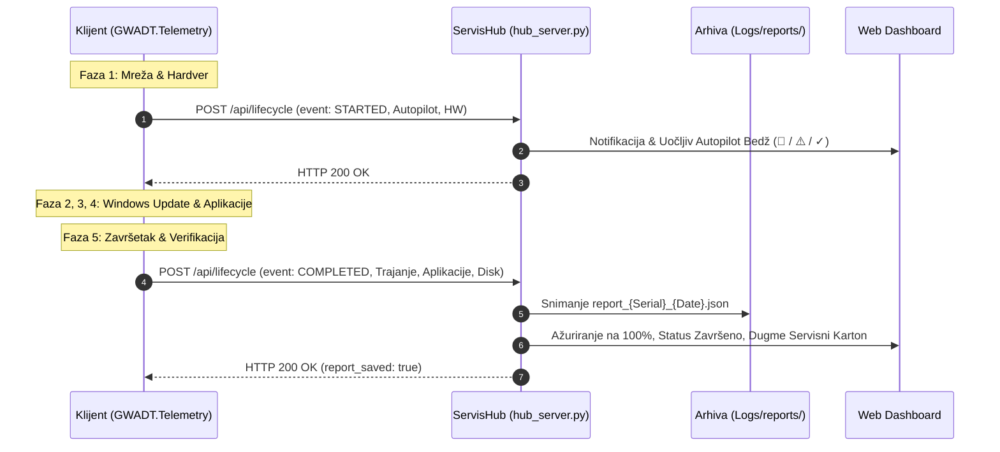

# ADR-0022: Diskretna Dvotačkasta Telemetrija (Start Autopilot Detekcija i Završni Servisni Karton)

## 1. Kontekst i Problem

Tokom serijskog servisiranja i instalacije Windows 11 operativnog sistema u radionici, telemetrijski nadzor je ključan za produktivnost tehničara. Međutim, postojeći model kontinuiranog prenosa podataka (heartbeat i live log streaming) suočavao se sa sledećim izazovima:

1. **Rizik od zagušenja i nepotrebnog mrežnog saobraćaja (Network Chatter):**
   - Konstantno slanje pulsiranja na svakih nekoliko sekundi opterećuje lokalni Wi-Fi i mrežnu infrastrukturu kada se istovremeno instalira 5 ili više računara.
   - Za potrebe praćenja stanja servisa serviseru najčešće nisu potrebne mikro-informacije svake sekunde, već dva ključna trenutka: **početak rada** (sa bezbednosnom proverom) i **završetak rada** (sa sumiranim rezultatima).

2. **Kritični rizik od Windows Autopilot / Intune blokade:**
   - Klijentski računari koji su administrativno zaključani u korporativni Microsoft Intune / Autopilot zakupac (`! AP-REG`) ili imaju vezane aktivne organizacione naloge (`~ AAD/MDM`) moraju biti uočeni **odmah na samom početku procesa** (u prvom minutu instalacije, tokom Faze 1).
   - Ukoliko tehničar ne primeti Autopilot registraciju na vreme, računar može proći celu instalaciju, da bi tek pri predaji klijentu ili sledećem OOBE logovanju zatražio korporativne kredencijale zakupca.

3. **Nedostatak trajnog digitalnog servisnog kartona:**
   - Po završetku instalacije podaci o trajanju procesa, uspešnosti instalacije aplikacija (Office, Acrobat, Chrome, WinRAR), licencnom statusu i preostalom prostoru na SSD-u ostajali su rasuti po tekstualnim log fajlovima na klijentu.
   - Nije postojala automatizovana, centralizovana baza digitalnih servisnih kartona po serijskom broju mašine za arhivu servisa i izdavanje klijentu.

---

## 2. Doneta Odluka

Usvojen je i implementiran model **Diskretne Dvotačkaste Telemetrije Životnog Ciklusa** (Discrete Two-Point Lifecycle Telemetry) koji se integriše između klijentskih PowerShell modula i centralnog Python ServisHub-a:



### 1. Dvotačkasti Životni Ciklus Događaja

- **Tačka 1 — Događaj `STARTED` (Faza 1 - Početak rada):**
  - Okida se u skripti `Install-ServisApps.ps1` (Faza 1: Mreža), odmah nakon detekcije mrežne veze i očitavanja hardverskih specifikacija i Autopilot/MDM statusa preko `Get-HwInfo`.
  - Šalje identifikaciju računara, serijski broj, CPU, RAM, disk, zdravlje baterije i precizan trobojni Autopilot status (`Clean`, `AadMdm`, `Autopilot`).
  - ServisHub odmah registruje uređaj u floti sa statusom `"Aktivno"`, Faza 1, i ističe Autopilot upozorenje.

- **Tačka 2 — Događaj `COMPLETED` (Faza 5 - Završetak i Servisni Karton):**
  - Okida se na kraju Faze 5, neposredno pre pokretanja čišćenja `C:\setup` i završnog restarta (`Invoke-ServisCleanupAndFinalize`).
  - Prikuplja tačno trajanje procesa (od `$Global:ScriptStartTime`), statuse instaliranih programa (`Get-RealAppStatuses`: Chrome, WinRAR, Office, Acrobat, OEM Licenca), preostali slobodan prostor na sistemskoj particiji `C:` i sažetak.
  - ServisHub prebacuje status u `"Zavrseno"`, progres radnika postavlja na 100%, formatira trajanje i **automatski trajno snima JSON servisni karton na disk**.

### 2. Klijentska Funkcija `Send-ServisLifecycleEvent` (`GWADT.Telemetry.psm1`)

Funkcija je u potpunosti kompatibilna sa Windows PowerShell 5.1 i implementira **Zero-Block princip**:
- Koristi `[System.Net.HttpWebRequest]` sa UTF-8 telom.
- Poseduje striktno definisane mrežne tajmaute od **1500 ms**:
  ```powershell
  $req.Timeout = 1500
  $req.ReadWriteTimeout = 1500
  ```
- Obuhvaćena je `try/catch` blokom koji nikada ne prekida klijentsku skriptu, niti blokira operatera — u slučaju pada servera ili mrežnog prekida beleži lokalni DEBUG log i bezbedno vraća `$false`.

### 3. REST API Specifikacija

#### A. Endpoint `POST /api/lifecycle`
- **Putanja:** `/api/lifecycle`
- **Metod:** `POST`
- **Zaglavlje:** `Content-Type: application/json; charset=utf-8`

**Payload za `STARTED`:**
```json
{
  "event": "STARTED",
  "computer_name": "DESKTOP-ABC1234",
  "serial_number": "PF2X98ZA",
  "hw": {
    "cpu": "Intel(R) Core(TM) i7-1185G7 @ 3.00GHz",
    "ram_gb": 16,
    "disk_model": "NVMe SAMSUNG MZVLB512HBJQ",
    "battery_health": "88%",
    "autopilot_status": "Clean"
  },
  "autopilot": {
    "status": "Clean",
    "is_autopilot": false,
    "tenant": ""
  },
  "timestamp": "2026-09-18T18:30:00.000Z"
}
```

**Payload za `COMPLETED`:**
```json
{
  "event": "COMPLETED",
  "computer_name": "DESKTOP-ABC1234",
  "serial_number": "PF2X98ZA",
  "duration_seconds": 412,
  "duration_formatted": "6m 52s",
  "apps": {
    "Google Chrome": "OK",
    "WinRAR": "OK",
    "Microsoft Office 2024": "OK",
    "Adobe Acrobat Pro": "OK",
    "OEM Licenca": "OK"
  },
  "system_summary": {
    "os_build": "10.0.26200.8037",
    "free_space_c_gb": 428.5,
    "clean_desktop": true
  },
  "timestamp": "2026-09-18T18:36:52.000Z"
}
```

**Odgovor servera (HTTP 200):**
```json
{
  "status": "ok",
  "event": "COMPLETED",
  "device_id": "DESKTOP-ABC1234",
  "report_saved": true
}
```

#### B. Endpoint `GET /api/devices/<id>/report`
- **Putanja:** `/api/devices/<id>/report`
- **Metod:** `GET`
- **Opis:** Vraća najnoviji JSON servisni karton za zadati uređaj. Pretraga se vrši najpre u aktivnoj memoriji (`FLEET_DEVICES`), a zatim dinamičkom pretragom arhivskih fajlova u `Logs/reports/` (podržava identifikaciju i po nazivu računara i po serijskom broju).
- **Status kodovi:**
  - `200 OK`: Vraća formatiran JSON servisni karton.
  - `404 Not Found`: Vraća grešku ukoliko servisni karton za dati uređaj još uvek nije generisan ili uređaj ne postoji.

### 4. Trajno Arhiviranje Servisnih Kartona (`Logs/reports/`)

Svaki kompletirani servis automatski se arhivira na disk Linux serviserskog računara u:
- Putanja: `<GWADT_ROOT>/Logs/reports/`
- Obrazac naziva: `report_<TargetId>_<YYYYMMDD_HHMMSS>.json` (npr. `report_PF2X98ZA_20260918_183652.json`)
- Format: Formatirani JSON (`indent=2`, UTF-8, `ensure_ascii=False`).

### 5. Web Dashboard i Uočljivi Indikatori (`hub_server.py`)

1. **Uočljiv Autopilot Bedž:**
   - U zaglavlju kartice računara, odmah pored naziva mašine, renderuje se upečatljiv indikator:
     - 🚨 `! AUTOPILOT REGISTROVAN ({tenant})` (jarkocrveni bedž sa animiranim pulsom) za status `Autopilot`.
     - ⚠️ `~ AAD/MDM` (žuto upozorenje) za status `AadMdm`.
     - ✓ `* ČISTO` (zeleni bedž) za status `Clean`.
2. **Prikaz Vremena Trajanja:**
   - U statusnom boksu završene mašine jasno se ističe vreme trajanja: `⏱️ Trajanje: <strong>{duration_formatted}</strong>`.
3. **Interaktivni Servisni Karton (Modal Dialog):**
   - Na kartici završene mašine pojavljuje se namensko dugme `📋 Servisni Karton`.
   - Klikom na dugme otvara se responzivni modalni dijalog koji prikazuje sažetak servisa (vreme, hardver, Autopilot), tabelarni pregled svih instaliranih aplikacija i kompletan formatirani JSON kod, uz dugme za preuzimanje fajla na lokalni računar.

---

## 3. Posledice Odluke

### Pozitivne posledice:
1. **Rana detekcija bezbednosnih rizika:** Serviser već u prvom minutu instalacije ima pouzdanu vizuelnu i sistemsku informaciju da li je klijentski uređaj bezbedan za isporuku ili je vezan za Microsoft Autopilot / Intune zakupca.
2. **Nula rizika po stabilnost (Zero-Block):** Zbog strogog tajmauta od 1.5 sekundi i totalne izolacije u `try/catch` bloku, klijentska instalacija funkcioniše potpuno nesmetano čak i kada je mreža privremeno prekinuta ili ServisHub ugašen.
3. **Digitalni trag i standardizovan servisni izveštaj:** Svaki servisirani računar dobija trajan, standardizovan JSON zapis u `Logs/reports/` koji se može arhivirati, štampati ili automatski proslediti u CRM/bazu servisa.
4. **Drastično rasterećenje mreže:** Umesto hiljada poruka live streaminga, diskretna telemetrija troši samo dva ultra-lagana HTTP poziva tokom celokupnog životnog ciklusa.
5. **Potpuna usklađenost:** Zadržana je 100% kompatibilnost sa Windows PowerShell 5.1, `Test-GWADTModules.py` i novim E2E testom `Test-TelemetryE2E.py` (svi testovi PASS).

---

## 4. Povezane Beleške
- Glavni Indeks Znanja: [[index]]
- Pregled Arhitekture: [[architecture/overview]]
- Centralizovani Servisni Hub i Telemetrija: [[decisions/ADR-0013-live-fleet-telemetry-servis-hub]]
- Precizna Trobojna Autopilot Detekcija: [[decisions/ADR-0020-three-tier-autopilot-mdm-detection]]
- Detaljan Tok Faza: [[architecture/pipeline]]
- Statički i E2E QA Testovi: `Skripte/Test-TelemetryE2E.py`, `Skripte/Test-GWADTModules.py`
