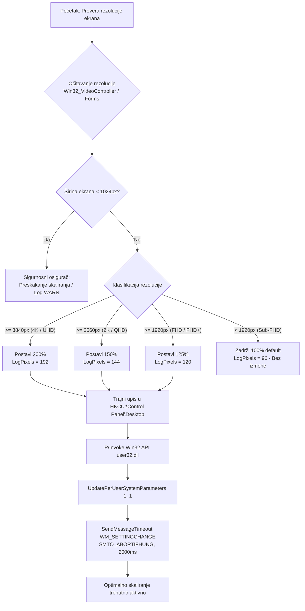

# ADR-0023: Automatsko DPI Skaliranje Ekrana na Osnovu Fizičke Rezolucije (FHD/2K/4K)

## 1. Kontekst i Problem

Tokom serijske pripreme i servisne instalacije Windows 11 operativnog sistema na različitim prenosnim i stonim računarima, primećen je čest problem neadekvatnog fabričkog DPI nivoa uvećanja radne površine:

1. **Neadekvatna fabrička skala na 1080p+ ekranima:**
   - Na prenosnim računarima sa dijagonalom ekrana od 14 ili 15.6 inča i Full HD (1920x1080) ili Full HD+ (1920x1200) rezolucijom, Windows 11 nakon čiste instalacije često zadržava podrazumevano skaliranje od 100%.
   - Pri 100% skaliranju na Full HD ekranima, ikone, meniji i sistemski fontovi su presitni, što zamara oči klijenta i otežava pregled serviseru.
2. **Kritično sitan tekst na 2K/QHD i 4K/UHD ekranima:**
   - Na savremenim uređajima visoke gustine piksela (2560x1440, 2560x1600, 3840x2160 i više), skala od 100% ili neadekvatna početna detekcija čini korisnički interfejs mikroskopskim i praktično neupotrebljivim pre manuelnog podešavanja.
3. **Potreba za nultom intervencijom servisera (Zero-Touch UX):**
   - Serviser ne bi trebalo ručno da otvara sistemska podešavanja prikaza za svaki računar kako bi namestio ergonomski ispravan nivo zumiranja.
   - Promena DPI skaliranja u Windowsu često zahteva odjavljivanje korisnika (*Sign out*) ili restart računara da bi se promene vizuelno primenile, što remeti kontinuitet instalacije.

Bilo je neophodno implementirati potpuno autonoman, siguran i deterministički mehanizam koji dinamički prepoznaje rezoluciju primarnog displeja i trenutno primenjuje ergonomski optimalnu skalu pre nego što se računar isporuči klijentu.

---

## 2. Razmatrane Opcije

- **Opcija 1: Oslanjanje isključivo na fabrički Windows OOBE mehanizam.**
  - *Mane:* Windows često zadržava 100% na čistim instalacijama pre instalacije OEM drajvera ili u specifičnim edicijama, što stvara loš prvi utisak kod korisnika i zahteva ručnu intervenciju.
- **Opcija 2: Statički upis fiksnih registarskih ključeva preko eksternog `.reg` fajla.**
  - *Mane:* Ne prilagođava se rezoluciji monitora (isti nivo bi se primenio i na HD monitor od 1366x768 i na 4K displej); zahteva restart pre nego što dođe do efekta.
- **Opcija 3: Hibridni mehanizam detekcije (CIM/WMI + Forms), trajnog upisa u registar i trenutne primene putem Win32 API P/Invoke poziva (Usvojeno).**
  - *Prednosti:* Dinamičko određivanje na osnovu stvarne rezolucije, determinističke servisne kategorije, trajna perzistencija u `HKCU`, trenutna primena bez odjavljivanja preko `user32.dll` i višeslojni bezbednosni osigurači (timeout od 2000 ms, fallback za niske rezolucije).

---

## 3. Doneta Odluka

Usvojena je **Opcija 3**. Razvijena je i integrisana funkcija `Set-OptimalDisplayScaling` unutar modula `GWADT.Branding.psm1`, kao i u samostalnoj skripti `Windows_setup.ps1`.



### 1. Pravila i Matrica Skaliranja

Pravila su definisana prema ergonomskim standardima servisa računara:

| Kategorija Ekrana | Raspon Širine Rezolucije | Skaliranje (%) | `LogPixels` (DPI) | Ponašanje Sistema |
|---|---|---|---|---|
| **Sub-FHD** | $< 1920\text{ px}$ (npr. 1366x768, 1600x900) | **100%** | `96` | Zadržava se fabrički podrazumevano stanje bez upisa u registar. |
| **FHD / FHD+** | $1920\text{ px} - 2559\text{ px}$ (npr. 1920x1080, 1920x1200) | **125%** | `120` | Trajni upis u registar + instant Win32 osvežavanje. |
| **2K / QHD** | $2560\text{ px} - 3839\text{ px}$ (npr. 2560x1440, 2560x1600) | **150%** | `144` | Trajni upis u registar + instant Win32 osvežavanje. |
| **4K / UHD** | $\ge 3840\text{ px}$ (npr. 3840x2160, 4096x2160, 5K, 8K) | **200%** | `192` | Trajni upis u registar + instant Win32 osvežavanje. |
| **Fallback / Sigurnosni Osigurač** | $< 1024\text{ px}$ (npr. 800x600, 640x480, 0x0) | N/A | N/A | Bezbedno preskakanje uz zapis u logu (zaštita od privremenih modova). |

### 2. Dvoslojna Detekcija Rezolucije

1. **Primarni nivo (CIM / WMI):**
   - Upit ka klasi `Win32_VideoController`:
     ```powershell
     $video = Get-CimInstance Win32_VideoController -ErrorAction SilentlyContinue |
         Where-Object { $_.CurrentHorizontalResolution -gt 0 } |
         Sort-Object CurrentHorizontalResolution -Descending |
         Select-Object -First 1
     ```
   - Koristi se opadajući poredak po horizontalnoj rezoluciji kako bi se selektovao primarni grafički adapter visoke rezolucije.
2. **Sekundarni fallback (`System.Windows.Forms.Screen`):**
   - Ukoliko WMI ne vrati podatke (npr. specifična virtuelna mašina ili privremeni drajver):
     ```powershell
     Add-Type -AssemblyName System.Windows.Forms -ErrorAction SilentlyContinue
     $primaryScreen = [System.Windows.Forms.Screen]::PrimaryScreen
     ```

### 3. Trajna Perzistencija u Registru

Za trajno očuvanje podešavanja nakon narednih restarta i prijavljivanja korisnika, vrši se upis u trenutni korisnički profil:
- **Putanja:** `HKCU:\Control Panel\Desktop`
- **Vrednosti:**
  - `LogPixels` (DWORD) = `120` (za 125%), `144` (za 150%) ili `192` (za 200%).
  - `Win8DpiScaling` (DWORD) = `1` (aktivira interpretaciju `LogPixels` skale na nivou celog desktopa).

### 4. Trenutna Primena preko Win32 API P/Invoke Poziva

Kako bi se novi nivo skaliranja odmah primenio na radnu površinu bez potrebe za odjavljivanjem operatera, koristi se `user32.dll`:

1. **Definisanje C# P/Invoke koda sa bezbednom proverom tipa:**
   - Provera `if (-not ([System.Management.Automation.PSTypeName]'GWADT.DpiHelper').Type)` garantuje idempotentnost u PowerShell 5.1 sesijama bez grešaka re-deklaracije tipa.
2. **Funkcije `UpdatePerUserSystemParameters` i `SendMessageTimeout`:**
   ```powershell
   [GWADT.DpiHelper]::UpdatePerUserSystemParameters(1, 1) | Out-Null
   $res = [UIntPtr]::Zero
   [GWADT.DpiHelper]::SendMessageTimeout([IntPtr]0xffff, 0x001A, [UIntPtr]::Zero, "Control Panel\Desktop", 2, 2000, [ref]$res) | Out-Null
   ```
   - `UpdatePerUserSystemParameters(1, 1)`: Obaveštava podsistem prikaza da pročita ažurirane parametre iz registra.
   - `SendMessageTimeout`: Šalje poruku `WM_SETTINGCHANGE` (`0x001A`) svim otvorenim prozorima (`HWND_BROADCAST = 0xffff`).
   - Fleg `SMTO_ABORTIFHUNG = 2`: Sprečava čekanje ukoliko je neka aplikacija blokirana.
   - Tajmaut `2000 ms`: Poziv nikada ne može zadržati skriptu duže od 2 sekunde.

---

## 4. Arhitektura i Sinhronizacija Komponenti

Komponenta za automatsko DPI skaliranje integrisana je u sve nivoe sistema:

1. **PowerShell Modul (`Skripte/Modules/GWADT.Branding.psm1`):**
   - Funkcija `Set-OptimalDisplayScaling` je implementirana i eksportovana u modulu.
   - Integrisana u glavnu funkciju Faze 3: `Invoke-SystemOptimizationAndBranding` (tačka H).
2. **Samostalna Skripta (`Programi/Windows_setup.ps1`):**
   - Dodat identičan korak 6 za DPI skaliranje pre restarta.
   - Sinhronizovano u `sources/$OEM$/$1/setup/Programi/Windows_setup.ps1` (100% hash poklapanje).
3. **Build Pajplajn (`Skripte/Build-DeployScript.py`):**
   - Kompajlira monolitnu skriptu `Install-ServisApps.ps1` i sinhronizuje je na sve 3 lokacije (`/`, `Skripte/`, `sources/$OEM$/$1/setup/`).
   - Ažurira `version.json` (verzija koda 2.5.0).
4. **Automatski Test Suite (`Skripte/Test-DpiScaling.py` & `Test-GWADTModules.py`):**
   - Namenski QA test runner koji simulira 19 rezolucija i graničnih uslova uz 100% prolaznost (PASS).
   - Verifikuje usklađenost sa PowerShell 5.1 pravilima sintakse.

---

## 5. Posledice i Bezbednosni Osigurači

### Pozitivne posledice:
- **Savršena ergonomija "iz kutije":** Klijent dobija računar sa optimalno prilagođenom veličinom slova i ikonica za njegov ekran odmah po prvom paljenju.
- **Ušteda vremena u servisu:** Tehničari više ne moraju ručno konfigurisati rezoluciju i nivo zumiranja.
- **Trenutan vizuelni efekat:** Zahvaljujući Win32 P/Invoke porukama, DPI promena stupa na snagu trenutno u tekućoj sesiji.
- **Čist kod i visoka pouzdanost:** Nema eksternih zavisnosti; koristi se isključivo ugrađeni Windows API.

### Bezbednosni osigurači:
1. **Fallback za rezolucije $< 1024\text{ px}$:**
   - Ako je aktivan bazični video adapter (npr. rezolucija 800x600 ili 1024x768 u prelaznoj fazi pre drajvera), skaliranje se preskače kako se ne bi izazvala izobličenja radne površine.
2. **Zaštita od zastoja (`SMTO_ABORTIFHUNG` + 2000ms):**
   - Slanje sistemske poruke je vremenski ograničeno i automatski prekida čekanje ukoliko neki pozadinski proces ne odgovara.
3. **Kompletna izolacija u `try/catch` blokovima:**
   - Bilo kakva neočekivana greška u P/Invoke sloju ili očitavanju rezolucije se evidentira u servisnom logu, ali **nikada ne prekida tok instalacije**.

---

## 6. Povezane Beleške

- Glavni Indeks Znanja: [[index]]
- Pregled Arhitekture Sistema: [[architecture/overview]]
- Troslojna Maksimizacija Konzole: [[decisions/ADR-0010-responsive-tui-maximization]]
- Detaljan Tok Faza Pajplajna: [[architecture/pipeline]]
- Modularna Skripting Infrastruktura: [[architecture/modules]]
- QA Test Suite: `Skripte/Test-DpiScaling.py`, `Skripte/Test-GWADTModules.py`
