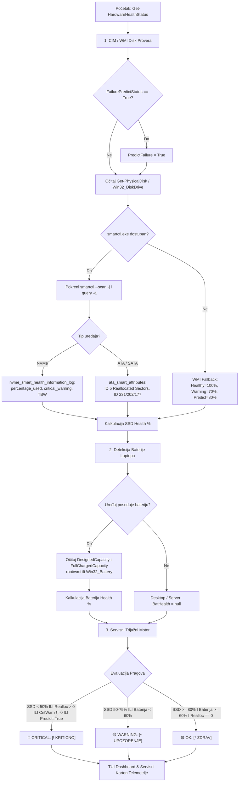

# ADR-0024: Hibridna S.M.A.R.T. i Baterija Hardverska Dijagnostika i Servisna Kategorizacija

## 1. Kontekst i Problem

U profesionalnom servisu računara, čista i automatizovana instalacija operativnog sistema predstavlja samo polovinu uspešnog radnog procesa. Ako se operativni sistem instalira na hardverski degradiran ili poluispravan uređaj (npr. NVMe/SATA SSD sa istrošenim ćelijama ili lošim sektorima, ili laptop sa degradiranom baterijom), klijent će ubrzo doživeti nestabilnost, usporavanje ili gubitak podataka, što direktno narušava reputaciju servisa.

Tradicionalni pristup u servisu patio je od sledećih problema:
1. **Zakasnela detekcija hardverskih otkaza:** Serviseri bi tek nakon kompletne instalacije ručno pokretali alate poput *CrystalDiskInfo* ili *HWiNFO* da bi uočili zdravlje diska i baterije, čime se trošilo vreme ukoliko se ispostavi da je disk za zamenu.
2. **Ograničenja standardnih WMI/CIM upita:** Standardne Windows WMI klase (`Win32_DiskDrive`, `MSStorageDriver_FailurePredictStatus`) pružaju binarni status (OK ili Predviđen otkaz), ali ne daju uvid u stvarni procenat preostalog životnog veka NVMe diska (wear level), broj upisanih terabajta (TBW), niti raw vrednosti realociranih sektora kod SATA diskova.
3. **Nedostatak automatizovane trijaže u konzoli:** Tokom rada skripte nije postojala jasna, trenutna vizuelna notifikacija (bedž) o hardverskom zdravlju računara u TUI dashboardu, niti su se podaci automatski beležili u centralni servisni karton za telemetrijski hub.

Bilo je neophodno projektovati autonoman, hibridni dijagnostički podsistem koji kombinuje nativne Windows CIM/WMI klase i tiho parsiranje industrijskog standarda `smartctl.exe` (Smartmontools), sa precizno definisanim pragovima trijaže i integracijom u TUI i telemetrijski karton.

---

## 2. Razmatrane Opcije

- **Opcija 1: Oslanjanje isključivo na nativni Windows WMI/CIM podsistem.**
  - *Mane:* `Get-PhysicalDisk` i `Win32_DiskDrive` često vraćaju `HealthStatus = "Healthy"` čak i na diskovima koji imaju na desetine realociranih sektora ili su na 15% preostalog životnog veka. Nema pristupa NVMe Health Log tabeli niti SMART atributima bez kompleksnog kernel-mode koda.
- **Opcija 2: Pokretanje teških eksternih GUI aplikacija (CrystalDiskInfo / HWiNFO).**
  - *Mane:* Zahteva korisničku intervenciju, otvaranje prozora na radnoj površini, ručno očitavanje i zatvaranje; narušava princip *Zero-Touch* automatizacije.
- **Opcija 3: Hibridna arhitektura (WMI/CIM + smartctl.exe JSON fallback & trijažni motor) (Usvojeno).**
  - *Prednosti:* Potpuno tiho i autonomno izvršavanje; ako je prisutan `smartctl.exe`, očitava se JSON telemetrija (`smartctl -j`) za NVMe (wear percentage, TBW, critical warning flag) i ATA/SATA diskove (realocirani loši sektori); ako `smartctl.exe` nije dostupan, aktivira se automatski fallback na `MSStorageDriver_FailurePredictStatus` i `Get-PhysicalDisk`. Za baterije laptopa očitava se `BatteryFullChargedCapacity` naspram `BatteryStaticData`. Svi podaci prolaze kroz strog servisni trijažni motor sa pragovima `OK`, `WARNING`, `CRITICAL`.

---

## 3. Doneta Odluka

Usvojena je **Opcija 3**. U modulu [`GWADT.Hardware.psm1`](file:///home/gru/Projects/Tehno-kutak%20windows%2011%20automat/Skripte/Modules/GWADT.Hardware.psm1) implementirana je funkcija `Get-HardwareHealthStatus`, uvezana u postojeći dijagnostički sistem (`Get-HardwareDiagnosticsInfo`, `Get-SystemHardwareInfo`), i povezana sa vizuelnim TUI banerom u [`GWADT.Core.psm1`](file:///home/gru/Projects/Tehno-kutak%20windows%2011%20automat/Skripte/Modules/GWADT.Core.psm1).



### 1. Servisni Pragovi i Matrica Trijaže

| Nivo Alarma | TUI Bedž | Kriterijumi za Diskovni Podsistem (SSD/HDD) | Kriterijumi za Bateriju | Servisna Akcija |
|---|---|---|---|---|
| **🟢 OK** | `[* ZDRAV]` | Preostalo zdravlje SSD $\ge 80\%$, $0$ realociranih sektora, `CriticalWarning == 0`, `PredictFailure == False`. | Kapacitet baterije $\ge 60\%$ fabričkog kapaciteta (ili stoni računar bez baterije). | Nema primedbi; sistem se isporučuje klijentu. |
| **🟡 WARNING** | `[~ UPOZORENJE]` | Preostalo zdravlje SSD između $50\%$ i $79\%$. | Kapacitet baterije između $1\%$ i $59\%$ fabričkog kapaciteta. | Zabeležiti u servisni nalog; preporučiti klijentu zamenu baterije ili praćenje diska. |
| **🔴 CRITICAL** | `[! KRITICNO]` | Preostalo zdravlje SSD $< 50\%$, realocirani loši sektori $> 0$ (ATA ID 5), NVMe `CriticalWarning != 0`, ili WMI `PredictFailure == True`. | N/A (fokus je na integritetu podataka diska). | **Zaustaviti isporuku!** Obavezna zamena diska pre puštanja računara u rad. |

### 2. Hibridni Detekcioni Mehanizam (Izvod iz Implementacije)

```powershell
# 1. Provera preko WMI/CIM failure predict
$fps = Get-CimInstance -Namespace root\wmi -ClassName MSStorageDriver_FailurePredictStatus -ErrorAction SilentlyContinue
foreach ($fp in $fps) {
    if ($fp.PredictFailure -eq $true) { $failurePredict = $true }
}

# 2. Tiho parsiranje smartctl.exe JSON telemetrije
if ($smartctlExe) {
    $devOut = & $smartctlExe -j -a $dev.Name 2>$null
    $smartObj = ($devOut -join "`n") | ConvertFrom-Json
    
    # NVMe S.M.A.R.T. podaci
    if ($smartObj.nvme_smart_health_information_log) {
        $nvmeLog = $smartObj.nvme_smart_health_information_log
        $used = [int]$nvmeLog.percentage_used
        $ssdHealth = [math]::Max(0, 100 - $used)
        $criticalWarning = [int]$nvmeLog.critical_warning
        $tbw = [math]::Round(($nvmeLog.data_units_written * 512000.0) / 1TB, 1)
    }
    # ATA / SATA S.M.A.R.T. podaci
    if ($smartObj.ata_smart_attributes.table) {
        foreach ($attr in $smartObj.ata_smart_attributes.table) {
            if ($attr.id -eq 5) { $reallocatedSectors = [int]$attr.raw.value }
            if ($attr.id -in @(231, 202, 177, 169)) { $ssdHealth = [int]$attr.value }
        }
    }
}
```

### 3. TUI Dashboard Integracija

U funkciji `Show-ServisDashboard` ([`GWADT.Core.psm1`](file:///home/gru/Projects/Tehno-kutak%20windows%2011%20automat/Skripte/Modules/GWADT.Core.psm1)), hardverski status se u realnom vremenu prikazuje serviseru u zaglavlju:

```
+-------------------------------------------------------------------------------+
|  PROCESOR : Intel Core i7-12700H @ 2.30GHz | RAM: 16.0 GB                     |
|  HARDVER  : [* ZDRAV] SSD: 98% (NVMe Samsung 980 Pro) | Baterija: 87%         |
+-------------------------------------------------------------------------------+
```

U slučaju problema, bedž trenutno prelazi u uočljivo upozorenje:
```
|  HARDVER  : [! KRITICNO] SSD: 42% (Realocirani: 12) | Baterija: 48%           |
```

---

## 4. Posledice i Benefiti

### Pozitivne Posledice:
- **Preventiva otkaza pre predaje klijentu:** Serviser odmah na početku instalacije dobija informaciju da li je disk pred krahom ili baterija na izdisaju, štedeći sate nepotrebnog rada na defektnom hardveru.
- **Objedinjavanje NVMe i SATA standarda:** Jedinstvena funkcija pokriva najsavremenije PCIe Gen4/Gen5 NVMe diskove (kroz `nvme_smart_health_information_log`) i klasične SATA SSD/HDD uređaje (kroz ATA SMART tabele).
- **Automatski servisni izveštaj:** Podaci o zdravlju diska (model, SSD %, TBW, realocirani sektori) i baterije (dizajnirani vs puni kapacitet) automatski postaju sastavni deo digitalnog servisnog kartona koji se šalje u Servis Hub.
- **Nulta zavisnost od korisnika:** Potpuno tiho izvršavanje bez iskačućih GUI prozora i bez potrebe za ručnim očitavanjem.

### Negativne Posledice i Rizici (i ublažavanje):
- *Rizik:* Odsustvo binarnog fajla `smartctl.exe` na minimalnim ili prilagođenim instalacionim medijumima.
  *Ublažavanje:* Implementiran robusni dvostruki WMI/CIM fallback (`MSStorageDriver_FailurePredictStatus`, `Get-PhysicalDisk`, `Win32_Battery`) koji obezbeđuje validnu procenu stanja čak i ako eksterni alat nije prisutan na disku.

---

## 5. Povezane Datoteke i Arhitektonske Odluke

- **Implementirani kod:**
  - [`Skripte/Modules/GWADT.Hardware.psm1`](file:///home/gru/Projects/Tehno-kutak%20windows%2011%20automat/Skripte/Modules/GWADT.Hardware.psm1) — Glavna funkcija `Get-HardwareHealthStatus`.
  - [`Skripte/Modules/GWADT.Core.psm1`](file:///home/gru/Projects/Tehno-kutak%20windows%2011%20automat/Skripte/Modules/GWADT.Core.psm1) — TUI statusna prezentacija (`Show-ServisDashboard`).
  - [`Skripte/Modules/GWADT.Telemetry.psm1`](file:///home/gru/Projects/Tehno-kutak%20windows%2011%20automat/Skripte/Modules/GWADT.Telemetry.psm1) — Uključivanje zdravstvenih parametara u servisni karton.
  - [`Skripte/Test-Task043-QA.py`](file:///home/gru/Projects/Tehno-kutak%20windows%2011%20automat/Skripte/Test-Task043-QA.py) — Dedikovani QA test suite sa 15 simuliranih hardverskih scenarija.
- **Povezane Arhitektonske Odluke:**
  - [[ADR-0010-responsive-tui-maximization]] — Responsivni TUI interfejs punom širinom ekrana.
  - [[ADR-0013-live-fleet-telemetry-servis-hub]] — Centralizovani servisni hub i daljinsko praćenje.
  - [[ADR-0022-diskretna-dvotackasta-telemetrija]] — Životni ciklus servisnog kartona i telemetrijski payload.
