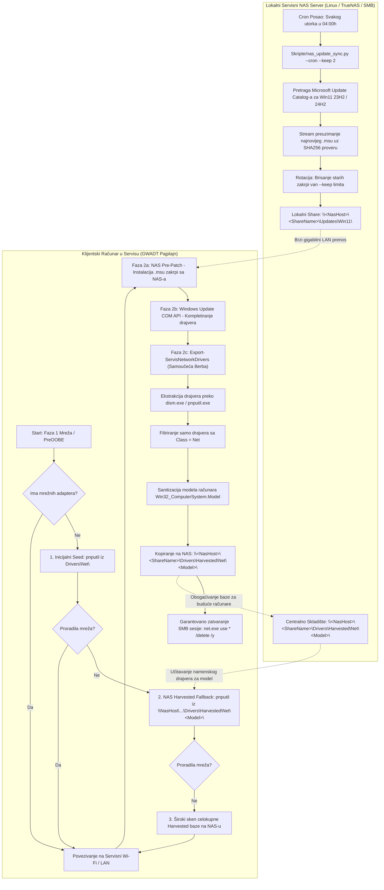

# ADR-0027: Samoučeće Prikupljanje Mrežnih Drajvera (Driver Harvesting) i Centralizovani NAS Sinhronizator Zakrpi

## 1. Kontekst i Problem

Tokom serijskog servisnog rada na velikom broju heterogenih prenosnih i desktop računara različitih proizvođača (HP, Dell, Lenovo, Asus, Acer, Fujitsu...), dva ključna operativna izazova usporavala su rad i zahtevala manuelnu intervenciju servisera:

1. **Problem "Hladnog Starta" za Mrežne Kartice (Cold-Start Network Problem):**
   Kada sveže instaliran Windows 11 operativni sistem ne poseduje ugrađeni (inbox) drajver za bežični (Wi-Fi) ili žični (LAN) mrežni kontroler (što je naročito učestalo na novijim Intel Wi-Fi 6E/7, Realtek 8852/8125, i MediaTek MT7921/MT7922 čipsetovima na ultrabook računarima bez RJ45 priključka), automatizovani ciklus ne može da uspostavi internet konekciju. Ranije je to zahtevalo ručno preuzimanje drajvera na USB fleš sa drugog računara ili upotrebu eksternih USB-to-Ethernet adaptera.
2. **Gubitak Naučenog Znanja o Hardveru (Ephemeral Knowledge):**
   Nakon što računar uspešno završi Fazu 2 (Windows Update) i preuzme sertifikovane Microsoft WHQL drajvere preko interneta, operativni sistem je posedovao sve potrebne binarne fajlove (`.inf`, `.sys`, `.cat`). Međutim, ti drajveri su ostajali "zaključani" u klijentskom *DriverStore* skladištu i nisu bili sačuvani za buduće instalacije istog ili srodnog modela računara u servisu.
3. **Zastarevanje i Zamor Održavanja Lokalnog NAS Keša Zakrpi:**
   Iako je u [ADR-0026](file:///home/gru/Projects/Tehno-kutak%20windows%2011%20automat/wiki/decisions/ADR-0026-nas-smb-update-caching.md) uveden mehanizam Pre-Patch instalacije `.msu` paketa sa serviserskog NAS servera, ručno mesečno skidanje kumulativnih zakrpi (LCU) za verzije 23H2 i 24H2 sa *Microsoft Update Catalog* portala predstavljalo je operativno opterećenje. Pojavom novih zakrpi svakog "Patch Tuesday" utorka, stari paketi su se nagomilavali, a ako serviser zaboravi da preuzme nove, klijentski računari su gubili pogodnost lokalnog keširanja.

Bilo je neophodno uspostaviti **autonomni, dvosmerni ekosistem**:
- **Klijentski sloj (Self-Learning Driver Harvesting):** Koji tokom instalacije na svakom računaru automatski "bere" (ekstrahuje) ispravne mrežne drajvere i centralizuje ih na servisni NAS organizovane po tačnom modelu uređaja, dok sledećim mašinama istog modela omogućava trenutnu instalaciju tih drajvera sa NAS-a pre izlaska na internet.
- **Inicijalni semenski paket (Curated Driver Seed):** Koji unapred obezbeđuje najčešće Wi-Fi i LAN drajvere u ISO/USB medijumu kako bi se eliminisao problem hladnog starta.
- **Serverski NAS sloj (Automated Update & Driver Sync):** Koji autonomno (preko cron-a na Linux/TrueNAS serveru ili periodičnog zadatka) pretražuje Microsoft Catalog, preuzima najnovije LCU zakrpe, verifikuje njihov SHA-256 integritet i rotira/briše zastarele pakete.

---

## 2. Razmatrane Opcije

- **Opcija 1: Korišćenje glomaznih "All-in-One" drajverskih paketa (DriverPacks / Snappy Driver Installer).**
  - *Mane:* Ovi paketi zauzimaju preko 35-40 GB prostora na medijumu; često sadrže zastarele ili nesertifikovane drajvere koji izazivaju plavi ekran (BSOD); instalacioni proces je spor i netransparentan.
- **Opcija 2: Ručno vođenje foldera sa drajverima na NAS-u od strane servisera.**
  - *Mane:* Ljudski faktor – serviseri u radionici nemaju vremena da ručno pokreću DISM eksport nakon svake instalacije; struktura direktorijuma bi bila nekonzistentna.
- **Opcija 3: Samoučeći mehanizam ("Driver Harvesting") + Centralizovani Python NAS Sinhronizator + Kurirani mrežni paket (Usvojeno).**
  - *Prednosti:*
    1. **Potpuna autonomija:** Sistem uči samostalno – svaki računar koji prođe kroz servis obogaćuje centralnu bazu na NAS-u za sve buduće mašine tog modela.
    2. **Stroga specijalizacija na mrežne adaptere:** Čuvaju se isključivo drajveri mrežne klase (`Class=Net`), što bazu održava kompaktnom (par megabajta po modelu) i munjevitom za instalaciju preko `pnputil.exe`.
    3. **Automatska rotacija zakrpi:** Python alat na NAS-u redovno osvežava LCU pakete i automatski briše zastarele verzije čuvajući fiksni broj najnovijih (`--keep N`).
    4. **Maksimalna bezbednost:** SMB kredencijali se koriste samo tokom trajanja kopiranja i garantovano brišu pre predaje računara klijentu.

---

## 3. Doneta Odluka i Arhitektura Rešenja

Usvojena je **Opcija 3**. Arhitektura se sastoji od tri sinergijske komponente:



---

## 4. Detaljan Opis Komponenti

### 4.1. Samoučeći Mehanizam: `Export-ServisNetworkDrivers`

Implementiran u modulu [`GWADT.Update.psm1`](file:///home/gru/Projects/Tehno-kutak%20windows%2011%20automat/Skripte/Modules/GWADT.Update.psm1) i integrisan u glavni instalacioni tok [`Install-ServisApps.ps1`](file:///home/gru/Projects/Tehno-kutak%20windows%2011%20automat/Install-ServisApps.ps1) na završetku Faze 2 (nakon što su svi drajveri uspešno ažurirani preko Windows Update-a).

**Radni tok funkcije:**
1. **Detekcija mrežnih uređaja:** Preko `Get-NetAdapter` i `Win32_PnPEntity (PNPClass='Net')` proverava da li računar ima aktivne mrežne komponente. Ako nema, prekida se dalji rad.
2. **Očitavanje konfiguracije NAS-a:** Čita `[ServisNas]` sekciju iz `Wifi-Servis.ini`. Proverava mrežnu dostupnost NAS hosta preko TCP porta 445 (uz tajmaut od 1500 ms) i rezervni ICMP ping.
3. **Sanitizacija modela računara:**
   ```powershell
   $rawModel = (Get-CimInstance Win32_ComputerSystem -ErrorAction SilentlyContinue).Model
   $cleanModel = ($rawModel -replace '[^\w\.\-\s]', '' -replace '\s+', '_').Trim()
   ```
   Specijalni karakteri koji nisu dozvoljeni u nazivima foldera se uklanjaju, a razmaci pretvaraju u donje crte (npr. `"HP EliteBook 840 G8"` $\rightarrow$ `"HP_EliteBook_840_G8"`).
4. **Izvoz drajvera iz sistema:**
   Drajveri se ekstrahuju u privremeni direktorijum u `$env:TEMP\GWADT_DriverExport_<GUID>` pomoću nativnih alata:
   - Primarno: `dism.exe /online /export-driver /destination:"<TempDir>"`
   - Fallback: `pnputil.exe /export-driver * "<TempDir>"`
5. **Filtriranje drajvera mrežne klase (`Class=Net`):**
   Skripta skenira sve izvezene `.inf` datoteke i zadržava samo one koje u zaglavlju sadrže direktivu:
   ```ini
   Class = Net
   ```
   Svi ostali drajveri (grafika, audio, čipset) se ignorišu, čime se veličina paketa za NAS svodi na svega 5 do 25 MB po modelu računara.
6. **Arhiviranje na NAS SMB deljenje:**
   Privremeno se mapira SMB resurs `\\<NasHost>\<ShareName>`, kreira se folder `Drivers\Harvested\Net\<ModelRačunara>\` ukoliko ne postoji, i rekurzivno kopiraju kompletni podfolderi sa `.inf`, `.sys` i `.cat` fajlovima.
7. **Dvostrano učenje (Two-Way Harvesting u `Invoke-NasUpdatePrePatch`):**
   Tokom narednih instalacija na računaru istog modela koji nema prepoznatu mrežnu karticu, funkcija `Invoke-NasUpdatePrePatch` automatski proverava da li na NAS-u postoji folder `Drivers\Harvested\Net\<CleanModel>\`. Ukoliko postoji, odmah poziva:
   ```powershell
   & pnputil.exe /add-driver "$modelHarvestDir\*.inf" /subdirs /install
   ```
   Ukoliko folder za konkretan model ne postoji, skripta vrši inteligentan fallback skeniranjem celokupne `Harvested\Net` baze.

---

### 4.2. Centralizovani NAS Sinhronizator Zakrpi: `Skripte/nas_update_sync.py`

Samostalna Python 3 CLI skripta ([`Skripte/nas_update_sync.py`](file:///home/gru/Projects/Tehno-kutak%20windows%2011%20automat/Skripte/nas_update_sync.py)) namenjena za rad direktno na Linux NAS serveru (TrueNAS CORE/SCALE, Synology DSM, QNAP, Debian/Ubuntu) ili na administratorskoj Windows radnoj stanici.

**Ključne mogućnosti:**
- **Automatsko parsiranje Microsoft Cataloga:** Pretražuje zvanični portal za kumulativne bezbednosne zakrpe (`"Windows 11 Cumulative Update x64"` za verzije 23H2 i 24H2), parsira HTML tabele iz `Search.aspx` i dinamički generiše zahteve ka `DownloadDialog.aspx` radi dobijanja pravih CDN linkova (`catalog.s.download.windowsupdate.com`).
- **Integritet i Atomičnost:** Preuzimanje se vrši u blokovima od 64 KB u privremenu datoteku sa ekstenzijom `.part`. Pre preimenovanja u `.msu`, računa se stvarna SHA-256 suma i veličina u bajtovima i upoređuje sa zvaničnim Microsoft metapodacima.
- **Politika Rotacije (`--keep N`):** Automatski pronalazi starije verzije istog tipa zakrpe i briše one koje prelaze zadati limit (podrazumevano čuva 2 najnovije verzije), sprečavajući nekontrolisano trošenje prostora na disku.
- **Režim za Cron (`--cron`):** Potiskuje interaktivne konzolne indikatore napretka, loguje sve događaje u formatirani fajl sa vremenskim žigom i omogućava tihu periodičnu automatizaciju.
- **Bezbedna Simulacija (`--dry-run`):** Prikazuje koje zakrpe bi bile preuzete, a koje obrisane, bez vršenja izmena na disku.

**Primer upotrebe:**
```bash
# Ručna provera i simulacija:
python3 Skripte/nas_update_sync.py --dry-run --version 23H2

# Standardno preuzimanje sa čuvanjem 2 najnovije zakrpe:
python3 Skripte/nas_update_sync.py --nas-dir /mnt/nas/gwadt-cache/Updates/Win11 --keep 2

# Podešavanje Linux cron posla (svakog utorka i srede u 04:00):
# 0 4 * * 2,3 /usr/bin/python3 /opt/gwadt/nas_update_sync.py --cron --nas-dir /mnt/storage/gwadt/Updates/Win11
```

---

### 4.3. Kurirani Početni Paket Mrežnih Drajvera: `Skripte/Preuzmi-MrezneDrajvere.py`

Za rešavanje problema inicijalne pripreme USB medijuma (pre nego što se formira harvested baza na NAS-u), implementirana je skripta [`Skripte/Preuzmi-MrezneDrajvere.py`](file:///home/gru/Projects/Tehno-kutak%20windows%2011%20automat/Skripte/Preuzmi-MrezneDrajvere.py).

Ona preuzima i priprema isključivo čiste INF/SYS/CAT pakete za 5 najkritičnijih mrežnih arhitektura:
1. **Intel Wi-Fi:** Wi-Fi 6, 6E, Wi-Fi 7 i Wireless-AC adapteri (AX200, AX201, AX210, AX211, BE200, AC9560...).
2. **Intel LAN:** Gigabitni i 2.5GbE Ethernet kontroleri (I217, I218, I219-V/LM, I225-V, I226-V).
3. **Realtek PCIe LAN:** PCIe GbE i 2.5GbE Family kontroleri (RTL8111, RTL8168, RTL8125).
4. **Realtek USB LAN:** USB 3.0 na Gigabit Ethernet adapteri (RTL8153, RTL8156) koji se često koriste u servisnom radu.
5. **Realtek Wi-Fi:** Široko rasprostranjeni prenosni Wi-Fi čipovi (RTL8821CE, RTL8822CE, RTL8852BE, RTL8852CE).

Drajveri se smeštaju u:
- `sources/$OEM$/$1/setup/Drivers/Net/` (automatski se kopiraju na `C:\setup` tokom Windows Setup faze).
- `Programi/Drivers/Net/` (rezervna kopija na USB medijumu).

---

## 5. Bezbednosni Standardi i Sanitizacija

Uvođenje mrežnih deljenja nosi bezbednosne rizike koji su u GWADT sistemu strogo adresirani:

1. **Zaštita Kredencijala:** Servisni nalog na NAS serveru ima definisane restriktivne dozvole (Read/Write isključivo na share `gwadt-cache`, bez pristupa drugim delovima serverskog sistema). Lozinke se ne smeštaju u skripte već se čitaju dinamički iz konfiguracione datoteke `Wifi-Servis.ini`.
2. **Garantovano Raskidanje SMB Sesija:**
   Svaka funkcija koja mapira NAS resurs (`Invoke-NasUpdatePrePatch`, `Export-ServisNetworkDrivers`) poseduje obavezni `finally` blok:
   ```powershell
   finally {
       & net.exe use "$uncShare" /delete /y >$null 2>&1
   }
   ```
3. **Globalna Sanitizacija pre Isporuke Klijentu:**
   U modulu [`GWADT.Cleanup.psm1`](file:///home/gru/Projects/Tehno-kutak%20windows%2011%20automat/Skripte/Modules/GWADT.Cleanup.psm1) funkcija `Invoke-ServisCleanupAndFinalize` pre brisanja `C:\setup` foldera izvršava `net.exe use * /delete /y`, čime se garantuje da na klijentskom računaru ne ostane nijedna zapamćena sesija ili mrežni disk.
4. **Čišćenje Privremenih Podataka:** Direktorijum za ekstrakciju drajvera u `$env:TEMP` se nepovratno briše odmah nakon slanja na NAS, bez ostavljanja tragova na disku.

---

## 6. Posledice i Koristi

### Pozitivne posledice:
- 🚀 **Autonomno Učenje Servisne Baze:** Servis više ne mora ručno da skuplja drajvere za nove modele laptopova. Svaki urađeni računar automatski "obuči" NAS server za sve buduće mašine tog modela.
- ⚡ **Eliminacija Zastoja Bez Mreže:** U kombinaciji sa kuriranim paketom mrežnih drajvera ([ADR-0025](file:///home/gru/Projects/Tehno-kutak%20windows%2011%20automat/wiki/decisions/ADR-0025-universal-netdriver-fallback.md)), verovatnoća zastoja zbog neprepoznate mrežne kartice svedena je praktično na nulu.
- 🌐 **Uvek Svež Keš Zakrpi:** `nas_update_sync.py` održava NAS ažurnim bez ikakvog ljudskog angažmana, donoseći gigabitno ubrzanje ažuriranja (Faza 2 završava za 2-4 minuta umesto 25-30 minuta).
- 🛡️ **Nula Ostavljenih Tragova:** Klijent dobija operativni sistem bez servisnih lozinki, bez otvorenih mrežnih veza i sa maksimalnim performansama.

### Negativne posledice / Kompromisi:
- Zahteva postojanje lokalnog NAS servera na servisnoj mreži (ako NAS nije dostupan, sistem se automatski i bezbedno prebacuje na standardno preuzimanje sa interneta bez prekida instalacije).
- Potreban je minimalni skladišni prostor na NAS-u (~5-10 GB za kumulativne zakrpe i ~1-2 GB za stotine modela drajvera).
