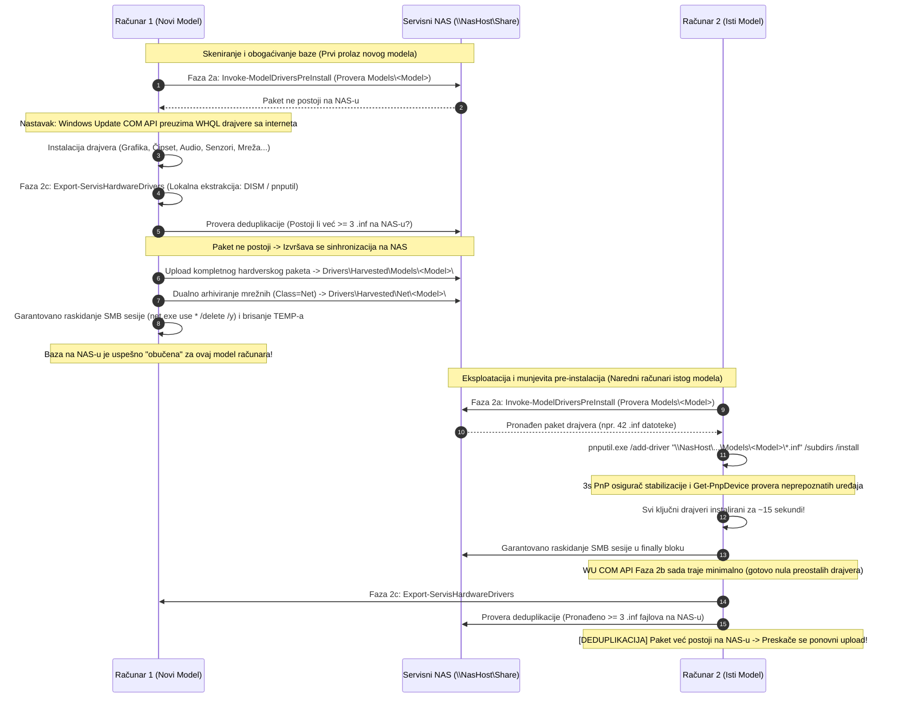

# ADR-0028: Sveobuhvatno Režimsko Prikupljanje i NAS Sinhronizacija SVIH Drajvera Računara (Universal Hardware Driver Harvesting & NAS Pre-Install)

## 1. Kontekst i Problem

Uvođenjem samoučećeg prikupljanja mrežnih drajvera ([ADR-0027](file:///home/gru/Projects/WIS Service%20windows%2011%20automat/wiki/decisions/ADR-0027-self-learning-driver-harvesting-and-nas-sync.md)) i univerzalnog mrežnog fallback podsistema ([ADR-0025](file:///home/gru/Projects/WIS Service%20windows%2011%20automat/wiki/decisions/ADR-0025-universal-netdriver-fallback.md)), uspešno je rešen problem "hladnog starta" i nemogućnosti uspostavljanja internet veze na prenosnim računarima bez integrisanog LAN porta.

Međutim, u svakodnevnoj servisnoj praksi na velikom broju računara pojavio se novi skup inženjerskih i operativnih uskih grla:

1. **Masivno Preuzimanje Drajvera sa Interneta (Bandwidth Choke):**
   Nakon što računar uspostavi vezu sa internetom, Windows Update COM API u Fazi 2 započinje pretragu i preuzimanje celokupnog hardverskog paketa drajvera sa Microsoft servera:
   - Drajveri za integrisanu i diskretnu grafiku (Intel Iris Xe/Arc, AMD Radeon, NVIDIA GeForce) koji redovno dostižu veličine od 500 MB do 1.2 GB.
   - Drajveri za čipset, I2C sabirnice, Intel Management Engine (MEI), Serial IO i SMBus kontrolere.
   - Drajveri za zvuk, HD audio kodeke i Smart Sound tehnologije (Realtek, Cirrus Logic, Senary).
   - Drajveri za Bluetooth adaptere, senzore (žiroskop, akcelerometar, ambijentalno osvetljenje), touchpad/I2C HID kontrolere, čitače otisaka prstiju i memorijskih kartica.
   Kada se u servisu istovremeno priprema 5 do 10 računara, paralelno preuzimanje više desetina gigabajta drajvera sa interneta dovodi do drastičnog zagušenja radioničke internet konekcije, usporava instalaciju i produžava Fazu 2 na **25 do 45 minuta po mašini**.

2. **Repetitivni Rad i Gubitak Već Preuzetih Drajvera:**
   U servis često dolaze serije istih ili srodnih modela (npr. 5 ili 10 komada *HP EliteBook 840 G8*, *Lenovo ThinkPad T14 Gen 2*, *Dell Latitude 5420*). Za svaki pojedinačni primerak, operativni sistem je iznova skidao identične drajverske pakete sa Microsoft servera, iako je prvi urađeni računar u toj seriji već imao sve WHQL drajvere uspešno preuzete, raspakovane i verifikovane na disku.

3. **Kašnjenje i Zastoji u PnP Prepoznavanju Specifičnog Hardvera:**
   Određeni drajveri (naročito I2C HID touchpad, senzori i audio DSP kodeci) na čistoj instalaciji Windows 11 često zahtevaju višestruke iteracije Windows Update-a i restarte da bi se pojavili u listi zakrpi. Do tada, serviser mora da koristi eksterni USB miš jer ugrađeni touchpad ne reaguje.

Bilo je neophodno proširiti mehanizam sa isključivo mrežnih drajvera na **sveobuhvatno, režimsko prikupljanje SVIH hardverskih drajvera računara (Universal Hardware Driver Harvesting)** i omogućiti **trenutni lokalni Pre-Install drajvera sa serviserskog NAS servera** organizovan po tačnom modelu računara pre pokretanja Windows Update pretrage.

---

## 2. Razmatrane Opcije

- **Opcija 1: Ostanak na isključivo mrežnim drajverima (ADR-0027) uz oslanjanje na internet za sve ostale drajvere.**
  - *Mane:* Zagušenje internet protoka servisa ostaje prisutno pri serijskom radu; instalacija traje nepotrebno dugo (25-45 min); ne iskorišćava se gigabitna lokalna mreža servisa.
- **Opcija 2: Korišćenje generičkih višenamenskih drajverskih paketa (DriverPack Solution / SDI / Snappy) sa lokalnog NAS-a.**
  - *Mane:* Zauzimaju 40-60 GB prostora; često sadrže modifikovane drajvere koji izazivaju nestabilnost, plavi ekran (BSOD) ili instaliraju neželjeni softver; drajveri nisu garantovano prilagođeni specifičnoj reviziji matične ploče određenog proizvođača.
- **Opcija 3: Sveobuhvatno režimsko prikupljanje (Universal Hardware Driver Harvesting) + NAS Pre-Install po modelu računara + Dualno arhiviranje i deduplikacija (Usvojeno).**
  - *Prednosti:*
    1. **Maksimalna brzina:** Računari za čiji model već postoje drajveri na NAS-u instaliraju **sve** drajvere (zvuk, grafika, čipset, senzori, Wi-Fi, BT) lokalno preko gigabitnog LAN-a za svega **10 do 20 sekundi** preko `pnputil.exe` pre izlaska na internet.
    2. **Samoučeća baza:** Prva mašina određenog modela koja preuzme zvanične Microsoft WHQL drajvere automatski ekstrahuje i obogaćuje NAS skladište za sve buduće mašine tog modela.
    3. **Deduplikacija i očuvanje resursa:** Ukoliko paket za dati model već postoji na NAS-u ($\ge 3$ `.inf` fajlova), izvoz se bezbedno preskače radi uštede vremena i mrežnog saobraćaja.
    4. **Unazadna kompatibilnost:** Dualno arhiviranje (`Models/<Model>` i `Net/<Model>`) garantuje punu usklađenost sa [ADR-0027](file:///home/gru/Projects/WIS Service%20windows%2011%20automat/wiki/decisions/ADR-0027-self-learning-driver-harvesting-and-nas-sync.md).
    5. **Strogi bezbednosni standardi:** Svaka funkcija garantovano raskida sve SMB sesije u svom `finally` bloku.

---

## 3. Doneta Odluka i Arhitektura Rešenja

Usvojena je **Opcija 3**. Arhitektura uspostavlja zatvorenu dvosmernu petlju između lokalnog serviserskog NAS servera i klijentskih računara u instalacionom toku:



---

## 4. Detaljan Opis Komponenti

### 4.1. Lokalna Pre-instalacija Hardvera: `Invoke-ModelDriversPreInstall`

Funkcija je implementirana u modulu [`GWADT.Update.psm1`](file:///home/gru/Projects/WIS Service%20windows%2011%20automat/Skripte/Modules/GWADT.Update.psm1) i integrisana u početak ciklusa ažuriranja unutar funkcija `Invoke-NasUpdatePrePatch`, `Invoke-WindowsUpdateCycle` i `Invoke-WindowsUpdatePhase`.

**Ključni mehanizmi:**
1. **Validacija konfiguracije:**
   Čita sekciju `[ServisNas]` iz `Wifi-Servis.ini`. Pre-instalacija se izvršava isključivo ukoliko su zadovoljeni uslovi:
   `Enabled == "1"` i `PreInstallDrivers == "1"`.
2. **Provera mrežne dostupnosti NAS hosta:**
   Proverava odziv NAS servera preko TCP porta 445 (uz tajmaut od 1500 ms) i ICMP pinga (`Test-NasHostOnline`).
3. **Detekcija i sanitizacija modela:**
   Poziva pomoćnu funkciju `Get-CleanComputerModel` koja očitava model iz WMI/CIM klase `Win32_ComputerSystem.Model`, uklanja nedozvoljene karaktere i zamenjuje razmake donjim crtama (npr. `"HP EliteBook 840 G8"` $\rightarrow$ `"HP_EliteBook_840_G8"`).
4. **Privremeno mapiranje SMB deljenja:**
   Mapira resurs `\\<NasHost>\<ShareName>` uz opcionu autentifikaciju definisanu u `Wifi-Servis.ini`.
5. **Pretraga i pnputil instalacija paketa:**
   Proverava postojanje direktorijuma `Drivers\Harvested\Models\<CleanModel>\` (ili putanje definisane parametrom `DriversSubDir`). Ukoliko pronađe `.inf` datoteke, poziva:
   ```powershell
   & pnputil.exe /add-driver "$modelDir\*.inf" /subdirs /install >$null 2>&1
   ```
6. **PnP Osigurač i Verifikacija:**
   Nakon instalacije, skripta primenjuje `Start-Sleep -Seconds 3` kako bi se Windows PnP menadžer stabilizovao i registrovao novi hardver, a zatim upitom `Get-PnpDevice -Status "Error", "Degraded", "Unknown"` evidentira broj preostalih neprepoznatih uređaja u sistemu.
7. **Garantovano raskidanje SMB sesije:**
   Unutar obaveznog `finally` bloka bezuslovno se izvršava:
   ```powershell
   finally {
       if ($smbMapped) {
           & net.exe use "$uncShare" /delete /y >$null 2>&1
           & net.exe use * /delete /y >$null 2>&1
       }
   }
   ```

---

### 4.2. Sveobuhvatna Režimska Berba: `Export-ServisHardwareDrivers`

Funkcija je zadužena za ekstrakciju svih instaliranih drajvera na klijentskom računaru i njihovo arhiviranje na servisni NAS.

**Ključni mehanizmi:**
1. **Režimi berbe (`HarvestMode`):**
   - `All` (podrazumevano u produkciji): Ekstrahuje i arhivira kompletne drajvere svih hardverskih komponenti (grafika, audio, čipset, senzori, touchpad, mrežne kartice).
   - `NetOnly`: Ograničava se isključivo na mrežne adaptere (`Class = Net`), analogno funkcionalnosti iz ADR-0027.
2. **Inteligentna Deduplikacija (Očuvanje resursa):**
   Pre ekstrakcije i prenosa, skripta proverava postojanje ciljnog foldera na NAS-u `Drivers\Harvested\Models\<CleanModel>\`. Ukoliko folder već sadrži $\ge 3$ `.inf` datoteke, a poziv nije forsiran parametrom `-Force`, skripta evidentira:
   `Drajveri za model <Model> vec postoje na NAS serveru (... .inf paketa). Preskacem ponovni upload (deduplikacija).`
   Ovim se drastično štedi vreme, disk I/O i lokalni mrežni protok.
3. **Lokalna ekstrakcija drajvera (DISM + pnputil fallback):**
   Kreira se jedinstveni privremeni direktorijum `$env:TEMP\GWADT_DriverExport_<GUID>\`. Ekstrakcija se vrši na dva nivoa:
   - Primarni: `dism.exe /online /export-driver /destination:"<TempDir>"`
   - Rezervni (fallback): `pnputil.exe /export-driver * "<TempDir>"`
4. **Dualno Arhiviranje (Dual Staging):**
   - **Hardverski paket modela:** Svi ekstrahovani paketi kopiraju se u `\\<NasHost>\<ShareName>\Drivers\Harvested\Models\<CleanModel>\<FolderName>\`.
   - **Mrežni paket (ADR-0027 kompatibilnost):** Svi drajveri koji poseduju `Class = Net` paralelno se kopiraju i u `\\<NasHost>\<ShareName>\Drivers\Harvested\Net\<CleanModel>\<FolderName>\`, čime se garantuje unazadna kompatibilnost sa ranijim mehanizmima i mrežnim fallback procedurama.
5. **Sanitizacija i zatvaranje resursa:**
   U `finally` bloku privremeni folder u `$env:TEMP` se kompletno briše (`Remove-Item -Recurse -Force`), a mrežne sesije se bezuslovno gase preko `net.exe use * /delete /y`.

---

### 4.3. Kompatibilnost i Wrapper Funkcija: `Export-ServisNetworkDrivers`

Radi očuvanja 100% unazadne kompatibilnosti sa postojećim pozivima u kodu i skriptama iz [ADR-0027](file:///home/gru/Projects/WIS Service%20windows%2011%20automat/wiki/decisions/ADR-0027-self-learning-driver-harvesting-and-nas-sync.md), funkcija `Export-ServisNetworkDrivers` je zadržana kao transparentni wrapper:

```powershell
function Export-ServisNetworkDrivers {
    [CmdletBinding()]
    param([switch]$Force)
    Export-ServisHardwareDrivers -Force:$Force
}
```

Obe funkcije, zajedno sa `Invoke-ModelDriversPreInstall`, uvrštene su u `Export-ModuleMember` direktivu modula `GWADT.Update.psm1`.

---

### 4.4. Konfiguracioni Parametri u `Wifi-Servis.ini`

Sve 3 kopije konfiguracione datoteke (`Wifi-Servis.ini`, `Skripte/Wifi-Servis.ini`, `sources/$OEM$/$1/setup/Wifi-Servis.ini`) proširene su novim parametrima unutar sekcije `[ServisNas]`:

```ini
[ServisNas]
Enabled=1
NasHost=192.168.170.254
ShareName=servis
Username=servis
Password=servis
UpdatesSubfolder=Updates\Win11
HarvestMode=All
PreInstallDrivers=1
DriversSubDir=Drivers\Harvested\Models
```

| Parametar | Podrazumevano | Značenje |
|---|---|---|
| `HarvestMode` | `All` | Režim berbe: `All` za kompletan hardver, `NetOnly` za samo mrežne adaptere |
| `PreInstallDrivers` | `1` | `1` aktivira lokalni Pre-Install drajvera sa NAS-a pre WU pretrage; `0` isključuje |
| `DriversSubDir` | `Drivers\Harvested\Models` | Relativna putanja na NAS deljenju gde se skladište paketi po modelima |

---

### 4.5. Integracija u Glavni Instalacioni Tok (`Install-ServisApps.ps1`)

U glavnom orkestracionom pajplajnu uvezana su dva ključna koraka Faze 2:
1. **Ulazak u Fazu 2:**
   Na početku ciklusa (`Invoke-WindowsUpdateCycle` $\rightarrow$ `Invoke-NasUpdatePrePatch` i `Invoke-WindowsUpdatePhase`), funkcija `Invoke-ModelDriversPreInstall` pretražuje NAS i instalira drajvere modela preko `pnputil.exe`.
2. **Izlazak iz Faze 2:**
   Nakon završetka svih iteracija Windows Update-a (kada računar ima kompletirane sertifikovane WHQL drajvere), na prelazu u Fazu 3 poziva se:
   ```powershell
   if (Get-Command Export-ServisHardwareDrivers -ErrorAction SilentlyContinue) {
       Export-ServisHardwareDrivers
   } elseif (Get-Command Export-ServisNetworkDrivers -ErrorAction SilentlyContinue) {
       Export-ServisNetworkDrivers
   }
   ```

---

## 5. Bezbednosni Standardi i Sanitizacija

Uvođenje prenosa i arhiviranja kompletnih drajverskih paketa prati strogi bezbednosni protokol:

1. **Striktno Zatvaranje SMB Sesija u Lokalnim `finally` Blokovima:**
   I `Invoke-ModelDriversPreInstall` i `Export-ServisHardwareDrivers` garantovano zatvaraju namensku sesiju i pozivaju `net.exe use * /delete /y` unutar svog `finally` bloka, bez obzira na to da li je proces uspeo, pao ili bio prekinut.
2. **Globalno Uništavanje Mrežnih Sesija pre Predaje Klijentu:**
   U završnoj fazi higijene ([`GWADT.Cleanup.psm1`](file:///home/gru/Projects/WIS Service%20windows%2011%20automat/Skripte/Modules/GWADT.Cleanup.psm1)), funkcija `Invoke-ServisCleanupAndFinalize` izvršava završno raskidanje svih mrežnih sesija i briše privremeni folder `C:\setup` u kome se nalazi `Wifi-Servis.ini`. Klijent dobija računar bez ijednog servisnog akreditiva ili aktivne mrežne veze ka servisnoj infrastrukturi.
3. **Higijena Privremenih Podataka na Disku:**
   Privremeni direktorijum `$env:TEMP\GWADT_DriverExport_<GUID>` u koji se drajveri ekstrahuju pre slanja na NAS se nepovratno briše odmah po završetku sinhronizacije. Na klijentskom SSD-u ne ostaje nikakav privremeni otpad.

---

## 6. Posledice i Koristi

### Pozitivne posledice:
- 🚀 **Drastično Ubrzanje Faze 2 (sa ~30 min na ~2-4 min):** Za sve računare čiji model već postoji u NAS bazi, drajveri se instaliraju lokalnom brzinom gigabitnog LAN-a u prvih 15 sekundi. Windows Update pretraga nakon toga pronalazi malo ili nimalo preostalih uređaja.
- 🌐 **Značajna Ušteda Internet Propusnog Opsega:** Eliminisan je višekratni download stotina gigabajta grafičkih, čipset i audio drajvera pri serijskoj pripremi računara u radionici.
- 🧠 **Samoučeća Servisna Baza:** Serviseri ne moraju ručno da traže drajvere po sajtovima proizvođača. Svaki obrađeni model samostalno registruje svoje drajvere na centralnom NAS-u.
- 🎯 **Eliminacija Zastoja Hardvera (Touchpad, Audio, Senzori):** Računari odmah po završetku Faze 2 imaju funkcionalan touchpad i zvuk, bez čekanja na dodatne WU cikluse.
- 🛡️ **Puna Unazadna Kompatibilnost:** Očuvan rad sa ranijim skriptama i procedurama definisanim u ADR-0025, ADR-0026 i ADR-0027.

### Negativne posledice / Kompromisi:
- **Zauzeće skladišta na NAS-u:** Čuvanje kompletnih hardverskih paketa (posebno grafičkih drajvera) zahteva više prostora na NAS-u nego samo mrežni drajveri (~500 MB do 2.5 GB po jedinstvenom modelu računara). Zahvaljujući mehanizmu deduplikacije ($\ge 3$ `.inf`), isti model se nikada ne arhivira više puta.
- **Zavisnost od dostupnosti NAS servera:** Ukoliko NAS server nije uključen ili je nedostupan na mreži, GWADT automatski i tiho nastavlja standardni rad preuzimanjem drajvera sa interneta preko Windows Update-a bez ikakvog prekida ili zastoja za korisnika.
