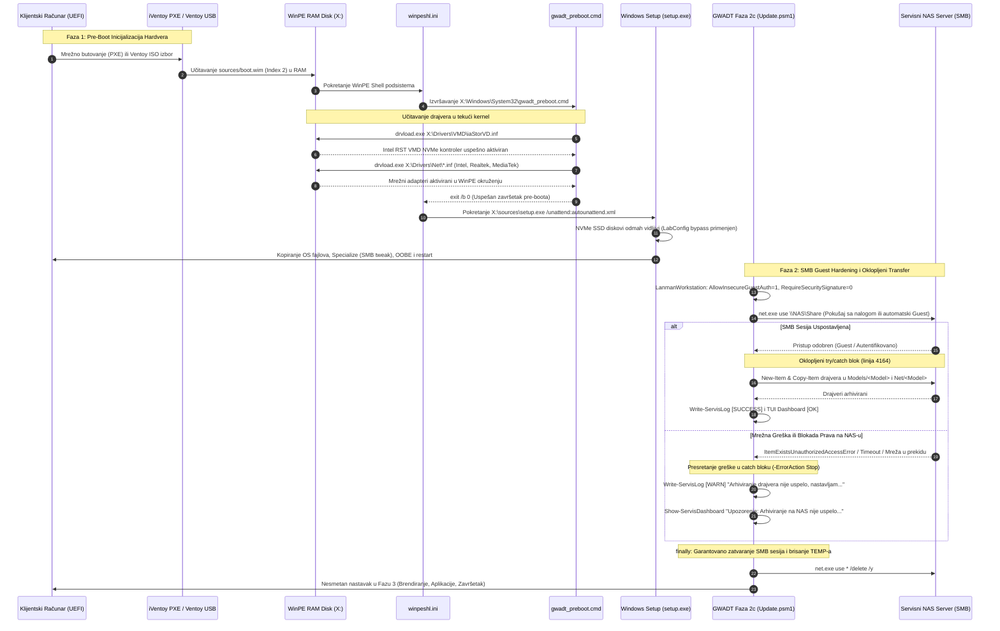

# ADR-0029: WinPE Intel VMD i Mrežna Pre-Boot Automatizacija i SMB Guest Hardening za Windows 11 24H2

## 1. Kontekst i Problem

Uvođenjem lokalnog NAS Pre-Patch keširanja ([ADR-0026](file:///home/gru/Projects/WIS Service%20windows%2011%20automat/wiki/decisions/ADR-0026-nas-smb-update-caching.md)), samoučećeg prikupljanja mrežnih drajvera ([ADR-0027](file:///home/gru/Projects/WIS Service%20windows%2011%20automat/wiki/decisions/ADR-0027-self-learning-driver-harvesting-and-nas-sync.md)) i sveobuhvatnog Pre-Install mehanizma svih hardverskih drajvera ([ADR-0028](file:///home/gru/Projects/WIS Service%20windows%2011%20automat/wiki/decisions/ADR-0028-universal-driver-harvesting-and-nas-sync.md)), instalacioni i servisni tok na operativnom sistemu Windows 11 doveden je do visokog nivoa efikasnosti.

Međutim, prelazak radionice na mrežni PXE boot (putem serviserskog **iVentoy** PXE servera na NAS-u) i uvođenje novog izdanja **Windows 11 24H2** otkrili su dva kritična problema koja su ugrožavala temeljnu **Zero-Touch** filozofiju GWADT sistema:

### Problem 1: WinPE na PXE butu (iVentoy) u RAM-u nema Intel VMD drajvere (Intel 10-14. gen RST NVMe kontroler)
Prilikom pokretanja instalacije preko PXE mreže (iVentoy) ili Ventoy USB medijuma na savremenim prenosnim i desktop računarima sa procesorima Intel Core 10, 11, 12, 13. i 14. generacije (Tiger Lake, Alder Lake, Raptor Lake, Meteor Lake), skladišni NVMe kontroler fabrički radi u **Intel VMD** (*Volume Management Device*) / Intel RST režimu.
- Kada se WinPE (`sources/boot.wim`, Index 2) učita u RAM virtuelni disk (`X:\`), fabrička Microsoft slika **ne poseduje ugrađene Intel RST VMD drajvere** (`iaStorVD.sys` / `iaStorVD.inf`), niti poseduje drajvere za moderne integrisane mrežne kartice.
- Kao posledica toga, čim se pokrene `setup.exe`, Windows Setup ne može da detektuje interni NVMe SSD disk i zaustavlja se uz blokirajući modalni dijalog:
  > *"A media driver your computer needs is missing. This could be a DVD, USB or Hard disk driver. If you have a CD, DVD, or USB flash drive with the driver on it, please insert it now."*
- Ovaj prekid je primoravao servisera da ručno ubacuje dodatni USB fleš sa F6 drajverima i pretražuje foldere, čime se u potpunosti gubila automatizacija instalacije.

### Problem 2: Windows 11 24H2 fabrički blokira nesiguran SMB Guest pristup (`AllowInsecureGuestAuth = 0`)
U novom izdanju Windows 11 24H2 (i srodnim kumulativnim bezbednosnim ažuriranjima za 22H2/23H2), Microsoft je uveo znatno strožije bezbednosne polise za SMB klijentski servis (`LanmanWorkstation`):
- Podrazumevana vrednost parametra `AllowInsecureGuestAuth` u registru je postavljena na `0` (onemogućen neautentifikovani/guest pristup).
- Podrazumevana vrednost parametra `RequireSecuritySignature` zahteva strogo digitalno potpisivanje SMB sesija.
- U radioničkom okruženju, serviserski NAS server često nudi anonimno (Guest) deljenje za repozitorijum drajvera i zakrpi kako bi se izbeglo čuvanje osetljivih lozinki. Prilikom izvršavanja funkcije `Export-ServisHardwareDrivers` u Fazi 2c (tačnije na liniji 4164 u kompajliranoj skripti), operacija kreiranja foldera (`New-Item`) ili prenosa datoteka (`Copy-Item`) na NAS izazivala je fatalnu PowerShell grešku:
  > `ItemExistsUnauthorizedAccessError: You can't access this shared folder because your organization's security policies block unauthenticated guest access.`
- Ukoliko ovakva mrežna greška nije bila oklopljena na nivou samog koda, dolazilo je do nepredviđenog prekida skripte pre prelaska u Fazu 3 (optimizacija, brendiranje i tihe instalacije aplikacija).

Bilo je neophodno projektovati trajno arhitektonsko rešenje koje obuhvata:
1. Automatizovano ubrizgavanje VMD i mrežnih drajvera direktno u `sources/boot.wim` i autonomno pozivanje pre pokretanja setup-a (WinPE Pre-Boot faza).
2. Sistematsko prilagođavanje LanmanWorkstation SMB polisa kroz sve faze životnog ciklusa sistema za potrebe Windows 11 24H2.
3. Neprobojno oklopljavanje mrežnih operacija u PowerShell modulima (`try/catch` sa `WARN` nivoom) koje garantuje da nikakav problem sa NAS serverom ne može zaustaviti pripremu računara za klijenta.

---

## 2. Razmatrane Opcije

### Opcija 1: Ručno učitavanje drajvera tokom Windows Setup-a (F6/Browse) i unos akreditiva
- *Prednosti:* Nema potrebe za modifikacijom `boot.wim` niti podešavanjem registarskih polisa.
- *Mane:* Potpuni krah automatizacije. Serviser mora fizički da stoji pored svakog računara u servisu, priključuje poseban USB sa drajverima i klikće kroz čarobnjake. Neprihvatljivo za profesionalni servis.

### Opcija 2: Ručno gašenje Intel VMD kontrolera u UEFI BIOS podešavanjima računara
- *Prednosti:* SSD postaje prepoznatljiv kao standardni AHCI/NVMe uređaj.
- *Mane:* Mnogi savremeni laptopi (HP Pavilion/Envy, Lenovo IdeaPad/ThinkBook, Acer Aspire) u najnovijim verzijama BIOS-a **uopšte nemaju opciju za isključivanje VMD-a**. Takođe, ručni ulazak u BIOS troši vreme, a eventualni kasniji fabrički reset BIOS-a od strane korisnika obara Windows uz BSOD (`INACCESSIBLE_BOOT_DEVICE`).

### Opcija 3: Potpuna WinPE Pre-Boot automatizacija (`wimlib-imagex update` u `boot.wim` + `winpeshl.ini` + `gwadt_preboot.cmd`) i LanmanWorkstation SMB Hardening sa dvostepenim fallbackom i try/catch oklopom (Usvojeno)
- *Prednosti:*
  1. **100% Zero-Touch PXE i Ventoy Boot:** Računar pokrenut preko iVentoy PXE servera ili USB fleša automatski inicijalizuje Intel VMD drajvere i sve mrežne kartice pre startovanja `setup.exe`. Diskovi su odmah vidljivi u čarobnjaku, a prelazak u instalaciju je trenutan.
  2. **Automatsko prilagođavanje za Windows 11 24H2:** Registarski ključevi `AllowInsecureGuestAuth = 1` i `RequireSecuritySignature = 0` konfigurišu se u fazama `windowsPE`, `specialize`, u post-instalacionim batch skriptama i dinamički u PowerShell-u.
  3. **Zero-Block garancija za klijenta:** Oklopljavanje operacija arhiviranja na NAS garantuje da eventualni mrežni ispad, gašenje NAS-a ili restrikcija prava na deljenju nikada ne zaustavlja instalaciju sistema i softvera za klijenta.
  4. **Dvostepeni SMB pristup:** Podrška za autentifikovani pristup (korisnik/lozinka) sa automatskim prelazom na Guest pristup bez zastoja.

---

## 3. Doneta Odluka i Arhitektura

Usvaja se celovito rešenje koje se sastoji iz dva komplementarna inženjerska stuba:
1. **WinPE Zero-Touch Pre-Boot podsistem:**
   - Skripta `Skripte/Patch-BootWim.py` direktno preko alata `wimlib-imagex update` u indeks 2 datoteke `sources/boot.wim` ubacuje:
     * Drajvere za skladište: `/Drivers/VMD/` (Intel RST VMD v19.5.1.1040 za 10-14. generaciju Intel procesora).
     * Mrežne drajvere: `/Drivers/Net/` (Intel LAN/WiFi, Realtek LAN/USB/WiFi, MediaTek WiFi).
     * Pre-boot startnu konfiguraciju: `/Windows/System32/winpeshl.ini`.
     * Pre-boot inicijalizator: `/Windows/System32/gwadt_preboot.cmd`.
   - Prilikom butovanja WinPE-a, `winpeshl.ini` presreće fabrički tok i najpre pokreće `gwadt_preboot.cmd` koji pomoću sistemskog alata `drvload.exe` učitava drajvere u kernel, a potom nesmetano predaje kontrolu standardnom `setup.exe`.
2. **LanmanWorkstation SMB Guest Hardening i Oklopljavanje:**
   - Podešavanje registarskih vrednosti `AllowInsecureGuestAuth = 1` i `RequireSecuritySignature = 0` na 4 nivoa:
     * `autounattend.xml`: Faza `windowsPE` (RunSynchronous order 7 i 8) i faza `specialize` (RunSynchronous order 5 i 6).
     * `sources/$OEM$/$$/Setup/Scripts/SetupComplete.cmd`.
     * `FirstLogon.cmd` (sinhronizovano na svim lokacijama: root, `Skripte/`, `$OEM$`).
     * `Skripte/Modules/GWADT.Update.psm1`: dinamički pre svakog SMB mapiranja.
   - Uvođenje dvostepenog mapiranja (`net.exe use` sa unetim podacima, pa automatski fallback na Guest).
   - Oklopljavanje celokupnog bloka arhiviranja drajvera na NAS u `try/catch` sa nivoom `WARN`, čime se garantuje prelazak u Fazu 3 čak i pri totalnom prekidu rada NAS-a.

### Mermaid Dijagram Sekvence: WinPE Pre-Boot i Faza 2c SMB Hardening



---

## 4. Detaljan Opis Tehničkih Komponenti

### 4.1. Automatizovana Skripta `Skripte/Patch-BootWim.py`
Skripta vrši offline modifikaciju `sources/boot.wim` datoteke bez montiranja WIM slike (što zahteva administrativna/root prava i često izaziva zaključavanje drajvova na Linuxu):
- Koristi `wimlib-imagex update` uz privremenu listu instrukcija:
  ```cmd
  delete --force --recursive /Drivers/VMD
  add "<root>/Za disk 10+ gen/RST-F6Floppy-19.5.1.1040" /Drivers/VMD
  delete --force --recursive /Drivers/Net
  add "<root>/sources/$OEM$/$1/setup/Drivers/Net" /Drivers/Net
  add "<temp>/winpeshl.ini" /Windows/System32/winpeshl.ini
  add "<temp>/gwadt_preboot.cmd" /Windows/System32/gwadt_preboot.cmd
  ```
- Obezbeđuje atomski i idempotentni update indeksa 2 (Windows Setup okruženje).
- Poseduje ugrađeni mehanizam automatske izrade rezervne kopije (`sources/boot.wim.bak`).
- Vrši automatsku verifikaciju prisustva svih integrisanih komponenti nakon ubacivanja.

### 4.2. Inicijalizacione Skripte `winpeshl.ini` i `gwadt_preboot.cmd`
- **`winpeshl.ini`** (postavljen u `X:\Windows\System32\`):
  Definiše redosled pokretanja procesa pre nego što Windows preuzme kontrolu:
  ```ini
  [LaunchApps]
  %SYSTEMROOT%\System32\gwadt_preboot.cmd
  %SYSTEMDRIVE%\sources\setup.exe
  ```
- **`gwadt_preboot.cmd`** (postavljen u `X:\Windows\System32\`):
  Izvršava pre-boot učitavanje drajvera:
  ```cmd
  @echo off
  title GWADT Pre-Boot Hardware Initialization
  echo =======================================================
  echo  GWADT WinPE Pre-Boot: Inicijalizacija drajvera...
  echo =======================================================
  echo [*] Ucitavam Intel VMD RST drajvere za NVMe diskove...
  if exist "X:\Drivers\VMD\iaStorVD.inf" (
      drvload.exe "X:\Drivers\VMD\iaStorVD.inf"
  )
  echo [*] Ucitavam osnovne mrezne drajvere...
  for /R "X:\Drivers\Net" %%f in (*.inf) do (
      drvload.exe "%%f" >nul 2>&1
  )
  echo [*] Hardverska inicijalizacija zavrsena. Pokrecem Windows Setup...
  exit /b 0
  ```
- **Rezultat:** Drajver za Intel RST VMD (`iaStorVD.inf`) i svi kurirani mrežni drajveri učitavaju se u RAM pre nego što se `setup.exe` uopšte pokrene. Kada se čarobnjak pojavi, NVMe SSD je inicijalizovan, particije su dostupne, a operater jednim klikom započinje proces.

### 4.3. LanmanWorkstation SMB Registry Tweakovi za Windows 11 24H2
Za prevazilaženje fabričkih restrikcija u Windows 11 24H2, implementirani su registarski parametri:
- **Putanja:** `HKLM\SYSTEM\CurrentControlSet\Services\LanmanWorkstation\Parameters`
- **Vrednosti:**
  * `AllowInsecureGuestAuth` = `1` (DWORD) — Omogućava pristup anonimnim deljenim resursima bez naloga.
  * `RequireSecuritySignature` = `0` (DWORD) — Onemogućava obavezno SMB potpisivanje koje prekida komunikaciju sa NAS uređajima bez konfigurisanog SMB3 potpisa.
- **Mesta implementacije:**
  1. `autounattend.xml`:
     * Prolaz `windowsPE` (RunSynchronous Order 7 i 8)
     * Prolaz `specialize` (RunSynchronous Order 5 i 6)
  2. `sources/$OEM$/$$/Setup/Scripts/SetupComplete.cmd` (izvršava se pre prvog logovanja korisnika).
  3. `FirstLogon.cmd` (na svim lokacijama: root, `Skripte/`, `sources/$OEM$/$$/Setup/Scripts/`).
  4. Dinamički u `Skripte/Modules/GWADT.Update.psm1` pre svakog pokušaja povezivanja na NAS.

### 4.4. Oklopljavanje Mrežnog Prenosa i Dvostepeni SMB Fallback
U modulu `GWADT.Update.psm1`, funkcije `Export-ServisHardwareDrivers`, `Invoke-ModelDriversPreInstall` i `Invoke-NasUpdatePrePatch` unapređene su dvostepenim logovanjem i zaštitnim blokovima:
- **Dvostepeni pokušaj mapiranja:**
  ```powershell
  $mapped = $false
  if ($nas.Username -and $nas.Password) {
      & net.exe use "$uncShare" /user:"$($nas.Username)" "$($nas.Password)" >$null 2>&1
      if ($LASTEXITCODE -eq 0) { $mapped = $true }
  }
  if (-not $mapped) {
      & net.exe use "$uncShare" >$null 2>&1
      if ($LASTEXITCODE -eq 0) { $mapped = $true }
  }
  ```
- **Striktni `try/catch` oklop sa `-ErrorAction Stop`:**
  Kritične operacije kreiranja direktorijuma na NAS-u (`New-Item`) i kopiranja drajvera (`Copy-Item`) izolovane su u sopstveni `try/catch` blok:
  ```powershell
  try {
      if (-not (Test-Path $nasModelDest -ErrorAction SilentlyContinue)) {
          New-Item -Path $nasModelDest -ItemType Directory -Force -ErrorAction Stop | Out-Null
      }
      # Kopiranje INF paketa...
      Copy-Item -Path "$srcFolder\*" -Destination $destFolder -Recurse -Force -ErrorAction Stop
  } catch {
      Write-ServisLog "UPOZORENJE: Arhiviranje drajvera na NAS server nije uspelo ($($_.Exception.Message)). Nastavljam sa servisnim procesom..." -Level "WARN" -Component "DriverHarvest"
      Show-ServisDashboard -LiveStatus "Upozorenje: Arhiviranje drajvera na NAS nije uspelo, nastavljam..."
  }
  ```
  Ovaj oklop garantuje da greška `ItemExistsUnauthorizedAccessError` (ili bilo koji mrežni prekid) **nikada više ne može srušiti skriptu**, već se evidentira upozorenje i rad se neometano nastavlja.

---

## 5. Bezbednosni Standardi i Sanitizacija

Uprkos privremenom omogućavanju `AllowInsecureGuestAuth` radi servisnog rada:
1. **Garantovano zatvaranje SMB sesija:** Svaka PowerShell funkcija u svom `finally` bloku bezuslovno izvršava:
   ```cmd
   net.exe use * /delete /y
   ```
   čime se osigurava da na klijentskoj mašini ne ostaju otvorene mrežne sesije ka radioničkoj infrastrukturi.
2. **Čišćenje privremenih drajvera:** Svi ekstrahovani paketi u `$env:TEMP` se brišu odmah po završetku izvoza.
3. **Konačna sanitizacija pre isporuke:** U Fazi 5 (`GWADT.Cleanup.psm1`), sa računara se nepovratno uklanjaju konfiguracione datoteke `Wifi-Servis.ini`, privremeni folder `C:\setup` i svi servisni nalozi, čime se klijentu isporučuje čist i bezbedan sistem.

---

## 6. Verifikacija i Generisani Artefakti

Implementacija je prošla kroz rigoroznu višestepenu QA verifikaciju:
- **QA Test Suite-ovi (100% PASS):**
  * `Skripte/Test-Task046-QA.py`: 4/4 bloka uspešno položeno (LanmanWorkstation tweakovi, dvostepeni SMB fallback, try/catch oklop i jednakost kontrolnih suma).
  * `Skripte/Test-GWADTModules.py`: 8/8 modula, 69 funkcija položeno (100% PASS).
  * `Skripte/Verify-PowerShellSyntax.py`: PowerShell 5.1 AST analiza potvrdila 0 sintaksnih grešaka i 100% balans koda.
  * Regresioni testovi `Test-Task045-QA.py` i `Test-Task044-QA.py`: 100% PASS.
- **Integritet WIM slike:**
  * Provereno prisustvo `/Drivers/VMD/` i `/Drivers/Net/` drajvera u `sources/boot.wim` (Index 2).
  * Verifikovan sadržaj datoteka `winpeshl.ini` i `gwadt_preboot.cmd` direktnom ekstrakcijom iz WIM-a.
- **Sinhronizacija skripti:**
  * `Install-ServisApps.ps1` rekompajliran i sinhronizovan na sve 3 lokacije (MD5: `bdc68a684f1124a2416de406053def7c`).
  * `Wifi-Servis.ini` sinhronizovan na sve 3 lokacije (MD5: `bdfb4c1ecad58eda36760cbc8ac09b73`).
- **Generisana nova zvanična ISO slika:**
  * **Naziv fajla:** `GWADT-Win11-Pro-10.0.26200.8037.iso`
  * **Veličina:** 8.74 GB
  * **MD5 kontrolna suma:** `d69de97cad8fe9fd9ff46ee0888b62fa`
  * **Distribucija:** Uspešno sinhronizovano na skladište servisnog NAS servera u direktorijum `/home/gru/Storage/Boot_ISO/01_Windows/` za potrebe iVentoy PXE i Ventoy USB instalacija.

---

## 7. Posledice i Operativne Koristi

| Aspekt | Pre ADR-0029 | Sa ADR-0029 |
|---|---|---|
| **PXE / Ventoy Boot na Intel 10-14. gen** | Zastoj uz dijalog o nedostajućim drajverima (VMD NVMe nije prepoznat) | **100% Zero-Touch:** drajveri se učitavaju pre setup-a, diskovi su odmah vidljivi |
| **Mreža u WinPE okruženju** | Ograničeno na fabričke drajvere; nema podrške za novije Wi-Fi/LAN čipove | Automatski učitani Intel, Realtek i MediaTek drajveri u RAM |
| **Windows 11 24H2 SMB Guest Pristup** | Blokada i prekid skripte na liniji 4164 (`ItemExistsUnauthorizedAccessError`) | Usklađene polise u registru, omogućen nesmetan rad sa radioničkim NAS-om |
| **Otpornost na Mrežne Kvarove** | Pad ili nedostupnost NAS-a mogla je prekinuti instalacioni proces | **Zero-Block garancija:** `WARN` obaveštenje, proces bezuslovno nastavlja dalje |
| **Ušteda Vremena Servisera** | 5 do 15 minuta ručne intervencije po laptopu novije generacije | **0 sekundi:** Potpuno automatizovan tok od butovanja do gotovog računara |

---

## 🔗 Povezane Beleške i Odluke
- [[index]] — Centralni indeks znanja i MOC.
- [[architecture/overview]] — Pregled arhitekture sistema GWADT.
- [[architecture/hardware-bypass]] — Zaobilaženje hardverskih restrikcija u WinPE fazi.
- [[architecture/network-wlan]] — Mrežni podsistem i servisni Wi-Fi.
- [[decisions/ADR-0025-universal-netdriver-fallback]] — Univerzalni fallback mrežnih drajvera.
- [[decisions/ADR-0026-nas-smb-update-caching]] — Lokalno NAS SMB keširanje zakrpi.
- [[decisions/ADR-0027-self-learning-driver-harvesting-and-nas-sync]] — Samoučeće prikupljanje mrežnih drajvera.
- [[decisions/ADR-0028-universal-driver-harvesting-and-nas-sync]] — Sveobuhvatno prikupljanje svih drajvera po modelima.
