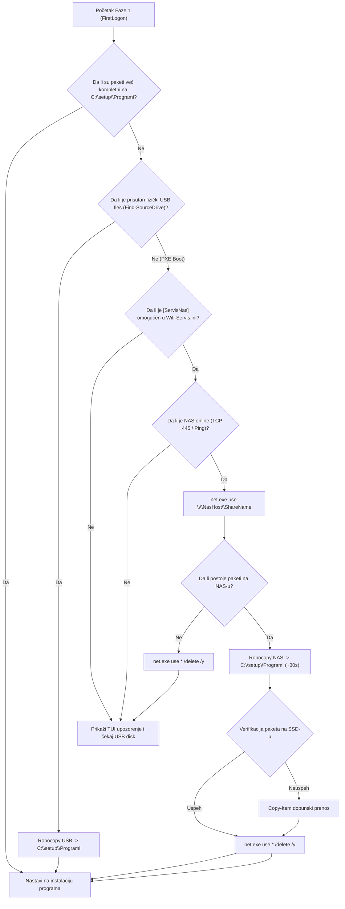

# ADR-0032: Automatska NAS SMB Sinhronizacija i Fallback za Instalacione Pakete Programa pri PXE Boot-u

## 1. Kontekst i Problem

Nakon uspešnog rešavanja iVentoy PXE mrežnog butovanja (ADR-0031) i uspešne instalacije operativnog sistema Windows 11 Pro preko lokalne mreže, tokom FirstLogon faze (`Install-ServisApps.ps1`) uočeno je da instalacioni paketi programa (`Programi/` folder koji sadrži Office 2024, Adobe Acrobat Pro, Google Chrome, WinRAR, BatteryBar i OEM Licenca) **nisu prekopirani na lokalni SSD** (`C:\setup\Programi`).

### Root Cause Analiza:
1. **Razlika u medijumu između USB i PXE buta:**
   - Prilikom instalacije sa fizičkog USB fleš diska, fleš medijum ostaje priključen na računar (kao `D:\` ili `E:\`) i sadrži folder `Programi`.
   - Prilikom **iVentoy PXE mrežnog buta**, računar **nema priključen nikakav fizički USB disk**; nakon završetka Windows Setup faze, u sistemu postoji isključivo `C:\` disk.
2. **Ponašanje funkcije `Find-SourceDrive`:**
   - Funkcija `Find-SourceDrive` u `GWADT.Core.psm1` skenira isključivo lokalne particije sistema koje nisu `C:\`:
     ```powershell
     $drives = Get-PSDrive -PSProvider FileSystem | Where-Object { $_.Root -and ($_.Root -ne "C:\") }
     ```
   - Kada je u sistemu prisutan samo `C:\`, `Find-SourceDrive` vraća prazan string `""`.
3. **Prekid toka instalacije programa:**
   - Inicijalni blok u `Install-ServisApps.ps1` (linije 7225–7265) proverava `if ($SourceRoot)` pre pokretanja prenosa paketa. Pošto je `$SourceRoot` bio prazan, kopiranje je u potpunosti preskočeno.
   - Kasnije, kada kontrola stigne do `Ensure-ProgramiAvailable` / `Install-CoreApps`, skripta proverava postojanje Office i Adobe instalera na `C:\setup\Programi`. Pošto paketi nedostaju, skripta prikazuje upozorenje i ulazi u petlju od 60 pokušaja (2 minuta) čekajući da serviser ručno ubaci USB fleš disk. Ukoliko USB disk ne bude ubačen, instalacija svih programa se preskače.

---

## 2. Razmatrane Opcije

1. **Opcija A: Ugradnja foldera `Programi` direktno unutar ISO slike (`sources/$OEM$/$1/setup/Programi`)**
   - *Prednosti:* 100% autonomno, paketi se prebacuju na disk tokom samog Windows Setup-a.
   - *Mane:* Veličina ISO slike raste sa 8.17 GB na preko 12.4 GB. Prenos 12.4 GB preko iVentoy PXE mreže značajno usporava instalaciju i zauzima mrežni protok. Svako ažuriranje Office-a ili Chrome-a zahteva ponovni rebuild i redistribuciju celog ISO-a.
2. **Opcija B: Direktno pokretanje instalacija sa mreže (Direct SMB Stream)**
   - *Prednosti:* Ne troši 4.2 GB prostora na lokalnom SSD-u, nema čekanja na robocopy.
   - *Mane:* Office Click-to-Run i Adobe Acrobat instaleri često pucaju ili se blokiraju kada se pokreću preko UNC mrežnih putanja ili nestabilnih bežičnih veza.
3. **Opcija C: Automatski NAS SMB Fallback sa robocopy prenosom na SSD [PRIHVAĆENO]**
   - *Prednosti:* ISO ostaje izuzetno kompaktan (8.17 GB) i brzo se butuje. Ako nema fizičkog USB diska, skripta automatski preuzima pakete sa lokalnog servisnog TrueNAS servera (`\\192.168.170.254\servis\Programi`) preko gigabitnog LAN-a za samo ~30–40 sekundi. Nakon prenosa, instalacija se pokreće lokalno sa SSD-a što pruža 100% stabilnost.

---

## 3. Doneta Odluka i Arhitektura

Usvojena je **Opcija C**. Uveden je hibridni model distribucije instalacionih paketa:
1. **Lokalni USB Fleš (Primarni izvor):** Ako je prisutan, paketi se prebacuju sa USB-a.
2. **Servisni NAS SMB Server (Sekundarni/PXE izvor):** Ako nema USB-a, skripta proverava lokalnu mrežu, mapira SMB resurs na TrueNAS serveru, kopira pakete i garantovano zatvara sesiju.
3. **Interaktivni serviserski upit (Terenski Fallback):** Ako računar radi van servisa (nema ni USB ni NAS), skripta obaveštava korisnika da ubaci USB fleš disk.

### Arhitektonski Dijagram Toka:



---

## 4. Implementirane Komponente

### 1. Centralni NAS Repozitorijum na TrueNAS-u
- Folder `Programi` (4.43 GB) postavljen u koren SMB deljenja `servis`:
  `\\192.168.170.254\servis\Programi\`
- Sadrži:
  - `Office 2024\` (OInstall + Office 16.0.14334.20848 podaci)
  - `Adobe.Acrobat.Pro.2024.x64.Multilingual\`
  - `GoogleChromeStandaloneEnterprise64.msi`
  - `winrar-x64-701.exe`
  - `BatteryBarSetup-3.6.6.exe`
  - `CustomScripts\` (Opcioni post-install skriptovi)

### 2. Funkcija `Sync-ProgramiFromNas` u `GWADT.Core.psm1`
- Čita konfiguraciju iz `[ServisNas]` (`Wifi-Servis.ini`).
- Proverava mrežni odziv NAS-a (`Test-NasHostOnline`).
- Mapira SMB deljenje sa ili bez kredencijala (podrška za Windows 11 Guest autentifikaciju).
- Proverava prisustvo paketa na NAS-u.
- Prikazuje profesionalni TUI statusni baner serviseru.
- Izvršava `robocopy.exe "\\<NasHost>\<ShareName>\Programi" "C:\setup\Programi" /E /R:1 /W:1 /NDL /NFL /NJH /NJS`.
- U slučaju potrebe vrši poravnanje ugnježdenih foldera (`Repair-ProgramiNesting`).
- Sprovodi rigoroznu verifikaciju paketa (Office, Adobe, Chrome).
- **Safety Guardrail:** U `finally` bloku garantovano zatvara sve mrežne konekcije:
  ```powershell
  & net.exe use "$uncShare" /delete /y >$null 2>&1
  & net.exe use * /delete /y >$null 2>&1
  ```

### 3. Nadogradnja `Ensure-ProgramiAvailable` i POSTAMBLE Inicijalizacije
- U `Ensure-ProgramiAvailable`: pre ulaska u blokirajuću petlju sa zvučnim signalom i čekanjem USB-a, skripta poziva `Sync-ProgramiFromNas`. Ako NAS prenos uspe, funkcija momentalno vraća lokalnu putanju i nastavlja rad bez ikakve pauze!
- U inicijalnom bloku monolitne skripte: ako se detektuje nedostatak lokalnih paketa pri pokretanju skripte na računaru bez USB-a, automatski se pokreće NAS preuzimanje.

---

## 5. Bezbednosni Standardi i Verifikacija

1. **Zaštita mrežnih akreditiva:**
   - Kredencijali za NAS se nikada ne ostavljaju u perzistentnim mrežnim mapiranjima.
   - Svaki poziv `net use` je izolovan u `try/finally` bloku sa obaveznim `net use * /delete /y`.
2. **Automatsko Testiranje (QA Suite):**
   - Kreiran dedikovani test `Skripte/Test-Task049-QA.py` (5/5 test blokova, 100% PASS).
   - Verifikovana PowerShell 5.1 AST sintaksa bez grešaka (`Verify-PowerShellSyntax.py`).
   - Verifikovana identičnost MD5 heševa monolitne skripte na sve 3 lokacije.

---

## 6. Posledice i Koristi

- **Ekspresan PXE Boot:** Veličina ISO slike ostaje optimalnih 8.17 GB, što omogućava trenutno pokretanje klijenta preko iVentoy servera.
- **Centralizovano Održavanje:** Ažuriranje verzije programa (npr. novi Chrome MSI ili noviji WinRAR) vrši se direktno na NAS deljenju `\\192.168.170.254\servis\Programi`, bez potrebe za prepakivanjem ISO slike.
- **Univerzalnost:** Skripta identično i besprekorno funkcioniše i pri butovanju sa fizičkog USB diska i pri butovanju preko iVentoy PXE mreže.
