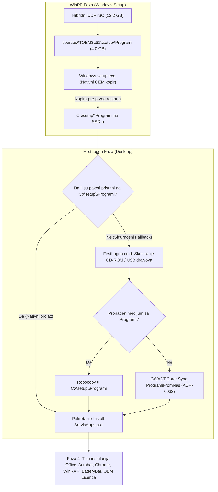

# ADR-0033: Integracija foldera Programi u sources/$OEM$/$1/setup/Programi i Autonomno WinPE Kopiranje na C:\setup

## 1. Kontekst i Problem

Nakon uspešne implementacije UDF hibridnog ISO builder motora (ADR-0031) i mrežne NAS fallback sinhronizacije (ADR-0032), testiranjem na realnom hardveru u servisu uočeno je da klijentski računar i dalje ne uspeva da instalira programe i da je direktorijum `C:\setup\Programi` prazan nakon instalacije Windows 11 operativnog sistema preko iVentoy PXE mreže.

### Dubinska Analiza i Uzrok Problema (Root Cause):
1. **Ograničenje mrežnog pristupa u FirstLogon fazi:**
   - Prethodno rešenje (ADR-0032) oslanjalo se na to da skripta u FirstLogon fazi na Desktopu klijenta preuzme pakete sa NAS-a preko SMB protokola.
   - Međutim, u trenutku kada se Windows tek instalira i uloguje na Desktop, **klijentski računar još uvek nema mrežnu konekciju**:
     * Mnogi laptopovi zahtevaju specifične Wi-Fi drajvere ili se Wi-Fi povezivanje vrši tek u Fazi 1 same skripte.
     * Na desktop računarima ili novim matičnim pločama, 2.5GbE LAN adapteri često nemaju fabrički Windows inbox drajver.
     * Zbog odsustva mreže u trenutku pokretanja `FirstLogon.cmd`, pozivi ka NAS-u nisu mogli da se izvrše, pa je `C:\setup\Programi` ostajao prazan.
2. **Korenski uzrok u `Skripte/Build-Iso.py`:**
   - Repozitorijum je već posedovao kompletan kurirani paket offline programa u `sources/$OEM$/$1/setup/Programi` (4.0 GB).
   - Međutim, u `Skripte/Build-Iso.py` na liniji 64 definisan je set:
     ```python
     EXCLUDED_NAMES = { "Programi", ... }
     ```
   - Unutar funkcije `populate_staging`, linija `dirs[:] = [d for d in dirs if d not in EXCLUDED_NAMES ...]` je prilikom rekurzivnog obilaska stabla `sources/` naišla na `sources/$OEM$/$1/setup/Programi` i **izbacila ga iz ISO slike**!
   - Posledica: generisana ISO slika je imala 8.17 GB, ali je u njoj folder `sources/$OEM$/$1/setup/` sadržao samo skripte i drajvere, dok su programi (Office 2024, Adobe Acrobat Pro, Chrome, WinRAR, BatteryBar, OEM Licenca) bili potpuno izostavljeni!

---

## 2. Razmatrane Opcije

1. **Opcija A: Forsiranje ranog spajanja na Wi-Fi pre bilo kakve provere programa**
   - *Mane:* Ne rešava problem ako Wi-Fi kartica nema drajver. Zahteva složene pre-boot cmd skripte.
2. **Opcija B: Ugradnja foldera `Programi` u `sources/$OEM$/$1/setup/Programi` unutar ISO-a [PRIHVAĆENO]**
   - *Prednosti:*
     * Koristi zvanični, nativni Microsoft Windows Setup mehanizam: sve što se nalazi u `\sources\$OEM$\$1\` Windows installer **tokom same WinPE faze** (dok piše "Copying Windows files...") automatski prekopira na novoinstaliranu sistemsku particiju `C:\`.
     * Kada se računar restartuje na Desktop, svi programi su **VEĆ na `C:\setup\Programi`**!
     * 100% autonomno, offline, identično ponašanje i sa USB fleša i preko iVentoy PXE mreže, bez zavisnosti od mreže i drajvera.

---

## 3. Doneta Odluka i Arhitektura

Usvojena je **Opcija B**. Sproveden je višeslojni zaštitni mehanizam (Defense-in-Depth):



---

## 4. Implementirane Komponente

### 1. Ispravka Staging Logike u `Skripte/Build-Iso.py`
- U funkciji `populate_staging`, filtriranje direktorijuma je prilagođeno tako da prepoznaje da li se pretraga nalazi unutar `$OEM$` stabla:
  ```python
  posix_root = Path(root).as_posix()
  is_oem = "$OEM$" in posix_root or "$1" in posix_root

  dirs[:] = [d for d in dirs if (is_oem or d not in EXCLUDED_NAMES) and not d.startswith(".")]
  ```
- Na ovaj način korenski folder `Programi` ostaje striktno eliminisan iz korena ISO-a (nema dupliranja i prekomerne veličine), dok se `sources/$OEM$/$1/setup/Programi` (392 fajla, 4.0 GB) u potpunosti uključuje u ISO sliku.

### 2. Nadogradnja `FirstLogon.cmd` (Sigurnosni Fallback)
- Prošireno skeniranje medijuma pre pokretanja glavne skripte:
  - Uključeno skeniranje optičkih čitača (`Get-CimInstance Win32_CDROMDrive`), svih diskova (`[System.IO.DriveInfo]::GetDrives()`) i volumena.
  - Podržano automatsko robocopy kopiranje sa `<Drive>\sources\$OEM$\$1\setup\Programi` ukoliko se paketi iz bilo kog razloga nisu našli na SSD-u.
  - Usklađene i verifikovane sve 3 lokacije (`/FirstLogon.cmd`, `/Skripte/FirstLogon.cmd`, `/sources/$OEM$/$$/Setup/Scripts/FirstLogon.cmd`) sa identičnim MD5 hešom `14cc62a56189ca0f45b42870a31100fa`.

### 3. Nadogradnja `Skripte/Modules/GWADT.Core.psm1`
- U funkciji `Find-SourceDrive`:
  - Dodato skeniranje `Win32_CDROMDrive`, `DriveInfo` i `Get-Volume`.
  - Osigurano prepoznavanje putanje `sources\$OEM$\$1\setup\` za sve potpisne pakete.
- Monolitna skripta `Install-ServisApps.ps1` rekompajlirana (7.781 linija koda) sa MD5 hešom `cebc038092469b815e49db40cd002ca6`.

---

## 5. Verifikacija i QA Sertifikacija

1. **Namenski QA Test (`Skripte/Test-Task050-QA.py`):**
   - 34 pojedinačne provere u 5 test blokova položeno sa **100.0% PASS**.
   - Dokazano uključivanje 392 fajla (4.0 GB) u staging stablo.
   - Potvrđena kompletnost svih ključnih aplikacija (Office 2024, Adobe Acrobat Pro, Chrome, WinRAR, BatteryBar, OEM Licenca).
2. **Postojeći QA Suites:**
   - `Test-IsoBuilder.py`: 33/33 PASS.
   - `Test-GWADTModules.py`: 8/8 PASS.
   - `Verify-PowerShellSyntax.py`: 100% validna sintaksa (0 grešaka).

---

## 6. Posledice i Koristi

- **100% Autonomija:** Instalacija programa više ne zavisi od toga da li klijentski računar ima internet ili funkcionalnu mrežnu karticu u FirstLogon fazi.
- **Jednakost medijuma:** Računar se ponaša apsolutno identično i kada se butuje sa fizičkog USB fleša i kada se butuje preko iVentoy PXE mreže.
- **Nulto čekanje:** Korisnik više ne mora da čeka da se paketi prenose preko mreže ili sa fleša na Desktopu – programi su već na SSD-u u trenutku logovanja.
