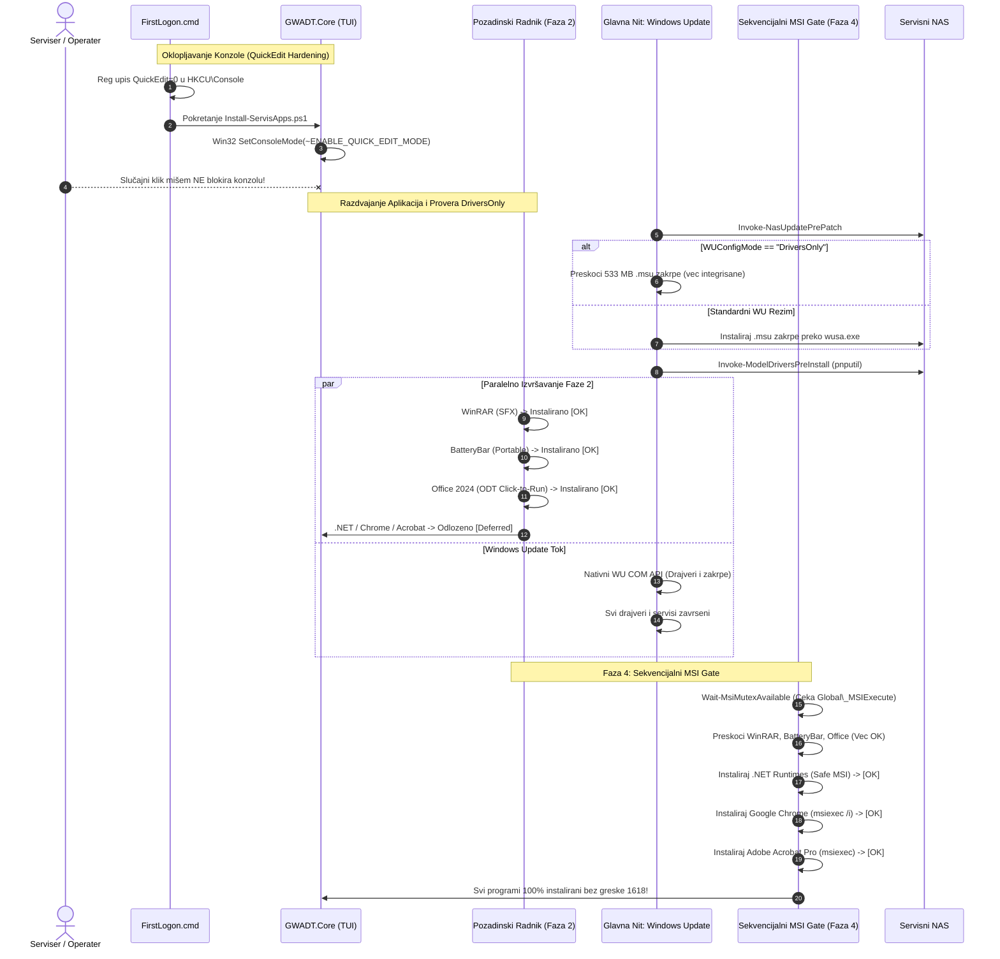

# ADR-0034: Razdvajanje MSI Radnika od Windows Update-a (Prevencija Greške 1618), Sekvencijalni MSI Gate i Gašenje QuickEdit Režima Konzole

## 1. Kontekst i Problem

Tokom terenskog testiranja i verifikacije masovnog deploymenta na novim serijama računara u servisu Tehno-kutak, uočena su tri kritična operativna problema koja su ugrožavala stabilnost i autonomiju procesa:

### a) Zamrzavanje PowerShell konzole usled podrazumevanog Windows QuickEdit moda
U podrazumevanoj konfiguraciji Windows konzole (`cmd.exe` i `powershell.exe`), opcija **QuickEdit Mode** je fabrički omogućena. 
Kada serviser, operater ili korisnik slučajno ili namerno klikne levim tasterom miša bilo gde unutar prozora PowerShell konzole dok skripta radi, Windows konzolni podsistem automatski ulazi u režim selekcije teksta (*Mark Mode*). U tom trenutku, Windows podsistem **kompletno suspenduje (zamrzava) glavnu izvršnu nit procesa**, pauzirajući celokupan tok instalacije, tajmere i mrežnu komunikaciju sve dok operater ne pritisne taster `Enter` ili `Esc`. Ukoliko računar ostane bez nadzora, proces ostaje zamrznut satima.

### b) Greška 1618 (`ERROR_INSTALL_ALREADY_RUNNING`) i kolizija Windows Installer mutexa (`_MSIExecute`)
Radi ubrzanja procesa, GWADT u Fazi 2 paralelno sa Windows Update pre-patch i drajverskim tokom pokreće pozadinskog radnika (`AppWorkerJob` / `$IsWorker = $true`) za instalaciju aplikacija. Međutim:
- Windows Installer servis (`msiexec.exe`) koristi ekskluzivni globalni sistemski mutex `Global\_MSIExecute` koji dozvoljava samo **jednu aktivnu MSI instalacionu transakciju u datom trenutku na nivou celog OS-a**.
- Dok glavna nit instalira kumulativne `.msu` zakrpe i hardverske drajvere (koji često u pozadini aktiviraju `msiexec.exe` ili TrustedInstaller servis), pozadinski radnik je pokušavao da paralelno instalira programe zasnovane na MSI tehnologiji:
  * Microsoft .NET Desktop i ASP.NET Core Runtimes (MSI / Bundle)
  * Google Chrome Enterprise (`GoogleChromeStandaloneEnterprise64.msi`)
  * Adobe Acrobat Pro 2024 (MSI baza `AcroPro.msi` unutar Setup.exe)
- Rezultat je bila trenutna kolizija: `msiexec.exe` vraća fatalni exit kod `1618` (`ERROR_INSTALL_ALREADY_RUNNING`), što je dovodilo do neuspešne instalacije ključnih programa ili ostavljanja zaključanog stanja u `HKLM\...\Installer\InProgress`.

### c) Nepotrebna instalacija 533 MB `.msu` kumulativnih zakrpi u `DriversOnly` režimu
Kada se u servisnoj konfiguraciji `Wifi-Servis.ini` postavi `[WindowsUpdate] Mode=DriversOnly` (sa namerom da se ažuriraju samo hardverski drajveri, npr. na sveže slipstreamovanim WIM slikama koje već sadrže najnoviji LCU), funkcija `Invoke-NasUpdatePrePatch` je ignorisala ovo podešavanje i bezuslovno preuzimala i instalirala masivne `.msu` pakete (preko 533 MB) sa lokalnog NAS servera. Time je trošeno dragoceno vreme (2-4 minuta) na instalaciju zakrpe koja je već integrisana u sistem.

---

## 2. Razmatrane Opcije

### Za Problem QuickEdit moda:
1. **Opcija A: Uputstvo serviserima da ne klikću u prozor konzole** — *Odbijeno*: Ljudski faktor je nepouzdan; prozor se često fokusira klikom miša.
2. **Opcija B: Isključivo upis u registar pre pokretanja** — *Delimično*: Pomaže za nove konzole, ali ne utiče na konzolni prozor koji je već otvoren i aktivan.
3. **Opcija C: Višeslojno gašenje (Registar u `FirstLogon.cmd` + Win32 Console API u `GWADT.Core.psm1`) [PRIHVAĆENO]**: Potpuna eliminacija rizika i pre i tokom izvršavanja.

### Za Problem MSI Greške 1618:
1. **Opcija A: Potpuno ukidanje paralelnog radnika i vraćanje na striktno sekvencijalnu instalaciju** — *Odbijeno*: Povećava ukupno vreme servisa za 5-8 minuta jer se ni bezbedni programi (Office ODT, WinRAR, BatteryBar) ne bi instalirali tokom čekanja na drajvere.
2. **Opcija B: Retry petlja za MSI u radniku** — *Odbijeno*: Stvara agresivno opterećenje CPU-a i diska, rizikuje timeout-e i može omesti instalaciju drajvera.
3. **Opcija C: Hibridno razdvajanje Non-MSI radnika i Sekvencijalnog MSI Gate-a u Fazi 4 [PRIHVAĆENO]**:
   - Programi koji ne koriste MSI (`WinRAR`, `BatteryBar`, `Office Click-to-Run`) instaliraju se paralelno u pozadini.
   - Programi koji koriste MSI (`.NET`, `Chrome`, `Acrobat`) se u radniku bezbedno odlažu sa statusom `Deferred`.
   - U Fazi 4, tek nakon što se Windows Update potpuno završi, sekvencijalni MSI Gate čeka oslobađanje mutexa (`Wait-MsiMutexAvailable`) i tiho završava odložene programe.

---

## 3. Doneta Odluka i Arhitektura

Usvojeno je hibridno rešenje sa jasnim razdvajanjem nadležnosti:

### 🔄 Sekvencijalni Dijagram Izvršavanja



---

## 4. Tehnička Implementacija Komponenti

### 1. Trajno Gašenje QuickEdit Režima

1. **Pre-launch registarski nivo (`FirstLogon.cmd`):**
   Pre startovanja bilo kog PowerShell procesa i u Sekciji 5 pre startovanja `Install-ServisApps.ps1`, forsirano se gasi QuickEdit:
   ```cmd
   reg.exe add "HKCU\Console" /v "QuickEdit" /t REG_DWORD /d 0 /f >nul 2>&1
   reg.exe add "HKCU\Console\%%SystemRoot%%_System32_WindowsPowerShell_v1.0_powershell.exe" /v "QuickEdit" /t REG_DWORD /d 0 /f >nul 2>&1
   ```

2. **Runtime Win32 API nivo (`Skripte/Modules/GWADT.Core.psm1`):**
   Unutar klase `Win32ConsoleHelper` dodata je metoda `DisableQuickEdit`:
   ```csharp
   [DllImport("kernel32.dll", SetLastError = true)]
   public static extern IntPtr GetStdHandle(int nStdHandle);
   [DllImport("kernel32.dll", SetLastError = true)]
   public static extern bool GetConsoleMode(IntPtr hConsoleHandle, out uint lpMode);
   [DllImport("kernel32.dll", SetLastError = true)]
   public static extern bool SetConsoleMode(IntPtr hConsoleHandle, uint dwMode);

   const int STD_INPUT_HANDLE = -10;
   const uint ENABLE_QUICK_EDIT_MODE = 0x0040;
   const uint ENABLE_EXTENDED_FLAGS = 0x0080;

   public static bool DisableQuickEdit() {
       IntPtr hIn = GetStdHandle(STD_INPUT_HANDLE);
       uint mode;
       if (!GetConsoleMode(hIn, out mode)) return false;
       mode &= ~ENABLE_QUICK_EDIT_MODE;
       mode |= ENABLE_EXTENDED_FLAGS;
       return SetConsoleMode(hIn, mode);
   }
   ```
   Metoda se automatski poziva pri inicijalizaciji konzole unutar funkcije `Set-ConsoleMaximized`.

### 2. Izolacija MSI Instalera u Radniku (`Skripte/Modules/GWADT.Apps.psm1`)

U funkciji `Install-AllServisPrograms`:
- **Non-MSI programi:** WinRAR, BatteryBar i Office 2024 (`officeclicktorun.exe`) izvršavaju se bez obzira na vrednost switch parametra `$IsWorker`.
- **MSI-zavisni programi:** Za .NET Runtimes, Google Chrome i Adobe Acrobat Pro implementirana je `if ($IsWorker)` zaštita:
  ```powershell
  if ($IsWorker) {
      if (Get-Command Write-ServisLog -ErrorAction SilentlyContinue) {
          Write-ServisLog "Pozadinski radnik: Instalacija programa ($app) se odlaze za Fazu 4 radi prevencije MSI 1618 kolizije sa Windows Update-om." -Level "INFO" -Component "Worker"
      }
      if (Get-Command Update-AppWorkerStatus -ErrorAction SilentlyContinue) {
          Update-AppWorkerStatus -Status "Running" -CurrentApp "$app (odlozeno za Fazu 4)" -Progress $curProg -AppId $appId -AppState "Deferred"
      }
  } else {
      # Sekvencijalna instalacija sa Wait-MsiMutexAvailable
  }
  ```

### 3. Zaštita TUI Dashboard-a od Lažnih Alarma (`GWADT.Core.psm1`)

U funkciji `Get-AppsGridItems`, status aplikacije koja ima `$wState -eq "Deferred"` vizuelno se renderuje kao:
- Tekst: `[..] Deferred`
- Boja: `Cyan`
Time je sprečeno da se aplikacije privremeno prikazuju kao neuspele (`[!] Failed`) dok traje Faza 2 i Faza 3, čime je očuvan profesionalni izgled servisne konzole.

### 4. Sekvencijalni MSI Gate u Fazi 4 (`Invoke-AppsPhase`)

Pre nego što Faza 4 započne sekvencijalnu instalaciju odloženih aplikacija, aktivira se `Wait-MsiMutexAvailable -TimeoutSec 180`:
- Proverava `ServisWuActive` sistemski indikator.
- Testira dostupnost mutexa `Global\_MSIExecute`.
- Proverava ključ `HKLM:\...\Installer\InProgress`.
- Proverava aktivne `msiexec.exe` procese.
- Čisti zaostale `PendingFileRenameOperations` ključeve preko `Remove-PendingRebootLocks`.
Tek kada je sistem 100% slobodan, poziva se `Install-AllServisPrograms -IsWorker:$false`.

### 5. Uvažavanje `Mode=DriversOnly` u `Invoke-NasUpdatePrePatch` (`GWADT.Update.psm1`)

```powershell
$wuMode = Get-WUConfigMode
if ($wuMode -eq "DriversOnly") {
    Write-ServisLog "Rezim rada je DriversOnly. Preskacem instalaciju kumulativnih .msu zakrpi sa NAS servera jer su vec integrisane u sistem." -Level "INFO" -Component "NAS"
    return
}
```
Lokalni drajveri za model računara (`Invoke-ModelDriversPreInstall`) i mrežni drajveri sa NAS-a i dalje se nesmetano instaliraju.

---

## 5. Posledice i Bezbednosni Standardi

### Pozitivne posledice:
- **0% zastoja usled slučajnog klika mišem:** QuickEdit mod je neutralisan na svim nivoima, garantujući neprekidan rad bez obzira na interakciju operatera sa ekranom.
- **Potpuna eliminacija greške 1618:** MSI instalacije se nikada ne preklapaju sa Windows Update servisom ili instalacijom drajvera.
- **Maksimalna brzina instalacije:** Office Click-to-Run (najduža instalacija, 3-5 min) i dalje se završava u pozadini tokom Faze 2, dok se u Fazi 4 sekvencijalno instaliraju samo lagani MSI paketi (.NET, Chrome, Acrobat) za svega 60-90 sekundi.
- **Ušteda vremena i mrežnog saobraćaja u DriversOnly režimu:** Eliminisan bespotreban prenos i dekompresija 533 MB zakrpa na ažurnim WIM slikama.

### Negativne posledice / Kompromisi:
- U Fazi 4 konzola provodi dodatnih 1-2 minuta na instalaciji MSI programa umesto da svi programi budu završeni pre ulaska u Fazu 4. Ovaj kompromis je apsolutno opravdan jer je stabilnost instalacije 100% zagarantovana bez fatalnih grešaka.

---

## 🔗 Povezani Dokumenti
- [[index]] — Centralna mapa sadržaja (MOC).
- [[architecture/overview]] — Pregled arhitekture sistema.
- [[architecture/pipeline]] — Faze izvršavanja i radnik.
- [[architecture/silent-applications]] — Arhitektura tihih instalacija aplikacija.
- [[decisions/ADR-0008-wu-com-api-streaming]] — Windows Update COM API.
- [[decisions/ADR-0026-nas-smb-update-caching]] — Lokalno NAS SMB keširanje zakrpi.
- [[decisions/ADR-0033-winpe-oem-programi-iso-integration]] — Integracija foldera Programi u OEM strukturu.
- [[memory/gotchas]] — Evidencija greške 1618 i QuickEdit zamrzavanja.
