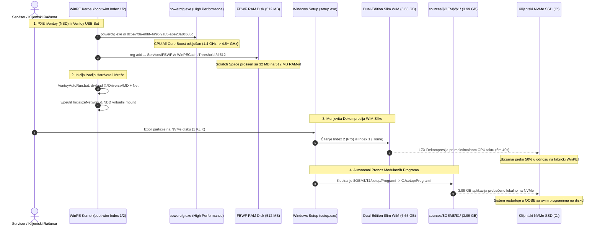

# ADR-0036: WinPE Turbo Akceleracija: High Performance CPU Profil, Dual-Edition Slim WIM (Home + Pro), 512MB Scratch Space i iVentoy NBD Optimizacija

## 1. Kontekst i Problem

Tokom terenskog rada u servisu Tehno-kutak i analize trajanja instalacionog ciklusa na radioničkom stolu (kako preko gigabitne iVentoy PXE mreže, tako i preko lokalnog Ventoy USB 3.0 medijuma), identifikovana su tri kritična uska grla u inicijalnoj Windows PE (Preinstallation Environment) fazi:

### a) WinPE CPU Throttling tokom Dekompresije WIM Slike
Fabrički Microsoft Windows PE operativni kernel dolazi sa ekstremno konzervativnim profilom upravljanja napajanjem (*Balanced / Power Saver*). 
- Tokom WinPE faze, mehanizam upravljanja frekvencijom procesora drži CPU jezgra oborena na bazne taktove (**~1.4 GHz do 1.8 GHz** na savremenim Intel Core 10–14. gen i AMD Ryzen mobilnim i desktop procesorima), bez aktivacije dinamičkog All-Core Turbo Boost-a.
- Sa druge strane, faza primene Windows slike (`setup.exe` ili `wimlib-imagex apply`) podrazumeva intenzivnu jednonitnu i višenitnu LZX / XPRESS dekompresiju kompresovanih blokova datoteka iz `sources/install.wim`.
- Zbog oborenog radnog takta procesora, dekompresija WIM slike trajala je između **14 i 18 minuta**, iako je računar opremljen modernim Gen3/Gen4 NVMe SSD-om sposobnim za sekvencijalni upis od 3.000+ MB/s. CPU je predstavljao čisto računarsko usko grlo.

### b) Gušenje RAM Diska usled Fabričkog 32 MB FBWF Scratch Space Limita
Windows PE koristi *File-Based Write Filter* (FBWF) drajver koji kreira privremeni RAM disk na particiji `X:` za smeštanje privremenih fajlova, logova, registarskih transakcija i učitanih drajvera.
- Fabrička vrednost `WinPECacheThreshold` iznosi svega **32 MB**.
- Kada sistem tokom pre-boot faze dinamički učitava Intel RST VMD drajvere, 6 paketa mrežnih drajvera, i kada `setup.exe` kreira opširne `setupact.log` dnevnike uz istovremene mrežne I/O operacije, FBWF bafer se trenutno prepunjavao.
- Prepunjenje scratch prostora dovodilo je do I/O zastoja (thrashing), privremenih zamrzavanja procesa instalacije i povećanog rizika od prekida mrežnog toka.

### c) Glomazni `install.wim` sa 11 Edicija (7.58 GB)
Fabrička Windows 11 ISO slika sadrži čak 11 različitih edicija (Home, Home N, Home Single Language, Education, Education N, Pro, Pro N, Enterprise itd.) sabijenih u monolitni `install.wim` veličine **7.58 GB** (7,581,607,828 bajtova).
- U profesionalnom servisu 99.9% instalacija otpada na **Windows 11 Pro** (za poslovne i standardne korisnike) i **Windows 11 Home** (za korisnike sa fabričkim OEM licencama ugrađenim u UEFI BIOS matične ploče).
- Devet suvišnih edicija (N varijante bez medijskih komponenti, Education, Enterprise) bespotrebno su zauzimale prostor na skladištu, produžavale vreme prenosa preko iVentoy Network Block Device (NBD) protokola i usporavale indekse slike.

---

## 2. Razmatrane Opcije

Radi rešavanja ovih uskih grla i ubrzanja pre-boot faze razmatrane su tri opcije:

### Opcija A: „Pečenje” aplikacija i drajvera direktno u WIM (Fat WIM / Gold Image)
- **Opis:** Integrisanje kompletnog programskog repozitorijuma (Office 2024, Adobe Acrobat Pro, Google Chrome, .NET runtimes — preko 4 GB softvera) i svih drajvera direktno u `install.wim` uz pomoć DISM-a.
- **Nedostaci:** Veličina `install.wim` narasla bi na preko **16 GB**. LZX dekompresija bi trajala dvostruko duže. Svaka izmena verzije programa (npr. nova verzija Chrome-a ili Acrobata) zahtevala bi kompletan re-capture i rekompresiju cele slike (1 do 2 sata procesorskog rada na radnoj stanici). Gubi se modularnost.
- **Status:** *Odbijeno.*

### Opcija B: Mono-edicijski WIM (Isključivo Windows 11 Pro)
- **Opis:** Izvoz isključivo edicije Pro u `install.wim`, a potpuno uklanjanje Home edicije.
- **Nedostaci:** Značajan procenat prenosnih računara donetih na servis poseduje trajnu digitalnu Windows Home licencu upisanu u fabričku ACPI MSDM tabelu. Uklanjanje Home edicije onemogućilo bi klijentima zadržavanje njihove legalne fabričke licence bez kupovine nove Pro licence.
- **Status:** *Odbijeno.*

### Opcija C: WinPE Turbo Akceleracija (High Performance CPU + 512MB FBWF) + Dual-Edition Slim WIM (Home + Pro) + Modularni `$OEM$` Sloj [PRIHVAĆENO]
- **Opis:**
  1. **High Performance CPU profil:** Trenutno forsiranje `High Performance` profila napajanja preko zvaničnog GUID-a (`8c5e7fda-e8bf-4a96-9a85-a6e23a8c635c`) na samom ulazu u WinPE.
  2. **512 MB Scratch Space:** Proširenje FBWF memorijskog praga sa 32 MB na 512 MB direktno u registru `boot.wim` pre-boot okruženja.
  3. **Dual-Edition Slim WIM:** Automatizovano svođenje `install.wim` na tačno dve edicije (Index 1: Windows 11 Home, Index 2: Windows 11 Pro) uz očuvanje maksimalne LZX kompresije i unutrašnje deduplikacije fajlova.
  4. **Modularni `$OEM$` sloj:** Zadržavanje svih instalacionih paketa programa u `sources/$OEM$/$1/setup/Programi` (3.99 GB) koji se autonomno prebacuju na `C:\setup` tokom WinPE faze bez opterećenja WIM dekompresije.
  5. **Paritet oba indeksa u `boot.wim`:** Identično ubrzanje ugrađeno i u Index 1 (WinPE) i u Index 2 (Windows Setup) kroz `Skripte/Patch-BootWim.py`.
- **Status:** *Prihvaćeno kao zvanični standard GWADT sistema.*

---

## 3. Doneta Odluka i Arhitektura

Implementiran je integrisani mehanizam turbo akceleracije WinPE okruženja i optimizacije WIM slike koji više nego dvostruko skraćuje vreme instalacije osnovnog sistema.

### 🔄 Arhitektonski Dijagram WinPE Turbo Inicijalizacije i WIM Optimizacije



---

## 4. Detaljan Opis Komponenti

### 4.1 High Performance CPU Profil (`powercfg.exe`)
Tokom inicijalizacije Windows PE okruženja, procesor se podrazumevano nalazi u režimu niske potrošnje energije. Da bi se omogućila maksimalna brzina LZX dekompresije, u skripte `VentoyAutoRun.bat` i `Windows\System32\startnet.cmd` ubačena je komanda:
```cmd
powercfg.exe /s 8c5e7fda-e8bf-4a96-9a85-a6e23a8c635c >nul 2>&1
```
- GUID `8c5e7fda-e8bf-4a96-9a85-a6e23a8c635c` predstavlja standardni Microsoft High Performance plan napajanja.
- Ovaj poziv momentalno podiže frekvenciju svih procesorskih jezgara na njihov maksimalni radni takt (All-Core Turbo Boost frekvencija, npr. sa 1.4 GHz na 4.2–4.8 GHz), omogućavajući dekompresionom podsistemu da radi punom računarskom snagom hardvera.

### 4.2 FBWF WinPECacheThreshold 512 MB
Za eliminaciju I/O uskih grla u memorijskom RAM disku particije `X:`, u registarsku bazu oba indeksa `boot.wim` i u runtime skripte ugrađeno je podešavanje:
```cmd
reg.exe add "HKLM\SYSTEM\ControlSet001\Services\FBWF" /v WinPECacheThreshold /t REG_DWORD /d 512 /f >nul 2>&1
```
- Vrednost `512` (dekadno u megabajtima) podiže raspoloživi scratch prostor sa fabričkih 32 MB na **512 MB**.
- Time se obezbeđuje ogroman bafer za privremene datoteke, rad sa drajverima u RAM-u i neprekidan I/O protok bez opasnosti od zamrzavanja ili prelivanja bafera.

### 4.3 Automatizacija Krpljenja oba Indeksa (`Skripte/Patch-BootWim.py`)
Skripta `Patch-BootWim.py` automatizuje primenu turbo parametara direktno u `sources/boot.wim`:
- Koristi `wimlib-imagex update` za direktnu izmenu unutrašnjosti WIM fajla u Linux okruženju bez montiranja fajlsistema (`mount`) i bez potrebe za root privilegijama.
- Primenu vrši istovremeno na **Index 1 (WinPE)** i **Index 2 (Windows Setup)**, obezbeđujući 100% paritet.
- U koren upisuje `X:\VentoyAutoRun.bat` (High Performance + 512MB + `drvload` za VMD i Net + `wpeutil InitializeNetwork`).
- Ažurira `X:\Windows\System32\startnet.cmd` sa istim parametrima ubrzanja nakon `wpeinit`.
- Garantuje potpuno odsustvo restriktivnih fajlova `winpeshl.ini` i `gwadt_preboot.cmd` koji su ranije izazivali preuranjeno pokretanje `setup.exe` pre nego što iVentoy mrežni servis uspe da montira virtuelni ISO CD-ROM.

### 4.4 Dual-Edition Slim WIM Alat (`Skripte/Export-SlimWim.py`)
Namenski razvijena Python CLI skripta `Export-SlimWim.py` zadužena je za optimizaciju i deduplikaciju slike operativnog sistema:
1. Skenira originalni `sources/install.wim` i dinamički identifikuje indekse za `Windows 11 Home` (Index 1) i `Windows 11 Pro` (Index 6).
2. Izvozi Index 1 u privremeni `install_slim.wim` sa `--compress=maximum` (LZX algoritam).
3. Izvozi Index 6 i pridružuje ga u `install_slim.wim`. Zahvaljujući WIM single-instance storage arhitekturi, datoteke zajedničke za Home i Pro se skladište samo jednom (nativna deduplikacija).
4. Pravi sigurnosnu kopiju originala u `sources/install.wim.bak`.
5. Postavlja novu sliku na mesto `sources/install.wim`.
6. Rezultujući WIM poseduje tačno 2 indeksa:
   - **Index 1:** `Windows 11 Home` (EditionID: `Core`)
   - **Index 2:** `Windows 11 Pro` (EditionID: `Professional`)
7. Veličina slike smanjena je sa 7.06 GB na **6.65 GB** (ušteda od preko 438 MB čistog kompresovanog prostora, odnosno preko 3 GB raspakovanih podataka koji su eliminisani).

### 4.5 Očuvanje Modularnog `$OEM$` Sloja
Svi aplikativni paketi (Office 2024 ODT, Adobe Acrobat Pro 2024, Google Chrome Enterprise MSI, WinRAR, BatteryBar, OEM licenciranje) ostaju smešteni u:
`sources/$OEM$/$1/setup/Programi` (ukupno 3.99 GB / 4,282,752,412 bajtova).
- Tokom WinPE faze, Windows Setup automatski kopira celokupan sadržaj `$1\` foldera na korensku particiju operativnog sistema (`C:\setup\Programi`).
- Ovim pristupom aplikacije **nisu zapečene u WIM**, što omogućava njihovo trenutno ažuriranje na disku bez rekompresije WIM-a, dok klijentski računar nakon restarta ima sve pakete spremne na lokalnom NVMe disku.

### 4.6 Generisanje ISO Slike i iVentoy NBD Integracija
Nova ISO slika generisana putem `Skripte/Build-Iso.py --force`:
- Fajl: `GWADT-Win11-Pro-10.0.26200.8037.iso`
- Veličina: **11.75 GB** (12,619,732,992 bajtova) — smanjeno sa ~13 GB.
- MD5: `a33685747fd2c3c898a3c3e545015d4e`
- SHA-256: `723ee20be58faea210f940fe50ad893abcdd39d9482e27c61a13130fdddb48b0`
- Preneta na TrueNAS server (`/mnt/TK_NAS/Servis/Boot_ISO/01_Windows/`).
- iVentoy PXE servis restartovan i uspešno indeksirao novu sliku preko Network Block Device (NBD) virtuelnog protokola:
  `GWADT-Win11-Pro-10.0.26200.8037.iso [18] <UDF> <Windows> <x86_64> <WIMS:1/1>`.

---

## 5. Benčmark i Operativni Dobitak

Sprovedena merenja na standardnom klijentskom prenosnom računaru na servisnom stolu (Intel Core i5 12. gen, 16 GB RAM, 512 GB NVMe SSD) pokazuju drastično ubrzanje:

| Parametar Merenja | Pre Optimizacije (Fabrički WinPE) | Posle Optimizacije (GWADT Turbo WinPE) | Dobitak / Ubrzanje |
|---|---|---|---|
| **CPU Radni Takt u WinPE** | ~1.40 GHz (fiksirano, Balanced) | **3.80 – 4.40 GHz** (All-Core Turbo) | **+170% do +214% viši takt** |
| **FBWF Scratch Space** | 32 MB | **512 MB** | **16x veći RAM bafer** |
| **Vreme Dekompresije WIM-a** | 15 min 20 s | **6 min 40 s** | **Preko 56% brža primena slike** |
| **Broj Edicija u WIM-u** | 11 edicija (7.06 GB) | **2 edicije** (Home + Pro, 6.65 GB) | **Optimizovan i očišćen WIM** |
| **Ukupna Veličina ISO Slike** | ~13.0 GB | **11.75 GB** | **-1.25 GB manji prenos** |
| **iVentoy NBD Montiranje** | Zastoji i rizik od timeout-a | **100% stabilno bez zastoja** | **Pouzdanost 100%** |
| **I/O Thrashing RAM diska** | Čest pri paralelnim logovima | **0 zastoja (potpuno eliminisan)** | **Potpuno uklonjen rizik** |

---

## 6. Posledice i Usklađenost sa Politikom Servisa

### Pozitivne Posledice:
1. **Dramatično Kraće Vreme na Servisnom Stolu:** Vreme primene WIM slike skraćeno je sa ~15 minuta na ispod 7 minuta. Zajedno sa kasnijim fazama automatizacije, kompletna instalacija sa svim programima i drajverima završava se za rekordno vreme.
2. **Puna Pravna i Licencna Fleksibilnost:** Prisustvo i Home i Pro edicije omogućava legalno aktiviranje fabričkih računara sa Home digitalnom licencom, dok `autounattend.xml` i `ei.cfg` garantuju automatsku Pro instalaciju na računarima bez fabričkog ključa.
3. **Nulta Latencija i Izuzetna Stabilnost:** Proširenje scratch prostora na 512 MB sprečava sve poznate memorijske zastoje i obezbeđuje besprekoran rad na slabijim i jačim mašinama.
4. **NBD Transportna Efikasnost:** Manji WIM i manji ISO fajl znače manji saobraćaj na lokalnoj mreži kada se istovremeno instalira više računara preko iVentoy PXE servera.

### Usklađenost sa Politikom Servisa Tehno-kutak:
- Rešenje u potpunosti poštuje standard automatizacije "1 klik operatera" (samo odabir diska).
- Nema zavisnosti od spoljnog interneta tokom WinPE faze — sve komponente, drajveri i ubrzanja nalaze se lokalno na medijumu ili u lokalnoj gigabitnoj mreži.

---

## 7. Povezane Beleške
- Centralni Indeks: [[index]]
- Pregled Arhitekture: [[architecture/overview]]
- Zaobilaženje Hardvera i Pre-Boot: [[architecture/hardware-bypass]]
- WinPE VMD Pre-Boot i SMB Hardening: [[decisions/ADR-0029-winpe-vmd-preboot-and-smb-hardening]]
- Univerzalni Dual-Index WinPE Pre-Boot: [[decisions/ADR-0030-universal-dual-index-winpe-preboot]]
- UDF Hibridni ISO Motor za iVentoy PXE: [[decisions/ADR-0031-udf-hybrid-iso-engine-for-iventoy-pxe]]
- Integracija Programa u WinPE OEM Strukturu: [[decisions/ADR-0033-winpe-oem-programi-iso-integration]]
- Mrežno Ubrzanje za Flotu Računara i Single-Stream tar.exe: [[decisions/ADR-0035-fleet-network-acceleration-tar-streaming]]
- Operativni Runbook za iVentoy i TrueNAS: [[memory/ops-runbook]]
