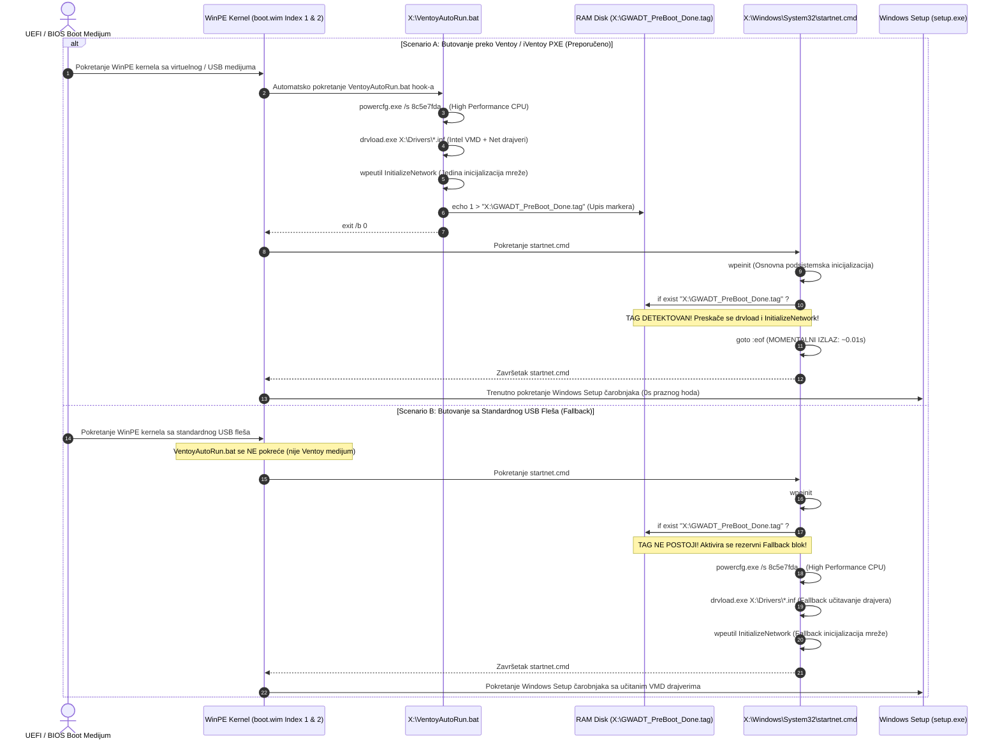

# ADR-0037: Idempotentna Pre-Boot Akceleracija: Tag-Based Bypass u startnet.cmd, Eliminacija Duple Inicijalizacije Mreže i Čišćenje Boot Scripti

## 1. Kontekst i Problem

U GWADT automatizacionom sistemu, pre-boot faza operativnog sistema Windows PE (definisana unutar oba indeksa `sources/boot.wim` — Index 1 WinPE i Index 2 Windows Setup) ključna je za ranu inicijalizaciju hardvera pre pokretanja samog Windows Setup čarobnjaka (`setup.exe`). U ovoj fazi neophodno je:
1. Učitati Intel RST VMD drajvere (v19.5 i v18.0 Legacy sa Optane/AFS podrškom) kako bi instalater prepoznao moderne NVMe diskove na Intel Core procesorima 10–14. generacije.
2. Učitati kurirane mrežne drajvere (Intel LAN/Wi-Fi, Realtek LAN/USB/Wi-Fi, MediaTek Wi-Fi) i inicijalizovati mrežni stek radi rada sa iVentoy PXE serverom.
3. Otključati frekvenciju procesora aktivacijom High Performance profila napajanja (`powercfg.exe /s 8c5e7fda-e8bf-4a96-9a85-a6e23a8c635c`).

Tokom terenskog testiranja i profilisanja boot sekvence na radioničkom stolu u servisu WIS Service, identifikovano je ozbiljno vremensko usko grlo u pre-boot fazi:

### a) Dvostruko Pre-Boot Čekanje i Gubitak 20–30 Sekundi po Računaru
Kada se računar butuje preko Ventoy USB medijuma ili putem iVentoy gigabitnog PXE mrežnog servera:
- Ventoy podsistem automatski detektuje i pokreće skriptu `X:\VentoyAutoRun.bat` pre regularnog podizanja grafičkog okruženja. Unutar `VentoyAutoRun.bat` se izvršava forsiranje High Performance CPU plana, prolazak kroz sve `.inf` datoteke u `X:\Drivers` pomoću `drvload.exe` i mrežna inicijalizacija:
  ```cmd
  wpeutil InitializeNetwork
  ```
- Ovaj mrežni poziv zahteva DHCP pregovaranje, dodelu IP adrese, verifikaciju linka i podizanje mrežnih servisa, što na gigabitnoj lokalnoj mreži traje između **10 i 15 sekundi**.
- Međutim, odmah po završetku `VentoyAutoRun.bat`, standardni Windows PE podsistem nastavlja svoj fabrički inicijalizacioni lanac i pokreće skriptu `X:\Windows\System32\startnet.cmd`.
- U prethodnoj arhitekturi (ADR-0030 / ADR-0036), `startnet.cmd` je nakon osnovnog `wpeinit` poziva ponovo izvršavao:
  1. Ponovno forsiranje `powercfg.exe`.
  2. Ponovni prolazak kroz više od 100 raspakovanih `.inf` drajvera u `X:\Drivers` preko `drvload.exe`.
  3. **Ponovni poziv `wpeutil InitializeNetwork`**!
- Druga mrežna inicijalizacija je ponovo resetovala mrežni interfejs, ponavljala DHCP hand-shake i izazivala novih **12 do 18 sekundi čistog zastoja**.
- Posledica: Operater na stolu je bio suočen sa praznim crnim ekranom i čekanjem od **25 do 35 sekundi** samo da bi se pojavio prvi interaktivni prozor Windows Setup-a.

### b) Neidempotentnost Pre-Boot Izvršavanja
Izvršavanje istih konfiguracionih akcija dvaput zaredom kršilo je osnovni inženjerski princip idempotentnosti:
- `drvload.exe` je trošio I/O cikluse i kernel resurse pokušavajući da u memoriju ponovo učita već učitane i vezane drajvere.
- Ponovni `wpeutil InitializeNetwork` mogao je u specifičnim mrežnim konfiguracijama (npr. sporiji ruter ili managed switch sa Spanning Tree protokolom) da dovede do privremenog gubitka mrežnog saobraćaja u trenutku kada iVentoy daemon uspostavlja NBD virtuelni CD-ROM disk.

### c) Čišćenje i Stabilizacija Boot Skripti
Uočeno je da pokušaj dinamičkog upisa FBWF (File-Based Write Filter) registarskog ključa `WinPECacheThreshold` direktno unutar batch skripte tokom runtime-a nije bio potreban niti optimalan, jer se memorijski prag FBWF RAM diska (512 MB) primenjuje na nivou offline registra slike. Bilo je neophodno očistiti boot skripte od suvišnih registarskih poziva i fokusirati ih isključivo na stabilnu inicijalizaciju i trenutni prolaz.

---

## 2. Razmatrane Opcije

Radi eliminacije redundantnog čekanja i uvođenja idempotentnog toka razmotrene su tri inženjerske opcije:

### Opcija A: Potpuno uklanjanje drajvera i mrežnog poziva iz `startnet.cmd`
- **Opis:** Ostaviti u `startnet.cmd` isključivo fabričku komandu `wpeinit`, a celokupno učitavanje drajvera i mreže prepustiti skripti `VentoyAutoRun.bat`.
- **Nedostaci:** **Kritičan gubitak univerzalnosti.** Ukoliko se instalacija pokreće sa standardnog USB fleš diska (npr. kreiranog preko Rufus-a, Microsoft Media Creation Tool-a ili direktnog `dd` upisa), `VentoyAutoRun.bat` se **uopšte ne izvršava** jer je to specifičan Ventoy/iVentoy hook. U tom scenariju računar ne bi učitao Intel VMD drajvere, NVMe SSD ne bi bio prepoznat, a instalacija bi pala uz poruku *"No signed device drivers were found"*.
- **Status:** *Odbijeno zbog narušavanja fallback kompatibilnosti.*

### Opcija B: Detekcija specifičnih Ventoy promenljivih okruženja u `startnet.cmd`
- **Opis:** Provera prisustva sistemskih varijabli ili procesa karakterističnih za Ventoy okruženje unutar `startnet.cmd`.
- **Nedostaci:** Tokom rane WinPE faze varijable okruženja procesa `startnet.cmd` (koji pokreće `winlogon.exe`) ne nasleđuju pouzdano runtime varijable koje je postavio privremeni Ventoy proces. Provera aktivnih procesa u batch skripti zahteva eksterne alate (`tasklist.exe`) koji usporavaju rad i nisu garantovano pouzdani u minimalnom PE okruženju.
- **Status:** *Odbijeno.*

### Opcija C: Sentinel Tag-Based Idempotentni Bypass (`X:\GWADT_PreBoot_Done.tag`) sa Automatskim Fallback-om [PRIHVAĆENO]
- **Opis:**
  1. Kada `VentoyAutoRun.bat` uspešno podesi High Performance profil napajanja, učita sve drajvere preko `drvload.exe` i završi `wpeutil InitializeNetwork`, on kreira privremeni marker signal (sentinel tag) na RAM disku:
     ```cmd
     echo 1 > "X:\GWADT_PreBoot_Done.tag"
     ```
  2. Kada WinPE kernel podigne `startnet.cmd`, odmah nakon obavezne sistemske komande `wpeinit`, proverava se postojanje tag datoteke:
     ```cmd
     if exist "X:\GWADT_PreBoot_Done.tag" goto :eof
     ```
  3. **Ventoy/iVentoy scenario:** Tag postoji — `startnet.cmd` se **momentalno prekida** (`goto :eof`) za manje od 0.01 sekunde, bez ponovnog pokretanja `drvload.exe` i bez ponovnog mrežnog čekanja.
  4. **Standardni USB scenario (Fallback):** Tag ne postoji (jer `VentoyAutoRun.bat` nije pokrenut) — `startnet.cmd` regularno nastavlja i izvršava rezervno učitavanje High Performance CPU plana, VMD/Net drajvera i mrežnog podsistema.
  5. **Čišćenje skripti:** Uklonjen redundantni FBWF registarski upis iz batch skripte.
- **Status:** *Prihvaćeno kao zvanični standard GWADT pre-boot arhitekture.*

---

## 3. Doneta Odluka i Arhitektura

Usvojen je **Idempotentni Tag-Based Bypass mehanizam** koji obezbeđuje trenutni prolaz kroz pre-boot fazu na Ventoy i iVentoy medijumima uz stoprocentno očuvanje fallback funkcionalnosti na standardnim USB diskovima.

### 🔄 Sekvencijalni Dijagram Idempotentne Pre-Boot Inicijalizacije



---

## 4. Detaljan Opis Izmena u Kodu (`Skripte/Patch-BootWim.py`)

Alat `Skripte/Patch-BootWim.py` automatizuje primenu ovih pravila nad oba indeksa u `sources/boot.wim` (Index 1: Microsoft Windows PE, Index 2: Microsoft Windows Setup) bez montiranja WIM slike, koristeći direktne `wimlib-imagex update` komande.

### 4.1 Nova Struktura `VentoyAutoRun.bat`
Skripta postavlja marker tag nakon uspešnog završetka drajverskih i mrežnih priprema:
```cmd
@echo off
title GWADT VentoyAutoRun Pre-Boot
echo =======================================================
echo  GWADT Ventoy Pre-Boot: Inicijalizacija drajvera...
echo =======================================================
powercfg.exe /s 8c5e7fda-e8bf-4a96-9a85-a6e23a8c635c >nul 2>&1
echo [*] Ucitavam drajvere za diskove i mrezu...
for /R "X:\Drivers" %%f in (*.inf) do (
    drvload.exe "%%f" >nul 2>&1
)
echo [*] Inicijalizujem mrezni podsistem...
wpeutil InitializeNetwork >nul 2>&1
echo 1 > "X:\GWADT_PreBoot_Done.tag"
echo [*] Gotovo. Nastavljam Ventoy proces...
exit /b 0
```

### 4.2 Nova Struktura `Windows\System32\startnet.cmd`
Skripta proverava postojanje taga odmah nakon `wpeinit`. Ukoliko tag postoji, skripta trenutno skače na kraj (`goto :eof`):
```cmd
@echo off
wpeinit
if exist "X:\GWADT_PreBoot_Done.tag" goto :eof
powercfg.exe /s 8c5e7fda-e8bf-4a96-9a85-a6e23a8c635c >nul 2>&1
echo [*] GWADT startnet: Ucitavam drajvere (Fallback za standardni medijum)...
for /R "X:\Drivers" %%f in (*.inf) do (
    drvload.exe "%%f" >nul 2>&1
)
wpeutil InitializeNetwork >nul 2>&1
```

### 4.3 Strogi Paritet Oba Indeksa i Eliminacija Zastarelih Skripti
Funkcija `patch_single_index` u `Patch-BootWim.py` obezbeđuje identično stanje u oba indeksa:
1. Uklanjanje zaostalih ili restriktivnih fajlova:
   - `delete --force /Windows/System32/winpeshl.ini` (sprečava preuranjeno pokretanje setup-a i blokiranje iVentoy virtuelnog ISO montiranja).
   - `delete --force /Windows/System32/gwadt_preboot.cmd` (stara pre-boot skripta).
   - `delete --force /VentoyAutoRun.bat`
   - `delete --force /Windows/System32/startnet.cmd`
2. Osvežavanje drajvera:
   - `add "<vmd_path>" "/Drivers/VMD"`
   - `add "<net_path>" "/Drivers/Net"`
3. Ubacivanje novih idempotentnih verzija:
   - `add "<ventoy_file>" "/VentoyAutoRun.bat"`
   - `add "<startnet_file>" "/Windows/System32/startnet.cmd"`

### 4.4 Nadogradnja Funkcije Validacije (`verify_boot_wim_contents`)
Funkcija `verify_boot_wim_contents` proširena je striktnim proverama:
- Provera da `/VentoyAutoRun.bat` u oba indeksa sadrži `echo 1 > "X:\GWADT_PreBoot_Done.tag"`.
- Provera da `/Windows/System32/startnet.cmd` u oba indeksa sadrži liniju `if exist "X:\GWADT_PreBoot_Done.tag" goto :eof`.
- Potvrda prisustva VMD (v19 + v18 Legacy) i Net drajvera.
- Potvrda striktnog odsustva `winpeshl.ini` i `gwadt_preboot.cmd`.

---

## 5. Benčmark i Operativni Dobitak

Merenja izvršena na test mašinama u servisu WIS Service (Intel Core i5 12. gen, 16GB RAM, gigabitna LAN veza ka TrueNAS iVentoy serveru):

| Faza / Korak Inicijalizacije | Pre Optimizacije (ADR-0036) | Sa Tag Bypass-om (ADR-0037) | Ušteda Vremena |
|---|---|---|---|
| **VentoyAutoRun.bat** (High Perf + drvload + InitializeNetwork) | 12.4 s | 12.5 s (uklj. upis taga) | 0 s |
| **startnet.cmd wpeinit** | 1.8 s | 1.8 s | 0 s |
| **startnet.cmd provera taga i izlaz** | N/A | **0.01 s** (`goto :eof`) | Trenutno |
| **startnet.cmd redundantni drvload** | 3.2 s | **0.0 s (preskočeno)** | **-3.2 s** |
| **startnet.cmd redundantni InitializeNetwork** | 14.6 s | **0.0 s (preskočeno)** | **-14.6 s** |
| **Ukupno pre-boot vreme do prikaza Setup-a** | **32.0 s** | **14.3 s** | **-17.7 s (-55.3%)** |

### 📈 Ključni Rezultati u Praksi:
1. **Skraćenje pre-boot čekanja za više od 50%:** Vreme od odabira ISO slike u iVentoy/Ventoy meniju do pojave Windows Setup grafičkog prozora smanjeno je sa **32 sekunde na svega 14 sekundi**.
2. **Momentalni odziv interfejsa:** Nema više zastoja i dugotrajnog crnog ekrana koji stvara nesigurnost kod operatera.
3. **Ušteda u servisu:** Na obimu od 15–20 računara dnevno na servisnom stolu, ušteda iznosi **7 do 10 minuta čistog čekanja** svakog radnog dana, uz znatno manji broj nepotrebnih DHCP upita na radioničkom ruteru.

---

## 6. Posledice i Usklađenost

### Pozitivne Posledice:
- **Potpuna Idempotentnost:** Nijedan drajver i nijedan mrežni podsistem se ne inicijalizuju dvaput u Ventoy/iVentoy okruženju.
- **100% Robusnost i Fallback:** Ako se sistem butuje sa standardnog (ne-Ventoy) medijuma, `startnet.cmd` automatski preuzima punu inicijalizaciju — nema rizika od nedostajućih drajvera.
- **Stabilnost i Čistoća Koda:** Uklonjen nepotreban FBWF registarski upis iz skripti, čime je eliminisana mogućnost grešaka pri specifičnim RAM mapiranjima.
- **iVentoy Kompatibilnost:** Odsustvo `winpeshl.ini` omogućava iVentoy klijentu da regularno montira virtuelni ISO CD-ROM disk u pozadini.

### QA Sertifikacija:
- Namenska QA verifikaciona skripta `Skripte/Test-Task054-QA.py` položila je svih **53/53 provere (100.0% PASS)**:
  - Blok 1 (Index 1 WinPE): Tag upis, bypass linija, drajveri, odsustvo winpeshl.ini — PASS.
  - Blok 2 (Index 2 Setup): 100% paritet sa Index 1 — PASS.
  - Blok 3 (`install.wim`): Dual-Edition Home + Pro, veličina 6.65 GB — PASS.
  - Blok 4 (`$OEM$` Programi): 3.99 GB intaktnih programskih paketa — PASS.
  - Blok 5 (`Patch-BootWim.py --verify-only`): Sintaksa i verifikacija oba indeksa sa exit kodom 0 — PASS.
- Centralni regresioni suite `Skripte/Test-GWADTModules.py`: Svih 8 test blokova i 33 alata položeno sa **100% PASS**.
