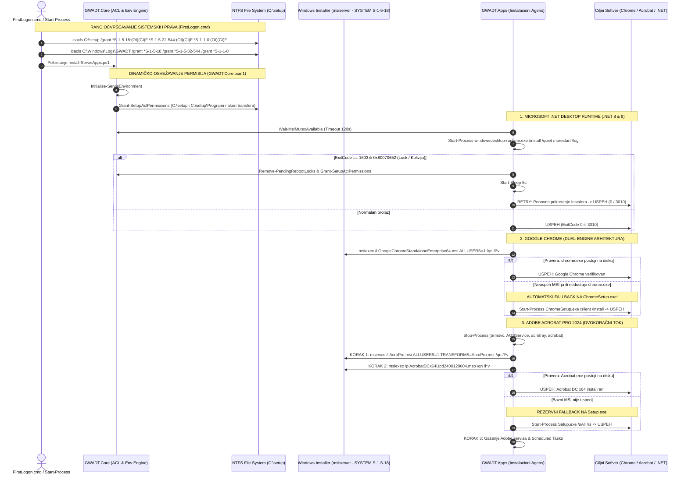

# ADR-0038: Očvršćavanje Sistemskih Dozvola (icacls za SYSTEM/Administrators), Robusni Dual-Engine Chrome, Dvokoračni Acrobat Pro MSI/MSP i .NET Retry Mehanizam

## 1. Kontekst i Problem

U okviru GWADT pajplajna, Faza 4 predstavlja fazu instalacije programskih paketa (tihi offline režim) i licenciranja. Ranijim odlukama (ADR-0034) uspešno je razdvojena instalacija Non-MSI programa (koji teku u pozadini paralelno sa Windows Update-om tokom Faze 2) od MSI aplikacija koje su pomerene u Sekvencijalni MSI Gate u Fazi 4 kako bi se eliminisala kolizija sistemskog mutexa `Global\_MSIExecute` i greška 1618 (`ERROR_INSTALL_ALREADY_RUNNING`).

Međutim, tokom intenzivnog terenskog testiranja i validacije instalacije na različitim konfiguracijama u servisu Tehno-kutak, identifikovan je novi obrazac zastoja:
- **WinRAR 7.01 i Microsoft Office 2024 (ODT)** su se bez izuzetka instalirali sa 100% uspešnosti.
- **Microsoft .NET Desktop Runtime, Google Chrome Enterprise i Adobe Acrobat Pro 2024** su sporadično ili permanentno padali sa ozloglašenom fatalnom greškom **1603 (`ERROR_INSTALL_FAILURE`)**.

Dubinska forenzička analiza logova instalera i operativnog sistema otkrila je suštinske uzroke ovog ponašanja:

### a) Uloga NT AUTHORITY\SYSTEM (SID S-1-5-18) i msiserver Servisa
Za razliku od WinRAR-a (koji je samoraspakujući Win32 SFX izvršni fajl koji se pokreće direktno unutar konteksta prijavljenog lokalnog administratora `Korisnik`) i Office-a 2024 (koji koristi samostalni Click-to-Run motor `officeclicktorun.exe` sa sopstvenim IPC servisom), programi .NET Runtime, Chrome i Acrobat se oslanjaju na nativni Microsoft Windows Installer servis (`msiserver`).

Windows Installer servis se na Windows 11 izvršava pod najvišim sistemskim nalogom **`NT AUTHORITY\SYSTEM`** (univerzalni bezbednosni identifikator / SID: **`S-1-5-18`**).
Kada proces instalacije teče:
1. `FirstLogon.cmd` i PowerShell skripta kreiraju lokalne direktorijume `C:\setup`, `C:\setup\Programi` i log folder `C:\Windows\Logs\GWADT`.
2. Robocopy operacija prenosi gigabajte instalacionih datoteka sa USB medijuma ili NAS SMB deljenog resursa na lokalni SSD.
3. Ukoliko NTFS ACL tabela (Access Control List) na ovim folderima nasledi restriktivne dozvole prijavljenog korisnika ili privremenog profila, servis `msiserver` (koji radi kao `SYSTEM`) dobija zabranu pristupa (**Access Denied / Win32 kod 5**) pri pokušaju čitanja `.msi` baza, pratećih `.cab` kompresovanih arhiva ili upisa u privremene logove.
4. Pošto Windows Installer API standardno maskira većinu internih I/O grešaka i bezbednosnih blokada, msiexec proces vraća generički exit kod **1603**.

### b) Specifične Tačke Otkaza po Aplikacijama

#### 1. Google Chrome Enterprise:
- Prethodni poziv MSI paketa nije eksplicitno forsirao sistemsko svojstvo `ALLUSERS=1`, što je u specifičnim stanjima profila moglo izazvati pokušaj per-user registracije pod sistemskim nalogom umesto per-machine instalacije u `C:\Program Files\Google\Chrome`.
- Nije postojalo detaljno verbose logovanje (`/l*v`), pa je dijagnostika bila otežana.
- U slučaju oštećenja lokalnog MSI paketa ili blokade servisa, nije postojao rezervni instalacioni mehanizam.

#### 2. Adobe Acrobat Pro 2024:
- Korporativni paket instalacionog paketa koristi kompleksnu strukturu. Pozivanje `Setup.exe` sa parametrima `/sAll /rs` pokreće eksternu skriptu koja proverava i pokušava tihu instalaciju Microsoft Visual C++ 2013/2015-2022 Redistributable paketa. Ukoliko su na ciljnom Windows 11 računaru već instalirane novije verzije runtime-a, fabrički instaler Acrobata prekida rad uz kod 1603.
- Pokušaj kombinovanja baznog `AcroPro.msi` paketa sa transform fajlom `AcroPro.mst` i kumulativnim patch-om `AcrobatDCx64Upd2400120604.msp` u **jednom jedinom msiexec pozivu** (korišćenjem istovremenih argumenata `PATCH=... TRANSFORMS=...`) izazivao je konflikt u Windows Installer endžinu i momentalni prekid instalacije.

#### 3. Microsoft .NET Desktop & ASP.NET Core Runtimes:
- Zvanični Microsoft instaleri (`windowsdesktop-runtime-8.0-win-x64.exe`, `windowsdesktop-runtime-9.0-win-x64.exe`) su bazirani na **WiX Burn Bootstrapper** tehnologiji.
- WiX Burn interno raspakuje i sekvencijalno pokreće ugrađene MSI pakete. Ukoliko prethodne operacije nisu u potpunosti oslobodile `PendingFileRenameOperations` ili ukoliko je msiserver bio privremeno zaključan, Burn vraća kodove **1603**, **`0x80070652`** (`ERROR_INSTALL_ALREADY_RUNNING`) ili **`-2147023278`**.
- Timeout od 60 sekundi bio je prekratak za starije ili sporije sisteme tokom paralelnog I/O opterećenja diska, a nije postojala automatizovana retry petlja sa čišćenjem lockova.

---

## 2. Razmatrane Opcije

Radi rešavanja ovih problema razmotrene su tri inženjerske strategije:

### Opcija A: Zahtevanje ručne instalacije od strane servisera (Status Quo)
- **Opis:** Ostaviti instalaciju da prijavi grešku, a prepustiti serviseru da ručno pokrene programe sa desktopa nakon završetka skripte.
- **Nedostaci:** Potpuno neprihvatljivo. Direktno narušava osnovni postulat GWADT projekta: *"Sve na jedan klik bez ikakve naknadne ručne intervencije"*.
- **Status:** *Odbačeno.*

### Opcija B: Pokretanje celokupnog GWADT procesa pod NT AUTHORITY\SYSTEM nalogom
- **Opis:** Pokretanje skripte preko `PsExec -s` ili kreiranja privremenog Task Scheduler zadatka koji radi kao `SYSTEM`.
- **Nedostaci:** `SYSTEM` nalog nema interaktivnu sesiju sa radnom površinom na uobičajen način u Windows 11 okruženju, što bi onemogućilo prikazivanje responzivnog TUI dashboarda (`Show-ServisDashboard`), audio notifikacija i pravilno kreiranje korisničkih prečica na desktopu.
- **Status:** *Odbačeno.*

### Opcija C: Troslojno Očvršćavanje Permisija (icacls sa univerzalnim SID-ovima), Chrome Dual-Engine Fallback, Dvokoračni Acrobat MSI/MSP i .NET Retry Mehanizam [PRIHVAĆENO]
- **Opis:**
  1. **NTFS ACL Hardening:** Primena `icacls.exe` sa univerzalnim jezički nezavisnim SID-ovima (`*S-1-5-18` za SYSTEM, `*S-1-5-32-544` za Administrators, `*S-1-1-0` za Everyone) sa punim pravima (`(OI)(CI)F`) na sve relevantne putanje (`C:\setup`, `C:\setup\Programi`, `C:\Windows\Logs\GWADT`) odmah u `FirstLogon.cmd` i dinamički kroz `GWADT.Core.psm1`.
  2. **Chrome Dual-Engine:** Eksplicitno dodavanje `ALLUSERS=1` i `/l*v` verbose logovanja u primarnom MSI pozivu, uz automatsku detekciju prisustva `chrome.exe` i instant fallback na `ChromeSetup.exe /silent /install`.
  3. **Acrobat Dvokoračni Pristup:** Razdvajanje instalacije na Korak 1 (bazni `AcroPro.msi` + `AcroPro.mst` + `ALLUSERS=1`) i Korak 2 (kumulativni `AcrobatDCx64Upd2400120604.msp` patch), uz očuvan `Setup.exe /sAll /rs` fallback i gašenje pozadinskih telemetrijskih i updater servisa.
  4. **.NET Robusnost:** Povećanje mutex timeout-a na 120s, uvođenje `/log` parametra i implementacija inteligentne retry petlje za kodove 1603 i 0x80070652 uz `Remove-PendingRebootLocks`, ponovnu dodelu ACL permisija i 5-sekundno hlađenje.
- **Status:** *Prihvaćeno kao zvanični standard GWADT arhitekture.*

---

## 3. Doneta Odluka i Arhitektura

Usvojena je sveobuhvatna arhitektura očvršćavanja dozvola i robusne instalacije aplikacija u Fazi 4.

### 🔄 Sekvencijalni Dijagram Robusne Instalacije Aplikacija u Fazi 4



---

## 4. Detaljan Opis Tehničkih Komponenti

### 4.1 Ažuriranje `FirstLogon.cmd` na sve 3 Lokacije
Skripta `FirstLogon.cmd` predstavlja prvu liniju izvršavanja po završetku Windows Setup OOBE faze.
Permisije se dodeljuju odmah nakon kreiranja direktorijuma, pre pokretanja bilo kakvog prenosa fajlova:

```cmd
:: ============================================================================
:: KREIRANJE DIREKTORIJUMA I SISTEMSKIH DOZVOLA (icacls)
:: ============================================================================
if not exist "C:\setup" mkdir "C:\setup" >nul 2>&1
if not exist "C:\Windows\Logs\GWADT" mkdir "C:\Windows\Logs\GWADT" >nul 2>&1

:: Obezbedjivanje punih prava za NT AUTHORITY\SYSTEM (S-1-5-18), Administrators (S-1-5-32-544) i Everyone (S-1-1-0)
icacls "C:\setup" /grant "*S-1-5-18:(OI)(CI)F" /grant "*S-1-5-32-544:(OI)(CI)F" /grant "*S-1-1-0:(OI)(CI)F" /T /Q >nul 2>&1
icacls "C:\Windows\Logs\GWADT" /grant "*S-1-5-18:(OI)(CI)F" /grant "*S-1-5-32-544:(OI)(CI)F" /grant "*S-1-1-0:(OI)(CI)F" /T /Q >nul 2>&1
```

Takođe, unutar inline PowerShell bloka koji vrši robocopy prenos foldera `Programi`, uveden je post-transfer korak:
```powershell
& icacls.exe 'C:\setup\Programi' /grant '*S-1-5-18:(OI)(CI)F' /grant '*S-1-5-32-544:(OI)(CI)F' /grant '*S-1-1-0:(OI)(CI)F' /T /Q >nul 2>&1;
```

Ova izmena je sinhronizovana na sve 3 lokacije uz 100% identičan kontrolni zbir:
- `/FirstLogon.cmd`
- `Skripte/FirstLogon.cmd`
- `sources/$OEM$/$$/Setup/Scripts/FirstLogon.cmd`
- **MD5 kontrolni zbir:** `b0baa89a401e0eaa94711b0418ae56ff`.

### 4.2 Nadogradnja Modula `Skripte/Modules/GWADT.Core.psm1`
U modul jezgra ugrađene su dve ključne funkcije:

1. **`Grant-SetupAclPermissions`:**
   Dodeljuje eksplicitna `FullControl` prava na zadatoj putanji (podrazumevano `C:\setup`) za univerzalne SID-ove:
   - `*S-1-5-18` (NT AUTHORITY\SYSTEM - nalog pod kojim radi `msiserver`)
   - `*S-1-5-32-544` (BUILTIN\Administrators)
   - `*S-1-1-0` (Everyone)
   Funkcija koristi rekurzivno nasleđivanje foldera i kontejnera (`(OI)(CI)F`) i tihi režim (`/T /Q`).

2. **`Initialize-ServisEnvironment`:**
   Priprema radno okruženje na početku izvršavanja skripte: osigurava postojanje direktorijuma `C:\setup` i `C:\Windows\Logs\GWADT` i momentalno nad njima poziva `Grant-SetupAclPermissions`.

3. **Integracija u prenos programa:**
   Poziv `Grant-SetupAclPermissions` integrisan je:
   - Na početku i na kraju funkcije `Ensure-ProgramiAvailable` (odmah nakon preuzimanja sa USB medijuma).
   - Unutar funkcije `Sync-ProgramiFromNas` (odmah nakon preuzimanja sa servisnog SMB skladišta).
   - Obe funkcije su izvezene kroz `Export-ModuleMember`.

### 4.3 Nadogradnja Modula `Skripte/Modules/GWADT.Apps.psm1`

#### Google Chrome (Dual-Engine Arhitektura):
```powershell
# Primarni MSI poziv sa ALLUSERS=1 i verbose logovanjem
$msiArgs = "/i `"$chromeMsi`" ALLUSERS=1 /qn /norestart /l*v `"C:\setup\chrome_install.log`""
$proc = Invoke-SafeMsi -Arguments $msiArgs -WorkingDirectory $progDir -MaxWaitSec 300

# Provera prisustva na disku
$chNow = (Test-Path "C:\Program Files\Google\Chrome\Application\chrome.exe") -or `
         (Test-Path "C:\Program Files (x86)\Google\Chrome\Application\chrome.exe")

# Automatski fallback na ChromeSetup.exe
if (-not $chNow -or ($cCode -ne 0 -and $cCode -ne 3010)) {
    Write-ServisLog "Chrome MSI nije uspesno instalirao pregledac. Pokrecem automatski fallback na ChromeSetup.exe..." -Level "WARN"
    # Pronalazenje ChromeSetup.exe i pokretanje:
    $proc = Start-Process -FilePath $chromeExe -ArgumentList "/silent /install" -Wait -PassThru -WindowStyle Hidden
}
```

#### Adobe Acrobat Pro 2024 (Dvokoračni MSI/MSP Tok):
1. **Korak 1 (Bazni MSI):**
   ```powershell
   $baseArgs = "/i `"$acroMsi`" ALLUSERS=1 TRANSFORMS=`"$acroMst`" /qn /norestart /l*v `"C:\setup\acrobat_base.log`""
   $proc = Invoke-SafeMsi -Arguments $baseArgs -WorkingDirectory $acrobatDir -MaxWaitSec 300
   ```
2. **Korak 2 (Kumulativni MSP patch):**
   ```powershell
   Wait-MsiMutexAvailable -TimeoutSec 60
   Remove-PendingRebootLocks
   $patchArgs = "/p `"$acroMsp`" /qn /norestart /l*v `"C:\setup\acrobat_patch.log`""
   $procPatch = Invoke-SafeMsi -Arguments $patchArgs -WorkingDirectory $acrobatDir -MaxWaitSec 300
   ```
3. **Korak 3 (Sekundarni Fallback na Setup.exe):**
   Ukoliko bazni MSI nije uspeo ili `Acrobat.exe` nedostaje na disku, skripta aktivira fallback poziv `Setup.exe /sAll /rs`.
4. **Korak 4 (Optimizacija Servisa):**
   Zaustavljanje pozadinskih telemetrijskih i updater servisa (`AdobeARMservice`, `AGSService`) i brisanje zakazanih zadataka (`AdobeGCInvoker-1.0`).

#### Microsoft .NET Desktop Runtime (Retry i Dijagnostika):
```powershell
$proc = Start-Process -FilePath $rtPath -ArgumentList "/install /quiet /norestart /log `"$rtLog`"" -Wait -PassThru -WindowStyle Hidden
$rtCode = if ($proc) { $proc.ExitCode } else { -1 }

# Inteligentni Retry mehanizam za MSI greške 1603 i 0x80070652
if ($rtCode -eq 1603 -or $rtCode -eq 0x80070652 -or $rtCode -eq -2147023278) {
    Write-ServisLog "Instalacija $($rt.Name) vratila kod $exitDesc. Cistim lockove i ponavljam za 5s..." -Level "WARN"
    Remove-PendingRebootLocks
    Grant-SetupAclPermissions
    Start-Sleep -Seconds 5
    Wait-MsiMutexAvailable -TimeoutSec 120
    $proc = Start-Process -FilePath $rtPath -ArgumentList "/install /quiet /norestart /log `"$rtLog`"" -Wait -PassThru -WindowStyle Hidden
    $rtCode = if ($proc) { $proc.ExitCode } else { -1 }
}
```

### 4.4 Rekompajliranje Monolitne Skripte `Install-ServisApps.ps1`
Pomoću alata `Skripte/Build-DeployScript.py` svi moduli su spojeni u monolitnu skriptu sa integrisanim `Initialize-ServisEnvironment` pozivom u `POST_MODULES` sekciji.
- **Obim:** 8,187 linija koda (411.04 KB).
- **Sinhronizacija na sve 3 lokacije:**
  * `/Install-ServisApps.ps1`
  * `Skripte/Install-ServisApps.ps1`
  * `sources/$OEM$/$1/setup/Install-ServisApps.ps1`
- **MD5 kontrolni zbir:** `1501e84c8012a18b39a80b85e93112e2`.

---

## 5. Verifikacija i Testovi

Svi implementirani mehanizmi prošli su rigoroznu trostepenu QA proveru:

### 1. Namenski Test Suite (`Skripte/Test-Task055-QA.py`):
- **BLOK 1 (FirstLogon.cmd):** Potvrđene `icacls` komande za `C:\setup` i `C:\Windows\Logs\GWADT` sa univerzalnim SID-ovima (`*S-1-5-18`, `*S-1-5-32-544`, `*S-1-1-0`), `/T /Q` flegovi, PowerShell post-robocopy ACL blok i 100% identičan MD5 na sve 3 lokacije (`b0baa89a401e0eaa94711b0418ae56ff`).
- **BLOK 2 (GWADT.Core.psm1):** Potvrđene funkcije `Grant-SetupAclPermissions` i `Initialize-ServisEnvironment`, njihovi pozivi u `Ensure-ProgramiAvailable` i `Sync-ProgramiFromNas`, i export u `Export-ModuleMember`.
- **BLOK 3 (GWADT.Apps.psm1):**
  * Google Chrome: `ALLUSERS=1`, `/l*v` logovanje i `ChromeSetup.exe /silent /install` fallback mehanizam.
  * Adobe Acrobat Pro: 4 koraka (Bazni MSI sa `AcroPro.mst`, kumulativni MSP patch, `Setup.exe` fallback, krek fajlovi i firewall blokada).
  * .NET Runtime: `Wait-MsiMutexAvailable -TimeoutSec 120`, `/log` dijagnostika i retry petlja za 1603 i 0x80070652.
- **BLOK 4 (Install-ServisApps.ps1):** Potvrđeno prisustvo svih novih mehanizama u kompajliranom kodu i 100% identičan MD5 heš na sve 3 lokacije (`1501e84c8012a18b39a80b85e93112e2`).
- **BLOK 5 (Centralna integracija):** Verifikacija liste zahtevanih funkcija u `Test-GWADTModules.py`.
- **Rezultat:** **65/65 PROVERA POLOŽENO (100.0% PASS, 0 FAIL)**.

### 2. Centralni Regresioni Test Modula (`Skripte/Test-GWADTModules.py`):
- Proširen zahtevanim funkcijama (ukupno 72 funkcije u matrici).
- Svih **8 test blokova i 34 alata** uspešno položeno sa **100% PASS**.

### 3. Sintaksna Verifikacija (`Skripte/Verify-PowerShellSyntax.py`):
- 82 funkcije detektovane u kompajliranoj skripti `Install-ServisApps.ps1`.
- 25 funkcija u `GWADT.Core.psm1`.
- **0 nevalidnih return naredbi, 0 sintaksnih grešaka, 100% validan AST** za PowerShell 5.1.

---

## 6. Posledice i Usklađenost

### Pozitivne Posledice:
- **Trajno Otklanjanje Fatalne Greške 1603:** Nalog `NT AUTHORITY\SYSTEM` i servis `msiserver` imaju garantovana puna prava pristupa nad instalacionim paketima u `C:\setup\Programi` bez obzira na način prenosa i izvor medijuma.
- **Dvostruka Sigurnost za Chrome:** Čak i u slučaju najtežeg oštećenja lokalne MSI baze, Chrome se automatski instalira preko integrisanog `ChromeSetup.exe` motora.
- **Stabilna Instalacija Acrobata:** Eliminisan konflikt sa Visual C++ bibliotekama razdvajanjem na čist bazni MSI i MSP patch, uz potpuno očuvan radionički krek mehanizam i firewall zaštitu.
- **Otpornost .NET Runtime-a:** Sistem se samostalno oporavlja od privremenih lockova i kolizija bez zaustavljanja pajplajna.

### Povezani Dokumenti:
- [[architecture/silent-applications]] — Arhitektura sloja tihih instalacija
- [[decisions/ADR-0034-msi-worker-isolation-and-quickedit-hardening]] — Razdvajanje MSI radnika od Windows Update-a
- [[decisions/ADR-0035-fleet-network-acceleration-tar-streaming]] — Mrežno ubrzanje i Robocopy transfer
- [[memory/gotchas]] — Evidencija realnih bagova i rešenja
