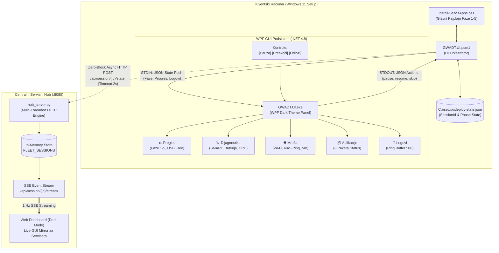
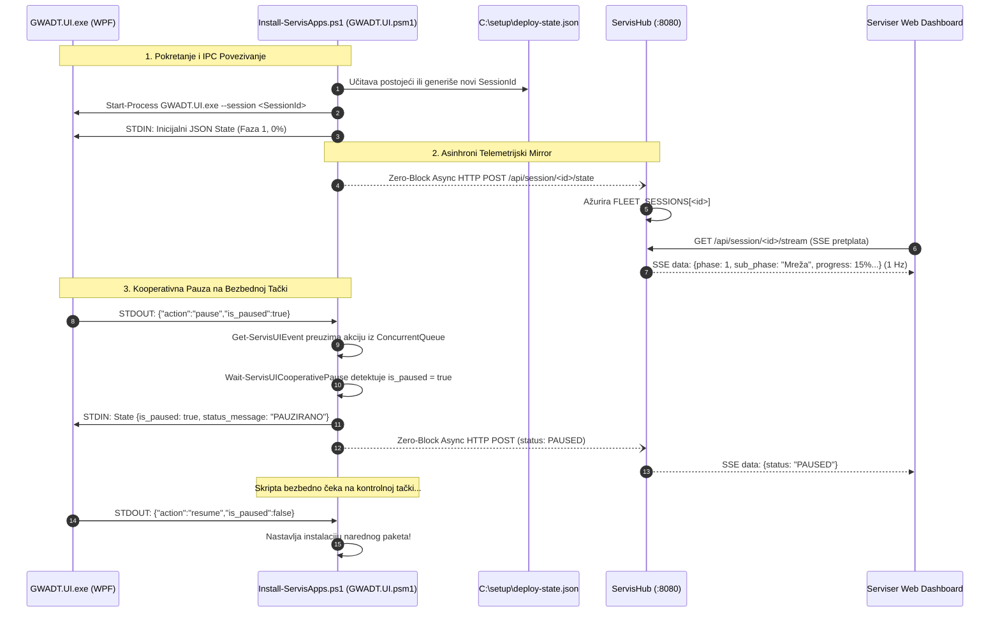

# ADR-0040: GWADT.UI WPF .NET Framework 4.8 Servisni Panel i ServisHub SSE Telemetrijski Mirror

## 1. Kontekst i Problem

Tokom dosadašnjeg razvoja GWADT sistema, operaterski interfejs na klijentskim mašinama oslanjao se na maksimizovanu PowerShell konzolu i ASCII tekstualni dashboard (`Show-ServisDashboard` u `GWADT.Core.psm1`). Iako je sistem obezbedio visoku pouzdanost i automatsko gašenje QuickEdit moda radi sprečavanja zamrzavanja terminala mišem ([[decisions/ADR-0034-msi-worker-isolation-and-quickedit-hardening]]), praktična upotreba u dinamičnoj servisnoj radionici nametnula je tri ključna inženjerska izazova:

### 1.1. Ograničenja ASCII Terminalskog Dashboarda
- **Vizuelna preglednost:** Na radnom stolu sa više različitih rezolucija i formata ekrana (od 1366x768 laptopova do 4K monitora), ASCII konzola ima ograničene mogućnosti formatiranja, ne podržava bogate grafičke indikatore (grafikone istrošenosti SSD-a, status baterije sa animacijom, strukturirane liste paketa sa statusnim ikonama).
- **Rizik od neželjene interakcije:** Iako je QuickEdit isključen, nepažljivo pritiskanje tastera (npr. `Ctrl+C` ili zatvaranje prozora) unutar PowerShell konzole može prekinuti instalacioni proces usred osetljivih koraka (poput registracije drajvera ili particionisanja).
- **Nedostatak interaktivne kontrole:** Tehničar na konzoli nije imao intuitivan način da bezbedno pauzira rad (npr. radi zamene napajanja ili inspekcije), preskoči pojedinačni korak ili odloži restart sistema bez ubijanja cele skripte.

### 1.2. Fizički Obilazak i Praćenje Flote
- U servisu "Tehno-Kutak" istovremeno se na radnom stolu priprema između 3 i 10 računara.
- Serviser je do sada morao neprekidno da prilazi svakom računaru ponaosob kako bi utvrdio:
  - Da li je USB fleš bezbedno odvojen (Fast USB Release) i spreman za sledeći računar.
  - Koliko je preostalo zdravlja na NVMe/SATA disku (S.M.A.R.T. Wear level i TBW).
  - Da li se baterija puni i koliki joj je fabrički kapacitet.
  - Koji se tačno program trenutno instalira i da li ima zastoja.
- Iako je ADR-0013 uveo osnovni ServisHub i dvotačkastu telemetriju (`STARTED` / `COMPLETED`, [[decisions/ADR-0022-diskretna-dvotackasta-telemetrija]]), nedostajao je kontinuirani prenos stanja u realnom vremenu (1 Hz) koji bi radnoj stanici servisera omogućio da vidi identičan grafički prikaz kao na ekranu klijenta.

### 1.3. Arhitektonska Dilema: .NET 8 vs .NET Framework 4.8
- Razmatranje izrade modernog GUI interfejsa dovelo je do kritičnog pitanja verzije radnog okruženja:
  - **Rizik modernog .NET 8 / WinUI 3:** Microsoft .NET 8 Desktop Runtime **nije fabrički prisutan** na čistoj instalaciji Windows 11! On se unutar samog GWADT pajplajna instalira tek u **Fazi 4** kroz sekvencijalni MSI Gate.
  - Pokušaj da se GUI razvije u .NET 8 stvara nerazrešiv paradoks ("kokoška i jaje"): aplikacija ne bi mogla da se pokrene u Fazi 1, Fazi 2 i Fazi 3 pre nego što sam orkestrator instalira .NET 8 runtime.
  - **Prednost .NET Framework 4.8 / 4.8.1:** .NET Framework 4.8 je sastavni, neotuđivi deo Windows 11 operativnog sistema (nativno instaliran u `C:\Windows\Microsoft.NET\Framework64\v4.0.30319`). Izvršni fajl baziran na .NET 4.8 može se pokrenuti **odmah u prvoj sekundi FirstLogon faze**, bez potrebe za instalacijom bilo kakvih spoljnih biblioteka ili runtime paketa!

---

## 2. Razmatrane Alternative

| Kriterijum | Opcija A: ASCII TUI (Status Quo) | Opcija B: .NET 8 / WinUI 3 Aplikacija | Opcija C: Lokalni Web UI (Electron/WebView2) | Opcija D: C# WPF .NET Framework 4.8 + ServisHub SSE Mirror [PRIHVAĆENO] |
| :--- | :--- | :--- | :--- | :--- |
| **Zavisnost od instalacije** | Nema (čist PowerShell) | Zahteva .NET 8 Runtime (nije dostupan pre Faze 4) | Zahteva WebView2 runtime ili teški Electron (~150MB) | **Nula spoljnih zavisnosti** (nativan u Win11) |
| **Vreme startovanja** | Trenutno | Odloženo do Faze 4 | Zadrška pri inicijalizaciji browser jezgra | **Trenutno (< 0.5s)** |
| **Korisnički interfejs** | Tekstualna konzola | Savremeni Fluent UI | HTML5/CSS | **Izvorni WPF Dark Theme sa 5 tabova** |
| **Interaktivne kontrole** | Nema (samo prikaz) | Dugmad i kontrole | Web forme | **Pauza, Nastavak, Preskakanje, Odlaganje restarta** |
| **Daljinski nadzor** | Samo log fajlovi na kraju | Zaseban mrežni kôd | WebSockets | **Zero-Block HTTP POST + SSE Mirror (1 Hz)** |
| **Otpornost na padove** | Srednja | Niska (ako nedostaje runtime) | Niska (zauzeće RAM-a) | **Visoka (automatski Console fallback)** |

---

## 3. Doneta Odluka i Arhitektura

Usvaja se **GWADT.UI podsistem baziran na samostalnom C# WPF .NET Framework 4.8 izvršnom fajlu sa dvosmernim IPC cevovodom i ServisHub SSE telemetrijskim ogledalom (Mirror)**.

Arhitektura se sastoji od 4 međusobno povezane celine:
1. **Lokalni WPF GUI klijent (`GWADT.UI.exe`):** Samostalna C# WPF aplikacija ciljana na .NET Framework 4.8.
2. **Orkestracioni PowerShell modul (`GWADT.UI.psm1`):** Upravlja životnim ciklusom GUI procesa, IPC komunikacijom i asinhronim slanjem telemetrije.
3. **ServisHub SSE Mirror (`hub_server.py`):** REST API i Server-Sent Events ruter na centralnom Linux/Windows serveru za prenos stanja na 1 Hz ka serviserskom Web Dashboard-u.
4. **Kooperativna kontrolna kapija (`Wait-ServisUICooperativePause`):** Mehanizam za bezbedno pauziranje i nastavak bez rizika od oštećenja MSI transakcija.



---

## 4. Detaljna Tehnička Specifikacija Podsistema

### 4.1. C# WPF .NET Framework 4.8 Izvršni Fajl (`GWADT.UI.exe`)
- **Projekat i kompajliranje:** `Skripte/GWADT.UI/GWADT.UI.csproj` koristi Microsoft .NET Framework 4.8 bez ijednog eksternog NuGet paketa. Kompajliranje se vrši u jednoj sekundi putem alata `Build.bat` (sa punom podrškom za `/silent` i `/auto` režim) pozivanjem ugrađenog sistemskog MSBuild-a (`C:\Windows\Microsoft.NET\Framework64\v4.0.30319\MSBuild.exe`). Projekat je striktno konfigurisan sa `ToolsVersion="4.0"` umesto Visual Studio specifičnog `ToolsVersion="15.0"`, što omogućava trenutno kompajliranje na čistoj Windows 11 mašini bez potrebe za eksternim SDK-ovima ili razvojnim okruženjima.
- **Arhitektura koda:**
  - `MainWindow.xaml` / `MainWindow.xaml.cs`: Kompletan XAML layout sa MVVM paternom (`MainViewModel`, `BaseViewModel`, `RelayCommand`), implementiran striktno u C# 5.0 (Classic C#) sintaksi.
  - `Models.cs`: Tipizirane strukture za `PhaseItem`, `AppItem`, `LogEntry` i globalno stanje (`MainViewModel`).
  - `JsonHelper.cs`: Samostalni, brzi, lagani JSON parser i serijalizator bez eksternih zavisnosti (`Newtonsoft.Json`), potpuno refaktorisan na C# 5.0 standard (uklonjena novija sintaksa, `out var` i pattern matching).
- **Korisnički interfejs:**
  - **Header:** Prikazuje prepoznati model računara, serijski broj, CPU model, RAM memoriju, NVMe/SATA disk i štopericu proteklog vremena servisa (`00:14:32`).
  - **Tab 1 [Pregled]:** Faza tracker (1–5 sa zelenim bedževima za završene i pulsirajućim okvirom za aktivnu), centrirani progres bar sa procentima (0–100%), dinamički opis trenutne operacije, istaknuti zeleni baner `✓ USB FLEŠ DISK JE BEZBEDNO ODVOJEN (Možete slobodno izvaditi fleš disk)` čim se završi lokalno keširanje, i prikaz poslednjih 5 log linija.
  - **Tab 2 [Dijagnostika]:** Prikaz zdravlja diska (Wear Level %, TBW upis, SMART status `Healthy/Warning`, realocirani sektori), status baterije (procena fabričkog kapaciteta %, ciklusi punjenja, AC/DC status), te opterećenje procesora i memorije.
  - **Tab 3 [Mreža]:** Prikaz SSID bežične mreže, dodeljene lokalne IP adrese, statusa veze sa servisnim NAS-om, latencije (ping u ms) i ukupne količine preuzetih megabajta sa gigabitnog NAS keša.
  - **Tab 4 [Aplikacije]:** Pregled 8 programskih celina (.NET 8 Runtime, Google Chrome, WinRAR, Adobe Acrobat Pro, Microsoft Office 2024, BatteryBar, OEM Licenca, Servisne Prečice) sa jasnim statusnim bedževima: `OK` (zeleno), `RUNNING` (narandžasto), `WAIT` (sivo), `ERROR` (crveno).
  - **Tab 5 [Log]:** Virtualizovani `ListView` sa ring baferom fiksne veličine od maksimalno **500 linija** (vreme, nivo loga, komponenta, tekst poruke) i opcijom za automatsko skrolovanje (`AutoScroll`).
  - **Donja traka za akcije:** Interaktivna dugmad za kontrolu toka:
    - `[ ⏸ Pauza ]` / `[ ▶ Nastavi ]` (menja stanje kooperativne pauze)
    - `[ ⏭ Preskoči ]` (zahteva preskakanje trenutnog neuspešnog koraka)
    - `[ ⏱ Odloži restart ]` (odlaže zakazani restart za 10 minuta)
    - Statusni LED indikator IPC veze sa PowerShell-om.
  - **Završni ekran (Completion Panel / Servisni Karton):** Po završetku Faze 5 prikazuje se sažeti karton sa rekapitulacijom servisa i veliko digitalno odbrojavanje od 60 sekundi do automatskog gašenja mašine, uz mogućnost prekida odbrojavanja tasterom `[ ⏹ Zaustavi gašenje / Pregledaj detalje ]` radi ručne inspekcije.

### 4.2. Stdin/Stdout JSON Streaming IPC Cevovod
- Komunikacija između PowerShell skripte i C# aplikacije odvija se isključivo preko standardnih tokova (Standard Input / Standard Output) u UTF-8 kodiranju:
  - **STDIN (PowerShell ➔ GUI):** PowerShell funkcija `Update-ServisUI` serijalizuje globalno stanje u jednoj liniji komprimovanog JSON formata i upisuje ga u `StreamWriter` standardnog ulaza GUI procesa (`$Global:GWADT_UI_Stdin.WriteLine($jsonState)`).
  - **STDOUT (GUI ➔ PowerShell):** Kada korisnik klikne dugme u interfejsu (npr. Pauza), GUI aplikacija poziva `Console.Out.WriteLine(json)` šaljući događaj:
    ```json
    {"action":"pause","is_paused":true,"phase":2,"timestamp":"2026-09-26T12:00:00.000Z"}
    ```
  - PowerShell proces asinhrono hvata izlaz kroz `Process.OutputDataReceived` događaj i smešta ga u bezbedan višenitni red (`ConcurrentQueue[string]`), čime se potpuno eliminiše rizik od blokiranja glavne niti skripte.

### 4.3. Zero-Block Asinhroni ServisHub SSE Mirror
- Kako bi serviser na svojoj centralnoj radnoj stanici imao živi uvid u rad svakog klijenta:
  - **Prijem stanja (`POST /api/session/<session_id>/state`):** Svaki put kada se pozove `Update-ServisUI`, skripta preko `[System.Threading.ThreadPool]::QueueUserWorkItem` asinhrono šalje HTTP POST zahtev na ServisHub port 8080.
  - **Zero-Block garancija:** HTTP zahtev ima strogo ograničen timeout od **2000 ms**. Ako je server nedostupan ili lokalna mreža privremeno prekinuta, radna nit odbacuje izuzetak bez ikakvog uticaja na tok instalacije na računaru.
  - **In-Memory evidencija sesija:** ServisHub u rečniku `FLEET_SESSIONS` čuva najsvežiji snapshot stanja svakog računara. Ukoliko telemetrija ne stigne duže od 30 sekundi, server sesiji automatski dodeljuje status `STALE`.
  - **SSE Live Streaming (`GET /api/session/<session_id>/stream`):** ServisHub pruža standardni `text/event-stream` endpoint. Kada serviser u Web Dashboard-u otvori karticu klijenta, browser uspostavlja SSE vezu i na taktu od **1 Hz** prima kompletno stanje klijenta (`data: {...}\n\n`), reprodukujući identičan prikaz faza, progresa, dijagnostike i logova.



### 4.4. Kooperativna Pauza i Očuvanje MSI Transakcija
- **Opasnost nekontrolisanog prekida:** Nasilno prekidanje instalacije usred rada servisa `msiserver` dovodi do zaključavanja sistemskog mutexa `Global\_MSIExecute`, ostavljanja polovično instaliranih datoteka u `C:\Program Files` i unosa u `PendingFileRenameOperations`, što pri narednom pokretanju izaziva fatalne greške 1618 i 1603 ([[decisions/ADR-0034-msi-worker-isolation-and-quickedit-hardening]], [[decisions/ADR-0038-msi-permission-and-installer-hardening]]).
- **Arhitektonsko rešenje:**
  - Uvedena je funkcija `Wait-ServisUICooperativePause -CheckpointName "<NazivKontrolneTačke>"`.
  - Kontrolne tačke su strateški raspoređene u orkestratoru **isključivo između atomskih operacija**:
    - Pre početka svakog pojedinačnog kruga Windows Update-a.
    - Pre početka instalacije svakog softverskog paketa (WinRAR, Chrome, Office, Acrobat Pro).
    - Pre pokretanja OEM licence.
    - Pre međurestarta između Faze 3 i Faze 4.
  - Kada serviser u GUI-ju pritisne taster `[ ⏸ Pauza ]`, orkestrator ne zaustavlja instaler usred kopiranja fajlova, već tekuću operaciju privodi kraju, a zatim na prvoj sledećoj kontrolnoj tački prelazi u stanje čekanja i emituje status `PAUZIRANO`.
  - Kada serviser klikne `[ ▶ Nastavi ]`, skripta momentalno nastavlja rad bez ikakvog rizika od oštećenja operativnog sistema.

### 4.5. Kontinuitet Sesije preko `deploy-state.json` i RunOnce Oživljavanje
- Tokom celokupnog životnog ciklusa instalacije računar prolazi kroz najmanje dva planirana restarta (Windows Update krugovi u Fazi 2 i kontrolisani međurestart između Faza 3 i 4 definisan u [[decisions/ADR-0039-two-pass-deployment-interim-reboot]]).
- **Očuvanje identiteta sesije:**
  1. Pri prvom pokretanju sistem formira trajni identifikator:
     `SessionId = "$($env:COMPUTERNAME)-$((Get-Date).ToString('yyyyMMdd-HHmmss'))-$([guid]::NewGuid().ToString().Substring(0, 8))"`.
  2. `SessionId` se trajno perzistira unutar datoteke `C:\setup\deploy-state.json`.
  3. Pre svakog restarta `deploy-state.json` čuva trenutni broj faze i `SessionId`.
  4. Nakon restarta, Windows preko `RunOnce` unosa `GWADT_Resume` ponovo pokreće `Install-ServisApps.ps1`.
  5. Orkestrator učitava `deploy-state.json`, preuzima identičan `SessionId` i poziva `Initialize-ServisUI -SessionId $SessionId`.
  6. GUI aplikacija se ponovo podiže (`GWADT.UI.exe --session "<SessionId>"`), a telemetrijski HTTP zahtevi nastavljaju da se šalju pod istim identifikatorom.
  7. **Rezultat:** Serviser u centralnom Web Dashboard-u ne vidi duplirane uređaje niti prekinute sesije — računar tokom restarta glatko prelazi u status `Restart u toku`, a zatim neometano nastavlja prikaz od Faze 4.

### 4.6. Striktna C# 5.0 (Classic C#) Standardizacija, .NET 4.0 MSBuild Kompatibilnost i Verify-CSharpSyntax.py Validator

Kompajliranje korisničkog interfejsa na ciljnim klijentskim mašinama donelo je specifičan sistemski izazov vezan za verziju ugrađenog C# kompajlera na čistoj instalaciji Windows 11 operativnog sistema.

#### 4.6.1. Ograničenja Sistemskog .NET 4.0 MSBuild i csc.exe Alata
- **Lokacija sistemskog kompajlera:** `C:\Windows\Microsoft.NET\Framework64\v4.0.30319\MSBuild.exe` i pripadajući `csc.exe`.
- **Podržana jezička specifikacija:** Ugrađeni .NET Framework 4.0 kompajler podržava isključivo **C# 5.0 (Classic C#)** jezički standard. Na čistom Windows sistemu bez instaliranog Visual Studio razvojnog okruženja ili Roslyn kompajlera, ugrađeni `csc.exe` v4.0.30319 odbija sve C# 6.0 i C# 7.0+ konstrukcije i prekida build sa fatalnim greškama (`CS1519: Invalid token '=>'`, `CS1002: ; expected`, `CS1525: Invalid expression term '$'`).
- **Prilagođavanje projektnog fajla (`GWADT.UI.csproj`):** Postavljen je atribut `ToolsVersion="4.0"` umesto podrazumevanog `ToolsVersion="15.0"` (koji zahteva Visual Studio 2017+ Build Tools). Time se ugrađenom sistemskom MSBuild-u omogućava da prepozna i uspešno obradi projektni fajl.

#### 4.6.2. Pravila Refaktoringa na C# 5.0 Standard
Celokupan izvorni kôd podsistema `GWADT.UI` u `Skripte/GWADT.UI/` i `sources/$OEM$/$1/setup/Skripte/GWADT.UI/` striktno je standardizovan prema sledećoj matrici zamene:

| Moderna C# 6.0/7.0+ Konstrukcija | Razlog Nekompatibilnosti (csc.exe v4.0) | Standardizovano C# 5.0 Rešenje |
| :--- | :--- | :--- |
| **Expression-Bodied Members (`=>`)** | Greška `CS1519` pri deklaraciji svojstava, metoda i akcesora | Klasični blokovi sa vitičastim zagradama: `get { return ...; }` i puno telo metode `{ ... }` |
| **String Interpolation (`$"..."`)** | Greška `CS1525` na karakteru `$` | `string.Format("{0}...", arg)` ili konkatenacija stringova |
| **Auto-Property Initializers** | `CS1002` na sintaksi `{ get; } = ...` | Svojstva `{ get; private set; }` sa eksplicitnom inicijalizacijom u konstruktoru |
| **Nameof Operator (`nameof(...)`)** | `CS0103` (The name 'nameof' does not exist) | Eksplicitni string literali (`"PropertyName"`) |
| **Out Variable Inline (`out var x`)** | `CS1003` / `CS1525` (sintaksna greška na `var`) | Eksplicitna deklaracija promenljive pre poziva (`Type x; TryParse(..., out x);`) |
| **Pattern Matching (`is Type var`)** | `CS1003` na varijabli iza tipa | Standardna provera `if (obj is Type)` uz eksplicitno kastovanje `(Type)obj` ili `as` operator |
| **Throw Expressions (`?? throw ...`)** | `CS1525` u ternarnim i null-coalescing izrazima | Klasični blok `if (param == null) throw new ArgumentNullException(...);` |
| **Null-Conditional Operator (`?.`)** | `CS1519` na karakterima `?.` | Klasična null provera: `var handler = Event; if (handler != null) handler(...);` |

#### 4.6.3. Tihi Build Pipeline u `Build.bat`
Skripta `Build.bat` u direktorijumu `Skripte/GWADT.UI/` proširena je podrškom za automatsko i neblokirajuće izvršavanje:
- **Parametri:** Prihvata argumente `/silent`, `/auto`, `-silent`, `-auto`.
- **Ponašanje:** U tihom režimu skripta potiskuje sve informativne `echo` poruke, uklanja interaktivne `pause` komande i poziva sistemski MSBuild sa prekidačima `/v:quiet /nologo`.
- **Exit kod:** Vraća čist kod `0` u slučaju uspeha ili `1` u slučaju greške, što omogućava parent procesima bezbednu proveru statusa.

#### 4.6.4. Dvostruki Automatski Mehanizam Izgradnje
Kako bi se obezbedilo da `GWADT.UI.exe` uvek bude na raspolaganju čak i ako se distribuira samo izvorni C# kôd:
1. **Nivo operativnog sistema (`FirstLogon.cmd`):**
   - Tokom ranog podizanja u `FirstLogon.cmd`, skripta skenira USB i skladišne izvore za prisustvo foldera `GWADT.UI`.
   - Ukoliko pronađe `Build.bat` a `GWADT.UI.exe` nedostaje, odmah nakon kopiranja datoteka u `C:\setup\Skripte\GWADT.UI` autonomno poziva:
     `cmd.exe /c "call C:\setup\Skripte\GWADT.UI\Build.bat /silent"`
   - Izvršna datoteka se generiše u milisekundama pre nego što se pokrene glavni orkestrator.
2. **Nivo PowerShell modula (`GWADT.UI.psm1`):**
   - Funkcija `Initialize-ServisUI` pre aktivacije GUI-ja proverava postojanje `GWADT.UI.exe` na definisanim kandidat putanjama.
   - Ukoliko izvršni fajl nedostaje, funkcija pre odustajanja na konzolni režim locira `Build.bat`, pokreće ga u pozadini (`Start-Process -FilePath $buildBat -ArgumentList "/silent" -Wait`) sa timeout-om od 30 sekundi, i po uspešnom završetku automatski podiže tek kompajlirani WPF interfejs.

#### 4.6.5. Rigorozni Statički Analizator: `Verify-CSharpSyntax.py`
U repozitorijumu je implementiran namenski statički QA validator `Skripte/Verify-CSharpSyntax.py` koji štiti bazu koda od regresije:
- **Leksička analiza:** Samostalni parser bez spoljnih Python biblioteka koji uklanja jednolinijske (`//`) i višelinijske (`/* ... */`) komentare, pravilno procesira regularne i verbatim (`@"..."`) stringove i detektuje interpolirane stringove (`$"..."`, `$@"..."`).
- **Detekcija prekršaja:**
  * Proverava deklaracije svojstava, metoda i akcesora na prisustvo `=>` strelica, uz precizno razlikovanje legitimnih C# 3.0 lambda izraza unutar tela metoda (`x => x > 0`).
  * Detektuje auto-property initializere (`{ get; } = ...`), null-conditional operatore (`?.`), `nameof(...)`, inline `out var` i throw izraze.
- **Integracija u QA pajplajn:**
  * `Verify-CSharpSyntax.py` automatski skenira `Skripte/GWADT.UI/` i `sources/$OEM$/$1/setup/Skripte/GWADT.UI/`.
  * Integrisan je u centralni regresioni test suite `Skripte/Test-GWADTModules.py` (Test Blok 7).
  * Vraća exit code 0 samo ako su svi `.cs` fajlovi 100% C# 5.0 kompatibilni.

---

## 5. Posledice Odluke

### 5.1. Prednosti (Benefits)
1. **Nativna kompatibilnost (Zero-Prerequisites):** .NET Framework 4.8 garantuje rad od prve sekunde podizanja Windows 11 sistema, pre instalacije bilo kakvih novijih runtime-ova.
2. **Superiorna ergonomija i vizuelni uvid:** Responzivna tamna tema sa namenskim tabovima za dijagnostiku, mrežu, aplikacije i logove pruža trenutnu informaciju o stanju uređaja sa udaljenosti od nekoliko metara.
3. **Udaljeni nadzor u realnom vremenu:** 1 Hz SSE strimovanje omogućava tehničaru da sa svog radnog stola prati celokupnu flotu bez fizičkog obilaska.
4. **Sigurnost instalacionog procesa:** Kooperativna pauza na bezbednim tačkama garantuje očuvanje MSI transakcija i sprečava korupciju sistema.
5. **Brza detekcija hardverskih mana:** Istaknuti prikaz S.M.A.R.T. zdravlja SSD-a i degradacije baterije u realnom vremenu omogućava serviseru da odmah kontaktira klijenta radi zamene neispravne komponente.
6. **Graceful Fallback:** U slučaju bilo kakvog problema sa GUI izvršnim fajlom (nedostaje fajl, oštećenje), orkestrator automatski prebacuje backend na `Console` bez prekida instalacije.
7. **Nezavisnost od razvojnih alata (Zero Visual Studio Requirement):** Striktna C# 5.0 standardizacija i `ToolsVersion="4.0"` omogućavaju da se kôd po potrebi direktno i tiho rekompajlira na čistom Windowsu koristeći fabrički sistemski MSBuild v4.0.30319.

### 5.2. Rizici i Strategije Ublažavanja (Risks & Mitigations)
- **Rizik 1: Blokada instalacionog pajplajna usled nedostupnosti ServisHub servera.**
  - *Ublažavanje:* Svi mrežni pozivi ka ServisHub-u (`POST /api/session/<id>/state`) izolovani su u `ThreadPool` pozadinskim nitima sa strogim timeoutom od 2000 ms i zaštićeni praznim `catch` blokom. Pad servera ili prekid Wi-Fi veze ima 0% uticaja na lokalni tok instalacije.
- **Rizik 2: Prepunjavanje radne memorije akumulacijom logova u GUI-ju.**
  - *Ublažavanje:* Kolekcija `AllLogs` u `MainViewModel` implementirana je kao ring bafer sa strogim ograničenjem na maksimalno 500 unosa (`MaxLogCount = 500`). Stari unosi se automatski uklanjaju.
- **Rizik 3: Zamrzavanje GUI interfejsa velikim brojem poruka.**
  - *Ublažavanje:* Čitanje sa STDIN-a vrši se u zasebnoj asinhronoj niti (`Task.Run`), a prenos u UI nit obavlja se preko `Dispatcher.BeginInvoke`.
- **Rizik 4: Slučajno prevremeno gašenje računara na završnom ekranu.**
  - *Ublažavanje:* Implementirano je veliko vizuelno odbrojavanje od 60 sekundi sa uočljivim tasterom `[ ⏹ Zaustavi gašenje / Pregledaj detalje ]` koji trenutno prekida tajmer i vraća punu kontrolu tehničaru.
- **Rizik 5: Slučajno uvođenje C# 6.0/7.0+ novotarija u izvorni C# kôd.**
  - *Ublažavanje:* Implementiran je namenski statički analizator `Skripte/Verify-CSharpSyntax.py` koji je integrisan u centralni QA paket (`Test-GWADTModules.py`, Test Blok 7) i bezuslovno blokira build proces ukoliko detektuje expression-bodied članove, interpolaciju stringova, auto-prop init, nameof, throw expressions ili out var konstrukcije.

---

## 6. Povezane Odluke i Reference

- [[decisions/ADR-0010-responsive-tui-maximization]] — Troslojna maksimizacija PowerShell konzole i responsive ASCII dashboard.
- [[decisions/ADR-0013-live-fleet-telemetry-servis-hub]] — Centralizovani Servisni Hub, REST API i SSE streaming.
- [[decisions/ADR-0022-diskretna-dvotackasta-telemetrija]] — Dvotačkasta telemetrija (STARTED i COMPLETED) i digitalni servisni karton.
- [[decisions/ADR-0024-smart-battery-hardware-health-check]] — Hibridna S.M.A.R.T. i baterija hardverska dijagnostika.
- [[decisions/ADR-0034-msi-worker-isolation-and-quickedit-hardening]] — Izolacija MSI radnika i gašenje QuickEdit moda konzole.
- [[decisions/ADR-0038-msi-permission-and-installer-hardening]] — Očvršćavanje sistemskih dozvola i robusni instaleri.
- [[decisions/ADR-0039-two-pass-deployment-interim-reboot]] — Dvoetapni deployment sa kontrolisanim međurestartom pre Faze 4.
- [[architecture/overview]] — Sveobuhvatni pregled arhitekture sistema.
