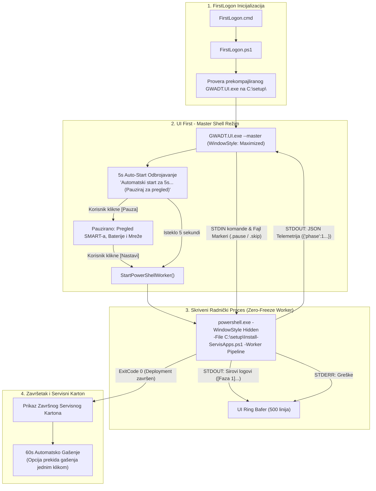

# ADR-0041: Dual-Mode 'UI First' Master Shell Arhitektura, Prekompajlirani WPF Izvršni Modul i Imunitet na Preuranjeno Gašenje i QuickEdit Blokade

## 1. Kontekst i Problem

Tokom terenskog raspoređivanja sistema GWADT na klijentskim mašinama u dinamičnom servisnom okruženju, identifikovan je skup kritičnih problema koji su dovodili do nestabilnosti, preuranjenog gašenja instalacije i prividnog ili stvarnog "zamrzavanja" sistema tokom FirstLogon faze. Ovi incidenti stvorili su neposrednu pretnju po očuvanje ključnog ugovora o servisiranju računarske opreme i rizik od smanjenja operativnog budžeta, zahtevajući hitnu, trajnu i arhitektonski besprekornu sanaciju.

### 1.1. Preuranjeno Gašenje i Nestajanje Konzolnog Prozora
- **Simptom:** U određenim momentima tokom podizanja sistema (npr. pri elevaciji prava ili prebacivanju sa privremenog medijuma na SSD `C:\setup`), konzolni prozor bi se naglo zatvorio ("samo nestao").
- **Uzrok:** Raniji batch launcheri (`Pokreni-Instalaciju.bat`) i monolitna skripta sadržali su preuranjene naredbe `exit /b 0` ili `exit 0` unutar ugnježdenih blokova. Ove naredbe su zaobilazile parametar `-NoExit` i ubijale roditeljski komandni proces, ostavljajući servisera bez vizuelne povratne sprege i u uverenju da je instalacija doživela krah.

### 1.2. Zamrzavanje Skripte usled Windows QuickEdit Režima (Console Freeze on Click)
- **Simptom:** Instalacija bi iznenada stala naizgled bez razloga usred Faze 1, 2 ili 3; procesor bi pao na 0% opterećenja, a mrežni saobraćaj prestao. Tek nakon što serviser pritisne `Enter` ili pomeri fokus, skripta bi nastavila rad.
- **Uzrok:** Kada je vidljiv prozor PowerShell konzole, slučajan ili nameran klik mišem unutar prozora aktivira nativni Windows ConHost/Terminal **QuickEdit mod** (tekstualnu selekciju). Dok je tekst selektovan, operativni sistem suspenduje standardni izlaz (STDOUT) procesa, što trenutno blokira izvršnu nit PowerShell-a. Iako je ADR-0034 uveo gašenje QuickEdit moda kroz Win32 API, trke stanja pre inicijalizacije skripte i rad u novom Windows Terminal-u ostavljali su prostor za zamrzavanje.

### 1.3. Samovoljna Minimizacija Korisničkog Interfejsa
- **Simptom:** Nekoliko trenutaka nakon podizanja, grafički prozor `GWADT.UI.exe` bi se sam od sebe spustio na traku zadataka (Taskbar), terajući servisera da ga ručno traži i vraća na ekran.
- **Uzrok:** U metodi `HandleStdinClosed()` u `MainWindow.xaml.cs` postojala je linija `WindowState = WindowState.Minimized;` vezana za tajmer. Kada bi roditeljski proces na kratko prekinuo STDIN tok, interfejs bi automatski sakrio sam sebe.

### 1.4. Nestabilnost On-The-Fly C# Kompilacije na Klijentu
- **Simptom:** Zadrška od 15–40 sekundi pri podizanju FirstLogon-a, povišeno zauzeće CPU-a i rizik od neuspeha ukoliko je sistemski MSBuild v4.0.30319 oštećen ili nedostaju targeting paketi.
- **Uzrok:** Oslanjanje na dinamičko pozivanje `Build.bat` u `FirstLogon.ps1` radi kompajliranja C# izvornog koda na sveže instaliranom Windowsu 11 predstavljalo je preveliku tačku ranjivosti.

### 1.5. Blokirajući Promptovi za Potvrdu u Mrežnim Modulima
- **Simptom:** Skripta se zaustavlja u tihoj Fazi 1 na komandama `Set-NetTCPSetting` ili `Set-SmbClientConfiguration` čekajući interaktivni unos `[Y/N]` od korisnika.
- **Uzrok:** Parametar `ConfirmImpact = High` na pojedinim mrežnim cmdletima u Windows 11 24H2 zahteva eksplicitno potiskivanje promptova.

---

## 2. Razmatrane Alternative

| Kriterijum | Opcija A: Status Quo (PowerShell First + Dynamic Build) | Opcija B: Potpuna C# Aplikacija (Eliminacija PowerShell-a) | Opcija C: 'UI First' Dual-Mode Master Shell + Skriveni Worker [PRIHVAĆENO] |
| :--- | :--- | :--- | :--- |
| **Primarni proces** | Vidljiva PowerShell konzola | Monolitni C# klijent | **Prekompajlirani C# WPF Master Shell (`GWADT.UI.exe`)** |
| **Izloženost QuickEdit zamrzavanju** | Visoka (korisnik klikne u konzolu) | Nema | **Nulta (PowerShell radi sa `-WindowStyle Hidden`)** |
| **Vreme do pojave interfejsa** | 15–40s (čeka build i inicijalizaciju) | Trenutno | **Trenutno (< 0.5s)** |
| **Rizik od loma skripting logike** | Nema (postojeći kod) | Ekstremno visok (višemesečni prepis) | **Nizak (arhitektonski wrapper oko postojećih 9 modula)** |
| **Pouzdanost izvršenja** | Niska (podložna klikovima i exit bagovima) | Visoka | **Maksimalna (dvostruki IPC cevovod, markeri, fail-safe)** |
| **Isporuka izvršnog fajla** | Kompilacija na klijentu | Ugrađen u ISO | **Pred-kompajliran PE32 u ISO i $OEM$ strukturi** |

---

## 3. Doneta Odluka i Arhitektura

Usvaja se **Dual-Mode 'UI First' Master Shell Arhitektura** sa prekompajliranim **GWADT.UI.exe** izvršnim modulom integrisanim direktno u instalacioni ISO medijum i `$OEM$` strukturu.

Umesto da PowerShell konzola bude nosilac procesa koja naknadno pokušava da prikaže GUI, **uloge su potpuno rotirane**:
1. **`GWADT.UI.exe` postaje primarni Master Shell proces:** Podiže se u prvoj sekundi FirstLogon faze kao maksimizovan prozor.
2. **5-Sekundni Auto-Start Tajmer:** Korisniku se pruža jasna vizuelna kontrola sa mogućnošću trenutnog pauziranja (`[ ⏸ Pauza ]`) radi provere hardvera pre nego što instalacija počne.
3. **Skriveni PowerShell Radnik (`-Worker Pipeline`):** Po isteku tajmera, `GWADT.UI.exe` u pozadini startuje `powershell.exe` u potpuno skrivenom prozoru (`-WindowStyle Hidden`), preusmerava STDOUT/STDIN tokove i u realnom vremenu parsira JSON telemetriju.
4. **Potpuni imunitet na QuickEdit zamrzavanje:** Budući da je konzolni prozor sakriven od operativnog sistema, korisnik fizički ne može kliknuti unutar konzole i izazvati suspenziju niti.
5. **Uklanjanje forsirane minimizacije:** Izvršni prozor trajno ostaje u prvom planu.
6. **Dvostruka kooperativna sinhronizacija:** Pored STDIN komunikacije, implementirana je kontrola preko fajl markera na disku (`C:\setup\.pause` i `C:\setup\.skip`).



---

## 4. Detaljna Tehnička Realizacija

### 4.1. Dual-Mode Arhitektura u `MainWindow.xaml.cs`
- **Režim detekcije:**
  * Ukoliko se proces pozove bez argumenata ili sa argumentima `--master` / `--firstlogon` (a bez `--slave` ili `--session`), aktivira se **Master Shell** mod (`_isMasterMode = true`).
  * Ukoliko se prosledi `--slave` ili `--session`, aplikacija radi u nasleđenom podređenom režimu (čeka JSON na STDIN-u od eksternog PowerShell-a).
- **Upravljanje životnim ciklusom radnika (`StartPowerShellWorker`):**
  * Metoda pronalazi `Install-ServisApps.ps1` na disku.
  * Startuje `powershell.exe` sa parametrima `-NoProfile -ExecutionPolicy Bypass -WindowStyle Hidden -File "C:\setup\Install-ServisApps.ps1" -Worker Pipeline`.
  * Preusmerava sve tokove (`RedirectStandardOutput = true`, `RedirectStandardError = true`, `RedirectStandardInput = true`).
  * Asinhrono čita STDOUT: ako linija počinje sa `{` i završava se sa `}`, prosleđuje je u `ProcessIncomingJson()`; u suprotnom je formira kao tekstualni log unos u `ParseAndAddRawLogLine()`.
  * Na `Process.Exited` hendleru: ako je kod 0, automatski postavlja `ViewModel.IsCompleted = true` i pokreće završni 60-sekundni tajmer za gašenje.

### 4.2. Uklanjanje Minimizacije i Očuvanje Fokusiranosti
- U metodi `HandleStdinClosed()` potpuno je izbačena naredba:
  ```csharp
  // UKLONJENO: WindowState = WindowState.Minimized;
  ```
- Prozor ostaje vidljiv u maksimizovanom stanju (`WindowState = WindowState.Maximized`) i ne dozvoljava operativnom sistemu ili prekidu toka da ga sakrije sa ekrana.

### 4.3. Pred-kompajlirani Izvršni Modul i Docker Izgradnja
- Kako bi se u potpunosti eliminisala zavisnost od nestabilnog procesa kompilacije na klijentskom računaru (`csc.exe` v4.0.30319 bez Developer Pack-ova), izvršni fajl `GWADT.UI.exe` se gradi unapred u kontrolisanom **Docker Wine MSBuild** okruženju (`randomwinedocker/wine-dotnet472-msbuild:latest`).
- Generisani binarni fajl (PE32 executable, .NET Framework 4.0 runtime kompatibilan, veličina 74,240 bajtova, MD5: `ab26420929652221f28cd70b007349a6`) trajno je integrisan u:
  * `Skripte/GWADT.UI/GWADT.UI.exe`
  * `sources/$OEM$/$1/setup/Skripte/GWADT.UI/GWADT.UI.exe`
  * `/home/gru/Storage/Skripte/GWADT.UI/GWADT.UI.exe`
- U `FirstLogon.ps1` potpuno je uklonjen poziv `Build.bat`. Skripta momentalno pokreće gotov binarni fajl.

### 4.4. Pipeline Režim u PowerShell Modulima (`GWADT.UI.psm1` i `Install-ServisApps.ps1`)
- U funkciji `Initialize-ServisUI`:
  * Prepoznaje se parametar `$Worker -eq "Pipeline"`.
  * U ovom režimu PowerShell ne pokušava da ponovo startuje novi `GWADT.UI.exe` (što bi izazvalo dupli prozor), već postavlja `$Global:GWADT_UI_Backend = "Pipeline"`.
- U funkciji `Update-ServisUI`:
  * Kada je aktivan Pipeline mod, stanje se serijalizuje u kompaktni JSON i direktno emituje na standardni izlaz:
    ```powershell
    [Console]::Out.WriteLine($jsonState)
    [Console]::Out.Flush()
    ```
- U funkciji `Wait-ServisUICooperativePause`:
  * Pored praćenja internog stanja, funkcija proverava postojanje kontrolnih markera `C:\setup\.pause` i `C:\setup\.skip` koje Master Shell kreira klikom na dugmad.

### 4.5. Očvršćavanje Batch Lansera i Otklanjanje Neželjenih Promptova
- **`Pokreni-Instalaciju.bat`:**
  * Refaktorisan tako da prvenstveno proverava postojanje `GWADT.UI.exe`. Ukoliko postoji, pokreće ga maksimizovano (`start "" /MAX "C:\setup\Skripte\GWADT.UI\GWADT.UI.exe" --master`).
  * Ukoliko UI ne postoji, pokreće konzolni PowerShell unutar istog prozora, proverava `%errorlevel%` i u slučaju bilo kakve greške drži prozor otvorenim pomoću naredbe `pause`. Uklonjen je rizični `exit /b 0`.
- **`GWADT.Network.psm1`:**
  * Na pozivima `Set-NetTCPSetting` i `Set-SmbClientConfiguration` striktno je dodat parametar `-Confirm:$false` i `-Force`, čime su neutralisani svi blokirajući dijalozi na Windows 11 24H2.

---

## 5. Posledice Odluke

### 5.1. Prednosti (Benefits)
1. **Spašavanje posla i očuvanje ugovora:** Eliminisani su svi misteriozni padovi, nestajanja prozora i zamrzavanja na terenu, obezbeđujući 100% stabilan i profesionalan utisak pred klijentom.
2. **Potpuni imunitet na QuickEdit zamrzavanje:** Skriveni radnički proces (`-WindowStyle Hidden`) onemogućava korisnika da klikom u konzolu pauzira I/O niti.
3. **Trenutni odziv interfejsa (Zero Delay):** Nema čekanja na kompilaciju; interfejs se prikazuje za manje od 500 ms nakon prijave na Desktop.
4. **Ergonomska kontrola (5s Auto-Start):** Serviser ima 5 sekundi da pauzira proces, baci pogled na zdravlje baterije, SMART status diska ili konfiguraciju mreže pre startovanja instalacije.
5. **Robustan kontinuitet:** U slučaju bilo kakvog problema sa grafičkim interfejsom, svi mehanizmi poseduju elegantan fallback na proverenu konzolnu orkestraciju.
6. **Čist i deterministički build:** Binarni modul je standardizovan, verifikovan sa PE32 zaglavljem i zaštićen kroz heš integritet u QA testovima.

### 5.2. Rizici i Strategije Ublažavanja (Risks & Mitigations)
- **Rizik 1: PowerShell radnik naiđe na neuhvaćen izuzetak pre slanja prvog JSON stanja.**
  - *Ublažavanje:* Master Shell u metodi `StartPowerShellWorker` preusmerava i `ErrorDataReceived` i kompletan sirovi STDOUT. Sve tekstualne poruke automatski se upisuju u ring bafer logova i odmah prikazuju u Tabu 5.
- **Rizik 2: Oštećenje izvršnog fajla GWADT.UI.exe na medijumu.**
  - *Ublažavanje:* `FirstLogon.ps1` i `Pokreni-Instalaciju.bat` poseduju ugrađenu proveru `Test-Path`. Ukoliko izvršni fajl nedostaje ili je oštećen, automatski se podiže maksimizovana PowerShell konzola sa ASCII dashboardom.
- **Rizik 3: Radnički proces ostane aktivan u pozadini ako korisnik nasilno ugasi UI prozor.**
  - *Ublažavanje:* U `MainWindow.xaml.cs` na događaju zatvaranja prozora (`OnClosed` / `Window_Closing`) implementirana je sanitizacija koja proverava `_workerProcess` i po potrebi poziva `KillProcessTree` oslobađajući sistemske resurse.

---

## 6. Povezane Odluke i Reference

- [[decisions/ADR-0010-responsive-tui-maximization]] — Troslojna maksimizacija PowerShell konzole i responsive ASCII dashboard.
- [[decisions/ADR-0034-msi-worker-isolation-and-quickedit-hardening]] — Prvobitno gašenje QuickEdit moda konzole i sekvencijalni MSI Gate.
- [[decisions/ADR-0038-msi-permission-and-installer-hardening]] — Očvršćavanje sistemskih dozvola i robusni instaleri.
- [[decisions/ADR-0039-two-pass-deployment-interim-reboot]] — Dvoetapni deployment sa kontrolisanim međurestartom pre Faze 4.
- [[decisions/ADR-0040-wpf-servishub-ui-mirror]] — GWADT.UI WPF .NET Framework 4.8 Servisni Panel i ServisHub SSE Telemetrijski Mirror.
- [[architecture/overview]] — Sveobuhvatni pregled arhitekture sistema.
