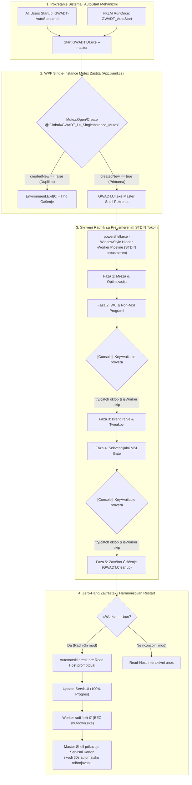

# ADR-0042: Prevencija Zastoja (Deadlock Prevention) na Preusmerenim Tokovima, Sistemska Mutex Zaštita Korisničkog Interfejsa i Harmonizacija Životnog Ciklusa Radničkog Procesa

## 1. Kontekst i Problem

Nakon uspešnog uvođenja Dual-Mode 'UI First' Master Shell arhitekture ([[decisions/ADR-0041-ui-first-master-shell-architecture]]), uočeni su specifični ivični scenariji tokom terenskog testiranja i laboratorijske simulacije koji su mogli dovesti do zastoja (hang/deadlock) ili kolizije procesa na sveže instaliranim Windows 11 mašinama.

U 'UI First' arhitekturi, grafički interfejs (`GWADT.UI.exe`) pokreće PowerShell skriptu u pozadini sa parametrom `-Worker Pipeline` i preusmerenim tokovima (`RedirectStandardOutput = true`, `RedirectStandardError = true`, `RedirectStandardInput = true`) u skrivenom prozoru (`-WindowStyle Hidden`). U takvom asinhronom cevovodu, ponašanje konzolnih API-ja i procesnih mehanizama dramatično se razlikuje od klasične interaktivne PowerShell konzole.

### 1.1. Deadlock na 100% Progresa usled Bezuslovnog `Read-Host` u Skrivenom Radniku
- **Simptom:** Skripta uspešno završi sve instalacije aplikacija, prođe Fazu 5 (čišćenje), grafički interfejs prikaže 100% progresa, ali proces instalacije nikada formalno ne završi; Master Shell ostaje u stanju čekanja, a sistem se ne gasi niti restartuje.
- **Uzrok:** U modulu `GWADT.Cleanup.psm1` (funkcija `Invoke-ServisCleanupAndFinalize`), završna petlja za odlučivanje servisera o pregledu logova sadržala je bezuslovni poziv cmdleta `Read-Host "Da li zelite restart? (D/N)"`. Kada se PowerShell izvršava sa preusmerenim STDIN tokom u skrivenom prozoru, `Read-Host` blokira izvršnu nit čekajući unos sa konzole koja fizički ne postoji i nije dostupna korisniku, izazivajući permanentni deadlock.

### 1.2. Kolizija Procesa Restarta Između Radnika i Master Shell-a
- **Simptom:** Ukoliko bi skripta pokušala samostalno da izvrši `shutdown.exe /r /t 5` ili `Restart-Computer`, to bi prekinulo Master Shell pre nego što WPF interfejs uspe da prikaže završni servisni karton i pokrene definisani 60-sekundni tajmer za pregled statusa hardvera i aplikacija.
- **Uzrok:** Neusklađenost nadležnosti nad životnim ciklusom mašine. Radnički proces je u ranijim verzijama tretirao sebe kao vrhovnog orkestratora i samostalno naređivao reboot, umesto da u Master Shell režimu prepusti kontrolu nad gašenjem roditeljskom procesu.

### 1.3. `System.InvalidOperationException` pri Pristupu `[Console]::KeyAvailable` na Preusmerenom Ulazu
- **Simptom:** Skripta neočekivano pada u Fazi 2b (Windows Update) ili Fazi 4 (Aplikacije) uz grešku:
  `System.InvalidOperationException: Cannot read keys when either application has no console or when console input has been redirected from a file or another process.`
- **Uzrok:** U `.NET Framework` runtime-u, statičko svojstvo `[System.Console]::KeyAvailable` i metoda `[System.Console]::ReadKey()` bacaju fatalni `InvalidOperationException` ukoliko proces nema pridruženu interaktivnu Win32 konzolu ili ako je `StandardInput` preusmeren. Tajmeri sa opcijom prekida pritiskom na taster (npr. 15s tajmer u `GWADT.Update.psm1` i 30s tajmer u `GWADT.Apps.psm1`) rušili su radnički proces ukoliko nisu imali zaštitni oklop.

### 1.4. Višestruko Pokretanje `GWADT.UI.exe` usled Redundantnih Windows Startup Mehanizama
- **Simptom:** Prilikom prijave na Desktop podižu se dva ili tri konkurentna prozora `GWADT.UI.exe`, što dovodi do trke resursa, duplog pokretanja skrivenog PowerShell radnika i kolizija u pristupu datotekama na `C:\setup`.
- **Uzrok:** Radi garantovanja pouzdanog automatskog pokretanja (Fail-Safe AutoStart), sistem koristi i Startup folder (`C:\ProgramData\...\Startup\GWADT-AutoStart.cmd`) i RunOnce registar (`HKLM\...\RunOnce\GWADT_AutoStart`). U određenim okolnostima Explorer pokreće oba mehanizma u kratkom vremenskom razmaku. Bez mehanizma međusobnog isključivanja na nivou operativnog sistema, WPF aplikacija je dozvoljavala paralelne instance.

---

## 2. Razmatrane Alternative

| Kriterijum | Opcija A: Status Quo (Interaktivne Pretpostavke) | Opcija B: Uklanjanje Startup/RunOnce Redundanse | Opcija C: Sveobuhvatna Harmonizacija, Try/Catch Oklop i Globalni Mutex [PRIHVAĆENO] |
| :--- | :--- | :--- | :--- |
| **Rukovanje STDIN tokom** | Blokira na `Read-Host` | Blokira na `Read-Host` | **Automatska detekcija `$isWorker` uz `break` pre prompta** |
| **Rukovanje `KeyAvailable`** | Puca sa `InvalidOperationException` | Puca sa `InvalidOperationException` | **Preskakanje u radniku + obavezni `try/catch` oklop** |
| **Kontrola restarta** | Radnik nasilno gasi mašinu | Radnik nasilno gasi mašinu | **Radnik radi `exit 0`, Master Shell vodi 60s odbrojavanje** |
| **Prevencija duplih UI procesa** | Nema (podiže se više prozora) | Uklanjanje jednog mehanizma (smanjuje fail-safe pouzdanost) | **Sistemski imenovani `Global\GWADT_UI_SingleInstance_Mutex`** |
| **Rizik od zastoja (Hang)** | Ekstremno visok na 100% | Visok | **Nula (Zero-Hang garancija)** |

---

## 3. Doneta Odluka i Arhitektura

Usvaja se sveobuhvatni paket mera za prevenciju zastoja i zaštitu procesa:

### 3.1. Eliminacija Blokirajućih Promptova u Radničkom Modu (`$isWorker`)
U svim ključnim modulima (`GWADT.Cleanup.psm1`, `GWADT.Update.psm1`, `GWADT.Apps.psm1`, `GWADT.Core.psm1`) uvedena je standardizovana provera radničkog režima:
```powershell
$isWorker = ($Global:Worker -or $Worker -or $Global:GWADT_UI_Backend -eq "Pipeline")
```
U funkciji `Invoke-ServisCleanupAndFinalize`:
1. U petlji završnog odlučivanja ubačen je osigurač:
   ```powershell
   if ($isWorker) { break }
   ```
   koji se izvršava **pre bilo kakvog poziva `Read-Host`**, i u scenariju kada su svi programi instalirani i kada neki program nedostaje. Radnik automatski nastavlja tok čišćenja bez čekanja.
2. Na samom završetku funkcije, u radničkom modu se **ne pozivaju** `shutdown.exe /r /t 5` niti `Restart-Computer`. Umesto toga, radnik:
   - Ažurira status preko `Update-ServisUI -Progress 100 -PhaseName "Zavrseno" -StatusText "Instalacija kompletirana. Sistem spreman."`
   - Upisuje završni `SUCCESS` marker u trajni servisni log.
   - Izvršava kontrolisani `exit 0`.

### 3.2. Harmonizacija Životnog Ciklusa sa Master Shell-om
Kada radnik završi sa kodom 0, Master Shell (`GWADT.UI.exe`):
1. Detektuje regularan završetak procesa radnika (`workerProcess.ExitCode == 0`).
2. Prikazuje završni servisni karton (pregled hardvera, SMART zdravlje, status svih instaliranih paketa i drajvera).
3. Pokreće vizuelni tajmer od 60 sekundi za automatsko gašenje/restart, uz omogućavanje serviseru da jednim klikom prekine tajmer i ostane na sistemu radi dodatnih provera.

### 3.3. Oklopljeni Pristup Konzolnim Tastaturnim API-jima
1. **Windows Update (`GWADT.Update.psm1`):** 15-sekundni tajmer se u radničkom modu potpuno preskače (`if (-not $isWorker)`). Pristup `[Console]::KeyAvailable` obuhvaćen je robusnim `try/catch` blokom koji u slučaju izuzetka vraća `$false`.
2. **Aplikacije (`GWADT.Apps.psm1`):** 30-sekundni tajmer pri nedostatku instalacionih paketa preskače se u radničkom modu, a `[System.Console]::KeyAvailable` je zaštićen `try/catch` blokom.
3. **Fatal Error Screen (`GWADT.Core.psm1`):** Funkcija `Show-ServisFatalErrorScreen` u radničkom modu odmah bez interakcije vraća `"Skip"`, dok je poziv `[Console]::ReadKey($true)` za interaktivni mod osiguran `try/catch` blokom koji u slučaju preusmerenog ulaza bezbedno vraća `"Skip"`.

### 3.4. Sistemska Mutex Zaštita u WPF Korisničkom Interfejsu (`App.xaml.cs`)
U `Skripte/GWADT.UI/App.xaml.cs` implementirana je zaštita jedinstvene instance korišćenjem operativnog sistema imenovanog Mutex-a u globalnom imenskom prostoru:
```csharp
private static Mutex _appMutex;
private const string MutexName = @"Global\GWADT_UI_SingleInstance_Mutex";

protected override void OnStartup(StartupEventArgs e)
{
    bool createdNew;
    _appMutex = new Mutex(true, MutexName, out createdNew);

    if (!createdNew)
    {
        // Instanca već postoji - tiho napusti proces bez kolizije
        Environment.Exit(0);
        return;
    }

    base.OnStartup(e);
}

protected override void OnExit(ExitEventArgs e)
{
    if (_appMutex != null)
    {
        try { _appMutex.ReleaseMutex(); } catch { }
        _appMutex.Close();
        _appMutex = null;
    }
    base.OnExit(e);
}
```
Korišćenje prefiksa `Global\` obezbeđuje validnost Mutex-a kroz sve sesije (uključujući prelaz iz SYSTEM u korisničku sesiju). Ukoliko bilo koji sekundarni mehanizam pokrene novu instancu `GWADT.UI.exe`, ona se momentalno gasi sa kodom 0, ostavljajući primarni prozor netaknutim.



---

## 4. Posledice i Verifikacija

### 4.1. Pozitivne Posledice
- **100% Zero-Hang garancija:** Uklonjena i poslednja tačka zastoja na završetku instalacije; sistem nikada ne ostaje u blokadi na 100%.
- **Stabilnost na preusmerenom ulazu:** Eliminisan rizik od rušenja PowerShell radnika usled `InvalidOperationException` na `KeyAvailable` i `ReadKey`.
- **Otpornost na dvostruko pokretanje:** Višestruki Startup i RunOnce pozivi više ne mogu kreirati konkurentne instance niti izazvati sudar radničkih procesa.
- **Predvidiv korisnički doživljaj:** Serviser uvek ima čist uvid u završni servisni karton tokom 60 sekundi sa mogućnošću prekida gašenja.

### 4.2. Rigorozna QA Verifikacija (Test-Task068-QA.py)
Implementirana je namenska verifikaciona skripta `Skripte/Test-Task068-QA.py` koja proverava:
1. `Read-Host` eliminaciju iza `$isWorker` osigurača u `GWADT.Cleanup.psm1` i `Install-ServisApps.ps1` na 5 lokacija (PASS).
2. `try/catch` zaštitu i preskakanje za `KeyAvailable` i `ReadKey` u modulima `GWADT.Update`, `GWADT.Apps` i `GWADT.Core` (PASS).
3. Sistemski `Global\GWADT_UI_SingleInstance_Mutex` u `App.xaml.cs` na svim lokacijama (PASS).
4. PE32 validnost i MD5 paritet `GWADT.UI.exe` (`e4c2ce3d26796f76a8b1a1419d2d791c`) (PASS).
5. Integritet i MD5 paritet monolitnog `Install-ServisApps.ps1` (`d17ffd4bd23c0e812759f22a34677351`) (PASS).
6. Statičku sintaksu: `Verify-CSharpSyntax.py` 16/16 PASS, `Verify-PowerShellSyntax.py` 11/11 PASS, `Test-GWADTModules.py` 100% PASS.

---

## 🔗 Povezane Beleške
- Glavni Indeks: [[index]]
- Pregled Arhitekture: [[architecture/overview]]
- Dual-Mode 'UI First' Master Shell: [[decisions/ADR-0041-ui-first-master-shell-architecture]]
- Dvoetapni Deployment i Međurestart: [[decisions/ADR-0039-two-pass-deployment-interim-reboot]]
- Poznate Zamke i Rešenja: [[memory/gotchas]]
