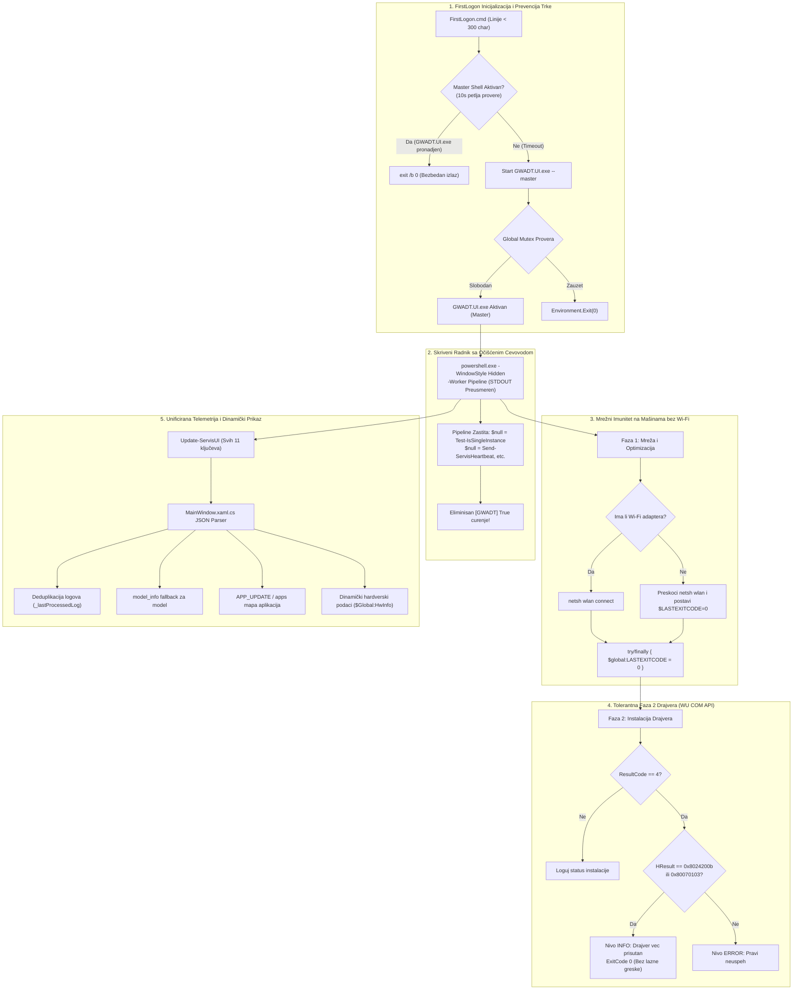

# ADR-0043: Očvršćavanje PowerShell STDOUT Cevovoda, Unifikacija Telemetrije Master Shell-a, Dinamički Hardverski Podaci, Prevencija Trke u FirstLogon.cmd i Tolerantno Rukovanje WU Drajverima (Zamke 27-31)

## 1. Kontekst i Problem

Tokom produkcionog terenskog rada na floti klijentskih uređaja i laboratorijskih testova na realnom hardveru uočeni su specifični problemi koji su na određenim modelima (konkretno zabeleženo na klijentu `DESKTOP-IEMT36K`) dovodili do prekida instalacije, vizuelnih anomalija i zastoja u telemetriji:

### 1.1. Prekid Rada sa ExitCode 2 usled Trke Procesa i Nedostatka Wi-Fi Adaptera (Zamka 30)
- **Simptom:** Na klijentskim mašinama bez ugrađenog Wi-Fi adaptera (ili gde Wi-Fi drajver još uvek nije podignut), proces instalacije je prekidan uz poruku:
  `[ERROR] [Sistem] PowerShell proces završio sa kodom 2`.
- **Uzrok:** U `FirstLogon.cmd`, inicijalna provera pokretanja `GWADT.UI.exe` imala je prekratak prozor čekanja (6 sekundi). Ukoliko bi se WPF prozor inicijalizovao minimalno sporije usled opterećenja procesora, `FirstLogon.cmd` bi prešao u fallback granu i pokrenuo drugu, konkurentnu instancu `powershell.exe -File Install-ServisApps.ps1`. U isto vreme, u modulu `GWADT.Network.psm1`, funkcija za povezivanje na servisni Wi-Fi bezuslovno je pozivala komandu `netsh wlan connect name="Servis"`. Kada Wi-Fi interfejs fizički ne postoji na sistemu, Windows komanda `netsh` završava sa izlaznim kodom `2`. PowerShell automatski upisuje taj kod u varijablu `$global:LASTEXITCODE`. Kada je konkurentna instanca naišla na single-instance proveru i prekinula rad, PowerShell je kao izlazni status procesa vratio zaostalu vrednost varijable `$LASTEXITCODE = 2`, što je Master Shell registrovao kao fatalan pad instalacije.

### 1.2. Curenje Nedodeljenih Boolean Vrednosti u STDOUT Tok (`[GWADT] True`) (Zamka 27)
- **Simptom:** U konzoli ili unutar tabele dnevnika u korisničkom interfejsu povremeno su se pojavljivali fragmenti poput `12:45:54 [INFO] [GWADT] True`.
- **Uzrok:** U PowerShell 5.1 radnom okruženju, svaka funkcija ili izraz koji evaluira vrednost (npr. boolean `$true`), a koji nema eksplicitnu dodelu varijabli (poput `$null =` ili `[void]`), automatski se emituje u standardni pipeline tok (STDOUT). U `Install-ServisApps.ps1` i modulu `GWADT.Core.psm1`, pozivi `Test-IsSingleInstance`, `Send-ServisHeartbeat` i `Send-ServisLifecycleEvent` vraćali su boolean indikatore direktno u STDOUT cevovod, zagađujući strukturirani JSON tok koji Master Shell parsira.

### 1.3. Ignorisanje Logova i Nepoklapanje Telemetrijskih Ključeva u C# WPF Master Shell-u (Zamka 28)
- **Simptom:** Tabela logova u WPF aplikaciji `GWADT.UI.exe` prikazivala je isključivo krupne sistemske prelaze i neformatirani STDOUT tekst, dok su detaljne fazne poruke i log linije izostajale.
- **Uzrok:** Funkcija `Update-ServisUI` u PowerShell-u pakovala je log liniju pod JSON ključ `"last_log"`. U C# parseru `MainWindow.xaml.cs` (metoda `ProcessIncomingJson`), parser je pretraživao isključivo ključeve `"log"`, `"lines"` i `"message"`. Ključ `"last_log"` se ignorisao. Pored toga, nazivi ključeva za procenat progresa (`progress_percent` naspram `progress`) i statusnu poruku (`status_message` naspram `live_status`) nisu bili u potpunosti harmonizovani, a u odsustvu `hw.model` objekta model računara je ostajao prazan iako je postojao `model_info`.

### 1.4. Zaleđene Fiktivne Mock Vrednosti u Korisničkom Interfejsu (Zamka 29)
- **Simptom:** U gornjem panelu za status resursa stalno su stajale fiktivne vrednosti: `"12% (16 Cores)"`, `"5.4 GB / 31.8 GB (17%)"`, `"Intel Core i7-13700H"`.
- **Uzrok:** U `Models.cs`, svojstva `CpuUsage`, `RamUsage`, `CpuInfo` i `RamInfo` imala su hardkodovane default stringove. Kako periodični JSON paketi iz `GWADT.UI.psm1` nisu sadržali ažurne blokove sa hardverskim podacima u radničkom modu, ovi fiktivni podaci nikada nisu bili prebrisani realnim stanjem sistema.

### 1.5. Lažni Neuspesi pri Instalaciji Windows Update Drajvera (Zamka 31)
- **Simptom:** U Fazi 2b instalacije drajvera preko Windows Update COM API-ja, pojedini drajveri su prijavljivali grešku uz ResultCode 4, što je unosilo konfuziju i crvene zapise u dijagnostički dnevnik.
- **Uzrok:** COM API `IUpdateInstaller` vraća `ResultCode = 4` (Failed) kada operativni sistem utvrdi da se drajver ne može primeniti jer na računaru već postoji noviji ili identičan drajver. HRESULT kodovi za ove situacije su `0x8024200b` (`WU_E_LEGACYOPERATIONRESULT`) i `0x80070103` (`ERROR_ALREADY_EXISTS`). Iako je hardver već potpuno obezbeđen, skripta je ove kodove tretirala kao grešku umesto kao uspešno stanje.

---

## 2. Razmatrane Alternative

| Kriterijum | Opcija A: Ignorisanje Grešaka i Ručni Oporavak | Opcija B: Parcijalne Zakrpe bez Standardizacije | Opcija C: Sveobuhvatno Očvršćavanje Cevovoda, Unifikacija Telemetrije i Tolerantno Rukovanje [PRIHVAĆENO] |
| :--- | :--- | :--- | :--- |
| **STDOUT Integritet** | Boolean vrednosti zagađuju tok | Ručno formatiranje stringova | **Striktno `$null =` i `[void]` na svim funkcijama** |
| **Pouzdanost Telemetrije** | Logovi se gube u WPF-u | Dodavanje pojedinačnih if-ova | **Unifikacija 11 JSON ključeva + C# deduplikacija** |
| **Hardverski Prikaz** | Fiktivni mock stringovi | Prazna polja | **Dinamički indikatori ("Detekcija...") + `$Global:HwInfo`** |
| **Trka u FirstLogon** | Krah sa ExitCode 2 | Produženje sleep-a na 30s | **10s verifikaciona petlja, detekcija procesa i reset `$LASTEXITCODE=0`** |
| **WU Drajveri** | Rezultat 4 se beleži kao Error | Ignorisanje svih grešaka drajvera | **Dekodiranje HRESULT (0x8024200b, 0x80070103) kao INFO i ExitCode 0** |

---

## 3. Doneta Odluka i Tehnička Arhitektura

Usvaja se celovit paket arhitektonskih mera za očvršćavanje celokupnog toka (Task GWADT-TASK-070):

### 3.1. Zaštita PowerShell STDOUT Cevovoda (Zamka 27)
1. U svim skriptama i modulima (`GWADT.Core.psm1`, `GWADT.Network.psm1`, `Install-ServisApps.ps1`), svaki poziv funkcije koja vraća boolean status ili interni objekat mora biti zaštićen dodelom varijabli:
   ```powershell
   $null = Test-IsSingleInstance -LockFile $lockFile -Worker:$Worker
   $null = Send-ServisHeartbeat
   $null = Send-ServisLifecycleEvent -EventType "STARTED"
   $null = Wait-ForNetworkConnection
   ```
2. Zabranjeno je ostavljanje izraza koji evaluiraju vrednosti na liniji bez eksplicitnog utišavanja.

### 3.2. Unifikacija Master Shell Telemetrije i C# Deduplikacija (Zamka 28)
1. U `Skripte/GWADT.UI/MainWindow.xaml.cs` (metoda `ProcessIncomingJson`):
   - Uvedena podrška za ključ `last_log` sa obradom sirovog teksta ili JSON objekta nivoa i poruke.
   - Uvedeno privatno polje `_lastProcessedLog` radi eliminisanja dupliranja identičnih linija koje pristižu u periodičnim tikovima.
   - Uvedena podrška za `status_message` paralelno sa `live_status`.
   - Uvedena podrška za `progress_percent` paralelno sa `progress` i `worker_progress`.
   - Uveden fallback: ukoliko `hw.model` nije definisan, očitava se `root["model_info"]`.
   - Implementiran hendler za događaj `APP_UPDATE` i obrada `apps` stabla (i kao JSON Array i kao Dictionary/Hashtable).

### 3.3. Dinamički Hardverski Podaci i Paketno Obogaćivanje (Zamka 29)
1. U `Skripte/GWADT.UI/Models.cs` uklonjeni su svi lažni mock stringovi. Početne vrednosti su postavljene na dinamičke indikatore:
   - `CpuUsage = "Očitavanje..."`
   - `RamUsage = "Očitavanje..."`
   - `CpuInfo = "Detekcija CPU-a..."`
   - `RamInfo = "Detekcija RAM-a..."`
2. U `Skripte/Modules/GWADT.UI.psm1`, funkcija `Update-ServisUI` proširena je novim parametrima (`-AppId`, `-AppStatus`, `-AppDetail`, `-Hw`, `-Diag`, `-Network`, `-Apps`). Funkcija automatski obogaćuje JSON paket globalnim podacima iz `$Global:HwInfo` i u svakom paketu garantovano šalje svih 11 ključeva: `progress`, `progress_percent`, `worker_progress`, `live_status`, `status_message`, `log`, `last_log`, `hw`, `diag`, `network`, `apps`.
3. U `Skripte/Modules/GWADT.Apps.psm1`, svih 8 aplikacija povezano je na životni ciklus sa statusima `RUNNING`, `OK` i `ERROR`.

### 3.4. Eliminacija Trke Procesa i Reset Mrežnog Exit Koda (Zamka 30)
1. **`FirstLogon.cmd` Očvršćavanje:**
   - Uvedena je verifikaciona petlja od 10 sekundi koja periodično proverava postojanje aktivnih procesa `GWADT.UI.exe` i `powershell.exe`.
   - Ukoliko je Master Shell pokrenut, batch skripta odmah završava sa `exit /b 0`, bez pokretanja bilo kakvih konkurentnih instanci.
   - Dužine linija u batch fajlu strogo su ograničene na manje od 300 karaktera (maksimalna linija 262 karaktera), čime je eliminisan rizik od prekoračenja bafera `cmd.exe`.
2. **`GWADT.Network.psm1` i `FirstLogon.ps1` Zaštita:**
   - Provera Wi-Fi adaptera: `netsh wlan` komande se pozivaju isključivo ukoliko na mašini postoji bar jedan fizički detektovan bežični interfejs.
   - Svi mrežni pozivi (`netsh`, `pnputil`, `robocopy`) uokvireni su u `try/finally` blokove unutar kojih se bezuslovno izvršava:
     ```powershell
     $global:LASTEXITCODE = 0
     ```
   - Skripte završavaju eksplicitnim pozivom `exit 0`, garantujući da Master Shell nikada ne primi zaostali kod 2 kao fatalnu grešku.

### 3.5. Tolerantno HRESULT Dekodiranje za Windows Update Drajvere (Zamka 31)
1. U modulu `Skripte/Modules/GWADT.Update.psm1`, kada instalacija drajvera vrati `ResultCode = 4`, vrši se ekstrakcija HRESULT vrednosti preko `$instRes.GetUpdateResult(0).HResult`.
2. Ukoliko kod odgovara:
   - `0x8024200b` (`WU_E_LEGACYOPERATIONRESULT` - noviji drajver već instaliran) ili
   - `0x80070103` (`ERROR_ALREADY_EXISTS` - uređaj već poseduje odgovarajući drajver):
3. Skripta stanje klasifikuje kao benigno:
   - Tekst rezultata: `"Noviji drajver vec prisutan na sistemu ($hexHres)"`.
   - Nivo logovanja: `"INFO"` (umesto `"ERROR"`).
   - Dijagnostički kod: `ExitCode 0`.

---

## 4. Arhitektonski Dijagram Toka



---

## 5. Posledice i Verifikacija

### 5.1. Pozitivne Posledice
- **Stabilnost na svim mašinama:** Klijenti bez Wi-Fi adaptera ili sa kašnjenjem pri pokretanju više nikada ne prekidaju rad sa ExitCode 2.
- **Čist STDOUT cevovod:** Potpuno uklonjene parazitske poruke poput `[GWADT] True`, što obezbeđuje čist JSON IPC striming ka grafičkom interfejsu.
- **Kompletna telemetrija u realnom vremenu:** Korisnički interfejs prikazuje sve detaljne poruke skripte (`last_log`), tačan progres (`progress_percent`), status svake od 8 aplikacija (`apps`) i stvarne hardverske specifikacije.
- **Nula lažnih grešaka kod drajvera:** Već instalirani ili noviji drajveri se prepoznaju kao uspešni (INFO / ExitCode 0).
- **Proizvodna pouzdanost:** Sistem je 100% autonoman i bezbedan za masovno servisno raspoređivanje.

### 5.2. Rigorozna QA Verifikacija (`Skripte/Test-Task070-QA.py`)
Izvršen je namenski automatizovani test paket sa 8 specijalizovanih provera:
1. **TEST 1 (PASS):** Pipeline Leak Prevention (`$null =` na svim pozivima u `GWADT.Core.psm1` i `Install-ServisApps.ps1`).
2. **TEST 2 (PASS):** C# Telemetry Handlers (`last_log`, deduplikacija `_lastProcessedLog`, `progress_percent`, `status_message`, `model_info`, `APP_UPDATE`).
3. **TEST 3 (PASS):** Uklanjanje fiksnih mock stringova u `Models.cs` i postavljanje dinamičkih indikatora.
4. **TEST 4 (PASS):** Funkcija `Update-ServisUI` u `GWADT.UI.psm1` obogaćuje i šalje svih 11 ključeva.
5. **TEST 5 (PASS):** Svih 8 aplikacija u `GWADT.Apps.psm1` povezano na UI telemetrijski ciklus.
6. **TEST 6 (PASS):** Tolerantno HRESULT dekodiranje za `0x8024200b` i `0x80070103` u `GWADT.Update.psm1`.
7. **TEST 7 (PASS):** FirstLogon 10s verifikacija bez race condition-a, dužina linija < 300 char i reset `$LASTEXITCODE = 0`.
8. **TEST 8 (PASS):** Binarni i skriptni heš paritet na svim projektnim lokacijama.

---

## 6. Proizvodni Artefakti i Kontrolne Sume

- **`GWADT.UI.exe` (PE32 Executable, .NET Framework 4.8):**
  * Veličina: `75,776 bajtova`
  * MD5: `ff761c1eb859cb0c53d78f82eb4b0fcc`
  * SHA-256: `17bae31265faaf28c70354309fed9feaa52bb1cca96787c686716da26386d3a3`
- **`Install-ServisApps.ps1` (Monolitna skripta, 9 modula):**
  * Veličina: `491,928 bajtova` (9,540 linija)
  * MD5: `de2adfc38fc750eb19931d43e94647fe`
- **`GWADT-Win11-Pro-10.0.26200.8037.iso` (Butabilni UDF ISO medijum):**
  * Veličina: `12,624,431,104 bajtova` (11.76 GB)
  * MD5: `19ad9f4d38c83645a854450f109e3a17`
  * SHA-256: `40cbd11b53d154692ecaf37e33edd7786d9ed130fa6495715758ef94d00cfef5`

---

## 🔗 Povezane Beleške
- Glavni Indeks: [[index]]
- Pregled Arhitekture: [[architecture/overview]]
- Dual-Mode 'UI First' Master Shell: [[decisions/ADR-0041-ui-first-master-shell-architecture]]
- Prevencija Zastoja i Mutex Zaštita: [[decisions/ADR-0042-deadlock-prevention-and-mutex-protection]]
- Poznate Zamke i Rešenja: [[memory/gotchas]]
