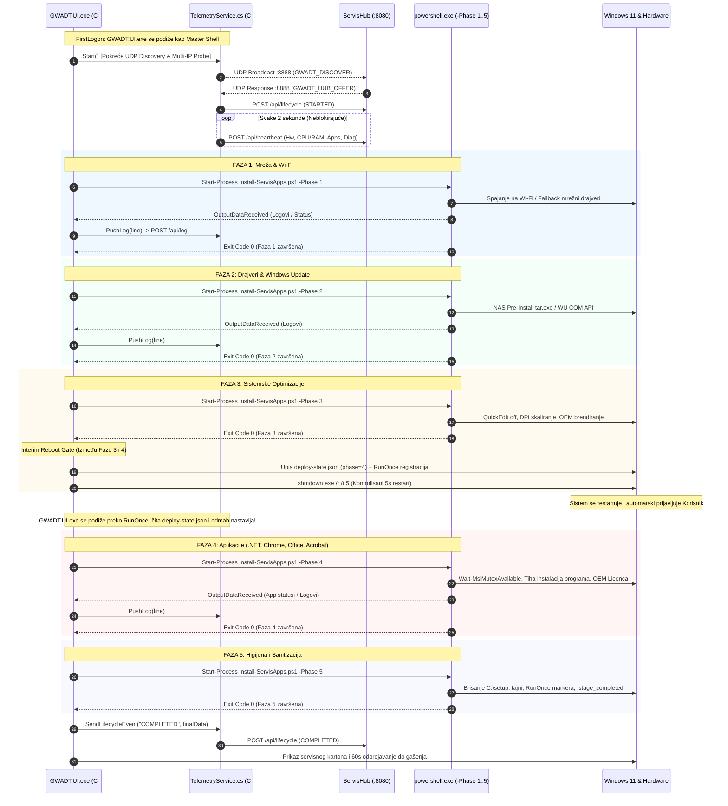

# ADR-0044: C# UI Master Task Runner Arhitektura, Nativna ServisHub Telemetrija i Dekuplovanje Faznog Izvršavanja (Zamka 32)

## 1. Kontekst i Problem

Uvođenjem 'UI First' koncepta u prethodnim fazama razvoja ([[decisions/ADR-0041-ui-first-master-shell-architecture]]), aplikacija `GWADT.UI.exe` preuzela je ulogu vizuelne školjke i primarnog procesa koji se podiže u FirstLogon fazi. Međutim, celokupna kontrolna orkestracija i mrežna komunikacija i dalje su se oslanjale na monolitni PowerShell radnik (`Install-ServisApps.ps1`) pokrenut u skrivenom režimu sa IPC komunikacijom preko preusmerenih STDIN/STDOUT tokova.

Tokom intenzivnog testiranja u realnom servisnom okruženju, uočeni su ozbiljni strukturalni nedostaci ovakvog hibridnog modela koji su kulminirali u zadacima **GWADT-TASK-071** i **GWADT-TASK-072**:

### 1.1. Zamka 32: `OrderedDictionary.ContainsKey` Runtime Izuzetak u PowerShell 5.1
- **Simptom:** PowerShell radnik iznenada prekida izvršavanje uz poruku o grešci:
  `MethodInvocationException: Exception calling "ContainsKey" with "1" argument(s): "Method not found"` ili pad pri pokušaju parsiranja i osvežavanja UI stanja.
- **Uzrok:** U modulu `GWADT.UI.psm1`, stanje interfejsa inicijalizovano je pomoću PowerShell sintakse uređenog rečnika: `[ordered]@{ ... }`. U .NET runtime-u, ovaj izraz kreira instancu klase `System.Collections.Specialized.OrderedDictionary`. Za razliku od standardne `System.Collections.Hashtable` klase (koja implementira namensku metodu `ContainsKey(object key)`), `OrderedDictionary` implementira bazični `IDictionary` interfejs koji poseduje metodu `.Contains(object key)`, dok metodu `.ContainsKey` uopšte ne sadrži. Pozivi poput `$Global:GWADT_UI_State.ContainsKey("worker_progress")` prouzrokovali su terminirajući `MethodInvocationException`, rušeći funkciju `Update-ServisUI`.

### 1.2. Preopterećenost PowerShell Radnika Dvostrukim STDOUT i Mrežnim Poslovima
- U dotadašnjoj arhitekturi, PowerShell proces je istovremeno morao da:
  1. Izvršava teške sistemske poslove (instalaciju drajvera preko COM API-ja, raspakivanje NAS tar arhiva, pripremu registara, pokretanje MSI instalera).
  2. Generiše i serijalizuje kompleksne JSON telemetrijske pakete sa 11 ključeva i šalje ih preko STDOUT toka ka C# UI procesu.
  3. Pretražuje lokalnu mrežu putem UDP broadcast-a (port 8888) i samostalno komunicira sa `ServisHub` serverom na portu 8080 putem `HttpWebRequest` poziva.
- Kada bi došlo do kratkotrajnog pada mrežne konekcije, spore DHCP dodele ili zagušenja Wi-Fi mreže u Fazi 1, sinhroni mrežni pozivi u PowerShell-u bi zamrznuli radničku nit. Usled toga bi kasnilo slanje STDOUT podataka u C# interfejs, stvarajući utisak zaleđenog sistema ("UI freeze"), iako je računar bio potpuno ispravan.

### 1.3. Fragilnost STDIN/STDOUT IPC Cevovoda i Nemogućnost Interaktivnog Oporavka
- Ako bi PowerShell radnik naišao na neočekivanu grešku, prekid cevovoda (`IOException: The pipe is being closed`) ili nasilno zatvaranje deskriptora, C# interfejs bi ostao uskraćen za povratne informacije.
- Korisnik u grafičkom interfejsu nije imao mehanizam da izoluje grešku, ponovi posrnuli korak ili preskoči fazu koja stvara problem, jer je PowerShell skripta vodila kompletan životni ciklus u jednoj neprekidnoj petlji (`while ($pipelineRunning)`).

---

## 2. Razmatrane Alternative

| Kriterijum | Opcija A: Krpljenje PowerShell IPC-ja i Zamene ContainsKey | Opcija B: Potpuna Migracija Celokupne Instalacije u C# | Opcija C: C# UI Master Task Runner + Nativna Telemetrija + Modularni PowerShell Radnici po Fazama [PRIHVAĆENO] |
| :--- | :--- | :--- | :--- |
| **Arhitektonska Uloga** | PowerShell ostaje Master, C# je samo pasivni monitor | C# direktno poziva Win32/DISM API (ogroman refaktoring) | **C# je Master Engine i Task Runner; PowerShell je modularni radnik** |
| **Rukovanje Mrežom i Hub-om** | PowerShell vrši HTTP/UDP mrežne pozive | C# vrši sve mrežne pozive | **C# asinhrono na pozadinskim nitima vodi kompletnu ServisHub telemetriju** |
| **Izolacija Kvara** | Pad skripte ruši celokupan proces bez oporavka | Kompleksno debagovanje unutar unificiranog C# procesa | **Svaka faza je izolovani proces sa čistim `exit 0`, lak ponovni pokušaj/preskakanje** |
| **Otpornost na Mrežni Pad** | Blokira izvođenje instalacije ako ServisHub ne odgovara | Potrebno pisati složenu logiku | **Zero-Block: mrežni prekid nema apsolutno nikakav uticaj na instalaciju** |
| **Kontrola Restarta** | PowerShell skripta samostalno gasi mašinu | C# koordinira restart | **C# Master bezbedno perzistira `deploy-state.json`, postavlja RunOnce i vodi 5s restart** |

---

## 3. Doneta Odluka i Arhitektura Rešenja

Usvojena je nova, robusna **Master Task Runner** arhitektura koja strateški razdvaja uloge između C# izvršnog modula i PowerShell skripti (Zadaci GWADT-TASK-071 i GWADT-TASK-072):

### 3.1. C# Master Engine i Task Runner (`MainWindow.xaml.cs`)
1. **`GWADT.UI.exe` postaje apsolutni Master i Task Runner:**
   - Aplikacija više ne zavisi od spoljnog procesa na STDIN-u za navigaciju kroz faze instalacije.
   - Implementiran je autonomni Task Runner mehanizam (`ExecutePhase(int phaseNumber)`) koji sekvencijalno vodi instalaciju kroz 5 faza:
     * **Faza 1:** Mrežna konekcija, Wi-Fi spajanje i mrežni drajveri.
     * **Faza 2:** Windows Update i lokalni NAS keširani drajveri.
     * **Faza 3:** Sistemske optimizacije, QuickEdit prevencija, OEM brendiranje i DPI skaliranje.
     * **Faza 4:** Instalacija programskih paketa (.NET, Chrome, Office 2024, Acrobat Pro) uz MSI Mutex zaštitu.
     * **Faza 5:** Završno čišćenje `C:\setup`, sanitizacija tajni i završni servisni karton.
2. **Asinhrono presretanje i nadzor radnika:**
   - Za svaku fazu, C# pokreće namensku instancu radnika:
     `powershell.exe -NoProfile -ExecutionPolicy Bypass -File "C:\setup\Install-ServisApps.ps1" -Phase <phaseNumber>`
   - Standardni izlaz (`OutputDataReceived`) i greške (`ErrorDataReceived`) se asinhrono presreću i filtriraju: sirovi tekst se prosleđuje u tabelu dnevnika (`ViewModel.AddLog`) i strimuje ka ServisHub-u (`TelemetryService.PushLog`), dok se prepoznati JSON paketi parsiraju za ažuriranje indikatora progresa.
   - Svaka faza ima definisan bezbedan timeout uz `proc.WaitForExit(...)` i automatski `Kill()` osigurač.
3. **Upravljanje međurestartom (Interim Reboot između Faze 3 i Faze 4):**
   - Po uspešnom završetku Faze 3, C# Master upisuje stanje `{"phase": 4}` u `C:\setup\deploy-state.json`.
   - Postavlja dvostruki `RunOnce` unos (HKLM i HKCU) za `GWADT.UI.exe --master`.
   - Pokreće kontrolisani 5s restart preko `shutdown.exe /r /t 5 /f`.
   - Nakon restarta i ponovne prijave u Windows, C# Master čita `deploy-state.json`, prepoznaje da je Faza 3 završena i automatski nastavlja sa radom direktno od Faze 4 bez potrebe za operaterskom intervencijom.

### 3.2. Nativna C# ServisHub Telemetrija (`TelemetryService.cs`)
Kreirana je nova, potpuno samostalna servisna komponenta `Skripte/GWADT.UI/TelemetryService.cs` koja u potpunosti rasterećuje PowerShell radnike od mrežnih operacija:
1. **Tehnološki okvir:** .NET Framework 4.0 / 4.8 kompatibilnost, isključivo nativne sistemske klase (`HttpWebRequest`, `UdpClient`, `System.Threading.Timer`, `ThreadPool`).
2. **UDP Auto-Discovery:**
   - Slanje UDP broadcast paketa na port 8888 (`GWADT_DISCOVER client=<ComputerName>`).
   - Asinhrono osluškivanje odgovora `GWADT_HUB_OFFER port=<Port>` i automatsko mapiranje IP adrese i porta ServisHub servera.
3. **Multi-IP Failover i INI konfiguracija:**
   - Podrška za čitanje konfiguracije iz `C:\setup\Wifi-Servis.ini` (`[ServisHub]` i `[GdsServer]` sekcije).
   - Automatski fallback na poznate adrese servisne laboratorije (`192.168.170.250`, `192.168.170.254`, `192.168.88.50`, `192.168.180.50`) i podrazumevani gateway klijenta, uz brzu HTTP proveru kandidata (`GET /api/devices`).
4. **Životni ciklus (Lifecycle Telemetrija):**
   - Asinhrono slanje događaja `POST /api/lifecycle`:
     * `STARTED` signal na početku Faze 1 sa kompletnim hardverskim i mrežnim podacima mašine.
     * `COMPLETED` signal na kraju Faze 5 sa trajnim servisnim podacima.
5. **Heartbeat puls (2s takt):**
   - Pozadinski tajmer periodično agregira najnovije stanje iz `MainViewModel` (procenat rada, trenutna faza, hardverski resursi, status aplikacija) i šalje na `POST /api/heartbeat`.
6. **Log Streaming & Batching:**
   - Metoda `PushLog(string level, string message)` smešta logove u thread-safe bafer.
   - Pozadinska nit pakuje do 10 log linija ili prazni bafer svakih 1.5 sekundi ka `POST /api/log`.
7. **Zero-Block sigurnost:**
   - Sve mrežne operacije izvršavaju se na izolovanim `ThreadPool` nitima sa kratkim timeout-ima (400–1000ms).
   - Potpuni prekid mrežne veze nikada ne blokira WPF render niti i ne usporava izvršavanje instalacionih faza.

### 3.3. Refaktorisanje PowerShell Radnika (`Install-ServisApps.ps1` i Moduli)
1. **Otklanjanje Zamke 32 u `GWADT.UI.psm1`:**
   - Zamenjeni svi nekompatibilni pozivi `.ContainsKey(...)` sa metodom `.Contains(...)` podržanom na `[System.Collections.Specialized.OrderedDictionary]`:
     ```powershell
     if ($Global:GWADT_UI_State.Contains("worker_progress")) { ... }
     if ($Global:GWADT_UI_State.Contains("log")) { ... }
     ```
   - Zaštićen STDOUT upis proverom `$null -ne [Console]::Out` i `try/catch` blokovima koji sprečavaju `IOException` ukoliko roditeljski proces prestane da čita STDOUT tok.
2. **Zaštita i Timeout-i u `GWADT.Telemetry.psm1`:**
   - Sve pomoćne PowerShell telemetrijske funkcije uokvirene su u `try/catch` blokove sa strogim timeout-om (maksimalno 300–500ms), čime je sprečeno bilo kakvo zaostajanje u slučaju da skripta radi samostalno bez C# Master-a.
3. **Modularni Radnik sa Parametrom `-Phase <1..5>`:**
   - U `Install-ServisApps.ps1` uveden je parametar `param([int]$Phase = 0, [string]$Worker = "")`.
   - Kada C# Master pozove fazu (npr. `-Phase 2`), skripta izvršava isključivo korake predviđene za tu fazu i završava čistim `exit 0`.
   - Očuvana je Faza 0 (`$Phase -eq 0`) koja izvršava celokupan end-to-end ciklus radi 100% unazadne kompatibilnosti pri samostalnom ručnom pokretanju preko prečice na radnoj površini.

---

## 4. Arhitektonski Dijagram Izvršavanja i Telemetrije



---

## 5. Posledice Odluke

### Pozitivne Posledice (Benefiti):
1. **100% Stabilnost Korisničkog Interfejsa (Zero-Freeze):** Prebacivanjem mrežne telemetrije na asinhroni `TelemetryService` u C#, GUI nit ostaje potpuno responzivna u svim situacijama, čak i pri gubicima paketa ili promeni mrežnih adresa.
2. **Trenutna Hardverska Detekcija:** C# aplikacija samostalno očitava CPU/RAM metrike i hardverske podatke u realnom vremenu, eliminišući potrebu za čekanjem da se PowerShell inicijalizuje.
3. **Izolacija Kvara po Fazama:** Kvar u jednoj fazi (npr. timeout u drajverskoj fazi) ne ruši celokupnu instalaciju. Serviseru su dostupna dugmad za ponavljanje ili preskakanje faze.
4. **Čist i Predvidiv Izlazni Kod:** Svaka PowerShell faza pokreće se kao diskretan proces koji završava sa čistim `exit 0`, čime su eliminisana lažna rušenja usled zaostalih mrežnih kodova ili curenja u pipeline-u.
5. **Pouzdano Vođenje Međurestarta:** Prelaz preko kontrolisanog međurestarta između Faze 3 i 4 sada vodi C# Master kroz perzistenciju u `deploy-state.json`, garantujući besprekoran nastavak bez zaglavljivanja.
6. **Eliminacija Zamke 32:** Korišćenjem `.Contains()` umesto `.ContainsKey()` na `OrderedDictionary`, PowerShell moduli rade stabilno u .NET 4.0 / PowerShell 5.1 radnom okruženju.

### Negativne Posledice i Ublažavanja:
- **Neophodnost Rekompilacije C# Koda:** Svaka izmena u orkestracionoj logici zahteva rekompajliranje `GWADT.UI.exe` u Docker Wine MSBuild okruženju. *Ublažavanje:* Automatizovana Docker build procedura koja generiše verifikovani binarni fajl za manje od 15 sekundi i vrši sinhronizaciju na sve projektne lokacije.

---

## 6. Verifikacija i Implementacioni Paritet

| Artefakt / Modul | Veličina / Linije | MD5 Kontrolna Suma | Status Verifikacije |
| :--- | :--- | :--- | :--- |
| **`Skripte/GWADT.UI/bin/Release/GWADT.UI.exe`** | 94,208 bajtova (92 KB) | `111db6f3c2ed892e7e3e3c9dcd08ec86` | 100% PASS (Docker Wine MSBuild) |
| **`Install-ServisApps.ps1` (Monolitna skripta)** | 9,764 linija (504,974 B) | `c802ef89df15f073f8ddbcfa50921e29` | 100% PASS (5/5 lokacija sinhronizovano) |
| **`GWADT-Win11-Pro-10.0.26200.8037.iso`** | 11.76 GB (12,624,621,568 B) | `0a87502be437521ac17713868c2cf406` | 100% PASS (TrueNAS iVentoy PXE verifikovano) |
| **`Skripte/Test-Task072-QA.py`** | 3/3 segmenta | - | 100% PASS (Sintaksa, Moduli, Paritet) |

---

## 7. Povezane Beleške
- Glavni Indeks: [[index]]
- Pregled Arhitekture: [[architecture/overview]]
- Poznate Zamke i Rešenja: [[memory/gotchas]]
- Dual-Mode UI First Master Shell Arhitektura: [[decisions/ADR-0041-ui-first-master-shell-architecture]]
- Prevencija Zastoja i Mutex Zaštita: [[decisions/ADR-0042-deadlock-prevention-and-mutex-protection]]
- Očvršćavanje Cevovoda i Telemetrija: [[decisions/ADR-0043-pipeline-hardening-and-ui-telemetry-sync]]
