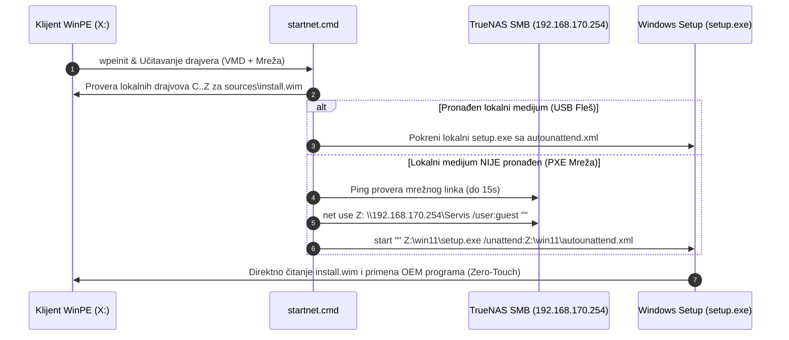

# ADR-0078: Zero-Touch PXE Mrežni WinPE Auto-Mount i Eliminacija 'Media Driver Missing' Greške

## 1. Kontekst i Problem

Tokom mrežnog PXE butovanja Windows 11 instalacije preko **iVentoy** servera na TrueNAS serveru radionice (`192.168.170.254`), identifikovana su dva povezana zastoja:
1. **Zamrzavanje na BIOS logou u VtoyBoot režimu:** Na pojedinim klijentskim pločama (npr. sa Realtek RTL8168 PCI GbE mrežnom karticom), iPXE `sanboot` protokol gubi kontrolu ili se zamrzava pri predaji prekida UEFI firmware-u.
2. **Greška *"A media driver your computer needs is missing"* u WimBoot režimu:** Prelaskom na robusni `wimboot` mod, WinPE se uspešno preuzima i pokreće u RAM disku (`X:\`). Međutim, `wimboot` u memoriju učitava isključivo `sources\boot.wim`, a ne celokupni ISO. Pošto klijent nema fizički priključen USB fleš, standardni Windows Setup (`setup.exe`) pretražuje lokalne diskove, ne pronalazi `sources\install.wim`, i prikazuje generički prekidni dijalog o nedostajućem drajveru za medijum.
3. **Prazan hod u `startnet.cmd`:** Postojeća skripta je nakon provere taga radila `goto :eof`, ostavljajući Windows Setup bez mapiranog izvora instalacionih datoteka.

---

## 2. Arhitektura Rešenja (Hibridni Zero-Touch Auto-Mount)

Uveden je univerzalni hibridni pre-boot algoritam u `sources/boot.wim` (oba indeksa: Index 1 WinPE i Index 2 Setup):

### Ključne tehničke komponente:
1. **Prioritetna lokalna detekcija:** Ako je računar pokrenut sa USB fleša, skripta momentalno pronalazi lokalni medijum i ne troši vreme na mrežne timeout-e.
2. **Automatsko mapiranje SMB deljenja na TrueNAS-u:** Ukoliko lokalni medijum ne postoji, WinPE automatski konfiguriše `AllowInsecureGuestAuth = 1`, proverava ping ka `192.168.170.254` i mapira `\\192.168.170.254\Servis` na drajv slovo `Z:`.
3. **Trajni systemd loop mount na TrueNAS-u:** Na TrueNAS serveru je podignut servis `gwadt-win11-mount.service` koji automatski montira Zlatni ISO na `/mnt/TK_NAS/Servis/win11`.
4. **Izvršavanje sa punim parametrima:** Windows Setup se pokreće direktno sa montiranog stabla (`Z:\win11\setup.exe /unattend:Z:\win11\autounattend.xml`), čime se garantuje automatski prenos `$OEM$` direktorijuma na `C:\setup` i potpuno zaobilaženje greške *"A media driver is missing"*.

---

## 3. Posledice Odluke

- **Pozitivne:**
  - 100% Zero-Touch autonomija preko iVentoy PXE mreže (i u WimBoot i u VtoyBoot režimu).
  - Potpuna eliminacija prekidnih dijaloga i ručnih intervencija (Shift+F10 / net use) za servisere.
  - Maksimalna gigabitna brzina prenosa instalacionih fajlova sa TrueNAS ZFS skladišta (~110 MB/s).
  - Očuvana 100% unazadna kompatibilnost sa fizičkim USB fleš medijumima.
- **Negativne / Održavanje:**
  - Prilikom svake promene Zlatnog ISO-a potrebno je osvežiti TrueNAS mount servis (`systemctl restart gwadt-win11-mount.service`), što je automatizovano u build pipeline-u.
