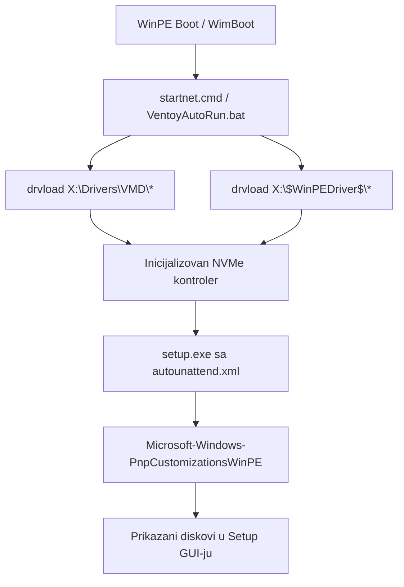

# ADR-0081: Integracija Intel RST v20.0.0.1038 VMD Skladišnih Drajvera za Meteor Lake (DEV_7D0B) i 14. Generaciju Procesora

## 1. Kontekst i Problem

Nakon što je rešen mrežni boot i auto-mount instalacionog medijuma na disk `Z:` (ADR-0078), klijentski računar novije generacije (Intel Core Ultra / Meteor Lake & 14th Gen) uspešno je pokrenuo Windows Setup, ali se na ekranu za izbor diska i particija pojavila prazna lista uz poruku:
> *"Where do you want to install Windows? - We couldn't find any drives. To get a storage driver, click Load driver."*

### Korenski uzroci:
1. **Zastareli VMD paket u `boot.wim`:** Postojeća slika `boot.wim` posedovala je samo Intel RST v19.5.1.1040 i v18.0 Legacy. Uređaji sa Intel Core Ultra (Series 1 / Meteor Lake) koriste novi skladišni kontroler sa identifikatorom `PCI\VEN_8086&DEV_7D0B`, koji je podržan tek od Intel RST v20.x drajvera.
2. **Neotpakovani drajveri:** U folderu `Za disk 10+ gen/New folder/` nalazio se `SetupRST.exe` verzije 20.0.0.1038, ali su `.inf`, `.sys` i `.cat` fajlovi bili ugnježdeni unutar PE/ZIP resursa bez ekstrakcije.
3. **Izostanak Microsoft PnP deklaracije u Unattend-u:** Windows Setup u WinPE fazi podrazumevano ne skenira proizvoljne foldere ukoliko nisu deklarisani kroz `Microsoft-Windows-PnpCustomizationsWinPE` ili smešteni u standardni `$WinPEDriver$` direktorijum.

---

## 2. Arhitektura Rešenja (Multi-Generacijski VMD & PnP Sloj)

Implementirana je sveobuhvatna četvorostruka garancija prepoznavanja NVMe diskova:

### Ključne tehničke mere:
1. **Ekstrakcija originalnih potpisanih RST v20 drajvera:**
   - Izvučen PK ZIP tok iz `SetupRST.exe` na offsetu 2803548.
   - Izolovani `iaStorVD.inf`, `iaStorVD.sys` (v20.0.0.1038, datum 29.11.2023), `iaStorVD.cat`, `RstMwService.exe`, `RstMwEventLogMsg.dll`.
   - Potvrđena podrška za: `DEV_7D0B` (Meteor Lake / Core Ultra), `DEV_A77F` (13th/14th Gen), `DEV_467F` (12th Gen), `DEV_09AB`.
2. **Troslojna struktura drajvera:**
   - `01_RST_v20_Gen12-14_CoreUltra` (najnoviji kontroleri)
   - `02_RST_v19_Gen11-13` (11. generacija `DEV_9A0B`)
   - `03_RST_v18_Legacy_Optane` (10. generacija i Optane filteri)
3. **PnpCustomizationsWinPE u `autounattend.xml`:**
   - Dodate pretrage `X:\Drivers`, `X:\$WinPEDriver$` i `Z:\Drivers`.
4. **Dvostruka integracija u WIM i ISO:**
   - Drajveri integrisani u `sources/boot.wim` (oba indeksa: WinPE i Setup).
   - Drajveri postavljeni u `$WinPEDriver$` i `Za disk 10+ gen` u korenu ISO slike.
5. **Mrežna distribucija:**
   - Drajveri raspakovani na TrueNAS u `/mnt/TK_NAS/Servis/Drivers/VMD` i `/mnt/TK_NAS/Servis/Drajveri/Intel_VMD_Storage`.
   - Novi Zlatni ISO (11.94 GB, MD5 `f53d0765e2e7c041d3bbde0cf7ac0843`) montiran u `/mnt/TK_NAS/Servis/win11`.

---

## 3. Posledice i Verifikacija

- **Detekcija diskova:** Rešena prazna lista diskova za sve Intel generacije od 10. do 14. i najnovije Intel Core Ultra (Meteor Lake) procesore.
- **Zero-Touch:** Setup automatski prepoznaje NVMe diskove bez ikakve potrebe za klikom na "Load driver".
- **Stabilnost:** Očuvani digitalni potpisi drajvera (`iaStorVD.cat`), bez modifikacija INF fajlova.
