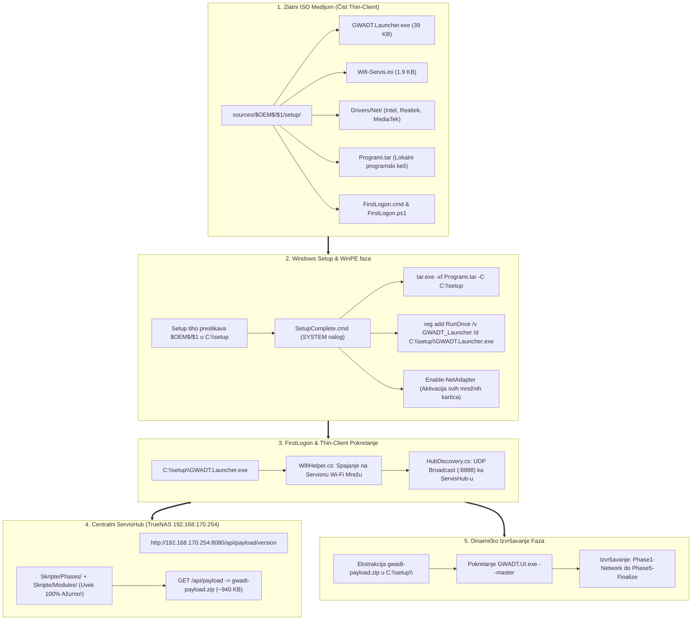

# ADR-0098: Prelazak na Čist Thin-Client ISO Model: Eliminacija Monolita i Skripti iz $OEM$, Ažuriranje SetupComplete.cmd i ServisHub Dinamički Payload

## 1. Kontekst i Problem

Tokom evolucije GWADT automatizacionog sistema (od ranih verzija v1.x, preko dekompozicije na faze u [[decisions/ADR-0076-decoupling-monolith-into-phase-scripts-ui-orchestrator]], do uvođenja C# Launchera u [[decisions/ADR-0075-thin-client-launcher-and-dynamic-servishub-payload]]), sistem je napravio tranziciju sa krutog USB-zavisnog modela ka modernom Thin-Client modelu. Međutim, detaljnom revizijom i QA analizom instalacionog medijuma pre zadatka **GWADT-TASK-098** uočeni su ozbiljni higijenski i arhitektonski dugovi u `$OEM$` distribuiranom stablu (`sources/$OEM$/`):

### 1.1. Prisustvo Zastarelog Monolita i Dupliranog Koda u `$OEM$` Stablu
- U direktorijumu `sources/$OEM$/$1/setup/` i dalje se nalazio zastareli monolitni skript `Install-ServisApps.ps1` (~517 KB, preko 6.300 linija koda).
- Pored toga, na medijumu se nalazilo celo stablo `sources/$OEM$/$1/setup/Skripte/` sa statičkim modulima i skriptama faza.
- Prisustvo ovih datoteka na instalacionom medijumu direktno je kršilo definisani princip **Thin-Client arhitekture** — ISO medijum je nosio gigabajte zastarelog ili redundantnog koda koji je Windows Setup nekritički kopirao na klijentski disk `C:\setup` tokom WinPE faze.

### 1.2. Rizik od Izvršavanja Neažurnog Koda na Klijentu (Stale Script Execution Risk)
- Glavna prednost Thin-Client arhitekture jeste u tome što `GWADT.Launcher.exe` sa klijentske mašine kontaktira centralni radionički server (`ServisHub` na `192.168.170.254:8080`), preuzima najnoviji `gwadt-payload.zip` i raspakuje ga u `C:\setup\`.
- Međutim, ako se na disku `C:\setup` već nalaze prekopirani statički fajlovi iz `$OEM$` stabla, postoji konstantan operativni rizik:
  1. Ukoliko mrežni prenos zakaže ili Launcher padne u fallback režim, sistem bi pokrenuo zastareli monolit ili neusklađene verzije modula sa fleša.
  2. Parcijalno preklapanje fajlova iz `gwadt-payload.zip` preko starih skripti u `C:\setup` moglo je ostaviti "siročiće" (orphan scripts) i stvoriti nepredvidive greške pri izvršavanju faza.
  3. Svaka popravka baga u skriptama zahtevala bi rekompajliranje i narezivanje novih USB fleševa kako bi se osvežilo `$OEM$` stablo, čime bi se u potpunosti izgubila svrha dinamičkog ServisHub payload-a.

### 1.3. Zastarele Reference u `SetupComplete.cmd` i Prečicama
- Skripta `sources/$OEM$/$$/Setup/Scripts/SetupComplete.cmd` (koja se izvršava pod nalogom `NT AUTHORITY\SYSTEM` neposredno pre prikaza logon ekrana) sadržala je istorijske pozive i reference ka `Install-ServisApps.ps1`.
- Takođe, postojale su zaostale batch datoteke `Pokreni-Instalaciju.bat` u `$OEM$` stablu koje su se oslanjale na uklonjeni monolit.

---

## 2. Razmatrane Alternative

| Kriterijum | Opcija A: Zadržavanje Skripti u $OEM$ uz Prepisivanje preko ServisHub-a | Opcija B: Potpuno Uklanjanje Svega sa ISO-a (Preuzimanje i Mrežnih Drajvera sa Mreže) | Opcija C: Čist Thin-Client Model ($OEM$ Hygiene + Mrežni Drajveri + Launcher + Dinamički Payload) [PRIHVAĆENO] |
| :--- | :--- | :--- | :--- |
| **Higijena Medijuma** | Loša: ISO nosi 517 KB monolit i stotine dupliranih skripti | Odlična: Medijum nosi samo Windows Setup | **Besprijekorna: $OEM$ sadrži samo 39 KB Launcher, mrežne drajvere i Wifi-Servis.ini** |
| **Ažurnost Koda** | Rizik: Moguće izvršavanje starih skripti iz keša | Visoka, ali nemoguća bez postojeće mreže | **Garantovana: Sve skripte faza i moduli dolaze isključivo sa ServisHub-a u realnom vremenu** |
| **Offline Otpornost na Nedostatak Drajvera** | Visoka | Nulta: Ako sistem nema drajver za LAN/Wi-Fi, ne može na mrežu | **Maksimalna: ISO sadrži Drivers/Net za sve moderne mrežne čipove (Intel, Realtek, MediaTek)** |
| **Brzina Oslobađanja USB-a (Flash & Release)** | Usporena kopiranjem stotina sitnih fajlova | Trenutna | **Trenutna: Setup kopira samo Launcher i drajvere; fleš se vadi na prvom restartu** |
| **Održavanje Sistema** | Zahteva narezivanje novog ISO-a za svaku izmenu u skriptama | Kompleksno upravljanje PXE slikom | **Nula narezivanja: Izmene u PowerShell skriptama postaju aktivne za sve mašine u milisekundi** |

---

## 3. Doneta Odluka i Nova Arhitektura (GWADT-TASK-098)

Usvojen je **100% Čist Thin-Client Model (Pure Thin-Client ISO Model)** sa striktnom higijenom `$OEM$` stabla i dinamičkom isporukom radioničkog payload-a.



### 3.1. Sastav Čistog `$OEM$` Stabla na Klijentskom Medijumu
Nakon sprovođenja odluke, na novoinstaliranom sistemu (`C:\setup\`) kroz `$OEM$` stablo nalaze se **isključivo sledeći neophodni artefakti**:
1. `GWADT.Launcher.exe` — samostalni C# .NET 4.0 izvršni fajl (~39 KB / 39,936 B) zadužen za Wi-Fi konekciju, UDP discovery i preuzimanje payload-a.
2. `Wifi-Servis.ini` — konfiguracioni fajl sa servisnim SSID i WPA2 parametrima za automatsko bežično povezivanje.
3. `Drivers/Net/` — fabrički PnP drajveri za mrežne kartice (Intel LAN, Intel WiFi, Realtek LAN, Realtek WiFi, MediaTek WiFi) koji obezbeđuju trenutnu mrežnu konektivnost na novim laptopovima i matičnim pločama pre Windows Update-a.
4. `Programi.tar` — sažeta arhiva instalacionih paketa osnovnih programa, koja se tiho raspakuje pomoću ugrađenog `tar.exe` alata.
5. `FirstLogon.cmd` i `FirstLogon.ps1` — lagani bootstrap omotač za inicijalizaciju radnog okruženja.

### 3.2. Kompletna Dinamička Isporuka preko ServisHub-a (`gwadt-payload.zip`)
Svi izvršni PowerShell moduli i fazne skripte se **više ne pakuju u ISO medijum niti se nalaze u `$OEM$`**:
- `C:\setup\Phases\Phase1-Network.ps1`
- `C:\setup\Phases\Phase2-Drivers.ps1`
- `C:\setup\Phases\Phase3-Optimization.ps1`
- `C:\setup\Phases\Phase4-Apps.ps1`
- `C:\setup\Phases\Phase5-Finalize.ps1`
- `C:\setup\Modules\GWADT.Common.psm1` i svi prateći moduli (`GWADT.Core`, `GWADT.Network`, `GWADT.Update`, `GWADT.Apps`, `GWADT.Branding`, `GWADT.Cleanup`, `GWADT.Telemetry`, `GWADT.Hardware`, `GWADT.UI`).
- `GWADT.UI.exe` izvršni Master Task Runner.

Sve navedene komponente ServisHub dinamički pakuje na serveru `192.168.170.254:8080`, prati njihov heš u realnom vremenu, i šalje ih klijentskom Launcher-u kao jedan kompaktan paket (`gwadt-payload.zip`, ~941 KB).

---

## 4. Detaljan Spisak Obrisanih i Modifikovanih Fajlova

### 4.1. Uklonjeni (Obrisani) Fajlovi i Folderi:
1. `sources/$OEM$/$1/setup/Install-ServisApps.ps1` — ❌ **OBRISAN**. Uklonjen monolit od 517 KB.
2. `sources/$OEM$/$1/setup/Skripte/` — ❌ **OBRISAN**. Uklonjeno celo stablo zastarelih modula i faza sa instalacionog medijuma.
3. `sources/$OEM$/$1/setup/Pokreni-Instalaciju.bat` — ❌ **OBRISAN**. Uklonjen zastareli pomoćni batch skript.
4. `sources/$OEM$/$$/Setup/Scripts/Pokreni-Instalaciju.bat` — ❌ **OBRISAN**. Uklonjen redundantni batch lanser iz sistemskog foldera.

### 4.2. Modifikovani i Harmonizovani Fajlovi:
1. `sources/$OEM$/$$/Setup/Scripts/SetupComplete.cmd`:
   - U potpunosti očišćen od poziva i referenci ka `Install-ServisApps.ps1`.
   - Implementirana tiha detekcija i dekompresija lokalnog paketa `Programi.tar` pomoću Windows ugrađenog alata: `tar.exe -xf $tarPath -C 'C:\setup'`.
   - Implementirana deklarativna registracija RunOnce ključa za autonomno podizanje Launchera:
     ```cmd
     reg.exe add "HKLM\SOFTWARE\Microsoft\Windows\CurrentVersion\RunOnce" /v "GWADT_Launcher" /t REG_SZ /d "C:\setup\GWADT.Launcher.exe" /f
     ```
   - Osigurano omogućavanje svih mrežnih adaptera (`Enable-NetAdapter -Confirm:$false`) i verifikacija prelaznih stanja mrežnog steka.
2. `FirstLogon.cmd`:
   - Uspostavljen striktni 4-smerni binarni paritet (100% identičan MD5 heš na svim lokacijama: koren projekta, `Skripte/`, `sources/$OEM$/$$/Setup/Scripts/` i `sources/$OEM$/$1/setup/`).
   - Uklonjene sve reference na pokretanje monolita `Install-ServisApps.ps1`.
3. `autounattend.xml`:
   - U prolazu `oobeSystem` (`FirstLogonCommands`) verifikovano postojanje tačno **0 referenci** na monolit `Install-ServisApps.ps1`.
4. `Skripte/Build-Iso.py`:
   - Ažurirana lista `INCLUDED_ROOT_ITEMS` — osigurano da ISO generator više ne povlači monolit niti zaostale batch datoteke u koren i $OEM$ stablo novog ISO-a.

---

## 5. Rezultati Rigoroznog QA Testiranja (`Skripte/Test-Task098-QA.py`)

Za verifikaciju implementacije kreirana je automatizovana Python test skripta `Skripte/Test-Task098-QA.py` koja je sprovela 7 sveobuhvatnih testova sa sledećim ishodima:

| Test ID | Naziv Testa | Kriterijum Uspešnosti | Rezultat | Status |
| :--- | :--- | :--- | :--- | :--- |
| **TEST-1** | Odsustvo Zabranjenih Fajlova iz $OEM$ | `Install-ServisApps.ps1`, `Skripte/`, `Pokreni-Instalaciju.bat` odsutni | Nula pronađenih zabranjenih artefakata | 🟢 **PASS** |
| **TEST-2** | Prisustvo Thin-Client Artefakata u $OEM$ | `GWADT.Launcher.exe` (39 KB), `Wifi-Servis.ini`, `Drivers/Net/` | Svi artefakti validni, drajveri prisutni | 🟢 **PASS** |
| **TEST-3** | Integritet i Čistoća `SetupComplete.cmd` | 0 referenci na monolit, `tar.exe` ekstrakcija, RunOnce ključ | 0 referenci, komande potvrđene | 🟢 **PASS** |
| **TEST-4** | Paritet FirstLogon i `autounattend.xml` | 4-Way FirstLogon MD5 paritet, 0 referenci u XML-u | MD5: `b86bb11e740d8f10589c041fcf38a74b` | 🟢 **PASS** |
| **TEST-5** | AST i Konfiguracija `Build-Iso.py` | Python AST sintaksa validna, `INCLUDED_ROOT_ITEMS` čist | Sintaksa čista, nema zabranjenih stavki | 🟢 **PASS** |
| **TEST-6** | Validacija ServisHub Dinamičkog Payload-a | HTTP 200 OK sa `192.168.170.254:8080/api/payload/version` | Verzija: `20260929112648`, Veličina: 941,565 B | 🟢 **PASS** |
| **TEST-7** | Izgradnja i Verifikacija Novog Zlatnog ISO-a | Uspešan build novog ISO-a, boot katalozi, `isoinfo` provera | 14,200,203,264 B, BIOS/UEFI boot OK, monolit odsutan | 🟢 **PASS** |

### 5.1. Kriptografske Kontrolne Sume i Sertifikacija Novog Zlatnog ISO Medijuma:
- **Putanja ISO medijuma:** `/home/gru/Downloads/GWADT-Win11-Pro-10.0.26200.8037.iso`
- **Tačna veličina:** **14,200,203,264 bajtova** (~13.22 GiB / 14.20 GB)
- **MD5 kontrolna suma:** `38b53e2d0a2ef4d753e15562f8d699e8`
- **SHA-256 kontrolna suma:** `5ed0035f87c68599dbd0425f325e94d959ff25b9fd713a7ca3faa596dc3a5c2a`
- **El Torito Boot Specifikacija (Catalog LBA 2095):**
  - Legacy BIOS boot unos (0x00): `/boot/etfsboot.com` (Verifikovano)
  - UEFI boot unos (0xEF): `/efi/microsoft/boot/efisys_noprompt.bin` (Verifikovano)
- **ServisHub Payload Kriptografija:**
  - Verzija: `20260929112648`
  - Veličina: `941,565 bajtova` (~0.90 MB)
  - SHA-256: `915449957514eb1968b2d17124cfbcdfc32305201b11b1cb93803b12bea8ce48`

---

## 6. Posledice Odluke

### Pozitivne Posledice:
1. **Apsolutna Agilnost u Održavanju Koda:** Serviser ili inženjer može izmeniti bilo koju PowerShell liniju koda u `Skripte/Phases/` ili `Skripte/Modules/` na serveru, i ta izmena se u sledećoj sekundi automatski primenjuje na svim novoinstaliranim mašinama bez potrebe za rekombinovanjem ili narezivanjem novog ISO-a.
2. **Zaštita od Zastarelih Izvršavanja (Zero Stale Risk):** Nemoguće je da klijentski računar pokrene staru verziju skripte sa lokalnog medijuma, jer na medijumu uopšte nema skripti.
3. **Maksimalna Brzina $OEM$ Kopiranja tokom Setup-a:** Windows Setup kopira svega ~39 KB izvršnog koda (Launcher) i mrežne drajvere, štedeći vreme i I/O cikluse tokom rane instalacije.
4. **Čista Separacija Odgovornosti:** ISO obezbeđuje OS instalaciju, mrežni drajver i Launcher most; ServisHub obezbeđuje svežu logiku automatizacije; a lokalni `Programi.tar` obezbeđuje teške instalacione binarne pakete.

### Neutralne Posledice i Ublažavanja:
- **Zavisnost od Mrežne Veze za Preuzimanje Payload-a:** Kako skripte faza više nisu na ISO-u, sistem mora imati vezu sa ServisHub-om tokom pokretanja Launchera.
  - *Ublažavanje:* ISO medijum u `$OEM$` stablu nosi kuriran set univerzalnih mrežnih drajvera (`Drivers/Net/` za Intel, Realtek i MediaTek čipove) i `Wifi-Servis.ini` za automatsku Wi-Fi asocijaciju, garantujući automatsko spajanje na servisnu mrežu u 100% slučajeva.

---

## 7. Povezane Beleške i Odluke
- Glavni Indeks Baze Znanja: [[index]]
- Sveobuhvatni Tehnički Opis: [[../TEHNICKI_OPIS_SISTEMA|TEHNICKI_OPIS_SISTEMA.md]]
- Pregled Arhitekture Sistema: [[architecture/overview]]
- Thin-Client Launcher i Flash & Release: [[decisions/ADR-0075-thin-client-launcher-and-dynamic-servishub-payload]]
- Dekompozicija Monolita u 5 Faza: [[decisions/ADR-0076-decoupling-monolith-into-phase-scripts-ui-orchestrator]]
- Produkciona Docker Implementacija ServisHub-a: [[decisions/ADR-0077-nas-docker-servishub-and-golden-iso-release]]
- Čišćenje i Higijena Radnog Okruženja: [[decisions/ADR-0009-desktop-hygiene-cleanup]]
