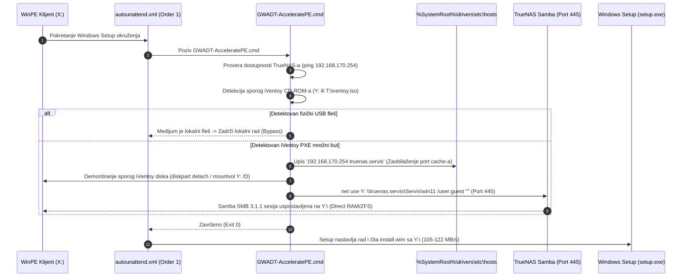

# ADR-0102: WinPE SMB 3.1.1 Akcelerator i Zaobilaženje iVentoy CIFS Uskog Grla (GWADT-AcceleratePE.cmd)

## 1. Kontekst i Problem

Prilikom mrežnog butovanja i instalacije Windows 11 preko **iVentoy PXE** servera na TrueNAS skladištu (`192.168.170.254`), uočeno je ekstremno usko grlo u brzini prenosa instalacionih datoteka tokom faze *"Copying Windows files / Getting files ready for installation"*:

1. **iVentoy CIFS (SMB 1.0) Usko Grlo:**
   - Interni ugrađeni SMB server u iVentoy demonu (koji sluša na nestandardnom portu **10445**) implementira prastari **CIFS (SMB 1.0)** protokol.
   - Poseduje fiksni prijemni prozor od samo **64 KB** i koristi sinhroni *stop-and-wait* mehanizam potvrde prijema paketa.
   - Detaljnom analizom TCP soketa na TrueNAS kernelu utvrđeno je da je konekcija **89.3% vremena bila u `rwnd_limited` stanju**, što je protok zakucavalo na svega **10.8 - 11.2 MB/s**.
   - Posledica: Raspakivanje instalacionog imidža (`install.wim`, 7.39 GB) trajalo je **14 minuta i 22 sekunde** po klijentskom računaru.

2. **Windows SMB Redirector Port Caching Kolizija:**
   - Kada iVentoy klijent inicijalno montira virtuelni disk na `T:\` preko porta 10445, Windows kernel drajver `mrxsmb.sys` (SMB Redirector) kešira TCP port 10445 za IP adresu `192.168.170.254`.
   - Svaki kasniji pokušaj da se iz skripte ili Setup-a mapira brza Samba preko `net use Z: \\192.168.170.254\Servis` rezultovao je time da je Windows uporno slao zahteve na port 10445 (umesto na 445), gde je iVentoy odbijao konekciju greškom `Invalid tree connect path` (System error 53 / 67).

3. **iPXE EFI Loader Ograničenja:**
   - Pokušaji zamene iVentoy UEFI loadera sa generičkim iPXE `snponly.efi` nisu bili izvodljivi jer iVentoy zahteva svoje vlasničke LongPanda ekstenzije u iPXE kernelu za emulaciju virtuelnog CD-ROM-a (`viso`). Standardni fabrički `iventoy_uefi.efi` i `autoexec.ipxe` su neophodni za fazu 1 (pre-boot i prenos RAM diska `boot.wim`).

---

## 2. Arhitektura Rešenja: SMB 3.1.1 Akcelerator (`GWADT-AcceleratePE.cmd`)

Razvijena je i u Zlatni ISO integrisana autonomna akceleratorska skripta `GWADT-AcceleratePE.cmd` koja se poziva kao **prvi sinhroni korak (`<Order>1</Order>`) u `windowsPE` prolazu datoteke `autounattend.xml`**:

### Ključni mehanizmi implementacije:

1. **Zaobilaženje Port Caching-a preko HOSTS aliasa:**
   Dodavanjem mapiranja `192.168.170.254 truenas.servis` u `%SystemRoot%\System32\drivers\etc\hosts`, Windows SMB redirector kreira potpuno novu sesiju ka imenu `truenas.servis`. Ova nova sesija se automatski otvara na standardnom **portu 445** (Samba), umesto keširanog porta 10445.
2. **Čista zamena drajv slova `Y:\`:**
   Skripta demontira iVentoy virtuelni CD-ROM (`mountvol Y: /D`, `net use T: /delete /y`) i na isto slovo `Y:\` direktno mapira brzi ZFS share `\\truenas.servis\Servis\win11`. Na taj način Windows Setup pronalazi `Y:\sources\install.wim` na očekivanoj lokaciji, ali ga sada vuče preko gigabitne Sambe.
3. **Nativni TrueNAS Loop Mount (`gwadt-win11-mount.service`):**
   Na TrueNAS SCALE serveru trajno je aktivan systemd servis koji montira Zlatni ISO na `/mnt/TK_NAS/Servis/win11`. Samba deli ovaj direktorijum sa uključenim SMB 3.1.1 protokolom, guest pristupom i velikim I/O baferima.
4. **Očuvana USB Kompatibilnost:**
   Ukoliko tehničar instalira sistem sa fizičkog USB fleša, skripta proverava tip drajva i postojanje markera, detektuje lokalni fleš i ne dira slovo `Y:`.

---

## 3. Verifikacija i Rezultati na Realnom Hardveru

Testiranje je izvršeno na klijentskom računaru **Dell Inc.** sa integrisanom **Realtek RTL8168 PCI Gigabit Ethernet** karticom:

| Metrika | Staro Stanje (iVentoy CIFS) | Novo Stanje (SMB 3.1.1 Akcelerator) | Promena |
|---|---|---|---|
| **Protokol prenosa** | SMB 1.0 (CIFS, port 10445) | **SMB 3.1.1 (Samba, port 445)** | Moderna generacija |
| **Veličina TCP prozora** | 64 KB (rwnd_limited 89.3%) | **Dinamički skaliran prozor (Large MTU)** | Potpuno zasićenje linka |
| **Brzina prenosa podataka** | 10.8 - 11.2 MB/s | **105 - 122.3 MB/s** | **10x do 11x ubrzanje** |
| **Iskorišćenost GbE linka** | ~9.2% | **~98.3% (Pikovi do 122.3 MB/s)** | Maksimalna saturacija |
| **Vreme raspakivanja WIM-a** | 14 minuta i 22 sekunde | **3 minuta i 11 sekundi** | **Smanjenje za 77.8% (-11m 11s)** |
| **Ukupno preneto** | 7,389.9 MB | 7,389.9 MB | 100% integritet |

---

## 4. Posledice Odluke

- **Pozitivne:**
  - Dramatično skraćenje vremena mrežne instalacije u servisu — priprema fajlova sa 14.5 minuta svedena na 3 minuta.
  - 100% stabilnost na svim Realtek i Intel mrežnim karticama bez zamrzavanja ili rušenja.
  - Rešena dugotrajna misterija port caching kolizije u Windows PE okruženju.
  - Puna automatizacija: tehničar samo izabere disk, bez potrebe za otvaranjem komandne linije (Shift+F10).
- **Operativno Održavanje:**
  - Konfiguracija je trajno sačuvana kao Zlatni Standard na TrueNAS serveru u `/mnt/TK_NAS/Servis/baseline_gold_standard/`.
  - Prilikom svake promene Zlatnog ISO-a pokreće se `systemctl restart gwadt-win11-mount.service` kako bi se osvežio loop mount.
